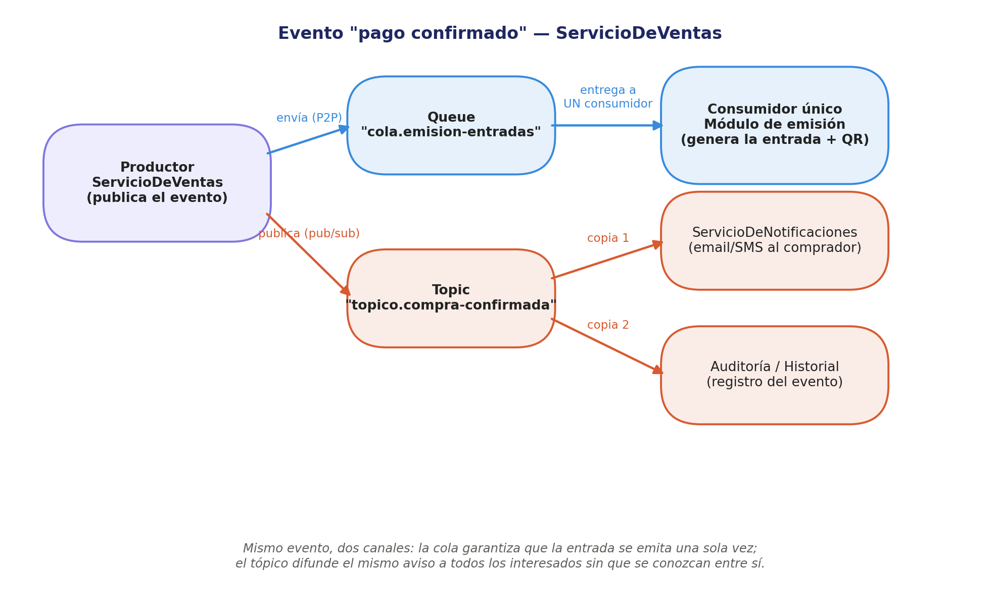

# Taller grupal — Escenario de mensajería (Palco)
**Desarrollo de Aplicaciones II · Unidad V · Clase 8 (21/09/2026)**
*Insumo directo para la Entrega 3 (checkpoint 19/10) — primer proceso con mensajería asincrónica real.*

---

## 1. Proceso elegido

**Evento: "pago confirmado"**, publicado por `ServicioDeVentas` al cerrar el checkout (hoy es una llamada síncrona interna — pasa a resolverse con mensajería a partir de este punto). Es el proceso más natural del dominio: dispara, sin bloquear el resto del checkout, todo lo que tiene que pasar después de que el pago quedó aprobado.

## 2. Modelo elegido: los dos, sobre el mismo evento

No es "uno u otro" — el mismo evento se resuelve con **una cola y un tópico en paralelo**, porque agrupa dos necesidades distintas:

| Necesidad | Modelo | Justificación |
|---|---|---|
| Emitir la entrada (QR) | **Punto a punto** (`cola.emision-entradas`) | Tiene que resolverla **un único responsable, una sola vez** — es exactamente el criterio del checklist ("¿lo resuelve un único responsable?"). Duplicar la emisión sería un bug grave (dos QR para la misma entrada). |
| Notificar al comprador + registrar auditoría | **Publicación/suscripción** (`topico.compra-confirmada`) | Varios módulos necesitan enterarse del mismo evento sin depender entre sí: hoy son Notificaciones y Auditoría, pero el tópico deja la puerta abierta a sumar suscriptores futuros (ej. un dashboard de analytics) sin tocar `ServicioDeVentas`. |

**Tolerancia a caídas (checklist):** si el consumidor de la cola está caído 5 minutos, el mensaje espera — la entrada se emite apenas vuelve, no se pierde. Si un suscriptor del tópico está caído, se pierde esa notificación puntual salvo que se configure como suscripción **durable** (ver clase: necesaria cuando "ningún evento se puede perder" — para Auditoría conviene durable; para el email de confirmación, no durable es aceptable).

## 3. Diagrama del flujo



- **Productor:** `ServicioDeVentas`, publica una vez y en dos canales.
- **Destino 1 (Queue):** `cola.emision-entradas` → **Consumidor único:** módulo de emisión de entrada (genera QR, marca la venta como emitida).
- **Destino 2 (Topic):** `topico.compra-confirmada` → **Suscriptores:** `ServicioDeNotificaciones` (email/SMS al comprador) y Auditoría/Historial (registro del evento), cada uno recibe su propia copia sin conocerse entre sí.

## 4. Tipo de mensaje JMS y body

**`TextMessage`** con JSON (consistente con lo ya usado en `ServicioDePagos`/`ServicioDeFacturación`, y más simple de inspeccionar/loguear que `ObjectMessage`). Body propuesto (igual para ambos canales — mismo evento, mismo payload):

```json
{
  "ventaId": "V-00231",
  "compradorId": "U-00789",
  "eventoId": "E-00042",
  "entradas": [
    { "entradaId": "T-000981", "sector": "Platea A", "titular": { "nombre": "...", "dni": "..." } }
  ],
  "montoTotal": 27500,
  "timestamp": "2026-09-29T15:04:00Z"
}
```

Header/properties: `tipoEvento=PAGO_CONFIRMADO`, usado para filtrar si en el futuro un mismo tópico agrupa más de un tipo de evento.
