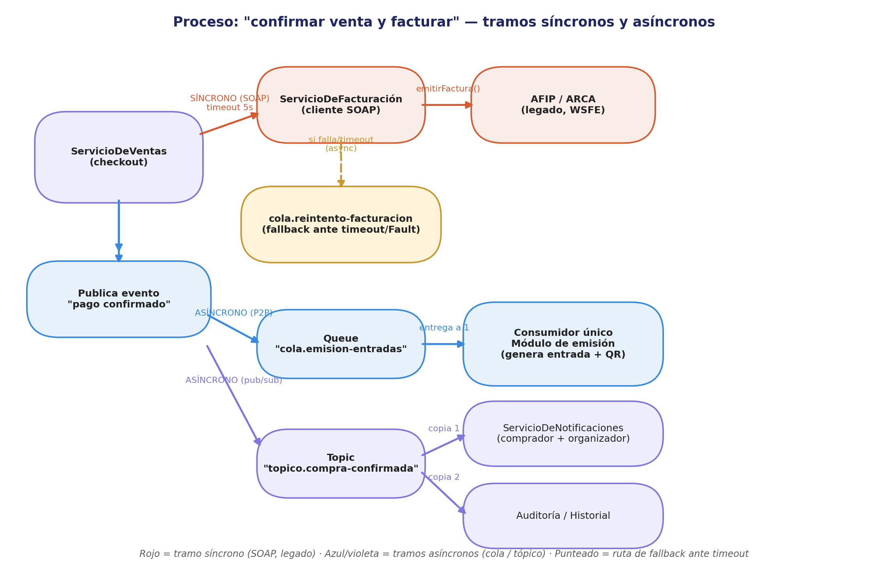

# Actividad Final Integradora — Sincrónico + asincrónico en un mismo proceso
**Desarrollo de Aplicaciones II · Clase 9 · Servicios Web** · *Insumo directo para la Entrega 3 (19/10 — mensajería asincrónica en vivo)*

**Escenario propio (equivalente a los del enunciado):** Palco — confirmar una venta de entradas requiere, en el mismo proceso de negocio, un tramo legado por SOAP (facturar con AFIP/ARCA) y tramos asincrónicos por mensajería (emitir la entrada y avisar a los interesados).

---

## 1. Diagrama de integración



Rojo = tramo síncrono (SOAP, legado) · Azul/violeta = tramos asíncronos (cola / tópico) · Punteado = ruta de fallback ante timeout.

## 2. Contrato del servicio SOAP

Como interfaz Java anotada con `@WebService` (JAX-WS) — es el mismo contrato que publicaría WildFly como WSDL al desplegar `ServicioDeFacturación`:

```java
@WebService(
    name = "ServicioDeFacturacion",
    targetNamespace = "http://palco.daii/facturacion"
)
public interface IFacturacion {

    @WebMethod(operationName = "emitirFactura")
    @WebResult(name = "respuesta")
    FacturaResponse emitirFactura(
        @WebParam(name = "solicitud") FacturaRequest solicitud
    ) throws FacturacionFault;

    @WebMethod(operationName = "consultarEstado")
    @WebResult(name = "estado")
    EstadoFactura consultarEstado(
        @WebParam(name = "facturaId") String facturaId
    ) throws FacturacionFault;
}

// Parámetro de entrada
public class FacturaRequest {
    public String ventaId;
    public String cuitOCompradorDni;
    public double montoTotal;
    public String tipoComprobante;   // "B" / "C", según condición fiscal del comprador
}

// Respuesta
public class FacturaResponse {
    public String facturaId;
    public String cae;               // Código de Autorización Electrónico (AFIP)
    public String vencimientoCae;    // fecha límite de validez del CAE
    public EstadoFactura estado;     // AUTORIZADA | PENDIENTE | RECHAZADA
}

// Fault — al menos uno, obligatorio por consigna
@WebFault(name = "FacturacionFault", targetNamespace = "http://palco.daii/facturacion")
public class FacturacionFault extends Exception {
    private final String codigo;     // ej. "AFIP_TIMEOUT", "AFIP_RECHAZO", "AFIP_NO_DISPONIBLE"
    private final String detalle;

    public FacturacionFault(String mensaje, String codigo, String detalle) {
        super(mensaje);
        this.codigo = codigo;
        this.detalle = detalle;
    }
    // getters...
}
```

Equivalente en pseudo-WSDL (lo que generaría el server a partir de la interfaz de arriba):

```
<definitions name="ServicioDeFacturacion">
  <message name="emitirFacturaRequest">  <part name="solicitud" type="tns:FacturaRequest"/> </message>
  <message name="emitirFacturaResponse"> <part name="respuesta" type="tns:FacturaResponse"/> </message>
  <message name="facturacionFault">      <part name="fault" type="tns:FacturacionFault"/> </message>

  <portType name="IFacturacion">
    <operation name="emitirFactura">
      <input message="tns:emitirFacturaRequest"/>
      <output message="tns:emitirFacturaResponse"/>
      <fault name="FacturacionFault" message="tns:facturacionFault"/>
    </operation>
  </portType>
</definitions>
```

## 3. Mensajería

| Evento publicado | Canal | Quién consume | Por qué |
|---|---|---|---|
| `pago confirmado` (tras facturar OK, o tras degradar tramo síncrono a async — ver punto 4) | **Queue** `cola.emision-entradas` | Módulo de emisión de entrada (único consumidor) | La entrada debe emitirse una sola vez — tarea puntual con un único responsable |
| `pago confirmado` (mismo evento, segundo canal) | **Topic** `topico.compra-confirmada` | `ServicioDeNotificaciones` (avisa a comprador y organizador) + Auditoría/Historial | Varios interesados distintos deben enterarse del mismo evento, sin conocerse entre sí ni bloquear al emisor |
| `factura.reintento` (solo si hubo timeout/Fault) | **Queue** `cola.reintento-facturacion` | Job de reintento de facturación (único consumidor, reintenta con backoff) | Es una tarea de recuperación que debe ejecutarse una sola vez por intento, igual que la emisión |

## 4. Justificación de cada tramo y manejo de fallas

**¿Por qué `ServicioDeVentas → ServicioDeFacturación → AFIP` es síncrono?** La facturación electrónica es un paso obligatorio por normativa, no diferible: la venta no puede darse por válida sin un CAE autorizado, y la respuesta (CAE o rechazo) se necesita antes de decidir cómo continúa el proceso. Es exactamente el criterio de la Clase de sincronía/asincronía: operación de corta duración, resultado necesario antes de seguir, baja tolerancia a diferir — procedural, no por procesos.

**¿Por qué la emisión de entrada y las notificaciones son asíncronas?** Ninguna de las dos necesita bloquear al emisor: la emisión debe resolverse una sola vez pero no instantáneamente (cola), y las notificaciones son de difusión a módulos que no deberían conocerse entre sí (tópico). Desacoplar estos tramos evita que una lentitud en notificaciones, por ejemplo, retrase la confirmación de la venta.

**Desafío extra — ¿qué hace el sistema si AFIP no responde en 5 segundos?**
1. El cliente SOAP de `ServicioDeFacturación` se invoca con **timeout de 5s**.
2. Si vence el timeout o AFIP devuelve un `FacturacionFault` (código `AFIP_TIMEOUT` / `AFIP_NO_DISPONIBLE`), el sistema **no reintenta sincrónicamente ni bloquea al comprador**: degrada ese tramo a asíncrono, publicando un mensaje en `cola.reintento-facturacion` para que un job de background reintente con backoff exponencial.
3. La venta queda marcada como **"confirmada, factura pendiente"** — se desacopla la emisión de la entrada (que sigue su curso normal por `cola.emision-entradas`) de la resolución de la factura, porque el comprador no tiene por qué perder su entrada por una caída puntual de un sistema externo.
4. Cuando el reintento resuelve el CAE, se actualiza el estado de la factura y recién ahí se cierra ese sub-proceso; si tras varios reintentos sigue fallando, se escala (alerta a `ServicioDeFacturación` / organizador) en vez de reintentar indefinidamente.

Este mismo patrón (SOAP síncrono con timeout corto + fallback asíncrono a una cola de reintento) es el que vamos a implementar para la Entrega 3.
