# Palco — Documentación del proyecto

| | |
|---|---|
| Materia | Desarrollo de Aplicaciones II · UADE |
| Comisión | Viernes, 08:45 a 11:45 |
| Integrantes | Santiago Loto, Sebastian Deya, Julian Zuchowicki, Valentina Frisoli, Joaquin Molina |
| Repositorio | https://github.com/santttii/deapps2 |
| Versión | Borrador unificado del 16/10/2026 |

## Estado del documento

| | |
|---|---|
| Qué refleja | El código del commit `bcbc26a` (19/10/2026) y la evidencia de `docs/entrega3/evidencia/`, tomada el 14/10 del servidor armado desde el tag `entrega-parcial-2` |
| De dónde sale | La Entrega Parcial N.º 1, el documento de integración de la Entrega Parcial N.º 2, los talleres de las clases 6, 8, 9, 10 y 11, la OpenAPI, la colección de Postman y el código. El anexo D lista cada documento |
| Para qué | Es el documento maestro. De acá salen el documento técnico de la Entrega Obligatoria N.º 2 (13/11, de 8 a 12 páginas) y la documentación final consolidada (10 a 15 páginas) |
| Estados | "Implementado": está en el código y se probó. "Simulado": funciona con un sustituto declarado. "Diseñado, pendiente": está diseñado y no implementado |

## Índice

- 1. Presentación
- 2. Requisitos y estado
- 3. Arquitectura general
- 4. Componentes
- 5. Decisiones de diseño
- 6. Patrones aplicados
- 7. Transacciones
- 8. Estrategia de integración (SOA)
- 9. API REST
- 10. Mensajería
- 11. Servicios web SOAP: Facturación con un ARCA simulado
- 12. Sistemas externos
- 13. Diagramas de secuencia
- 14. Seguridad
- 15. Frontend
- 16. Pruebas y evidencia
- 17. Cómo levantar y probar el sistema
- 18. Gestión del proyecto
- 19. Evolución del diseño
- 20. Qué es real y qué es simulado hoy
- 21. Limitaciones conocidas
- 22. Trabajo futuro
- Aprendizajes del equipo
- Declaración de uso de herramientas de IA generativa
- Anexos

# 1. Presentación

## 1.1 Qué es Palco y qué problema resuelve

Palco es una plataforma de venta de entradas para eventos (recitales, partidos, fiestas y otros espectáculos masivos) con **reventa oficial dentro de la misma plataforma**. Ataca dos problemas del mercado de entradas:

- **La reventa especulativa.** Cuando un evento se agota, las entradas reaparecen en canales informales a precios muy superiores al original. En Palco, quien no puede ir revende su entrada solo dentro de la plataforma y con un precio máximo fijo: el original más un 10 %. El tope lo fija la plataforma y el organizador no lo puede cambiar.
- **El fraude y la entrada duplicada.** Las entradas son **nominativas**: cada una lleva el nombre y el DNI de su titular, y en la puerta se valida que la entrada sea auténtica, que no se haya usado y que corresponda a la persona que la presenta.

Las reglas numéricas del dominio están en un solo lugar del código, `backend/common/src/main/java/com/palco/common/ReglasDeNegocio.java`, y valen para todos los servicios:

| Regla | Valor | Constante |
|---|---|---|
| Tope de reventa sobre el precio original | +10 % | `TOPE_REVENTA_PORCENTAJE` |
| Precio mínimo de reventa | 50 % del original | `MINIMO_REVENTA_PORCENTAJE` |
| Tasa de servicio sobre el subtotal | 10 % | `TASA_SERVICIO_PORCENTAJE` |
| Máximo de entradas por compra | 6 | `MAX_ENTRADAS_POR_ORDEN` |
| Cierre de la reventa antes del evento | 3 horas | `HORAS_LIMITE_REVENTA` |
| Duración de la reserva de cupo durante la compra | 10 minutos | `MINUTOS_RESERVA` |

Los montos se manejan en pesos enteros (`long`) en todo el backend, para evitar errores de redondeo.

## 1.2 Actores y roles

El sistema distingue cuatro roles. Los tres primeros son de personas y se guardan en `backend/servicios/usuarios/src/main/java/com/palco/usuarios/dominio/Rol.java` (`USER`, `ORGANIZER`, `STAFF`); viajan en el token de sesión (JWT, claim `groups`) y son los que usan las anotaciones `@RolesAllowed` de cada recurso REST. El cuarto es técnico.

| Actor | Rol en el sistema | Qué hace | Estado |
|---|---|---|---|
| Comprador | `user` | Se registra, verifica su email, compra entradas nominativas a su nombre o a nombre de otros titulares, consulta sus entradas y la factura de cada compra. Con la identidad verificada puede además revender una entrada propia: no es un tipo de cuenta aparte sino una capacidad del comprador (el "vendedor" de la Entrega Parcial N.º 1). | Compra y consulta de la factura: implementadas y probadas en el servidor el 16/10. Reventa: implementada y probada en el servidor el 16/10 por la API; sus pantallas, sin probar en el navegador |
| Organizador | `organizer` | Da de alta eventos con sus sectores, precios y cupos; el evento queda a su nombre. En el panel ve, por evento, entradas vendidas, recaudación a precio de lista, ocupación por sector, publicaciones de reventa activas y accesos registrados en la puerta. | Alta de eventos: implementado. Panel: implementado en el frontend con datos de Eventos, Validación y Reventa (endpoints probados en el servidor el 16/10), sin probar en el navegador; no hay un servicio propio de estadísticas |
| Personal de puerta | `staff` | Escanea la entrada en el ingreso (o tipea el código) y contrasta nombre y DNI del titular con el documento. El mismo escaneo marca la entrada como usada. | Implementado y probado en el servidor el 16/10 por la API; la pantalla `/puerta`, sin probar en el navegador |
| Otro servicio de Palco | `servicio` | Rol técnico para las llamadas entre servicios: por ejemplo, Ventas actualiza el cupo en Eventos o pide un cobro a Pagos, y Validación le pide a Ventas que marque una entrada como usada. El token lo emite Usuarios en `POST /api/usuarios/servicios/token` y lo obtiene `common/seguridad/TokenDeServicio.java`. | Implementado |

Los sistemas externos del dominio son la pasarela de pago (Mercado Pago, partner moderno por REST) y el sistema de facturación electrónica de AFIP/ARCA (legado, por SOAP). El 16/10 la cátedra aceptó que los dos sean simulados. La pasarela está **simulada** dentro de Pagos (`backend/servicios/pagos/src/main/java/com/palco/pagos/pasarela/PagosFake.java`). ARCA está **simulado** por un servicio SOAP propio en un WAR aparte (`backend/servicios/arca`, publicado en `/legado/arca`), que hace de sistema legado y no comparte clases con Palco; Facturación le pide el CAE de cada compra por SOAP. Esa integración está implementada y se probó en el servidor el 16/10 (sección 1.5).

## 1.3 Flujos principales

### Compra nominativa con reserva y pago — Implementado (con pasarela simulada)

1. El comprador elige un evento del catálogo (`GET /api/eventos`, público) y las cantidades por sector.
2. Carga los titulares: nombre y DNI de cada entrada (hasta 6 por compra).
3. Ventas abre la compra (`POST /api/v1/ventas`): valida, **reserva el cupo** en Eventos con un UPDATE atómico (dos compras simultáneas del último lugar: pasa una sola; evidencia en `docs/entrega3/evidencia/compras-simultaneas.txt`) y calcula subtotal más tasa de servicio. La compra en curso vive en un componente **stateful** (`ServicioDeVentas`, `@Stateful` con `@StatefulTimeout` de 10 minutos).
4. El comprador paga (`POST /api/v1/ventas/{ventaId}/pagos`). Ventas cobra a través de Pagos, que hoy responde con la pasarela simulada. Si el cobro sale aprobado, una única transacción declarativa guarda la venta como confirmada y publica el mensaje `PAGO_CONFIRMADO`. Si Pagos no contesta, o una falla después del cobro deshace esa transacción, la venta queda `EN_CHECKOUT` con el intento de pago anotado; la conciliación de pagos (`ConciliacionDePagos`, una vez por minuto) le pregunta a Pagos y, si el cobro salió aprobado, confirma la venta con ese mismo pago. En el servidor, el 16/10, una falla provocada después del cobro dio 500 con `idError` y la conciliación emitió la entrada en menos de 3 minutos.
5. Las entradas se emiten de forma **asincrónica**: el mensaje llega por la cola `cola.emision-entradas` al consumidor de emisión (`EmisionDeEntradasMDB`), que pasa las entradas de `PENDIENTE_EMISION` a `VALIDA`. El mismo mensaje sale por el tópico `topico.compra-confirmada` hacia el aviso al comprador (que hoy **se escribe en el log**, no se envía por email: simulado), hacia la auditoría (suscripción durable, implementado) y hacia Facturación (suscripción durable), que le pide el CAE al ARCA simulado por SOAP y guarda la factura; el comprador la consulta en `GET /api/v1/facturas/{ventaId}`. La facturación está implementada y se probó en el servidor el 16/10: la primera compra recibió la factura B 00001-00000001 con un CAE de 14 dígitos, una sola por venta, y la siguiente, el número siguiente.
6. Si el comprador cancela o pasan los 10 minutos sin pagar, el cupo se libera (`DELETE /api/v1/ventas/{ventaId}` o el barrido de `VencimientoDeReservas`, un `@Singleton` con `@Schedule` cada minuto).

### Reventa oficial con tope +10 % — Implementado

1. El titular publica una entrada propia `VALIDA` con un precio entre el 50 % y el 110 % de lo que pagó, hasta 3 horas antes del evento (`POST /api/v1/reventas`, rol `user`). Reventa le pregunta a Ventas, la dueña de las entradas, por la entrada, controla el rango y el horario en el servidor y le pide a Ventas que la pase a `PUBLICADA`; después guarda la publicación `ACTIVA` en su esquema. Para iniciar sesión hace falta el email verificado, que en esta etapa es la verificación de identidad (sección 1.5).
2. Mientras sigue `ACTIVA`, el vendedor la puede retirar (`DELETE /api/v1/reventas/{publicacionId}`) y la entrada vuelve a `VALIDA`.
3. Otro comprador la compra (`POST /api/v1/reventas/{publicacionId}/compra`, con `Idempotency-Key`, el titular nuevo y el medio de pago). Reventa toma la publicación con un UPDATE condicional (de dos compras a la vez, cobra una sola), cobra en Pagos el precio más la tasa de servicio y le pide a Ventas la transferencia: en una sola transacción, la entrada original pasa a `VENDIDA` y nace una venta `EMITIDA` del comprador con una entrada nueva `VALIDA`, con código QR nuevo y a nombre del titular nuevo. La publicación queda `VENDIDA`.

Se probó en el servidor el 16/10 de punta a punta, con la compra hecha desde otra cuenta y la entrada nueva en la venta del comprador. Las pantallas (`MyTicketsPage.tsx` para publicar y retirar, la sección "Reventa oficial" de `EventPage.tsx` y `ResalePage.tsx`) llaman a `/api/v1/reventas` (`frontend/src/servicios/reventa.ts`) y no guardan publicaciones en el navegador; no se probaron todavía en el navegador. No están hechos el aviso al vendedor ni la factura de la compra en reventa (la transferencia no publica `PAGO_CONFIRMADO`), y si la transferencia falla después de un cobro aprobado, el pago queda registrado en el log para devolverlo a mano (sección 4.7).

### Validación en puerta — Implementado

1. El personal de puerta elige el evento que controla y escanea el QR (o tipea el código) en `/puerta` (`frontend/src/pages/GatePage.tsx`).
2. El frontend llama a `POST /api/v1/validacion/escaneos` (rol `staff`) con el código y el evento. El código va en el cuerpo y no en la ruta, para que no quede en los logs de acceso.
3. Validación le pide a Ventas, la dueña de las entradas, que la use: `POST /api/v1/entradas/usos` (rol `servicio`). Ventas pasa la entrada de `VALIDA` a `USADA` con un UPDATE condicional: de dos puertas que escanean la misma entrada a la vez, cambia la fila una sola.
4. Validación guarda el escaneo en su registro y responde 201 con el resultado: `VALIDA` (con nombre, DNI y sector del titular para contrastar con el documento), `YA_USADA` (con el escaneo anterior), `INEXISTENTE`, `OTRO_EVENTO` (la entrada no se toca y sigue sirviendo en su evento) o `NO_HABILITADA` (publicada o vendida en la reventa, o anulada). "No puede entrar" es un dato del escaneo y no un error HTTP.
5. Si Ventas no responde, el intento queda registrado como `SIN_RESPUESTA` y el pedido devuelve 504; hay que escanear de nuevo.

El registro de la puerta (`GET /api/v1/validacion/escaneos?eventoId=`, roles `staff` y `organizer`) muestra el código recortado a sus últimos 6 caracteres. El código QR sigue siendo el UUID al azar que genera Ventas al emitir: no se puede adivinar, pero no está firmado.

Se probó en el servidor el 16/10 por la API: `OTRO_EVENTO`, `VALIDA` (la entrada queda `USADA`), `YA_USADA`, `INEXISTENTE` y 403 para un comprador. La pantalla `/puerta` no se probó todavía en el navegador.

### Alta de eventos — Implementado

El organizador crea el evento con su categoría, fecha, lugar y sectores con precio y cupo (`POST /api/eventos`, rol `organizer`). El servidor valida los datos, genera un slug único y no deja crear eventos que ya empezaron. La edición (`PUT`) y la cancelación de eventos están pendientes.

## 1.4 Casos de uso

El diagrama reúne los tres actores de persona, los dos sistemas externos simulados y los diez casos de uso del sistema. La descripción completa de cada caso (actor, precondición, flujo principal, flujos alternativos con el código HTTP y el tipo de error, postcondición y estado) está en `docs/documentacion/casos-de-uso.md`; acá va un resumen.

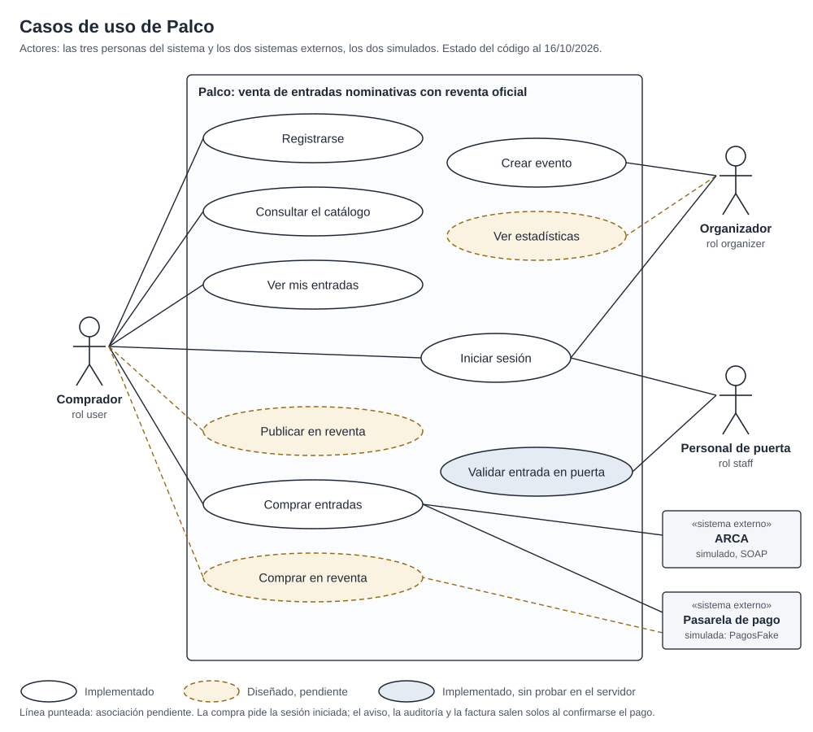

*Óvalo blanco: implementado; óvalo celeste: implementado, sin probar en el servidor; óvalo punteado: diseñado, pendiente. El diagrama muestra el estado anterior a la prueba del 16/10: todavía marca la reventa y las estadísticas como pendientes y la validación en puerta sin probar. El estado vigente es el de la tabla.*

| N.º | Caso de uso | Actor principal | Qué hace | Estado |
|---|---|---|---|---|
| CU-01 | Registrarse | Comprador | Alta de la cuenta con rol `user` (`POST /api/usuarios/registro`) y verificación del email con un código de 6 dígitos (`POST /api/usuarios/verificacion`), que deja la identidad verificada y abre la sesión. El código se escribe en el log del servidor | Implementado (envío de email simulado) |
| CU-02 | Iniciar sesión | Comprador, organizador, personal de puerta | `POST /api/usuarios/login` devuelve un JWT RS256 de 8 horas con el rol en `groups`. Con 5 fallidos en 15 minutos para un email, el siguiente responde 429 con `Retry-After` | Implementado |
| CU-03 | Consultar el catálogo | Comprador (también sin sesión) | Lista con filtro por categoría y búsqueda (`GET /api/eventos`) y detalle con sectores, precio y cupo (`GET /api/eventos/{slug}`) | Implementado |
| CU-04 | Comprar entradas | Comprador (con la pasarela y ARCA simulados) | Reserva del cupo con titulares nominativos, pago, confirmación en una transacción con la publicación de `PAGO_CONFIRMADO`, emisión asincrónica de las entradas y factura pedida al ARCA simulado por SOAP | Implementado, con pasarela simulada; probado en el servidor el 16/10, factura incluida |
| CU-05 | Ver mis entradas | Comprador | Compras del dueño del token con sus entradas (`GET /api/v1/ventas`) y cada entrada con su código QR una vez emitida | Implementado |
| CU-06 | Publicar en reventa | Comprador (vendedor) | Publica una entrada propia `VALIDA` con un precio entre el 50 % y el 110 % del pagado, hasta 3 horas antes del evento; el rango se valida en el servidor (`POST /api/v1/reventas`). Mientras está activa la puede retirar | Implementado y probado en el servidor el 16/10; la pantalla, sin probar en el navegador |
| CU-07 | Comprar en reventa | Comprador (con la pasarela simulada) | Compra una publicación de otro usuario (`POST /api/v1/reventas/{publicacionId}/compra`): se cobra precio más tasa, se emite una entrada nueva a su nombre y la original queda `VENDIDA`. No hay aviso al vendedor ni factura de esa compra | Implementado y probado en el servidor el 16/10; la pantalla, sin probar en el navegador |
| CU-08 | Crear evento | Organizador | `POST /api/eventos` con sectores, precio y cupo; el servidor valida, genera un slug único y rechaza fechas que no son futuras | Implementado |
| CU-09 | Ver estadísticas | Organizador | El panel de `/organizador` arma, por evento, vendidas, recaudación a precio de lista, ocupación por sector, reventa activa y accesos, leyendo Eventos, Reventa y el registro de la puerta. No hay un servicio que calcule estadísticas, y el panel muestra todos los eventos del catálogo, no solo los del organizador | Implementado en el frontend, sin probar en el navegador (los endpoints que lee se probaron en el servidor el 16/10); sin servicio propio |
| CU-10 | Validar entrada en puerta | Personal de puerta | El escaneo (`POST /api/v1/validacion/escaneos`) usa la entrada en Ventas con un UPDATE condicional, guarda el renglón del registro y devuelve el resultado con el titular (sección 1.3) | Implementado y probado en el servidor el 16/10; la pantalla, sin probar en el navegador |

Los diagramas de secuencia de cada integración que recorren estos casos están en la sección 13.

## 1.5 Alcance del trabajo práctico

**Entra en el alcance:**

- Los 8 componentes de negocio definidos en la Entrega Parcial N.º 1, cada uno como un WAR independiente con su propio esquema de base: Usuarios, Eventos, Ventas, Pagos, Validación, Reventa, Notificaciones y Facturación. Se comunican solo por REST o por JMS. Un noveno WAR, el ARCA simulado, representa al sistema externo legado y no es un componente de Palco.
- Los cuatro flujos de la sección 1.3 y los diez casos de uso de la sección 1.4, de punta a punta, con el frontend React conectado al backend.
- La integración síncrona por REST (API propia y cliente de la pasarela de pago) y por SOAP (facturación contra el sistema legado), y la asincrónica por cola y tópico sobre el ActiveMQ Artemis embebido en WildFly.
- Seguridad declarativa por rol y transacciones declarativas en el flujo de compra.

**Queda fuera del alcance** (o se resuelve con una versión simulada):

- **Cobro real.** El 13/10 se decidió no integrar Mercado Pago real: Pagos sigue con `PagosFake` y el requisito de REST lo cubre la API propia. El diseño de la integración real queda en el diagrama `docs/entrega-obligatoria-2/diagramas/diagrama_secuencia_mercadopago.png`, y se retoma si la cátedra pide una pasarela real. El 16/10 la cátedra confirmó que la pasarela simulada se acepta.
- **Envío real de emails.** El código de verificación y el aviso de compra quedan en el log del servidor; no hay proveedor de correo configurado.
- **Verificación de identidad con foto del DNI.** Al verificar el email, la cuenta queda con la identidad verificada; no hay validación documental.
- **Facturación contra el ambiente real de AFIP/ARCA.** La cátedra aceptó el 16/10 que la integración sea simulada. Se implementó el diseño decidido ese día, el más simple que cumple la consigna, y se probó en el servidor el mismo 16/10 (detalle en las secciones 4.8, 4.9 y 11):
  - ARCA es un servicio SOAP propio (`ArcaSimulado`, un POJO con `@WebService`) en un WAR aparte, `backend/servicios/arca`, publicado en `/legado/arca`, que representa al sistema externo legado. WildFly genera el WSDL a partir de la clase (`/legado/arca?wsdl`); para eso el servidor suma la capa `webservices`.
  - Facturación se suscribe de forma durable al tópico `topico.compra-confirmada` (`FacturacionDeComprasMDB`) y, por cada compra confirmada, le pide el CAE al ARCA simulado por SOAP (operación `FECAESolicitar`, síncrona). Guarda el número y el CAE en su esquema. La numeración la asigna el ARCA simulado.
  - Si ARCA no responde o rechaza el comprobante, el MDB deshace la entrega y se usan los reintentos del broker que ya existen (5 entregas cada 2 segundos y después la DLQ). No hay una cola de reintento aparte.
  - Ventas no cambia: la factura se consulta en Facturación (`GET /api/v1/facturas/{ventaId}`) y el campo `facturaEstado` de la venta sigue en `NO_APLICA`.
  - El cliente SOAP de Facturación se arma con una interfaz anotada (`PuertoArca`) y `Service.create` sobre el WSDL, sin generar código. El lector XML de CXF trae la DTD y las entidades externas deshabilitadas, y Facturación se niega a crear el cliente si alguien las habilita (SEC-I01).
  - Lo que el ARCA simulado no reproduce del real: no tiene autenticación (el real usa WSAA), numera en memoria y vuelve a 1 al redesplegarse, y si se le pide de nuevo el CAE de la misma venta devuelve el mismo comprobante.
- **Despliegue en la nube.** La consigna no lo exige; el sistema corre en un WildFly local con H2 en modo PostgreSQL. La migración a Supabase (PostgreSQL) está prevista, sin probar.
- **QR firmado.** El código de la entrada es un UUID al azar que genera Ventas: no se puede adivinar, pero no lleva firma.
- Recuperación de contraseña, modo offline de la puerta, liquidación al vendedor y al organizador, reembolsos a pedido del comprador (el único reembolso es el de una compra en la reventa que Ventas no pudo transferir, 7.10), y anulación de facturas o notas de crédito.

# 2. Requisitos y estado

## 2.1 Cómo leer la tabla

La tabla reúne los requisitos de cada entrega de la consigna (sección 5) y los transversales obligatorios (sección 6), con su estado al **16/10**. Las fechas son las de la comisión del viernes; la consigna está escrita para la comisión del lunes y sus fechas se citan solo como referencia.

| Entrega (nombre de la consigna) | Fecha del viernes | La consigna dice |
|---|---|---|
| Entrega Parcial N.º 1 | 04/09 (ya pasó) | 31/08 |
| Entrega Obligatoria N.º 1 — 1.º Parcial | 18/09 (ya pasó) | 14/09 |
| Entrega Parcial N.º 2 | 23/10, **sin confirmar con la cátedra** | 19/10 |
| Entrega Obligatoria N.º 2 — 2.º Parcial | 13/11 | 09/11 |
| Entrega Final | Sistema completo para el 27/11; defensa el viernes 04/12 (final adelantado, decidido el 16/10) | 30/11 en el detalle, 04/12 u 11/12 en el encabezado |

El 16/10 la cátedra confirmó que se entrega con las fechas del cronograma de la comisión del viernes, que el grupo de cinco integrantes está aceptado (la consigna fija de 3 a 4), que la documentación que se pide es técnica, con diagramas de casos de uso y casos de uso, y que no pide Figma ni manual de usuario. Las 8 a 12 páginas del documento técnico del 13/11 son de contenido, sin contar los anexos. El mismo día el grupo decidió defender la Entrega Final el 04/12, la primera fecha posible después de tener el sistema completo el 27/11. Siguen sin respuesta la hora límite de subida, si una cola y un tópico que salen del mismo evento cuentan como dos procesos asincrónicos (O2.1) y si se acepta la transacción con la base como último recurso en lugar de un datasource XA (O2.4).

Estados: **Cumplido** (está en el código o en la evidencia y se puede mostrar), **Parcial** (una parte está hecha y otra no, o una pieza está simulada) y **Pendiente** (no hay código). La prueba en el servidor que respalda el estado es la del 16/10, con el servidor armado desde cero: `mvn clean install` con 577 tests y 0 fallas, los 9 WAR desplegados con sus 8 `health` en 200 y el WSDL del ARCA simulado en 200, los 17 escenarios de integración (`scripts/pruebas/escenarios.mjs`), la colección de Postman con Newman (126 requests, 406 aserciones, 0 fallas) y la demo (`scripts/demo-entrega3.sh`) en sus dos modos. Las pantallas de puerta, reventa y panel del organizador todavía no se probaron en el navegador. Las rutas de código son relativas a `backend/servicios/<servicio>/src/main/java/com/palco/<servicio>/` salvo que se indique otra cosa.

## 2.2 Requisitos por entrega

| # | Requisito | Se exige en | Estado al 16/10 | Dónde se ve |
|---|---|---|---|---|
| E1.1 | Componentes candidatos (mínimo 6) con su interfaz: nombre, operaciones y responsabilidad | Entrega Parcial N.º 1 (04/09) | Cumplido | `docs/entrega1/Entrega_Parcial_1_Arquitectura.docx`, sección 2 (8 componentes con interfaz `I<Servicio>`) |
| E1.2 | Diagrama de arquitectura general | Entrega Parcial N.º 1 (04/09) | Cumplido | `docs/entrega1/Diagrama_Capas_EntradasEventos.drawio.png` |
| E1.3 | Stack tecnológico elegido y justificado | Entrega Parcial N.º 1 (04/09) | Cumplido | Documento de la Entrega Parcial N.º 1, sección 4 |
| E1.4 | Un componente completo desplegado en un servidor real, con capas separadas, y su justificación stateful o stateless | Entrega Parcial N.º 1 (04/09) | Cumplido | `ServicioDeEventos` (`@Stateless`) en WildFly; justificación en la sección 5 del documento |
| E1.5 | Documento de 2 a 4 páginas | Entrega Parcial N.º 1 (04/09) | Cumplido | `docs/entrega1/Entrega_Parcial_1_Arquitectura.docx` |
| O1.1 | Al menos 3 componentes implementados y desplegados, cada uno en capas | Entrega Obligatoria N.º 1 (18/09) | Cumplido hoy (los 8 componentes desplegados y probados en el servidor el 16/10). Si se cumplía al 18/09 no se puede ver en el repo: el historial de git tiene 3 commits hasta el 17/09 y el resto desde el 02/10 | Usuarios, Eventos, Ventas, Pagos, Notificaciones, Validación, Reventa y Facturación en `backend/servicios/` |
| O1.2 | Un componente stateful y uno stateless, con ciclo de vida gestionado por el contenedor | Entrega Obligatoria N.º 1 (18/09) | Cumplido | `ventas/negocio/ServicioDeVentas.java` (`@Stateful`, `@StatefulTimeout`, `@PostConstruct`, `@PreDestroy`, `@Remove`); `eventos/negocio/ServicioDeEventos.java` y `usuarios/negocio/ServicioDeUsuarios.java` (`@Stateless`) |
| O1.3 | Al menos 3 patrones de diseño aplicados y justificados por escrito | Entrega Obligatoria N.º 1 (18/09) | Parcial: aplicados en el código, sin documento que los justifique en el repo | Factory: `pagos/pasarela/FabricaDePasarela.java`, `ventas/negocio/externos/FabricaDeCobros.java` y `facturacion/negocio/externos/FabricaDeArca.java`. Adapter: `ventas/negocio/externos/ClienteDePagos.java` y `facturacion/negocio/externos/ArcaSoap.java` (traduce el contrato SOAP de ARCA a la interfaz propia `Arca`). Repository (DAO): un repositorio por entidad en `datos/` de cada servicio implementado, por ejemplo `ventas/datos/VentaRepository.java`, `eventos/datos/EventoRepository.java` y `usuarios/datos/UsuarioRepository.java`. Interfaz con implementaciones intercambiables: `pagos/pasarela/PasarelaDePagos.java` |
| O1.4 | Seguridad declarativa mínima en una operación sensible | Entrega Obligatoria N.º 1 (18/09) | Cumplido | `@RolesAllowed("organizer")` en `POST /api/eventos` (`eventos/api/EventosResource.java`) |
| O1.5 | Documento técnico de 5 a 8 páginas | Entrega Obligatoria N.º 1 (18/09) | No está en el repo | — |
| P2.1 | Diagrama de arquitectura de integración (SOA) | Entrega Parcial N.º 2 (23/10, sin confirmar) | Cumplido | `docs/entrega3/Diagrama_Integracion_SOA.svg` |
| P2.2 | Clasificación justificada de cada integración externa en síncrona o asincrónica | Entrega Parcial N.º 2 (23/10, sin confirmar) | Cumplido | `docs/entrega3/Entrega_Parcial_2_Integracion.md` |
| P2.3 | Un proceso de negocio de punta a punta con mensajería real y broker configurado | Entrega Parcial N.º 2 (23/10, sin confirmar) | Cumplido | Compra → `PAGO_CONFIRMADO` → emisión de entradas. Broker: Artemis embebido, destinos en `backend/servidor/src/main/wildfly/configurar.cli`. Evidencia en `docs/entrega3/evidencia/` (tag `entrega-parcial-2`) |
| O2.1 | Dos procesos con mensajería de punta a punta: uno por cola y uno por tópico | Entrega Obligatoria N.º 2 (13/11) | Cumplido, con el aviso al comprador simulado (se escribe en el log) | Cola: `ventas/mensajeria/EmisionDeEntradasMDB.java`. Tópico, con tres suscriptores: `notificaciones/mensajeria/AvisoDeCompraMDB.java` (no durable), `AuditoriaDeComprasMDB.java` (durable) y `facturacion/mensajeria/FacturacionDeComprasMDB.java` (durable); cada compra deja 3 copias en el tópico, como mostró la demo del 16/10. Evidencia: `docs/entrega3/evidencia/auditoria.txt`, `suscriptor-durable.txt`, `mensajes-pendientes.txt`. La cola y el tópico salen del mismo evento (`PAGO_CONFIRMADO`); si eso cuenta como dos procesos sigue sin respuesta de la cátedra |
| O2.2 | Un servicio SOAP con su WSDL, justificado como sistema legado | Entrega Obligatoria N.º 2 (13/11) | Cumplido, con ARCA simulado (aceptado por la cátedra el 16/10). Probado en el servidor el 16/10: el WSDL responde 200 y cada compra recibe su factura con número y CAE (escenario 15 y carpeta 7 de Postman) | Servicio: `backend/servicios/arca/src/main/java/com/palco/arca/ArcaSimulado.java` (`@WebService`, operación `FECAESolicitar`), WAR propio en `/legado/arca`, WSDL generado por WildFly en `/legado/arca?wsdl`. Cliente: `facturacion/negocio/externos/ArcaSoap.java` y `PuertoArca.java`. Capa `webservices` en `backend/servidor/pom.xml`. Justificación en las secciones 1.5 y 11. Tests: ARCA simulado, 11 (incluyen el WSDL y un sobre SOAP real); Facturación, 38 |
| O2.3 | Un servicio REST (partner moderno o API de consumo externo) | Entrega Obligatoria N.º 2 (13/11) | Cumplido como API propia; el partner moderno (Mercado Pago) está simulado, y la cátedra aceptó la pasarela simulada el 16/10 | `docs/api/openapi.yaml`, colección de Postman en `docs/api/`, `pagos/pasarela/PagosFake.java` |
| O2.4 | Transacciones declarativas en un flujo crítico de varios pasos | Entrega Obligatoria N.º 2 (13/11) | Cumplido | `ServicioDeVentas` confirma la venta con `@TransactionAttribute(REQUIRED)` y publica con `common/mensajeria/PublicadorPagoConfirmadoJms.java` (`MANDATORY`, por `java:/JmsXA`), así que la venta y el mensaje se confirman o se deshacen juntos. La falla a mitad del flujo tiene prueba repetible en `scripts/pruebas/escenarios.mjs`: el escenario 13 deshace la transacción después de publicar y el mensaje no sale; el 14 la hace fallar después del cobro (propiedad `palco.ventas.fallar-despues-del-cobro`): 500 con `idError`, la venta sigue `EN_CHECKOUT` sin entradas ni mensaje, el pago queda `APROBADO` en Pagos y la conciliación (`ventas/negocio/ConciliacionDePagos.java`) confirma la venta con ese mismo pago y emite la entrada en menos de 3 minutos. Los dos pasaron en el servidor el 16/10. Sigue sin respuesta de la cátedra si se acepta la base como último recurso en lugar de un datasource XA |
| O2.5 | Documento técnico de 8 a 12 páginas con un diagrama de secuencia por integración | Entrega Obligatoria N.º 2 (13/11) | Parcial | Diagramas de secuencia de la compra contra Pagos por REST (dos partes), la emisión por la cola (dos partes), el tópico con aviso y auditoría, la facturación por SOAP y la validación en puerta, en `docs/documentacion/diagramas/` (sección 13). Faltan el de autenticación y token de servicio y el de reventa. El de Mercado Pago (`docs/entrega-obligatoria-2/diagramas/`) queda como diseño. Este documento es la base del técnico. Según la cátedra (16/10), las 8 a 12 páginas son de contenido, sin contar los anexos |
| O2.6 | Diagramas de casos de uso y casos de uso | Documentación técnica (pedido de la cátedra del 16/10) | Cumplido | Diagrama `docs/documentacion/diagramas/casos-de-uso.svg` y descripción de CU-01 a CU-10 en `docs/documentacion/casos-de-uso.md`; resumen en la sección 1.4. La consigna no pide Figma ni manual de usuario |
| F.1 | Sistema completo integrado, con el checklist de la sección 6 cumplido | Entrega Final (sistema el 27/11, defensa el 04/12) | Parcial | Los 8 componentes implementados y probados en el servidor el 16/10 (577 tests, 17 escenarios de integración, Newman con 126 requests y 406 aserciones, sin fallas). Falta probar en el navegador las pantallas de puerta, reventa y panel del organizador, y quedan abiertos los puntos de la sección 6 que figuran como parciales o pendientes en estas tablas |
| F.2 | Documentación final de 10 a 15 páginas | Entrega Final (27/11) | Pendiente | Se recorta de este documento |
| F.3 | Repositorio git con historial incremental y participación visible de todos | Entrega Final (27/11) | Parcial | Ver T.11 |
| D.1 | Declaración del uso de IA en el documento de cada entrega obligatoria (consigna, sección 9) | Entregas obligatorias (13/11 y final) | Pendiente | La redacta el grupo, igual que los aprendizajes del equipo (decidido el 16/10) |

## 2.3 Requisitos transversales (sección 6 de la consigna)

Se exigen todos para la Entrega Final; varios ya se piden antes, en la entrega que figura en la tabla anterior.

| # | Requisito | Estado al 16/10 | Dónde se ve |
|---|---|---|---|
| T.1 | Mínimo 6 componentes de negocio, cada uno con interfaz explícita y documentada | Cumplido: los 8 componentes tienen su interfaz en el código y están probados en el servidor el 16/10 | `IUsuarios`, `IEventos`, `IVentas`, `IPagos`, `INotificaciones` (y `IAuditoria`), `IValidacion`, `IReventa` e `IFacturacion` en `negocio/` de cada servicio. Interfaces documentadas en `docs/entrega1/` y en la sección 4 |
| T.2 | Un componente stateful y uno stateless, justificados por escrito | Cumplido | `ServicioDeVentas` (`@Stateful`) y `ServicioDeEventos` (`@Stateless`); la justificación está en el comentario de cada clase y en el documento de la Entrega Parcial N.º 1 |
| T.3 | Arquitectura en capas (presentación, negocio, datos) en cada componente implementado | Cumplido | Los 8 componentes tienen las capas explícitas `api/` → `negocio/` → `datos/` → `dominio/`, y ningún Session Bean usa el `EntityManager`: el acceso a la base está en un repositorio por entidad (interfaz `@Local` más implementación `@Stateless` `<Entidad>RepositoryJpa`). Todos se probaron en el servidor el 16/10 con esa estructura. Los repositorios se prueban contra H2 en modo PostgreSQL con las migraciones (sección 3.3) |
| T.4 | Al menos 3 patrones de diseño distintos, aplicados y justificados | Parcial | Ver O1.3: Factory, Adapter y Repository están en el código; la justificación por escrito está en los comentarios de las clases y en la sección 6 |
| T.5 | Integración SOAP con WSDL, justificada como sistema legado | Cumplido, con ARCA simulado | Ver O2.2 |
| T.6 | Integración REST con partner moderno o API de consumo externo | Cumplido como API de consumo externo; Mercado Pago simulado, aceptado por la cátedra el 16/10 | Ver O2.3 |
| T.7 | Dos procesos asincrónicos: uno por cola y uno por tópico | Cumplido, a confirmar con la cátedra si la cola y el tópico del mismo evento cuentan como dos procesos | Ver O2.1; contrato en `docs/api/mensajeria-pago-confirmado.md` |
| T.8 | Seguridad declarativa (autenticación y autorización por rol) en al menos 2 operaciones sensibles | Cumplido | `@RolesAllowed` / `@PermitAll` en cada operación: `organizer` en el alta de eventos, `user` en las 6 operaciones de Ventas y en las de Reventa que cambian algo, `servicio` en el cupo, en Pagos, en Notificaciones, en el uso de la entrada y en las operaciones de reventa de Ventas, `staff` en el escaneo de la puerta, `staff` y `organizer` en su registro, y `user` o `servicio` en la consulta de la factura (una ajena da el mismo 404 que una inexistente). En el servidor, el 16/10, un comprador recibió 403 al escanear y el personal de puerta, 403 al pedir una factura. JWT RS256 firmado por Usuarios y validado con MicroProfile JWT. 401 sin token y 403 con rol incorrecto. Probado en el servidor el 16/10: el 401 por token inválido sale en Problem Details (`/problemas/token-invalido`) con `WWW-Authenticate: Bearer error="invalid_token"` y CORS (`common/rest/ErrorDeAutenticacionServlet.java` y `common/src/main/resources/META-INF/web-fragment.xml`); 5 logins fallidos en 15 minutos para un mismo email dan 429 con `Retry-After` (migración V4; los intentos los guarda `usuarios/datos/IntentoLoginRepository.java`, y la petición SEC-W04 de la colección de Postman pasó con esa clase); el 500 devuelve un `idError` que se busca en el log; PBKDF2 a 600.000 iteraciones. Decididas el 16/10: la vigencia de la sesión (SEC-W05) queda en 8 horas sin refresh token, parcial con vigencia justificada (sección 18.5), y los permisos por destino en el broker (SEC-I02) quedan como riesgo aceptado |
| T.9 | Transacciones declarativas en un flujo crítico de varios pasos | Cumplido | Ver O2.4 |
| T.10 | Stack consistente y justificado (Jakarta EE, Spring Boot, .NET, etc.) | Cumplido | Jakarta EE 11 sobre WildFly 41, Java 25, Maven; frontend React + Vite + TypeScript. Justificación en la Entrega Parcial N.º 1, sección 4 |
| T.11 | Repositorio git con historial incremental | Parcial | 39 commits entre el 16/09 y el 16/10, concentrados en cinco días (02/10, 06/10, 13/10, 14/10 y 16/10). Autores: santttii, vfrisoli, Sebastian Deya, Julián Zuchowicki y una identidad "Improvement". No hay commits a nombre de Joaquin Molina. Tag `entrega-parcial-2` |

## 2.4 Desafíos opcionales (sección 7 de la consigna)

| Desafío | Estado al 16/10 | Dónde se ve |
|---|---|---|
| Resiliencia ante la caída de un sistema externo | Parcial | Si un consumidor de mensajes se detiene, la compra sigue y los mensajes esperan en el broker (`docs/entrega3/evidencia/mensajes-pendientes.txt`); hasta 5 entregas con 2 segundos entre reintentos y después la cola de mensajes fallidos (`java:/jms/queue/DLQ`), configurados en `configurar.cli`. En el servidor, el 16/10, un mensaje inválido terminó en la DLQ con 2 copias, una por cada suscriptor durable del tópico (auditoría y facturación). Si Pagos no contesta o la confirmación falla después del cobro, la conciliación de pagos cierra la venta con el resultado real del cobro (probado el 16/10, escenario 14). Facturación usa los reintentos del broker cuando ARCA no responde, y despliega aunque ARCA esté caído porque baja el WSDL recién en el primer pedido; Validación registra `SIN_RESPUESTA` y responde 504 si Ventas no contesta. Esos dos casos de caída tienen tests, pero no se provocaron en el servidor. Sin Circuit Breaker |
| Heterogeneidad tecnológica (un componente en otra tecnología) | Pendiente | Todos los servicios son Jakarta EE |
| Prueba de escalabilidad horizontal | Pendiente | — |
| Al menos 2 ADR | Pendiente | Las decisiones están escritas con su porqué en la sección 5 (entre ellas la vigencia de la sesión y el diseño de la facturación por SOAP, del 16/10), pero no en formato ADR |

# 3. Arquitectura general

## 3.1 Stack

| Pieza | Tecnología y versión | Para qué se usa |
|---|---|---|
| Lenguaje | Java 25 (`maven.compiler.release` 25 en `backend/pom.xml`) | Todo el backend |
| Plataforma | Jakarta EE 11 (`jakarta.jakartaee-api` 11.0.0) | JAX-RS, CDI, EJB (Session Beans y MDB), JPA, Bean Validation, JMS, JSON-B |
| Servidor | WildFly 41.0.1.Final, armado con Galleon | Contenedor de los 9 WAR: los 8 servicios y el ARCA simulado |
| Construcción | Maven multimódulo: `common`, `servicios` (un módulo por servicio) y `servidor` | Compila, prueba y arma el servidor con los WAR adentro |
| Base de datos | H2 en memoria en modo PostgreSQL en desarrollo; PostgreSQL (Supabase) después, cambiando solo variables de entorno | Un esquema por servicio |
| Migraciones | Flyway 13.9.0, scripts en `src/main/resources/db/migracion` de cada servicio | Crean y actualizan el esquema al desplegar |
| Seguridad | MicroProfile JWT 2.2 (capa `microprofile-jwt` de WildFly), tokens firmados con RSA por Usuarios. Cada servicio verifica la firma con la clave pública que descarga de `/api/usuarios/jwks` y exige el emisor `palco` (`common/src/main/resources/META-INF/microprofile-config.properties`; la dirección de Usuarios sale de `PALCO_URL_INTERNA`) | `@RolesAllowed` / `@PermitAll` en cada operación |
| Mensajería | ActiveMQ Artemis embebido en el mismo WildFly (capa `embedded-activemq`) | Cola de emisión de entradas y tópico de compras confirmadas |
| Servicios web SOAP | Jakarta XML Web Services (`jakarta.xml.ws-api` 4.0.2, `provided`) sobre JBossWS/CXF (capa `webservices`) | El ARCA simulado (`@WebService`) y el cliente SOAP de Facturación. En los tests se publica con Metro (`jaxws-rt` 4.0.3, solo `test`) |
| Frontend | React + Vite + TypeScript (`frontend/`) | SPA que consume la API REST |

**Por qué este stack.** La Entrega Parcial N.º 1 eligió Jakarta EE porque es el stack de los laboratorios de la materia (WildFly), da soporte nativo a lo que pide el TP como requisito transversal (transacciones y seguridad declarativas, ciclo de vida manejado por el contenedor) y es portable entre servidores compatibles. Esa elección se mantuvo. H2 en modo PostgreSQL permite trabajar sin instalar una base, con la condición de que todo el SQL de las migraciones corra en las dos.

**Estado del frontend.** Sesión, catálogo, alta de eventos y compra usan el backend real. La pantalla de puerta llama a Validación, las de reventa llaman a `/api/v1/reventas` y el panel del organizador arma sus números con Eventos, Validación y Reventa. Los endpoints que usan esas tres pantallas se probaron en el servidor el 16/10; las pantallas, todavía no en el navegador. En el navegador quedan solo la sesión y el carrito de la compra en curso (`localStorage`; el carrito, con la clave `palco.state.v3`).

## 3.2 Nueve WAR independientes: ocho servicios y el ARCA simulado

Cada componente de negocio es un WAR propio (`backend/servicios/<servicio>`), con su ruta (`context-root` en `WEB-INF/jboss-web.xml`) y, si guarda datos, su propio esquema (`hibernate.default_schema` en `META-INF/persistence.xml`). Todos comparten un único datasource de WildFly (`java:jboss/datasources/PalcoDS`), pero cada uno lee y escribe solo su esquema.

| Servicio | Ruta base | Esquema | Estado |
|---|---|---|---|
| Usuarios | `/api/usuarios` | `usuarios` | Implementado |
| Eventos | `/api/eventos` | `eventos` | Implementado |
| Ventas | `/api/v1` (`/ventas`, `/entradas`) | `ventas` | Implementado |
| Pagos | `/api/v1/pagos` | `pagos` | Implementado, con pasarela **simulada** (`PagosFake`) |
| Notificaciones | `/api/notificaciones` | `notificaciones` | Implementado; el aviso al comprador es **simulado** (se escribe en el log) |
| Validación | `/api/v1/validacion` | `validacion` (tabla `escaneo`) | Implementado |
| Reventa | `/api/v1/reventas` | `reventa` (tabla `publicacion`) | Implementado |
| Facturación | `/api/v1/facturas` | `facturacion` (tabla `factura`) | Implementado |
| ARCA simulado (no es un servicio de Palco) | `/legado/arca` (WSDL en `/legado/arca?wsdl`) | no tiene: numera en memoria | Implementado |

El 16/10, con el servidor armado desde cero, se desplegaron los 9 WAR, los 8 `health` respondieron 200 (`/api/usuarios`, `/api/eventos`, `/api/v1`, `/api/v1/pagos`, `/api/v1/validacion`, `/api/v1/reventas`, `/api/notificaciones` y `/api/v1/facturas`), el WSDL de `/legado/arca?wsdl` respondió 200 y el log no tuvo ninguna línea `ERROR` al arrancar.

El noveno WAR, `backend/servicios/arca`, representa al sistema externo legado (sección 4.9). Se arma con el resto, pero su `pom.xml` hereda de `palco-backend` y no de `palco-servicios`, así que no recibe `palco-common` ni ninguna clase de Palco: el WAR tiene solo sus propias clases. Queda fuera de `/api` porque no es parte de la API de Palco.

**Por qué un WAR por componente.** Hace visible en el despliegue el límite entre componentes: un servicio no puede usar las clases de otro porque no están en su WAR, y cada uno se puede dar de baja o redesplegar solo (la evidencia de la Entrega Parcial N.º 2 lo usa para mostrar qué pasa cuando Pagos no está). El costo es más configuración que en un único WAR, y que entre servicios no hay transacción compartida: cada llamada REST queda confirmada en el otro servicio apenas responde, y quien llama se hace cargo de compensar (por ejemplo, Ventas devuelve el cupo a Eventos si la compra no se completa; ver `ClienteDeEventos`).

**Rutas.** Usuarios, Eventos y Notificaciones nacieron en `/api/<servicio>`. Ventas y Pagos se publicaron versionados (`/api/v1`). Los servicios nuevos nacen versionados: Validación en `/api/v1/validacion`, Facturación en `/api/v1/facturas` y Reventa en `/api/v1/reventas`. Las rutas viejas `/api/validacion`, `/api/facturacion` y `/api/reventa`, que solo tenían `health`, dejaron de existir. El `health` de cada uno queda bajo su ruta nueva (por ejemplo, `/api/v1/facturas/health`), y el nombre que informa sale del último tramo de la ruta: Facturación responde `"servicio": "facturas"`.

**Regla de integración.** Los servicios se hablan solo por REST o por JMS, nunca por clases o tablas del otro (`BaseDeDatos` en `common` lo deja escrito). Las llamadas entre servicios llevan un token con rol `servicio`, que consigue `TokenDeServicio` presentándole a Usuarios un secreto compartido (credenciales de cliente; token de 5 minutos). En desarrollo, el servidor arranca con un `PALCO_SECRETO_SERVICIOS` propio guardado en `backend/.env`, que no se versiona; los guiones de demo, escenarios y evidencia lo leen de la variable o de ese archivo, y la colección de Postman, de su variable `secretoServicios`. Fuera de desarrollo, el secreto es un requisito de despliegue (decisión del grupo del 16/10): `PALCO_SECRETO_SERVICIOS` se define con el mismo valor en todos los servicios y, si falta, el log lo avisa al arrancar. No se implementa un bloqueo del arranque: el sistema corre en un solo servidor que arma y configura el propio grupo, y el aviso en el log alcanza para detectar el olvido. La única excepción a "nada compartido" es `backend/common`, que no es un servicio sino una biblioteca que va adentro de cada WAR.

## 3.3 Capas dentro de cada servicio

Todos los servicios siguen la misma estructura de paquetes, tomada de Eventos y Usuarios:

| Paquete | Qué contiene | Regla |
|---|---|---|
| `api/` | Recurso JAX-RS y DTOs | Capa delgada: valida la entrada (Bean Validation), declara el rol y delega. No tiene lógica de negocio |
| `negocio/` | Interfaz `I<Servicio>` (`@Local`) y su Session Bean; migraciones (`Migraciones<Servicio>`, `@Singleton @Startup`); clientes de otros servicios y de sistemas externos en `negocio/externos/` | Acá viven las reglas y las transacciones |
| `datos/` | Un repositorio por entidad: interfaz `@Local` `<Entidad>Repository` e implementación `@Stateless` `<Entidad>RepositoryJpa` | El único lugar que usa el `EntityManager`. Está en los 8 servicios |
| `dominio/` | Entidades JPA y enums de estado | Sin dependencias de JAX-RS |
| `mensajeria/` | Message-Driven Beans | Puntos de entrada delgados, como el recurso REST: leen el mensaje y delegan |

Pagos tiene además `pasarela/` (la interfaz `PasarelaDePagos`, su fábrica y el simulador `PagosFake`), que es su capa de integración con el exterior. En Facturación esa capa es `negocio/externos/` (el cliente SOAP de ARCA). Ventas, Notificaciones y Facturación tienen `mensajeria/` con sus MDB. Validación y Reventa, que llaman a otros servicios por REST, tienen sus clientes en `negocio/externos/`.

**Por qué una capa de datos explícita.** El negocio conoce solo la interfaz del repositorio, así que sus tests usan dobles en memoria y el acceso a la base se prueba aparte, contra H2 en modo PostgreSQL con las migraciones de Flyway (por ejemplo, `eventos/datos/CupoEnH2Test`, `usuarios/datos/RepositoriosEnH2Test` y `notificaciones/datos/RegistroDeAuditoriaEnH2Test` y `reventa/datos/PublicacionesEnH2Test`). Los repositorios son `@Stateless` con la transacción por defecto (`REQUIRED`): se suman a la del Session Bean o del MDB que los llama y comparten su contexto de persistencia. Por eso un cambio sobre una entidad administrada (marcar el email verificado, renovar el código) se guarda al confirmar sin un método aparte, y la decisión de no deshacer la transacción (`CodigoIncorrecto`, `CredencialesIncorrectas`) sigue en el negocio. Validación y Facturación, cuyos Session Beans corren sin transacción (`NOT_SUPPORTED`), tienen repositorios que abren una transacción corta por método; en Reventa pasa lo mismo durante la compra, que corre `NOT_SUPPORTED` (sección 4.7).

## 3.4 `backend/common`

Biblioteca compartida (`palco-common`) que va dentro de cada WAR. No es un servicio y no tiene estado propio.

| Clase | Qué hace |
|---|---|
| `ReglasDeNegocio` | Fuente única de las reglas: tope de reventa (+10 %), mínimo de reventa (50 %), cargo de servicio (10 %), máximo de 6 entradas por orden, cierre de la reventa 3 horas antes, reserva de 10 minutos, validación de DNI. Montos en pesos enteros (`long`). El frontend tiene una copia en `frontend/src/types/index.ts` que tiene que coincidir |
| `ErroresDeNegocio` | Excepciones de negocio (`@ApplicationException(rollback = true)`) que el negocio lanza sin depender de JAX-RS. Incluye `DemasiadosIntentos`, que lleva los segundos de espera (nunca menos de 1) |
| `rest/ManejadoresDeErrores`, `rest/Problema` | Traducen cada excepción a un código HTTP con cuerpo Problem Details (RFC 9457, `application/problem+json`). Nunca se devuelve un stack trace. `DemasiadosIntentos` sale como 429 con la cabecera `Retry-After`. El 500 (`Inesperado`) genera un UUID, lo escribe en el log junto con la traza y lo devuelve en el miembro de extensión `idError`; los demás errores no lo llevan |
| `rest/ErrorDeAutenticacionServlet` y `META-INF/web-fragment.xml` | El 401 por un token que no se puede verificar (firma alterada, mal formado) lo emite el mecanismo MP-JWT del servidor antes de llegar a JAX-RS. El `web-fragment.xml` del jar registra este servlet como página de error del 401 en los 8 servicios, y responde `application/problem+json` (tipo `token-invalido`) con `WWW-Authenticate: Bearer error="invalid_token"` y las cabeceras CORS. Pedida directo, la ruta responde 404 |
| `rest/JsonProvider` | JSON-B en lugar del Jackson de RESTEasy: fechas ISO, `null` incluidos, y JSON mal formado como 400 con el mismo formato de error |
| `rest/HealthResource` | `GET <ruta del servicio>/health`: 200 si el servicio llega a la base, 503 si no |
| `rest/CorsFilter` | Orígenes permitidos desde `PALCO_CORS_ORIGENES`. Las cabeceras se arman en `cabecerasPara`, que usa también `ErrorDeAutenticacionServlet`: hay una sola lista de orígenes y cabeceras |
| `seguridad/Sesion`, `seguridad/TokenDeServicio` | Datos del usuario sacados del JWT; obtención y renovación del token de rol `servicio` |
| `mensajeria/PagoConfirmadoMensaje`, `DestinosJms`, `PublicadorPagoConfirmado(Jms)`, `MensajeInvalido` | El contrato del mensaje `PAGO_CONFIRMADO` (contrato en `docs/api/mensajeria-pago-confirmado.md`), los nombres JNDI de la cola y el tópico, y el publicador, que exige transacción (`MANDATORY`) para que el mensaje forme parte de la transacción de la venta |
| `datos/BaseDeDatos`, `Textos` | Acceso a la base compartida y utilidades de texto |

**Por qué existe.** Las reglas de negocio y el contrato del mensaje tienen que ser los mismos para quien publica y quien consume; duplicarlos en cada servicio permitiría que diverjan. Lo que va en `common` es contrato y plomería transversal, nunca lógica de un servicio en particular.

## 3.5 Armado y despliegue del servidor

El módulo `backend/servidor` arma un WildFly a medida con el `wildfly-maven-plugin` y Galleon, en `servidor/target/server`. Usa los feature packs `wildfly-galleon-pack` (41.0.1.Final) y `wildfly-datasources-galleon-pack` (11.5.0.Final) y solo estas capas:

| Capa | Para qué |
|---|---|
| `jaxrs-server` | REST, CDI, JPA, Bean Validation y transacciones |
| `ejb` | Session Beans completos: `@Stateful`, `@Schedule` y Message-Driven Beans |
| `embedded-activemq` | Broker JMS dentro del mismo servidor |
| `microprofile-jwt` | Validación de los tokens que firma Usuarios |
| `h2-driver`, `postgresql-driver` | Drivers de las dos bases |
| `webservices` | JAX-WS sobre JBossWS/CXF: publica el ARCA simulado y genera su WSDL (sección 4.9); da también el cliente SOAP de Facturación |

La capa `webservices` se sumó para la facturación por SOAP (nombre verificado en el feature pack 41.0.1). El armado se saltea si `servidor/target/server` ya existe, así que tomarla obliga a rearmar el servidor desde cero una vez (`mvn clean install` con WildFly detenido), lo que vacía la H2 en memoria y los mensajes del broker.

Después de provisionar, aplica `backend/servidor/src/main/wildfly/configurar.cli`, que deja versionada toda la configuración:

- **Datasource `PalcoDS`**: H2 en memoria (`MODE=PostgreSQL`) por defecto; con `PALCO_DB_DRIVER=postgresql`, `PALCO_DB_URL`, `PALCO_DB_USUARIO` y `PALCO_DB_PASSWORD` apunta a Supabase sin tocar los servicios. Pool de hasta 10 conexiones, compartido por los 8 servicios (por eso Pagos, Validación, Facturación, la compra en Reventa y el barrido de reservas evitan transacciones largas). El ARCA simulado no usa la base.
- **Mensajería**: la cola `cola.emision-entradas` (`java:/jms/queue/emisionEntradas`, punto a punto) y el tópico `topico.compra-confirmada` (`java:/jms/topic/compraConfirmada`, publicación/suscripción). Reintentos para todos los destinos: hasta 5 entregas con 2 segundos entre una y otra, y después la cola de mensajes fallidos (DLQ) que trae WildFly.
- **Seguridad**: `resteasy-role-based-security=true`, para que `@RolesAllowed` y `@PermitAll` se apliquen en los recursos REST. Los roles salen del claim `groups` del JWT.

El servidor tiene como dependencias los 9 WAR (los 8 servicios y `palco-arca`) y los despliega. El script corre una sola vez, cuando se arma el servidor: un cambio en `configurar.cli` se aplica con `jboss-cli` sobre el servidor en marcha o rearmando con `mvn clean install` (lo que borra los mensajes guardados del broker y, con H2 en memoria, los datos). En desarrollo, `backend/dev.sh` levanta el servidor con los 8 servicios y el ARCA simulado.

## 3.6 Diagramas

**Diagrama de capas de la Entrega Parcial N.º 1** (entregada el viernes 04/09; la consigna dice 31/08):

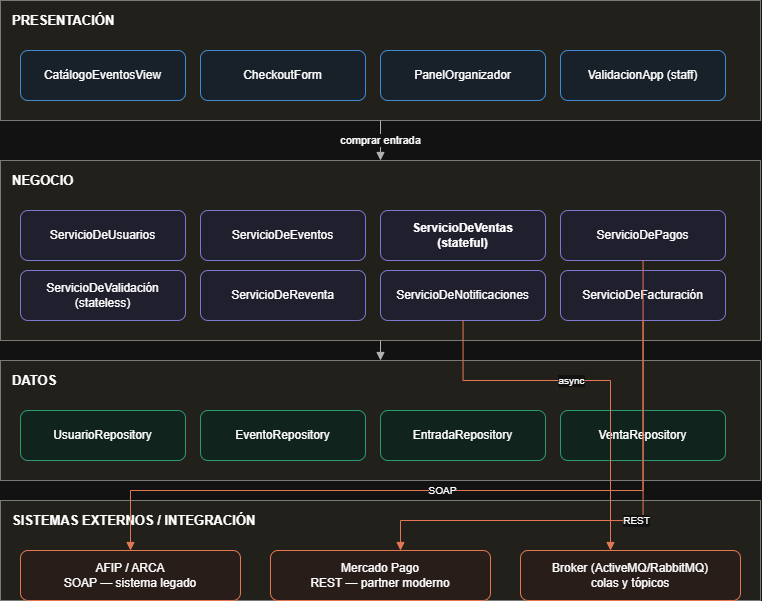

Representa la arquitectura lógica en tres capas (presentación, negocio, datos) más una capa de integración con tres sistemas externos: ARCA (ex AFIP) por SOAP para factura electrónica, Mercado Pago por REST y un broker de mensajería para los procesos asincrónicos. La flecha marca el recorrido del caso de uso "comprar entrada". Es un diagrama de diseño: en esa fecha solo estaba implementado ServicioDeEventos. Lo que cambió desde entonces: la capa de negocio quedó repartida en 8 WAR con un esquema cada uno; ARCA y Mercado Pago no tienen conexión real, y el 16/10 la cátedra aceptó que los dos queden simulados (Pagos usa una pasarela simulada y Facturación habla por SOAP con un ARCA simulado en un WAR aparte); el broker sí está funcionando.

**Diagrama de integración SOA de la Entrega Parcial N.º 2** (`docs/entrega3/`, para la entrega del 23/10, fecha sin confirmar con la cátedra):


Lleva el título "arquitectura de integración (SOA) al 13/10/2026": es una foto del sistema en esa fecha. Muestra los 8 servicios desplegados en WildFly, cada uno con su ruta y si es stateless o stateful; el broker Artemis con la cola `cola.emision-entradas` (I4, asincrónica, con su único consumidor `EmisionDeEntradasMDB`), el tópico `topico.compra-confirmada` (I5, con los dos suscriptores de Notificaciones) y la DLQ; las llamadas REST síncronas entre servicios (S1: Ventas hacia Usuarios, Eventos y Pagos; S2: los servicios hacia Usuarios por la clave pública y el token de servicio) y los dos sistemas externos, Mercado Pago (I2) y ARCA (I3, SOAP con timeout de 5 s y `cola.reintento-facturacion`). Las flechas llenas están implementadas y comprobadas en el servidor el 13/10; las punteadas (Facturación, Reventa y Validación, Mercado Pago, ARCA) están diseñadas y pendientes. Desde esa fecha el diagrama quedó desactualizado en cuatro puntos. Validación, Reventa y Facturación ya están implementadas, se probaron en el servidor el 16/10 y cambiaron de ruta (`/api/v1/validacion`, `/api/v1/reventas` y `/api/v1/facturas`). Facturación dispara la factura desde una suscripción durable al tópico, le pide el CAE por SOAP al ARCA simulado, que es un WAR aparte en `/legado/arca`, no tiene `cola.reintento-facturacion` (los reintentos son los del broker) y no informa la factura a Ventas (sección 4.8). Validación llama por REST a Ventas para usar la entrada (sección 4.6). Y Reventa llama por REST a Ventas (estado y transferencia de la entrada), a Pagos (cobro) y a Eventos (fecha del evento), sin mensajería (sección 4.7). **Pendiente: actualizar el diagrama** con esos cambios. Los diagramas de secuencia vigentes de cada integración están en la sección 13.

# 4. Componentes

Los ocho componentes salen de la Entrega Parcial N.º 1. Los ocho están implementados y se probaron en el servidor el 16/10, armado desde cero: `mvn clean install` con 577 tests y 0 fallas, los 17 escenarios de integración (`scripts/pruebas/escenarios.mjs`) y la colección de Postman con Newman (126 requests, 406 aserciones, 0 fallas). Lo que no se probó en el servidor está dicho en el estado de cada componente. La sección 4.9 describe el ARCA simulado, que no es un componente de Palco sino el sistema legado con el que se integra Facturación. En las tablas de endpoints, "rol" es la anotación de seguridad de la operación en el recurso JAX-RS. Todos los servicios responden `GET <ruta>/health` sin token.

## 4.1 Usuarios

- **Responsabilidad:** identidad, autenticación y roles. Registra usuarios, verifica el email con un código, inicia sesión y firma los tokens JWT que validan los demás servicios. También emite el token de rol `servicio` para las llamadas entre servicios.
- **Interfaz:** `IUsuarios` (`@Local`): `registrar`, `verificarEmail`, `reenviarCodigo`, `iniciarSesion`, `obtener`, `emitirTokenDeServicio`. El comentario de la interfaz lo presenta como "el servicio reutilizable del taller de integración: Ventas, Reventa, Validación y el panel del organizador dependen de él".
- **Stateless.** `ServicioDeUsuarios`: "cada operación recibe todo lo que necesita (los datos del pedido o el id del token) y lo que tiene que durar queda en la base, así que el contenedor reutiliza un pool de instancias".
- **Seguridad propia:** contraseñas con hash PBKDF2-HMAC-SHA256 (`seguridad/Contrasenas`; los hashes nuevos usan 600.000 iteraciones, `Contrasenas.ITERACIONES`, y los anteriores, de 310.000, siguen verificando porque el formato guarda las iteraciones de cada hash), claves RSA para firmar los JWT (`seguridad/ClavesJwt`) y publicación de la clave pública en `/jwks`. El código de verificación admite hasta 5 intentos (`MAX_INTENTOS_CODIGO`).
- **Límite de intentos de login (SEC-W04):** con 5 fallidos en 15 minutos para un mismo email (`MAX_INTENTOS_LOGIN` y `VENTANA_INTENTOS_LOGIN`, en `ServicioDeUsuarios`), el pedido siguiente responde 429 `demasiados-intentos` con `Retry-After`, aunque la clave sea correcta; vale también para emails que no tienen cuenta, así el límite no revela cuáles existen. Los intentos los guarda y consulta `datos/IntentoLoginRepository` (implementación `IntentoLoginRepositoryJpa`; antes era `negocio/IntentosDeLogin`, con las mismas consultas). Viven en la base y no en memoria, así el límite es el mismo con varias instancias o después de un redespliegue. Un login correcto borra los fallidos de ese email. El 401 del login es `CredencialesIncorrectas`, que no deshace la transacción (`rollback = false`) para que el intento fallido quede guardado.

| Método | Ruta | Rol | Qué hace |
|---|---|---|---|
| POST | `/api/usuarios/registro` | `@PermitAll` | Alta de usuario; queda pendiente de verificar el email |
| POST | `/api/usuarios/verificacion` | `@PermitAll` | Verifica el código y devuelve la sesión |
| POST | `/api/usuarios/verificacion/reenvio` | `@PermitAll` | Reenvía el código |
| POST | `/api/usuarios/login` | `@PermitAll` | Inicia sesión y devuelve el JWT; 401 con credenciales incorrectas y 429 al superar el límite de intentos |
| GET | `/api/usuarios/yo` | `user`, `organizer`, `staff` | Datos del dueño del token (Ventas la usa para saber si el comprador verificó su identidad) |
| POST | `/api/usuarios/servicios/token` | `@PermitAll` (lo protege el secreto compartido) | Token de rol `servicio` |
| GET | `/api/usuarios/jwks` | `@PermitAll` | Clave pública para validar los JWT |

- **Datos (esquema `usuarios`):** `usuario` (nombre, apellido, DNI único, email único, teléfono, fecha de nacimiento, hash de la contraseña, rol, email verificado, identidad verificada), `codigo_verificacion` (hash del código, vencimiento, intentos) e `intento_login` (SHA-256 del email normalizado y momento del intento fallido, con un índice por email y momento). V2 y V3 cargan usuarios de prueba; V4 crea `intento_login`; V5 rehashea las cuentas de prueba a 600.000 iteraciones (contraseña sin cambios, y solo si la fila conserva el hash original), para que su verificación no tarde distinto que la del hash falso que se calcula para un email inexistente y el tiempo de respuesta no deje ver qué emails existen.
- **Capa de datos:** `UsuarioRepository` (buscar por id, email o DNI, guardar, borrar), `CodigoVerificacionRepository` e `IntentoLoginRepository`. `borrar` hace `flush` para que el `DELETE` de una cuenta sin verificar salga antes del `INSERT` de la cuenta nueva con el mismo email o DNI.
- **Integraciones:** la consumen el frontend (sesión) y Ventas (`ClienteDeUsuarios`, con el token del propio comprador). Todos los servicios dependen de sus tokens.
- **Estado:** Implementado y probado en el servidor el 16/10. La sesión del usuario dura 8 horas (`DURACION_SESION`) y el token de servicio, 5 minutos. El pedido sin token a una operación con `@RolesAllowed` responde 401 con Problem Details (`ManejadoresDeErrores`); el 401 por token inválido, que rechaza el propio servidor antes de llegar al recurso, también sale como Problem Details (`ErrorDeAutenticacionServlet`, sección 3.4), y el 500 lleva `idError`. Verificación del 16/10, con el servidor armado desde cero: Usuarios desplegado en la migración v5; seis logins fallidos de un mismo email dieron cinco 401 y, el sexto, 429 con `Retry-After: 898`; una cuenta recién registrada completó registro, verificación, login y compra hasta `EMITIDA`. La verificación se hizo con la capa de datos de repositorios ya incorporada. Usuarios tiene 45 tests, entre ellos `RegistroYVerificacionTest`, `RepositoriosEnH2Test` y `LimiteDeIntentosDeLoginTest`.
- **Vigencia de la sesión (SEC-W05): parcial, vigencia justificada** (decisión del grupo del 16/10). La sesión se mantiene en 8 horas, sin refresh token, porque una sesión de compra o de un organizador dura una jornada. El token se firma con RS256 y cada servicio lo valida con la clave pública; la clave se regenera al redesplegar Usuarios si no se define `PALCO_JWT_CLAVE_PRIVADA`, lo que invalida las sesiones abiertas; el token entre servicios dura 5 minutos. El riesgo de que se use un token robado durante su vigencia se acepta para el alcance del trabajo.

## 4.2 Eventos

- **Responsabilidad:** catálogo de eventos y sus sectores (precio y cupo). Alta de eventos por el organizador y control del cupo vendido.
- **Interfaz:** `IEventos`: `listarEventos`, `obtenerDetalle`, `crearEvento`, `actualizarCupo`.
- **Stateless.** `ServicioDeEventos`: "cada operación es autocontenida y no depende de la llamada anterior, así que el contenedor reutiliza un pool de instancias". Fue el primer componente completo, presentado en la Entrega Parcial N.º 1 con esa misma justificación.

| Método | Ruta | Rol | Qué hace |
|---|---|---|---|
| GET | `/api/eventos?categoria=&q=` | `@PermitAll` | Lista eventos, con filtro por categoría y búsqueda |
| GET | `/api/eventos/{slug}` | `@PermitAll` | Detalle de un evento con sus sectores |
| POST | `/api/eventos` | `organizer` | Alta de evento |
| POST | `/api/eventos/{eventoId}/sectores/{sectorId}/cupo` | `servicio` | Reserva o devuelve lugares de un sector (la llama Ventas) |

- **Datos (esquema `eventos`):** `evento` (slug único, título, categoría, lugar, fecha, descripción, destacado, imagen, organizador) y `sector` (nombre, precio en pesos enteros, cupo, vendidas). La base garantiza que `vendidas` esté entre 0 y el cupo (`sector_vendidas_validas`): ese chequeo es la última red contra la sobreventa. V2 a V4 cargan eventos iniciales, corren sus fechas y agregan fotos.
- **Capa de datos:** `EventoRepository` (listar por categoría, buscar por slug, `existeSlug`, guardar) y `SectorRepository` (buscar por id, `sumarVendidas`). El UPDATE condicional del cupo quedó en `SectorRepository.sumarVendidas`: una sola sentencia con la condición `0 <= vendidas + cantidad <= cupo`, así que de dos compras simultáneas del último lugar la base deja pasar una sola; si cambió una fila, relee el sector. La regla de evento empezado (solo frena reservar; devolver siempre se acepta) sigue en `ServicioDeEventos`. La búsqueda por texto del catálogo se hace en Java, para que no dependa de cómo cada base compara los acentos.
- **Integraciones:** frontend (catálogo, alta y panel del organizador) y Ventas (cupo, con token de servicio).
- **Estado:** Implementado y probado en el servidor el 16/10, con la capa de datos. Eventos tiene 41 tests: `ServicioDeEventosTest` (28), `CupoEnH2Test` (8, el UPDATE condicional contra H2 en modo PostgreSQL) y `NuevoEventoDtoTest` (5, con Bean Validation).

## 4.3 Ventas

- **Responsabilidad:** la compra de punta a punta: reserva de lugares, datos de los titulares, cobro, confirmación y emisión de las entradas nominativas. Es dueña de las entradas.
- **Interfaz:** `IVentas`: `iniciarCompra`, `confirmarCompra`, `cancelarCompra`. Las tres son pasos de una misma conversación y se llaman sobre la misma instancia, por eso `confirmarCompra` y `cancelarCompra` no reciben el id de la venta. La Entrega Parcial N.º 1 listaba además `agregarEntrada`; en la implementación los titulares llegan todos juntos en `iniciarCompra` y esa operación no existe.
- **Stateful.** `ServicioDeVentas`: "una instancia por compra en curso, que el contenedor mantiene viva entre el pedido que abre la compra y el que la paga o la cancela. Guarda lo que todavía no está en la base: cuál es su venta y a nombre de quién va cada entrada (los titulares). [...] Un stateless no serviría: el pago podría caer en otra instancia del pool, que no conoce a los titulares." Muere con `@Remove` al pagar o cancelar (sobrevive a un pago rechazado, `retainIfException = true`) o por `@StatefulTimeout` si se abandona.
- **Piezas que rodean al stateful:**
  - `ComprasEnCurso` (`@ApplicationScoped`): índice de las compras abiertas, fachada que ordena los pasos que quedan fuera de la transacción (consultar a Usuarios, devolver cupo, marcar el intento de pago) y freno de la segunda llamada simultánea sobre la misma compra (409 `operacion-en-curso`).
  - `VencimientoDeReservas` (`@Singleton` con `@Schedule`, sin estado): una vez por minuto pasa a `VENCIDA` las compras con la reserva vencida y devuelve el cupo a Eventos. La reserva tiene un solo reloj, la hora guardada en la base, porque el `@PreDestroy` del stateful puede no ejecutarse.
  - `EmisionDeEntradasMDB` (sin estado): consume `PAGO_CONFIRMADO` de la cola, pone el código QR a cada entrada, las deja `VALIDA` y pasa la venta de `CONFIRMADA` a `EMITIDA`. Es idempotente y lo garantiza la base.
  - `Cobros` con dos implementaciones, `ClienteDePagos` (Adapter sobre la API REST de Pagos) y `CobrosFake`, elegidas por `FabricaDeCobros` según `PALCO_VENTAS_COBROS` (por defecto, Pagos real).
  - `ReventaDeEntradas` (`@Stateless`, transacción por defecto): los cambios de estado que pide Reventa; queda fuera de `IVentas` por la misma razón que `UsoDeEntradas`. La transferencia es una sola transacción: la entrada original pasa de `PUBLICADA` a `VENDIDA` y nace una venta `EMITIDA` del comprador con una entrada nueva `VALIDA`, con código QR nuevo y el titular nuevo, o no pasa nada de eso. Es idempotente: si el comprador ya tiene la venta de esa publicación, la devuelve sin cambiar nada. La ruta es `/api/v1/operaciones-de-reventa` y no `/api/v1/reventas`, porque ese prefijo es el `context-root` del WAR de Reventa.
  - `UsoDeEntradas` (`@Stateless`, transacción por defecto): usa una entrada en la puerta a pedido de Validación. Queda fuera de `IVentas` porque esa interfaz es la conversación stateful de una compra, y usar una entrada no tiene nada que ver con ella. Busca la entrada por su código QR y la pasa de `VALIDA` a `USADA` con un UPDATE condicional (`EntradaRepositoryJpa.marcarUsada`, con la condición del estado dentro del UPDATE, igual que la emisión); después la relee. De dos escaneos simultáneos solo uno cambia la fila: el otro espera el bloqueo y ya la ve `USADA` (`UsoEnH2Test` lo prueba con dos conexiones a la vez). Una entrada de otro evento no se toca.

| Método | Ruta | Rol | Qué hace |
|---|---|---|---|
| POST | `/api/v1/ventas` | `user` | Inicia la compra (cabecera `Idempotency-Key`); reserva cupo |
| GET | `/api/v1/ventas` | `user` | Compras del comprador |
| GET | `/api/v1/ventas/{ventaId}` | `user` | Una compra (404 si no es del comprador) |
| POST | `/api/v1/ventas/{ventaId}/pagos` | `user` | Paga la compra; al aprobarse, confirma y publica `PAGO_CONFIRMADO` |
| DELETE | `/api/v1/ventas/{ventaId}` | `user` | Cancela la compra y devuelve el cupo |
| GET | `/api/v1/entradas/{entradaId}` | `user` | Una entrada del comprador |
| POST | `/api/v1/entradas/usos` | `servicio` | Usa una entrada en la puerta (la llama Validación). 200 con la entrada `USADA`; 404 `no-encontrado`; 409 `entrada-de-otro-evento`, `entrada-ya-usada` o `entrada-no-habilitada` (publicada, vendida o anulada) |
| GET | `/api/v1/operaciones-de-reventa/entradas/{entradaId}?vendedorId=` | `servicio` | La entrada, si es de ese vendedor (la llama Reventa) |
| POST | `/api/v1/operaciones-de-reventa/publicaciones` | `servicio` | Pasa una entrada `VALIDA` del vendedor a `PUBLICADA` |
| POST | `/api/v1/operaciones-de-reventa/retiros` | `servicio` | Devuelve una entrada `PUBLICADA` a `VALIDA` |
| POST | `/api/v1/operaciones-de-reventa/transferencias` | `servicio` | Transfiere la entrada vendida en la reventa (sección 4.7) |

- **Datos (esquema `ventas`):** `venta` (comprador, evento, estado, estado de la factura, subtotal, cargo de servicio, total, vencimiento de la reserva, claves de idempotencia de la venta y del pago, id del pago), `venta_item` (sector, precio unitario, cantidad) y `entrada` (titular con nombre y DNI, precio pagado, estado, código QR único). La base exige que el total sea subtotal más cargo, que no haya dos entradas con el mismo DNI en una compra y que la clave de idempotencia sea única por comprador.
- **Integraciones:** REST síncrono con Usuarios (`/yo`), Eventos (cupo) y Pagos (cobro), con token de servicio salvo Usuarios; publica `PAGO_CONFIRMADO` en la cola y en el tópico dentro de la transacción de `confirmarCompra`; consume la cola. Validación la llama por REST para usar una entrada, y Reventa, para consultar, publicar, retirar y transferir entradas.
- **Estado:** Implementado y probado en el servidor el 16/10. Ventas tiene 273 tests. `factura_estado` vale `NO_APLICA` en toda venta: la factura se consulta en Facturación y Ventas no se entera de ella.

## 4.4 Pagos

- **Responsabilidad:** cobrar una venta a través de una pasarela, guardar el pago y garantizar la idempotencia (un mismo pedido repetido no cobra dos veces).
- **Interfaz:** `IPagos`: `procesarPago`, `obtener`, `buscarPorClave` y, desde el 23/10, `reembolsar`. `confirmarPago` (el aviso de la pasarela), de la Entrega Parcial N.º 1, se declara cuando se implemente.
- **Stateless.** `ServicioDePagos`: "no recuerda nada entre una llamada y la siguiente. Lo que tiene que durar (el pago y la clave con la que se pidió) queda en la base, así que cualquier instancia del pool puede atender cualquier pedido, también la repetición de uno anterior". Corre sin transacción propia (`NOT_SUPPORTED`) para no retener una conexión del pool mientras espera a la pasarela.
- **Pasarela:** `PasarelaDePagos`, elegida por `FabricaDePasarela` según `PALCO_PAGOS_PROVEEDOR` (por defecto `fake`; un valor desconocido impide el despliegue). Hoy la única implementación es `PagosFake`, que decide el resultado por el token de la tarjeta (`tok_rechazado`, `tok_sin_respuesta`, cualquier otro aprueba).

| Método | Ruta | Rol | Qué hace |
|---|---|---|---|
| POST | `/api/v1/pagos` | `servicio` | Procesa un pago (cabecera `Idempotency-Key`) |
| GET | `/api/v1/pagos?claveIdempotencia=` | `servicio` | El pago guardado con esa clave, o 404 `no-encontrado`. Lo usan las conciliaciones de Ventas y de Reventa |
| GET | `/api/v1/pagos/{pagoId}` | `servicio` | Consulta un pago |
| POST | `/api/v1/pagos/{pagoId}/reembolso` | `servicio` | Devuelve un pago `APROBADO` entero (`ventaId` y `motivo`) y responde 200 con el pago `REEMBOLSADO`. Repetirlo no devuelve dos veces. 409 `pago-no-reembolsable` si no está aprobado o es de otra venta (desde el 23/10) |

- **Datos (esquema `pagos`):** `pago` (venta, monto, medio de pago, proveedor, estado, motivo, clave de idempotencia única, id externo único, fechas y, si se devolvió, el motivo y la hora del reembolso, migración V2).
- **Reembolso** (desde el 23/10, limitación L2): la pasarela recibe la clave `reembolso:<pagoId>`, así dos pedidos a la vez no devuelven dos veces; después un `UPDATE` condicional pasa el pago de `APROBADO` a `REEMBOLSADO`. Si la pasarela no contesta, el pago sigue `APROBADO` y se puede repetir. `PagosFake` siempre devuelve.
- **Integraciones:** la llaman Ventas (compra del catálogo) y Reventa (compra en reventa), por REST con token de servicio. Mercado Pago no está conectado.
- **Estado:** Implementado, con pasarela **Simulada**, y probado en el servidor el 16/10; ese día la cátedra aceptó la pasarela simulada. Pagos tiene 36 tests. Mercado Pago real con su webhook: Diseñado, pendiente (diagrama de secuencia en `docs/entrega-obligatoria-2/diagramas/diagrama_secuencia_mercadopago.png`).

## 4.5 Notificaciones

- **Responsabilidad:** avisar al comprador cuando se confirma una compra y dejar registro de auditoría de cada compra confirmada.
- **Interfaces:** `INotificaciones` (`enviarConfirmacion`; `enviarRecordatorio` y `enviarAlertaCancelacion`, de la Entrega Parcial N.º 1, se declaran cuando se implementen) e `IAuditoria` (`registrar`, `listar`). Son dos interfaces porque "avisar puede fallar o perderse, auditar no".
- **Stateless.** `ServicioDeNotificaciones`: "cada aviso se arma solo con el mensaje que llega y no depende del aviso anterior". `ServicioDeAuditoria`: "registrar un mensaje no depende del anterior, y lo que tiene que durar queda en la base".
- **Consumidores del tópico `topico.compra-confirmada`:**
  - `AvisoDeCompraMDB`: suscripción no durable. Si el servicio está caído el aviso se pierde, y se acepta: "un aviso viejo no le sirve a nadie".
  - `AuditoriaDeComprasMDB`: suscripción durable (el broker guarda los mensajes mientras está detenido), un solo consumidor (`maxSession = 1`) para registrar en orden, y transacción del contenedor: si falla, reintento y DLQ al quinto intento.
- **Herramienta de desarrollo:** `PruebasDeMensajeria` publica mensajes de prueba (con `ventaId` que empieza con `prueba-`) para ver la mensajería sin hacer una compra. Decisión del grupo del 16/10: los endpoints `/pruebas/*` se mantienen, porque los usan la demo, la evidencia y la colección de Postman; son solo de desarrollo y piden rol `servicio`. Para producción habría que deshabilitarlos (el comentario de la clase propone hacerlo con una variable de entorno y excluir esas filas del listado); no está hecho.

| Método | Ruta | Rol | Qué hace |
|---|---|---|---|
| POST | `/api/notificaciones/pruebas/pago-confirmado` | `servicio` | Publica un `PAGO_CONFIRMADO` de prueba |
| POST | `/api/notificaciones/pruebas/pago-confirmado-con-falla` | `servicio` | Publica y falla, para mostrar que el mensaje no sale (forma parte de la transacción) |
| POST | `/api/notificaciones/pruebas/mensaje-invalido` | `servicio` | Publica un mensaje que no respeta el contrato, para mostrar el camino a la DLQ |
| GET | `/api/notificaciones/auditoria` | `servicio` | Lista el registro de auditoría |

- **Datos (esquema `notificaciones`):** `registro_auditoria` (id del mensaje como clave, tipo, venta, comprador, evento, monto total, cuerpo completo y hora de recepción). V2 agranda la columna del cuerpo.
- **Capa de datos:** `RegistroDeAuditoriaRepository` (`existe`, `guardar`, `ultimos`). `guardar` hace `persist` y `flush`, para que un `INSERT` rechazado falle dentro del método y el MDB no escriba en el log que procesó el mensaje. `ServicioDeAuditoria` decide el registro idempotente y el listado de los últimos 50. Notificaciones tiene 33 tests, entre ellos `RegistroDeAuditoriaEnH2Test` (3).
- **Integraciones:** solo JMS (consume el tópico). Nadie la llama por REST salvo las pruebas y el listado de auditoría.
- **Estado:** Implementado y probado en el servidor el 16/10, con la capa de datos: la demo (`scripts/demo-entrega3.sh`) terminó con código 0 en sus dos modos, y un mensaje inválido llegó a la DLQ con una copia por cada suscriptor durable. El aviso al comprador es **Simulado**: se escribe en el log, no se envía un email.

## 4.6 Validación

- **Responsabilidad:** validar en la puerta que el código de una entrada exista, sea del evento que se controla y se use una sola vez, y llevar el registro auditable de cada escaneo.
- **Interfaz:** `IValidacion` (`@Local`): `escanear(codigoQr, eventoId, escaneadoPor)`, `listar(eventoId)` y `obtener(escaneoId)`. La Entrega Parcial N.º 1 definía dos operaciones, `validarEntrada` y `marcarComoUsada`; quedaron unidas en `escanear` porque, con dos pasos, entre "es válida" y "marcala" otra puerta podría usar la misma entrada.
- **Stateless.** `ServicioDeValidacion`: "cada escaneo es independiente y no recuerda nada del anterior. Lo que tiene que durar (que la entrada se usó) queda en la base de Ventas, y el registro de la puerta en la de este servicio, así que cualquier instancia del pool atiende cualquier escaneo de cualquier puerta". Corre sin transacción propia (`NOT_SUPPORTED`), igual que Pagos: entre leer el registro y guardar el escaneo espera a Ventas, y con una transacción abierta esa espera retendría una conexión del pool que comparten los servicios. Por la misma razón, el escaneo `SIN_RESPUESTA` queda guardado aunque después se devuelva el error.
- **Uso único:** no se decide en Validación sino en Ventas, la dueña de la entrada, con el UPDATE condicional de `UsoDeEntradas` (sección 4.3). La base bloquea la fila y solo uno de dos escaneos simultáneos cambia algo, sin transacción distribuida.
- **Capas:** `api/` (`EscaneosResource` y DTOs), `negocio/` (`IValidacion`, `ServicioDeValidacion`, `MigracionesValidacion`), `negocio/externos/` (`ClienteDeVentas`), `datos/` (`EscaneoRepository` y `EscaneoRepositoryJpa`, una transacción corta por método) y `dominio/` (`Escaneo` y el enum `ResultadoEscaneo`).

| Método | Ruta | Rol | Qué hace |
|---|---|---|---|
| POST | `/api/v1/validacion/escaneos` | `staff` | Escanea un código (`codigoQr` y `eventoId` en el cuerpo). Responde 201 con `Location` y el resultado (`VALIDA`, `YA_USADA`, `INEXISTENTE`, `OTRO_EVENTO` o `NO_HABILITADA`), `puedeEntrar`, el mensaje para el personal, el titular (solo con `VALIDA`) y el uso anterior (solo con `YA_USADA`). 504 `sin-respuesta` si Ventas no responde |
| GET | `/api/v1/validacion/escaneos?eventoId=` | `staff`, `organizer` | Registro de un evento, del más nuevo al más viejo, con un máximo de 500 renglones |
| GET | `/api/v1/validacion/escaneos/{escaneoId}` | `staff`, `organizer` | Un escaneo; 404 si no existe |

- **Por qué 201 con cualquier resultado:** lo que se crea es el renglón del registro. "No puede entrar" es un dato y no un error HTTP, con el mismo criterio que Pagos aplica a un cobro rechazado.
- **Decisiones sobre los datos del escaneo:** el código viaja en el cuerpo y no en la ruta, para que no quede en los logs de acceso, y no se escribe en los logs de la aplicación. El registro guarda el código completo pero lo muestra recortado (`codigoParcial`, "…" más los últimos 6 caracteres), porque un código de otro evento escaneado por error sigue sirviendo allá. No guarda nombre ni DNI: son datos de Ventas, y a la entrada se llega por `entradaId`. Un 409 de Ventas con un tipo desconocido cuenta como `NO_HABILITADA`: ante la duda, no se deja entrar.
- **Si Ventas no responde:** el intento queda como `SIN_RESPUESTA` y el pedido devuelve 504. Si ese intento sí llegó a usar la entrada, el próximo escaneo da `YA_USADA` con `usoAnterior` apuntando a él y un mensaje para que el personal controle el documento.
- **Datos (esquema `validacion`):** tabla `escaneo` (id, código QR, evento, resultado, entrada, quién escaneó y cuándo, en UTC), con índices por evento y momento y por código. Sin claves foráneas a otros esquemas y sin check de lista de valores: los resultados válidos los controla el enum.
- **Integraciones:** REST síncrono con Ventas (`POST /api/v1/entradas/usos`, rol `servicio`) a través de `ClienteDeVentas` (`@ApplicationScoped`), con 2 segundos para conectar y 5 para leer; ante un 401 pide un token de servicio nuevo y reintenta una sola vez. Es síncrona porque la puerta necesita el resultado en el momento. La consumen la pantalla de puerta y el panel del organizador. Reventa no la llama: una entrada publicada o vendida da `NO_HABILITADA` porque su estado está en Ventas.
- **Límites conocidos:** el código QR es el UUID al azar que genera Ventas, no está firmado. No se verifica que el organizador sea dueño del evento cuyo registro consulta ni que el personal esté asignado a ese evento. Si falla el guardado de un escaneo `VALIDA` después de que Ventas usó la entrada, el pedido da 500 y el próximo escaneo da `YA_USADA` sin `usoAnterior`.
- **Estado:** Implementado y probado en el servidor el 16/10 por la API (escenario 16 y carpeta 5 de Postman): `OTRO_EVENTO` sin tocar la entrada, `VALIDA` con la entrada `USADA`, `YA_USADA` al repetir, `INEXISTENTE` y 403 para un comprador. El caso de Ventas sin responder (504 y `SIN_RESPUESTA`) tiene tests pero no se provocó en el servidor, y la pantalla `/puerta` no se probó todavía en el navegador. Validación tiene 26 tests: `ServicioDeValidacionTest` (12), `ClienteDeVentasTest` (8), `EscaneosResourceTest` (3) y `RegistroEnH2Test` (3, con la migración en H2 modo PostgreSQL). Del lado de Ventas, `UsoDeEntradasTest` (6), `UsoEnH2Test` (3) y 2 tests en `EntradasResourceTest`.

## 4.7 Reventa

- **Responsabilidad:** reventa oficial de entradas nominativas entre usuarios con sesión (el email verificado es la verificación de identidad de esta etapa), con el precio entre el 50 % y el 110 % de lo que pagó el vendedor y cierre 3 horas antes del evento. Las reglas salen de `ReglasDeNegocio` (`minimoReventa`, `topeReventa`, `HORAS_LIMITE_REVENTA`).
- **Interfaz:** `IReventa` (`@Local`): `listarActivas(eventoId)`, `listarDelVendedor`, `publicar`, `retirar` y `comprar`. De la Entrega Parcial N.º 1, `publicarReventa`, `cancelarPublicacion` y `comprarReventa` quedaron como `publicar`, `retirar` y `comprar`; se sumaron los dos listados que necesitan las pantallas.
- **Stateless.** `ServicioDeReventa`: "cada pedido llega completo (quién, qué publicación, qué precio, con qué tarjeta) y no hay una conversación que recordar entre un pedido y el siguiente, como sí la hay en el checkout de Ventas. Todo lo que tiene que durar queda en la base: el estado de la publicación y la compra en curso".
- **No es dueña de las entradas:** las tiene Ventas. Cada cambio de una entrada (publicarla, retirarla, transferirla) se le pide a Ventas por REST (`/api/v1/operaciones-de-reventa`, rol `servicio`, sección 4.3); Reventa guarda la publicación y su precio. Los dos servicios no comparten una transacción, así que cada operación decide qué hacer si la otra parte falla:
  - **Publicar:** primero controla, sin cambiar nada, que la entrada sea del vendedor y esté `VALIDA`, el rango de precio (`precio-fuera-de-rango`) y el horario (`reventa-cerrada`); después le pide a Ventas que la pase a `PUBLICADA` y recién ahí guarda la publicación `ACTIVA`. Si guardarla falla, le pide a Ventas que la retire.
  - **Retirar:** un UPDATE condicional deja la publicación `RETIRADA` y después Ventas devuelve la entrada a `VALIDA`. Si Ventas falla, la transacción se deshace y la publicación sigue `ACTIVA`. No se retira mientras alguien la está comprando.
  - **Comprar:** corre sin transacción propia (`NOT_SUPPORTED`), porque entre paso y paso llama a otros servicios. Toma la publicación con un UPDATE condicional que anota comprador, clave, titular y momento (de dos compras a la vez, cobra una sola), cobra en Pagos el precio más el cargo de servicio con una clave derivada de la `Idempotency-Key`, le pide a Ventas la transferencia y deja la publicación `VENDIDA`. Si el cobro se rechaza, la publicación se libera; si Pagos no responde, la toma queda: el mismo comprador puede reintentar con la misma clave sin que se cobre dos veces y, si no reintenta, la resuelve la conciliación de reventas (desde el 23/10, sección 7.10). La toma no vence por tiempo. Si el cobro sale aprobado y Ventas rechaza la transferencia, la publicación queda `ANULADA` y el pago se devuelve (desde el 23/10, 7.10); si Ventas no responde, la toma queda como cuando no responde Pagos. No se puede comprar una publicación propia (`compra-propia`).

| Método | Ruta | Rol | Qué hace |
|---|---|---|---|
| GET | `/api/v1/reventas?eventoId=` | `@PermitAll` | Publicaciones `ACTIVA` de un evento, de la más barata a la más cara |
| GET | `/api/v1/reventas/mias` | `user` | Publicaciones del usuario, en todos los estados |
| POST | `/api/v1/reventas` | `user` | Publica una entrada propia (`entradaId` y `precio`); 201 con la publicación |
| DELETE | `/api/v1/reventas/{publicacionId}` | `user` | Retira una publicación propia `ACTIVA`; 204. Una ajena da el mismo 404 que una inexistente |
| POST | `/api/v1/reventas/{publicacionId}/compra` | `user` | Compra (cabecera `Idempotency-Key`, titular nuevo y medio de pago); 201 con la publicación vendida, la entrada nueva y su venta, y `Location` hacia la entrada en Ventas. Repetirlo con la misma clave devuelve lo mismo |

- **Datos (esquema `reventa`):** tabla `publicacion` (id, entrada, vendedor, evento, sector, precio pagado, precio, precio máximo, estado, fecha de publicación, la compra en curso con comprador, clave y momento, y al venderse la venta nueva, el pago y el cierre). La base exige precio mayor que 0 y no mayor que el máximo; los estados (`ACTIVA`, `VENDIDA`, `RETIRADA` y, desde el 23/10, `ANULADA`) los controla el enum. Tabla `reembolso` (migración V3): una fila por pago a devolver, con publicación, comprador, monto, motivo y estado (`PENDIENTE`, `HECHO` o `RECHAZADO`). Sin claves foráneas a otros esquemas.
- **Capas:** `api/` (`ReventasResource` y DTOs), `negocio/` (`IReventa`, `ServicioDeReventa`, `ConciliacionDeReventas`, `DevolucionDeCobros`, `MigracionesReventa`, `TiposDeProblema`), `negocio/externos/` (`ClienteDeVentas`, `ClienteDePagos`, `ClienteDeEventos` sobre `ClienteRest`, con 2 segundos para conectar y 10 para leer), `datos/` (`PublicacionRepository`, `ReembolsoRepository` y sus implementaciones JPA) y `dominio/` (`Publicacion`, `EstadoPublicacion`, `Reembolso` y `EstadoReembolso`).
- **Integraciones:** REST síncrono, con token de servicio, con Ventas (entrada), Pagos (cobro) y Eventos (fecha del evento para la regla de las 3 horas; se lee del catálogo porque Eventos busca el detalle por slug). Validación no la llama: una entrada `PUBLICADA` o `VENDIDA` da `NO_HABILITADA` en la puerta porque su estado está en Ventas. La consumen las pantallas de reventa (`frontend/src/servicios/reventa.ts`) y el panel del organizador.
- **Límites conocidos:** si Pagos contesta que un pago no se puede devolver, el reembolso queda `RECHAZADO` con un `SEVERE` y se revisa a mano. El comprador no recibe un aviso del reembolso: lo ve en la respuesta de la compra (409) o, si lo resolvió la conciliación, en ningún lado. La compra en la reventa no avisa al vendedor.
- **Estado:** Implementado y probado en el servidor el 16/10 (escenario 17 y carpeta 6 de Postman): reventa de punta a punta con la compra hecha desde otra cuenta y la entrada nueva en la venta del comprador. Las pantallas de reventa no se probaron todavía en el navegador. Reventa tiene 69 tests (al 23/10; detalle en 16.1).

## 4.8 Facturación

- **Responsabilidad:** emitir la factura electrónica de cada compra confirmada contra ARCA (ex AFIP), el sistema legado del dominio, por SOAP, y dejarla consultable. Es la integración SOAP con WSDL que pide la consigna; el 16/10 la cátedra aceptó que ARCA sea simulado (sección 4.9).
- **Interfaz:** `IFacturacion` (`@Local`): `emitirFactura(PagoConfirmadoMensaje)`, `consultarFactura(ventaId)` y `consultarFacturaDelComprador(compradorId, ventaId)`. De la Entrega Parcial N.º 1, `consultarEstado` quedó como las dos consultas, y `reintentar` no hace falta como operación: los reintentos son los del broker.
- **Stateless.** `ServicioDeFacturacion`: "cada factura se arma solo con el mensaje que llega, y lo que tiene que durar (la factura, con su número y CAE) queda en la base. No hay conversación con nadie, así que cualquier instancia del pool atiende cualquier mensaje, también la reentrega de uno anterior". Corre sin transacción propia (`NOT_SUPPORTED`) para no retener una conexión de la base mientras espera a ARCA; la factura se guarda en una transacción corta del repositorio, y la transacción del mensaje queda suspendida y se confirma después. Si esa transacción se deshiciera con la factura ya guardada, la reentrega la encuentra y no hace nada.
- **Capas:** `mensajeria/` (`FacturacionDeComprasMDB`), `api/` (`FacturasResource` y DTOs), `negocio/` (`IFacturacion`, `ServicioDeFacturacion`, `MigracionesFacturacion`, `TiposDeProblema`), `negocio/externos/` (el cliente de ARCA), `datos/` (`FacturaRepository` y `FacturaRepositoryJpa`) y `dominio/` (`Factura`).
- **Disparo por el tópico:** `FacturacionDeComprasMDB` es el tercer suscriptor de `topico.compra-confirmada`: durable (`clientId` `palco-facturacion`, suscripción `facturacion-compras-confirmadas`), con el mismo selector de `PAGO_CONFIRMADO` y `maxSession = 1`, para facturar de a una compra y que no se le pidan a ARCA dos facturas de la misma venta a la vez. La compra no necesita la factura para confirmarse, así que esperar a ARCA dentro de `confirmarCompra` solo retendría una conexión, y sumar un suscriptor al tópico no toca Ventas.
- **Comprobante:** factura B (tipo 6) y punto de venta 1, constantes de `ServicioDeFacturacion` porque son datos fiscales de Facturación y no reglas de negocio compartidas. El importe es el total del mensaje y la fecha, el día en hora argentina (`America/Argentina/Buenos_Aires`). El número lo asigna ARCA, como hace el sistema real; Facturación no lleva un contador propio.
- **Idempotencia:** antes de llamar a ARCA se busca la factura de la venta, y un mensaje repetido termina ahí. Si dos entregas pasan ese paso a la vez, la restricción única de la base (`factura_venta_unica`) deja guardar una sola y la otra devuelve la que quedó. Además, el ARCA simulado devuelve el mismo comprobante si se le pide de nuevo la misma venta.
- **Fallas:** si ARCA no responde (tiempo vencido, conexión rechazada, WSDL que no baja o SOAP Fault), el servicio lanza `SinRespuesta`; si rechaza el comprobante, `ReglaIncumplida` (`comprobante-rechazado`). En los dos casos el MDB marca la entrega para deshacer (`setRollbackOnly`) y el broker reintenta con la política que ya existe: 5 entregas cada 2 segundos y después la DLQ, sin cola propia. Un rechazo no se arregla reintentando, pero la compra no puede quedar sin factura: va a la DLQ para revisarla con el procedimiento de la sección 10.6.
- **Cliente SOAP (`negocio/externos/`):** `Arca` es la interfaz propia; `ArcaSoap` es el Adapter que la implementa sobre `PuertoArca`, una interfaz Java anotada con el contrato del WSDL, y `RespuestaCaeXml`. Se arma con `Service.create` sobre el WSDL, sin generar código en el build. El WSDL se baja en el primer pedido y no al desplegar, así Facturación despliega aunque ARCA esté caído; el `Service` queda en memoria y el puerto se crea en cada pedido. `FabricaDeArca` (Factory, `@ApplicationScoped`) lee la configuración: `palco.facturacion.arca.wsdl` (por defecto `${PALCO_URL_INTERNA}/legado/arca?wsdl`) y los tiempos de espera, 2 segundos para conectar y 5 para leer, que rechaza si son 0 o menos.
- **Seguridad del XML (SEC-I01):** el lector StAX de CXF trae la DTD y las entidades externas deshabilitadas salvo que se defina la propiedad de sistema `org.apache.cxf.stax.allowInsecureParser`; Palco no la define, y `FabricaDeArca` se niega a crear el cliente si está en `true`.

| Método | Ruta | Rol | Qué hace |
|---|---|---|---|
| GET | `/api/v1/facturas/{ventaId}` | `user`, `servicio` | La factura de una venta: comprobante, número, CAE, vencimiento del CAE, importe y fecha. Con rol `user`, solo la propia; una ajena, una inexistente o una todavía sin facturar dan el mismo 404 `no-encontrado` |

- **Datos (esquema `facturacion`):** tabla `factura` (venta, comprador, evento, tipo de comprobante, punto de venta, número, CAE, vencimiento del CAE, importe en pesos enteros, fecha del comprobante y momento en que se guardó), con una sola factura por venta. No hay restricción única sobre tipo, punto de venta y número, porque el ARCA simulado vuelve a numerar desde 1 al redesplegarse.
- **Integraciones:** consume el tópico `topico.compra-confirmada` (JMS) y llama al ARCA simulado por SOAP. Ventas no cambia: `facturaEstado` sigue en `NO_APLICA` y la factura se consulta acá.
- **Estado:** Implementado y probado en el servidor el 16/10 (escenario 15 y carpeta 7 de Postman): la primera compra recibió la factura B 00001-00000001 con un CAE de 14 dígitos, una sola por venta, y la compra siguiente, el número siguiente. Con eso queda comprobado que el cliente corre sobre CXF en el servidor igual que sobre Metro en los tests. Facturación tiene 38 tests en 6 clases: el negocio, el MDB, el recurso, la fábrica, el cliente SOAP contra un servicio publicado con `Endpoint.publish` y el repositorio contra H2 en modo PostgreSQL. El corte por tiempo de espera y el rechazo de un sobre con DTD no se provocaron en el servidor: los cubren solo los tests.

## 4.9 ARCA simulado (sistema legado)

- **Qué es:** el sistema externo de facturación electrónica, simulado por un servicio SOAP propio que la cátedra aceptó el 16/10. No es un componente de Palco: es un WAR aparte (`backend/servicios/arca`, artefacto `palco-arca`) publicado en `/legado/arca`, fuera de `/api`, y no recibe `palco-common` ni comparte ninguna clase con Palco (sección 3.2). Así, Facturación se integra con él solo por el contrato del WSDL, como con un sistema legado real.
- **Servicio:** `ArcaSimulado`, un POJO con `@WebService` (portType `ServicioFacturaElectronica`, servicio `ArcaSimulado`, puerto `ArcaSimuladoPort`, espacio de nombres `urn:palco:legado:arca:wsfe`), mapeado en `web.xml` a la raíz del contexto. WildFly genera el WSDL a partir de la clase en `/legado/arca?wsdl`.
- **Operación:** `FECAESolicitar` (tipo de comprobante, punto de venta, importe total, fecha `aaaammdd` e id de la venta). Responde `Resultado` (`A` aprobado o `R` rechazado), número de comprobante, CAE de 14 dígitos, vencimiento del CAE (la fecha más 10 días) y observaciones. Rechaza con una observación, y sin numerar, un tipo que no sea 1, 6 u 11, un punto de venta fuera de 1 a 99998, un importe de 0 o menos, una fecha inválida o un id de venta vacío o de más de 40 caracteres.
- **Sin estado propio:** la numeración está en un `Talonario` en memoria del despliegue, correlativa por punto de venta y tipo, con métodos `synchronized` porque los pedidos llegan en varios hilos. No tiene base de datos.
- **Simulación declarada:** si se le pide otra vez el CAE de la misma venta, devuelve el mismo comprobante, así un reintento no saltea números (el sistema real no autoriza dos veces y se consulta con otra operación). No tiene autenticación (el real usa WSAA), su numeración vuelve a 1 al redesplegarlo, y queda expuesto sin autenticación si el servidor se publica fuera de la máquina local.
- **Modo sin respuesta:** con la propiedad de sistema `palco.arca.simular-sin-respuesta=true`, que se lee en cada pedido, espera 30 segundos y responde un SOAP Fault, sin numerar. Sirve para mostrar los reintentos y la DLQ de Facturación sin redesplegar.
- **Estado:** Implementado y probado en el servidor el 16/10: el WSDL responde 200 y numera las facturas de Facturación (sección 4.8). El modo sin respuesta no se usó en el servidor. Tiene 11 tests: 8 unitarios (numeración, rechazos, misma venta, modo sin respuesta y 60 pedidos simultáneos sin números repetidos) y 3 por SOAP, que publican el servicio y comprueban el WSDL y un sobre escrito a mano.

# 5. Decisiones de diseño

Las decisiones vienen de la Entrega Parcial N.º 1 (`docs/entrega1/`) y de lo que se eligió al implementar. Cada fila dice dónde se ve en el código. Cuando una decisión cambió, la tabla da la versión vigente y la sección 5.8 resume qué cambió y por qué.

## 5.1 Arquitectura

| Decisión | Alternativas consideradas | Por qué | Dónde se ve |
|---|---|---|---|
| Ocho componentes de negocio, cada uno un WAR propio con su esquema de base; se hablan solo por REST o JMS | Un único WAR con módulos; servicios que comparten clases | Es la descomposición de la Entrega Parcial N.º 1. Separar los despliegues obliga a que la integración sea explícita (contratos REST y mensajes), que es lo que evalúa la materia | `backend/servicios/*`, un `persistence.xml` y una migración por servicio. Con el ARCA simulado (`backend/servicios/arca`), que es un sistema externo y no un servicio de Palco, se despliegan 9 WAR: el 16/10, con el servidor armado desde cero, los 9 quedaron arriba y los 8 `health` respondieron 200 |
| Capas `api/` → `negocio/` → `dominio/`, con `datos/` (repositorios) y `mensajeria/` (MDB) donde hacen falta | Lógica en el recurso REST | El recurso valida la forma del pedido y delega; la regla de negocio queda en el Session Bean, donde el contenedor da transacciones y seguridad declarativas | `VentasResource` → `ComprasEnCurso` → `ServicioDeVentas` → `VentaRepository` |
| Reglas de negocio (tope +10 %, tasa 10 %, 6 entradas por compra, 10 minutos de reserva, DNI de 7 u 8 dígitos) en un solo lugar | Una constante por servicio | Con copias distintas, un servicio puede aceptar lo que otro rechaza. La regla del DNI estaba escrita dos veces y Ventas iba a sumar una tercera | `common/ReglasDeNegocio.java` (`esDniValido`, `MINUTOS_RESERVA`, `MAX_ENTRADAS_POR_ORDEN`) |
| `ServicioDeVentas` es `@Stateful`: una instancia por compra en curso | (a) `@SessionScoped` con sesión HTTP; (c) sin stateful, todo en la base | La instancia guarda lo que todavía no está en la base: los titulares de cada entrada (hasta que la compra se manda a cobrar, 5.2), el total y el vencimiento. La identidad sigue en un solo mecanismo, el token; la cookie de sesión solo vale dentro de un WAR. La reserva temporal es el ejemplo de stateful que da la consigna | `ServicioDeVentas` (`@Stateful(passivationCapable = false)`, `@StatefulTimeout(MINUTOS_RESERVA)`) |
| El stateful se ubica por el id de la venta, con un índice en un bean `@ApplicationScoped` que antes comprueba en la base que la venta sea del `sub` del token | Guardar la referencia en el recurso REST (se crea de nuevo en cada pedido) | Una venta ajena responde 404, igual que una que no existe | `ComprasEnCurso.enCurso`, `delComprador` |
| Una sola llamada a la vez por compra, frenada en la fachada con 409 `operacion-en-curso` | Dejarlo solo en `@AccessTimeout(0)` del stateful | En WildFly 41 la llamada que el contenedor rechaza hace además que descarte la instancia, con la primera llamada todavía adentro: un doble clic dejaba la compra sin poder pagarse. `@AccessTimeout(0)` queda como última barrera | `ComprasEnCurso.ocupar` / `desocupar` |
| La reserva la vence un barrido periódico sobre `vence_reserva`; los pagos sin resultado los cierra otro barrido, la conciliación (5.10) | (a) Que el `@PreDestroy` del stateful escriba en la base y llame a Eventos | La especificación avisa que `@PreDestroy` puede no ejecutarse (se vio: ante una excepción inesperada no corrió) y el timeout del stateful mide inactividad, no una hora fija. Queda un solo reloj, el de la base. Costo: la reserva puede durar hasta un minuto de más | `VencimientoDeReservas` (`@Singleton`, `@Schedule(minute = "*", persistent = false)`) |
| Mientras se espera a otro servicio no se retiene una conexión de la base | Agrandar el pool | Los 8 servicios comparten un pool de 10 conexiones (`configurar.cli`, `--max-pool-size=10`) y el servicio llamado necesita una para contestar. Con el orden anterior (guardar la venta antes de reservar), 80 compras simultáneas dieron 28 abiertas, 52 respuestas 504 y 20 lugares tomados sin venta; con el orden actual las 80 responden 201 (`docs/entrega3/evidencia/compras-simultaneas.txt`). Agrandar el pool solo corría el límite | `ServicioDeVentas.iniciarCompra` (reserva primero, guarda al final), `confirmarCompra` (cobra con el total que recuerda la instancia), `ServicioDePagos` (`NOT_SUPPORTED`) |
| Versionado de rutas: los servicios nuevos en `/api/v1` | Reescritura en el servidor; esperar; un WAR de puerta de entrada | Cambia una línea por servicio y no toca lo que ya funcionaba. Usuarios, Eventos y Notificaciones siguen en `/api/<servicio>` | Context root de Ventas (`/api/v1`), Pagos (`/api/v1/pagos`), Validación (`/api/v1/validacion`), Reventa (`/api/v1/reventas`) y Facturación (`/api/v1/facturas`) |
| Una capa `datos/` con repositorios en todos los servicios: interfaz `@Local` `<Entidad>Repository` e implementación `@Stateless` `<Entidad>RepositoryJpa`; ningún Session Bean usa el `EntityManager` | Dejar el `EntityManager` en el Session Bean de Usuarios, Eventos y Notificaciones | El negocio conoce solo la interfaz: sus tests usan dobles y el acceso a la base se prueba aparte contra H2 en modo PostgreSQL. Los repositorios usan `REQUIRED`, se suman a la transacción del Session Bean o del MDB y comparten el contexto de persistencia, así que el comportamiento no cambió | `usuarios/datos/`, `eventos/datos/`, `notificaciones/datos/` y los de Ventas, Pagos, Validación, Reventa y Facturación |

## 5.2 Datos

| Decisión | Alternativas consideradas | Por qué | Dónde se ve |
|---|---|---|---|
| H2 en modo PostgreSQL en desarrollo, Supabase después; migraciones Flyway con SQL que corra en las dos | Una base por motor; `hbm2ddl` | Se desarrolla sin instalar nada y el SQL se escribe una vez. Estado: las migraciones no se corrieron todavía contra PostgreSQL | `src/main/resources/db/migracion` de cada servicio, `configurar.cli` (`PalcoDS`) |
| Ninguna tabla lleva `check` de lista de valores | Mantenerlos y sumar una migración que los borre | En H2 2.4.240 un `check (rol in (...))` quedó atado a la conexión que corrió la migración; al cerrarla el pool, todo `INSERT` fallaba con 500. Los valores válidos los controla el enumerado de Java. Se editó la V1 porque esas restricciones no tienen nombre y todavía no había base permanente | V1 de Usuarios y Eventos; enumerados `EstadoVenta`, `EstadoPago`, `Rol` |
| Las fechas de los eventos de prueba se corren en una migración nueva | Editar la V2 | Flyway rechaza un script ya aplicado que cambió | `eventos/.../V3__correr_fechas.sql` |
| Ids de texto con prefijo y 8 caracteres de UUID (`V-3f9a1c2b`) | Número de la base mostrado como `V-00001` | Es la convención que ya funcionaba. Con la base en memoria la numeración volvería a 1 en cada reinicio mientras el broker conserva mensajes viejos | `ServicioDeVentas.nuevoId` |
| Dinero en pesos enteros (`long`) | `double`, `BigDecimal` | Sin errores de redondeo y simple de defender | Entidades `Venta`, `Pago`; DTOs |
| Cada cambio de estado de la venta es un `UPDATE` con la condición adentro, y solo sigue quien cambió la fila | Leer y después escribir | Con lectura y escritura separadas, pagar, cancelar y vencer se pueden pisar. Es la base la que decide, en una sola sentencia | `VentaRepositoryJpa.cambioUnaFila`, `confirmar`, `cancelar`, `vencer`, `marcarEmitida`, `confirmarConciliada`, `vencerPagoSinCobro`; `EntradaRepositoryJpa.marcarUsada`; `ReventaDeEntradasRepositoryJpa`; `PublicacionRepositoryJpa` en Reventa; en Eventos, `SectorRepository.sumarVendidas` (`0 <= vendidas + cantidad <= cupo`) |
| Las entradas nacen con el pago, en `PENDIENTE_EMISION`, y el consumidor de la cola las emite | Que las cree el MDB | El mensaje ya lleva el `entradaId` y el `GET` de la entrada responde apenas vuelve el pago | `ServicioDeVentas.entradasPara`, `EmisionDeEntradasMDB` |
| Los titulares se copian a la base justo antes del primer cobro, en la tabla `venta_titular`, y no al reservar | (a) Guardarlos al reservar; (b) dejarlos solo en la instancia hasta el pago aprobado | Desde el cobro puede haber plata cobrada, y la compra tiene que poder terminarse sin la instancia: con la copia, la conciliación crea las entradas (5.10). Una compra abandonada antes de pagar no deja DNI en la base, y hasta ese momento los titulares viven solo en la instancia, que sigue justificando el stateful. Con (b), una falla después del cobro dejaba plata cobrada sin forma de emitir las entradas. La copia corre en su propia transacción (`REQUIRES_NEW`): queda confirmada antes de llamar a Pagos y no se deshace si después falla el pago. Una compra que pierde su instancia antes de intentar pagar ya no se puede pagar (7.3) | `ServicioDeVentas.respaldarTitulares`, `VentaRepositoryJpa.respaldarTitulares`, `ventas/.../V2__conciliacion_de_pagos.sql` |
| La venta guarda cuándo empezó el último intento de pago (`pago_intentado`) | Medir desde `vence_reserva` | La conciliación necesita saber si un cobro puede seguir en camino. La anota el mismo `UPDATE` que anota `clave_pago`, y un reintento la actualiza | `VentaRepositoryJpa.guardarClaveDePago`, V2 de Ventas |
| Restricciones únicas como defensa de idempotencia: `(comprador_id, clave_idempotencia)` en la venta, la clave en el pago | Verificar solo en Java | Dos pedidos simultáneos pasan los dos la búsqueda previa; la restricción deja guardar a uno solo. `BaseDeDatos.esClaveDuplicada` busca el SQLState 23505 para no convertir en 409 cualquier falla | `ventas/.../V1__crear_tablas.sql` (`venta_clave_idempotencia_unica`), `common/datos/BaseDeDatos.java` |

## 5.3 API

| Decisión | Alternativas consideradas | Por qué | Dónde se ve |
|---|---|---|---|
| Errores en Problem Details (`application/problem+json`) para todos los servicios | Formato propio `{estado, mensaje, campos}`; excepciones propias en Ventas | Es un estándar, es lo que promete la OpenAPI, y `type` distingue dos errores con el mismo código (un 409 por cupo agotado de uno por reserva vencida) sin leer el texto | `common/rest/Problema.java`, `ManejadoresDeErrores.java` |
| La excepción lleva el tipo de problema; el código HTTP y el título los pone el manejador | Guardar el código HTTP en la excepción | El negocio no conoce HTTP. Todas las `ErroresDeNegocio` llevan `@ApplicationException(rollback = true)` | `common/ErroresDeNegocio.java` |
| Para errores que no son de la aplicación (405, 415), `type` vale `about:blank` y no lleva `detail` | Exponer el mensaje de la excepción | Ese texto es interno del servidor. Nunca se devuelve una traza | `ManejadoresDeErrores` |
| Un pago rechazado: Pagos responde 201 con `RECHAZADO`; Ventas le responde 402 al comprador | Que Pagos responda 402 | Para Pagos el pago se procesó y quedó guardado; si respondiera 402 el intento no quedaría registrado | `PagosResource`, `ClienteDePagos` |
| `Idempotency-Key` obligatoria al iniciar y al pagar; dos columnas en la venta (`clave_idempotencia`, `clave_pago`) | Una tabla clave → respuesta | Repetir la clave devuelve la venta como está hoy, sin reservar ni cobrar de nuevo, y no hay que guardar respuestas. Repetirla con otro pedido responde 409 `clave-reutilizada` | `ComprasEnCurso.iniciar` (`mismoPedido`), `pagar` |
| La clave que Ventas manda a Pagos es `<ventaId>:<clave>` | Reenviar la clave del comprador tal cual | En Ventas la clave es única por comprador; en Pagos, en todo el servicio. Sin el prefijo, dos compradores con la misma clave chocarían en Pagos | `ClienteDePagos.claveParaPagos` |
| Un 409 de Eventos se distingue por `type`: `evento-finalizado` o `cupo-agotado` | Decidir solo por el código | Eventos responde 409 en los dos casos; mirar solo el código diría "no quedan entradas" de un evento que ya pasó | `ClienteDeEventos` |
| Las respuestas de Ventas llevan enlaces a las operaciones siguientes | Respuestas sin enlaces | El cliente no arma las rutas a mano | `ventas/api/Enlaces.java` |

## 5.4 Mensajería

El contrato del mensaje está en `docs/api/mensajeria-pago-confirmado.md`; la mensajería se describe en detalle en su propia sección.

| Decisión | Alternativas consideradas | Por qué | Dónde se ve |
|---|---|---|---|
| Un mensaje `PAGO_CONFIRMADO` que va a una cola (emisión de entradas) y a un tópico (aviso, auditoría y facturación) | Solo tópico; llamadas REST síncronas | La cola tiene un único consumidor: las entradas se emiten una sola vez. El tópico le da una copia a cada suscriptor. El pago no espera a la emisión | `PublicadorPagoConfirmadoJms`, `configurar.cli` |
| El publicador es `@Stateless` con `MANDATORY` y publica por `java:/JmsXA` | `REQUIRED`; la fábrica `java:/ConnectionFactory` | Con `REQUIRED`, llamado sin transacción abriría una propia y el mensaje saldría aunque la venta fallara. `java:/ConnectionFactory` queda fuera de la transacción | `common/mensajeria/PublicadorPagoConfirmadoJms.java`, `DestinosJms.FABRICA_XA` |
| La base no es XA y entra a la transacción como último recurso; los consumidores son idempotentes | (b) Base XA; (c) tabla de salida con un proceso que publica | La consigna pide transacciones declarativas y explicar las fallas, no dos fases. La base XA no está verificada contra Supabase y la tabla de salida era más código. Si la cátedra acepta el último recurso en lugar de un datasource XA está consultado y sin respuesta al 16/10 | Sección 7.4 |
| El mensaje es un `record` con `timestamp` `Instant`, y `desdeJson()` siempre valida | Clase con setters; fecha como texto | JSON-B no avisa si falta un campo: lo deja en `null` o en 0 | `common/mensajeria/PagoConfirmadoMensaje.java` |
| Aviso y auditoría son dos MDB con dos interfaces en el mismo WAR | Una sola interfaz; un noveno WAR | Una interfaz mezclaba responsabilidades; otro WAR sumaba un despliegue | `AvisoDeCompraMDB`, `AuditoriaDeComprasMDB`, `INotificaciones`, `IAuditoria` |
| Auditoría es suscripción durable, con una sola sesión; el aviso no es durable | Las dos durables, o ninguna | Auditoría no puede perder eventos; un aviso viejo no le sirve a nadie. Con una sesión procesa en el orden de entrega | `AuditoriaDeComprasMDB` (`palco-auditoria`, `compras-confirmadas`, `maxSession` 1) |
| La clave de `registro_auditoria` es el `JMSMessageID` | Clave única por `venta_id` | El id no cambia en la reentrega; una clave por venta escondería que Ventas publicó dos veces | `ServicioDeAuditoria` |
| 5 entregas, con 2 segundos entre una y otra, y después la DLQ | Los valores de fábrica (10 seguidas, sin espera) | Una falla pasajera agotaría los intentos en un instante | `configurar.cli`, `address-setting=#` |
| Ante un mensaje inválido: la cola, auditoría y facturación deshacen (`setRollbackOnly`) y van a la DLQ; el aviso lo descarta con un `WARNING` | Lanzar una excepción; reintentar también en el aviso | Una excepción dejaba una traza por intento, y reintentar en el aviso sumaba en la DLQ una copia que nadie necesita recuperar. Un mensaje inválido del tópico deja en la DLQ una copia por suscriptor durable: dos, la de auditoría y la de facturación (escenario 12, 16/10) | `EmisionDeEntradasMDB.onMessage`, MDB de Notificaciones, `FacturacionDeComprasMDB` |

## 5.5 Pagos

| Decisión | Alternativas consideradas | Por qué | Dónde se ve |
|---|---|---|---|
| `ServicioDePagos` decide y guarda; la pasarela solo habla con el exterior | (b) Que cada pasarela implemente `IPagos` | Guardar el pago y detectar repetidos se escribe una sola vez y vale para cualquier pasarela. Coincide con la Entrega Parcial N.º 1 | `IPagos`, `ServicioDePagos`, `pasarela/PasarelaDePagos` |
| La pasarela la elige una Factory por configuración; un valor desconocido impide el despliegue | Un `if` en el servicio; caer al simulador | Separa configuración y negocio; no se cobra de mentira sin avisar | `FabricaDePasarela` (`palco.pagos.proveedor`, por defecto `fake`) |
| Ventas cobra detrás de la interfaz `Cobros`, con dos implementaciones elegidas por una Factory; el defecto es el servicio de Pagos | Llamar al simulador desde el bean | El servicio de Pagos se conectó sin tocar el bean de la compra. El simulador solo se usa si alguien escribió `fake`; un valor desconocido cobra contra Pagos con un `WARNING` | `FabricaDeCobros` (`palco.ventas.cobros`), `ClienteDePagos`, `CobrosFake` |
| Solo el cobro con pasarela simulada antes del 23/10; Mercado Pago, webhook y reembolso después | Sumar también Mercado Pago, webhook y reembolso antes del 23/10 | Esas piezas no responden a ningún punto del 23/10 y la firma del webhook no se pudo verificar contra la documentación oficial. El 16/10 la cátedra aceptó la pasarela simulada. Estado: **Simulado** (`PagosFake` decide por el token: `tok_rechazado`, `tok_sin_respuesta`, cualquier otro aprueba) | `PagosFake`; diagrama de secuencia de Mercado Pago (diseño) en `../entrega-obligatoria-2/diagramas/diagrama_secuencia_mercadopago.png` |
| El token de la tarjeta no se guarda | Guardarlo para reintentos | Es sensible y sirve para un solo cobro. Consecuencia: tras un `RECHAZADO`, la misma clave devuelve siempre ese rechazo; un intento nuevo necesita clave nueva | `Pago` (sin columna de token) |
| Una consulta por clave de idempotencia, `GET /api/v1/pagos?claveIdempotencia=...`, solo para el rol `servicio` | Una consulta por venta | La clave es única en Pagos y es lo que Ventas sabe del intento sin resultado: devuelve el pago guardado (aprobado o rechazado) o 404 `no-encontrado`. Por venta podría haber varios intentos y habría que elegir uno. Solo lee: no cobra ni cambia nada | `PagosResource.buscarPorClave`, `IPagos.buscarPorClave` |
| Ninguna transacción abierta mientras se espera a la pasarela | Una transacción por cobro | Retendría una conexión mientras contesta un tercero y, después de una clave duplicada, quedaría marcada para deshacerse: ya no se podría releer el pago ganador | `ServicioDePagos` (`NOT_SUPPORTED`), `PagoRepositoryJpa` (`@Stateless`, transacción corta por método) |

## 5.6 Seguridad

| Decisión | Alternativas consideradas | Por qué | Dónde se ve |
|---|---|---|---|
| Seguridad declarativa con `@RolesAllowed` / `@PermitAll` en cada operación; roles `user`, `organizer`, `staff`, `servicio` | Comprobaciones a mano en cada método | Lo pide la consigna y queda visible en la firma de cada operación | Recursos de cada servicio; `configurar.cli` (`resteasy-role-based-security`) |
| JWT firmado con RSA por Usuarios; roles en el claim `groups` | Sesión con cookie | Un token vale en los 8 servicios; la cookie solo dentro de un WAR | `usuarios/seguridad/Tokens.java`, `ClavesJwt` |
| Token de rol `servicio` por secreto compartido (credenciales de cliente) | (b) Un usuario "servicio" que hace login; (c) firmar a mano con una clave fija | Se explica en una frase; (b) obligaba a inventarle DNI y contraseña a algo que no es una persona | `POST /api/usuarios/servicios/token`, `common/seguridad/TokenDeServicio.java` |
| El token de servicio dura 5 minutos y se guarda en un bean `@ApplicationScoped`, que lo renueva cuando le quedan menos de 30 segundos; ante un 401 se invalida y se reintenta una vez | Pedir uno por llamada | Pedir uno por llamada duplicaba las llamadas a Usuarios | `TokenDeServicio.obtener` / `invalidar` |
| El secreto se compara con `MessageDigest.isEqual` | `equals` | Tarda lo mismo acierte o no | `ServicioDeUsuarios` |
| Contraseñas con PBKDF2 y 600.000 iteraciones (desde el 16/10; antes 310.000); el formato guarda las iteraciones | Otro algoritmo | El formato permite subir las iteraciones sin invalidar hashes viejos, como pide la guía actual de OWASP. La migración V5 rehashea las cuentas de prueba para que no tarden distinto que el hash falso | `usuarios/seguridad/Contrasenas.java`, `V5__cuentas_de_prueba_con_600000_iteraciones.sql` |
| Después de 5 logins fallidos en 15 minutos para un email, 429 con `Retry-After` aunque la clave sea correcta, también para emails inexistentes | Bloquear la cuenta; limitar por IP | No revela qué emails existen y no deja la cuenta bloqueada para siempre. Los intentos van en una tabla (V4), así funciona con varias instancias | `ServicioDeUsuarios`, `datos/IntentoLoginRepository`, `V4__intentos_de_login.sql` |
| El 401 por token inválido lo responde una página de error de `backend/common` como Problem Details, con `WWW-Authenticate` y CORS | Dejar la página HTML del servidor | El servidor lo rechazaba antes de la aplicación, en HTML y sin CORS, y el navegador lo veía como error de red | `common/rest/ErrorDeAutenticacionServlet.java`, `META-INF/web-fragment.xml` |
| Una venta o entrada ajena responde 404, igual que una que no existe | 403 | No revela que el recurso existe | `ComprasEnCurso.delComprador`, `obtenerEntrada` |
| Validación de caracteres de control en nombres e ids que van al log o al mensaje | Limpiar solo al escribir | Un salto de línea en el nombre del titular haría aparecer una línea falsa en el log del consumidor | `ServicioDeVentas.validar`, `common/Textos.java` |
| La sesión del usuario dura 8 horas, sin refresh token (decidido el 16/10) | Bajar el token a 15-30 minutos con un refresh token revocable | Una sesión de compra o de un organizador dura una jornada. El token se firma con RS256 y cada servicio lo valida con la clave pública; si no se define `PALCO_JWT_CLAVE_PRIVADA`, la clave se regenera al redesplegar Usuarios y los tokens anteriores dejan de valer; el token entre servicios dura 5 minutos. El riesgo de un token robado, que sirve hasta que vence, se acepta para el alcance del trabajo. Criterio SEC-W05: parcial, vigencia justificada | `DURACION_SESION` en `ServicioDeUsuarios`; request SEC-W05c de Postman, que comprueba que el token dura 8 horas |
| Sin usuarios ni permisos por destino en el broker: riesgo aceptado (decidido el 16/10) | Un usuario por servicio con permisos por destino | El broker está embebido en el mismo WildFly, los servicios se conectan por in-vm y la interfaz pública del servidor queda en 127.0.0.1 por defecto: ningún sistema externo se conecta al broker. Se revisa si el sistema se despliega fuera de una sola máquina. Criterio SEC-I02: no cumple, riesgo aceptado | `configurar.cli` (sin `security-setting` por destino) |
| El secreto de servicios fuera de desarrollo es un requisito de despliegue; el arranque no se bloquea (decidido el 16/10) | Que un servidor fuera de desarrollo no arranque sin la variable (`PALCO_ENTORNO` y una comprobación al desplegar Usuarios) | El bloqueo tocaba `backend/common` para un caso que se resuelve en el despliegue: definir `PALCO_SECRETO_SERVICIOS` con el mismo valor en todos los servicios. Si falta, vale `palco-desarrollo`, que está en el repo, y el log lo avisa al arrancar. En desarrollo se usa el de `backend/.env` | `common/seguridad/TokenDeServicio.java` (`SECRETO_DE_DESARROLLO` y el aviso en el log), `backend/.env` (no versionado) |
| Los endpoints de prueba de Notificaciones (`/pruebas/*`) se mantienen, solo para desarrollo (decidido el 16/10) | Quitarlos; moverlos a un WAR aparte | Los usan la demo, la evidencia y la colección de Postman. Piden rol `servicio`, así que un usuario común no puede publicar pagos falsos. Para producción habría que deshabilitarlos | `NotificacionesResource`, `PruebasDeMensajeria` |

## 5.7 Frontend

| Decisión | Alternativas consideradas | Por qué | Dónde se ve |
|---|---|---|---|
| Dos contextos: sesión (`SesionContext`) y catálogo y carrito (`AppContext`) | Uno solo | Son responsabilidades distintas | `frontend/src/store/SesionContext.tsx`, `frontend/src/store/AppContext.tsx` |
| `fetch` con `useEffect`, sin TanStack Query | Una librería de datos | Pocas llamadas; la librería sumaba conceptos que habría que saber explicar | `frontend/src/lib/api.ts` |
| Token en `localStorage`, confirmado después con `GET /yo` | Memoria; cookie HttpOnly | En memoria no sobrevive a recargar; la cookie exigía cambiar el backend | `SesionContext` |
| Sin datos de respaldo local para usuarios y eventos | Mantener los de mentira | Escondían las fallas del backend y creaban datos que el servidor no conoce | Catálogo, sesión |
| La reserva se crea al terminar el paso "Titulares" | Reservar al entrar al checkout | El backend pide los titulares en el mismo pedido que reserva y no deja cambiarlos | Checkout |
| Dos claves de idempotencia: la de la compra cambia si cambia el pedido; la del pago nace con la reserva, se guarda en el carrito y cambia solo después de un 402 | Deshabilitar el botón | El botón no cubre un corte de red. Ante un 504 se reintenta con la misma clave, que es lo único que destraba esa venta | `frontend/src/servicios/ventas.ts`, carrito |
| Cuenta regresiva recalculada contra el vencimiento del servidor, corregida por el desfase del reloj del navegador | Restar uno por segundo | El contador se atrasa con la pestaña en segundo plano y se reinicia al recargar; con el reloj adelantado la página cancelaba reservas recién hechas | Checkout (`desfaseReloj`) |
| Espera de la emisión: una consulta por segundo, hasta 30 | WebSockets | El backend no los ofrece; alcanza con un `setTimeout` | Confirmación |
| Un corte de red no cierra la sesión | Consultar el `health` y cerrar la sesión si responde | En un corte el `health` también responde un instante después: se cerraba la sesión y se perdía la clave de idempotencia | `api.ts` |
| Reventa, puerta y panel del organizador usan el backend; en el navegador queda solo el carrito de la compra en curso | Mantener los datos locales donde no hay servicio | Un dato fijo esconde lo que el backend no hace. Lo que todavía no tiene servicio (ventas por día, liquidación) no se muestra. Estado: lint y build sin errores el 16/10; estas tres pantallas todavía no se probaron en el navegador | `frontend/src/servicios/reventa.ts`, `validacion.ts`; `AppContext` (clave `palco.state.v3`) |
| La pantalla de puerta no decide nada: manda el código y el evento y muestra lo que responde Validación | Validar en el navegador | El uso único lo decide Ventas (5.12). Escanear ya marca la entrada como usada, así que no hay un segundo paso de "marcar ingreso" | Pantalla de puerta |
| El rango de precio de la reventa y el cierre de 3 horas también se controlan en la pantalla | Esperar la respuesta del servidor | Avisa sin ir al servidor. Es una copia de `ReglasDeNegocio` (`TOPE_REVENTA`, `MINIMO_REVENTA`, `HORAS_LIMITE_REVENTA`); la validación que vale es la de Reventa | `frontend/src/types/index.ts` |
| La compra en la reventa va con `Idempotency-Key`: ante un 504 o un corte se repite con la misma clave; ante otro error, clave nueva | Una clave por clic | Es el mismo criterio que el pago de una compra: el backend no cobra dos veces | `CompraReventaModal` |

## 5.8 Decisiones que cambiaron

| Decisión original | Fuente | Versión vigente | Por qué cambió |
|---|---|---|---|
| Repositorios para todos los servicios (`UsuarioRepository`, `EventoRepository`, `EntradaRepository`, `VentaRepository`) | Entrega Parcial N.º 1, sección 4 | Todos los servicios con base tienen su capa `datos/` (5.1 y 6.5). `negocio/IntentosDeLogin` pasó a `datos/IntentoLoginRepository` | Primero se sumaron en Ventas y Pagos, donde había UPDATE condicionales y transacciones cortas que separar del negocio; después en Usuarios, Eventos y Notificaciones, para que todos los servicios sigan las mismas capas y el negocio se pruebe con dobles |
| `validarEntrada` y `marcarComoUsada`, dos operaciones de Validación | Entrega Parcial N.º 1 | Una sola, `IValidacion.escanear` | Con dos pasos, entre "es válida" y "marcala" otra puerta podría usar la misma entrada (5.12) |
| Pagos sin resultado retenidos hasta resolverlos a mano | Ventas, hasta el 16/10 | Los cierra `ConciliacionDePagos` | Pagos sumó la consulta por clave y Ventas, la copia de los titulares (5.10) |
| La prueba de una falla después de publicar, con un WAR temporal | Ventas, hasta el 16/10 | Una propiedad de sistema que se prende y se apaga sin redesplegar (5.10) | El WAR temporal no quedaba en el repo y la prueba no se podía repetir |
| Facturación con cola de reintento propia, factura `PENDIENTE` y numeración en Facturación | Diseño anterior de Facturación | Reintentos del broker, numeración en el ARCA simulado (5.9) | Menos piezas con el mismo resultado; la sección 11.7 da el detalle |
| `IVentas` con `iniciarCompra`, `agregarEntrada`, `confirmarCompra`, `cancelarCompra` | Entrega Parcial N.º 1, sección 2 | Tres operaciones: `iniciarCompra` (con todos los renglones y titulares), `confirmarCompra`, `cancelarCompra` | La compra se arma completa en un pedido; agregar entradas de a una sumaba llamadas sin necesidad |
| "XA entre la base y el broker" | `TODO.md`, Fase 6 (ya corregido) | Broker XA y base como último recurso | No es un commit en dos fases: ver 7.4 |
| Guardar la cabecera de la venta antes de reservar | Primera versión de Ventas | Reservar primero y guardar la venta al final, de una vez | La prueba de 80 compras simultáneas agotaba el pool (5.1) |
| Concurrencia por compra solo con `@AccessTimeout(0)` | Primera versión de Ventas | Freno en `ComprasEnCurso` y `@AccessTimeout(0)` como última barrera | Comportamiento de WildFly 41, visto en vivo (5.1) |
| Una compra sin instancia seguía `EN_CHECKOUT` hasta el barrido | Ventas, hasta el 14/10 | Se cancela y devuelve el cupo cuando el comprador intenta pagarla | La compra nueva podía encontrar el sector agotado por la propia compra perdida |
| "Mis entradas" se recordaba en el navegador porque el backend no listaba ventas | Checkout del frontend | `GET /api/v1/ventas` lista las compras del usuario del token y el frontend las pide | Se sumó el listado en Ventas (`ComprasEnCurso.listar`, `MyTicketsPage.tsx`) |
| La línea del aviso decía "aviso enviado" | Evidencia del 13/10 | "Aviso registrado en el log; no se envía: no hay proveedor de correo" | No hay correo: el texto no puede ser más optimista que lo que pasa |
| `registro_auditoria.cuerpo` `varchar(4000)` | V1 de Notificaciones | `varchar(100000)` desde la V2 | Un mensaje válido de 6 entradas con nombres largos ocupaba 4733 caracteres y terminaba en la DLQ |

## 5.9 Facturación por SOAP

Estado: **Implementado**, contra un ARCA **simulado**. El 16/10, con el servidor armado desde cero, `/legado/arca?wsdl` respondió 200, la compra del escenario 15 se facturó una sola vez como factura B con el número 00001-00000001 y un CAE de 14 dígitos, la compra siguiente tomó el número siguiente, y la carpeta 7 de Postman pasó sin fallas. El 16/10 la cátedra confirmó que, por ahora, las integraciones con ARCA son simuladas; el grupo eligió el diseño más simple que cumple con un contrato SOAP con WSDL. La sección 11.7 tiene la lista completa de decisiones; acá van las que ordenan el resto del sistema.

| Decisión | Alternativas consideradas | Por qué | Dónde se ve |
|---|---|---|---|
| ARCA es un sistema legado simulado: un servicio SOAP propio (`@WebService`) en un WAR aparte, en `/legado/arca`, que no recibe `palco-common` | Llamar a un servicio real de ARCA; simular ARCA dentro del WAR de Facturación | Facturación lo llama como a cualquier sistema externo, por la red y con su contrato, sin compartir clases | `backend/servicios/arca` (`ArcaSimulado`, `Talonario`) |
| El WSDL lo publica WildFly a partir de la clase | Escribir el WSDL a mano primero | Es un solo contrato y lo genera el servidor; se sumó la capa `webservices` | `backend/servidor/pom.xml`; `/legado/arca?wsdl` |
| La factura la dispara un tercer suscriptor durable del tópico `topico.compra-confirmada` | Que Ventas llame a Facturación durante la compra; una cola propia | La compra no necesita la factura para confirmarse; sumar un suscriptor no cambia al productor (6.8). Es durable por la misma razón que auditoría: no se puede perder una compra sin facturar | `FacturacionDeComprasMDB` (`palco-facturacion`, `facturacion-compras-confirmadas`, `maxSession` 1) |
| Si ARCA no responde o rechaza, el MDB hace `setRollbackOnly` y se usan los reintentos del broker: 5 entregas cada 2 segundos y después la DLQ | Una cola de reintento aparte | No suma piezas: es la política de `configurar.cli` que ya usan los otros consumidores | `FacturacionDeComprasMDB`, `address-setting=#` |
| `ServicioDeFacturacion` corre sin transacción (`NOT_SUPPORTED`) y la factura se guarda en la transacción corta del repositorio | Guardarla en la transacción del MDB | No retiene una conexión de la base mientras espera a ARCA. Si la transacción del mensaje se deshiciera con la factura ya guardada, la reentrega la encuentra y no hace nada | `ServicioDeFacturacion`, `FacturaRepositoryJpa` |
| Ventas no cambia: la factura se consulta en `GET /api/v1/facturas/{ventaId}` y `facturaEstado` sigue en `NO_APLICA` | Que Facturación le avise a Ventas | Evita un mensaje de vuelta y un cambio en Ventas; cada servicio guarda lo suyo | `FacturasResource` |
| La numeración y el CAE los asigna el ARCA simulado | Que numere Facturación | En el sistema real el número y el CAE los da ARCA; Facturación solo los guarda | `Talonario` |
| Cliente SOAP con una interfaz anotada y `Service.create` sobre el WSDL, detrás de la interfaz propia `Arca` | Generar el cliente con `wsimport` | No suma un paso al build ni código generado. El negocio no sabe que es SOAP (Adapter, 6.2) | `PuertoArca`, `ArcaSoap`, `FabricaDeArca` |
| DTD y entidades externas deshabilitadas: `FabricaDeArca` no crea el cliente si `org.apache.cxf.stax.allowInsecureParser` está en `true` | Dejar la configuración de fábrica | Lo pide el criterio SEC-I01 (sección 14.9), contra XXE. CXF ya trae el lector StAX con las dos cosas deshabilitadas salvo con esa propiedad. Está implementado; lo que falta es mandarle al servidor un sobre con DTD (11.6) | `FabricaDeArca` |

## 5.10 Pagos sin resultado: conciliación y falla repetible

Estado: **Implementado**. El 16/10, con el servidor armado desde cero, el escenario 14 prendió la falla de prueba y pagó una compra: el comprador recibió 500 con `idError`, la venta siguió `EN_CHECKOUT` sin entradas ni mensaje, el pago quedó `APROBADO` en Pagos, y la conciliación confirmó la venta con ese mismo pago y emitió la entrada en menos de 3 minutos. La sección 7.8 cuenta qué se deshace y cómo se recupera.

| Decisión | Alternativas consideradas | Por qué | Dónde se ve |
|---|---|---|---|
| Los pagos sin resultado los cierra un barrido, `ConciliacionDePagos`, que le pregunta a Pagos por la clave derivada de cada uno | (a) Que el comprador reintente siempre; (b) resolverlos a mano; (c) vencerlos sin preguntar | Ventas no sabe si Pagos cobró, y solo Pagos lo sabe. (a) depende de la instancia, que puede perderse; (b) era la situación anterior; (c) podría vender dos veces un lugar cobrado. Con un pago aprobado confirma la venta; sin pago o con un rechazo, la vence y devuelve el cupo; si no se sabe, espera al minuto siguiente | `ConciliacionDePagos` (`@Singleton`, `@Schedule` en el segundo 30, `NOT_SUPPORTED`) |
| Un margen de 2 minutos desde el último intento antes de preguntar | Preguntar en la primera corrida | Un cobro de Ventas espera a Pagos como mucho unos 48 segundos (2 de conexión y 10 de lectura por pedido, con hasta dos reintentos). Antes de eso, un "no hay pago" puede ser falso. Es un tiempo técnico y no una regla de negocio: por eso está en la clase y no en `ReglasDeNegocio` | `ConciliacionDePagos.MINUTOS_DE_MARGEN` |
| No se toca una venta mientras su instancia vive y su reserva vale | Conciliar todas las marcadas | Mientras tanto el comprador puede reintentar con la misma clave, y es ese reintento el que la resuelve | `ConciliacionDePagos.conciliar` |
| La conciliación y el pago usan la misma marca de "ocupada" de `ComprasEnCurso` | Coordinarlos solo por la base | Un reintento y la conciliación nunca trabajan a la vez sobre la misma venta; el reintento recibe 409 `operacion-en-curso` | `ComprasEnCurso.tomarParaConciliar` |
| Un 404 de Pagos cuenta como "no hay pago" solo si trae `type` `/problemas/no-encontrado` | Decidir por el código | Un 404 sin ese cuerpo puede ser Pagos sin desplegar, y vencer por error vendería dos veces un lugar cobrado | `ClienteDePagos.buscarCobro` |
| Un componente aparte del barrido de reservas | Sumar la pregunta a `VencimientoDeReservas` | Responde otra pregunta ("¿se cobró?" y no "¿venció la hora?"), espera a otro servicio y toma ventas disjuntas: el barrido de reservas solo toca las que no tienen `clave_pago` | `ConciliacionDePagos`, `VencimientoDeReservas` |
| La confirmación conciliada va en un bean aparte, `ConfirmacionConciliada` (`@Stateless`, `REQUIRED`) | Un método de la misma conciliación | Una llamada a un método propio no pasa por el contenedor y no abriría la transacción: confirmar, crear las entradas y publicar tienen que ir juntos, igual que en una compra pagada | `ConfirmacionConciliada.confirmar` |
| La falla a mitad de la compra se repite con una propiedad de sistema solo de desarrollo, `palco.ventas.fallar-despues-del-cobro=true` | Un WAR temporal con la falla escrita; no probarla | Se lee en cada pago, así que se prende y se apaga con `jboss-cli` sin redesplegar. Lanza una `IllegalStateException` después del cobro aprobado, de confirmar, de crear las entradas y de publicar: el contenedor deshace las tres cosas y descarta la instancia. El comentario la declara como herramienta de prueba. La usa el escenario 14 | `ServicioDeVentas.PROPIEDAD_FALLA_DE_PRUEBA`, `scripts/pruebas/escenarios.mjs` |
| Con el simulador de cobros de Ventas (`fake`) no hay conciliación | Que el simulador recuerde los cobros | El simulador es para trabajar sin Pagos; `CobrosFake.buscarCobro` contesta "no se sabe" y la venta queda retenida | `CobrosFake` |

## 5.11 Reventa

Estado: **Implementado**. El 16/10, con el servidor armado desde cero, el escenario 17 recorrió la reventa de punta a punta (publicar dentro del rango, la compra de otra cuenta y la entrada nueva) y la carpeta 6 de Postman (29 requests, con los errores de rango, compra propia, cobro rechazado, compra repetida y retiro) pasó sin fallas. La pantalla de reventa todavía no se probó en el navegador.

| Decisión | Alternativas consideradas | Por qué | Dónde se ve |
|---|---|---|---|
| Reventa guarda las publicaciones; las entradas siguen siendo de Ventas, que las publica, retira y transfiere cuando Reventa se lo pide por REST con el token de servicio | Que Reventa cambie las entradas en su esquema | Cada servicio es dueño de sus datos y se hablan solo por REST. Las operaciones internas están en `/api/v1/operaciones-de-reventa`, no en `/reventas`, porque bajo `/api/v1` ese prefijo es el context root del WAR de Reventa | `ServicioDeReventa`, `ReventaDeEntradasResource` |
| `ServicioDeReventa` es stateless | Stateful, como la compra | Cada pedido llega completo y lo que dura (el estado de la publicación y la compra en curso) queda en la base | `ServicioDeReventa` |
| Antes de cobrar, un `UPDATE` condicional "toma" la publicación (comprador, clave, titular y hora) sin cambiar su estado. La toma no vence por tiempo: la saca la compra, un reintento del mismo comprador o la conciliación de reventas (cambio del 23/10; antes valía 2 minutos) | Cambiar el estado a "reservada"; no tomarla; dejar que la toma venza | De dos compras simultáneas, una sola llega a cobrar; la otra recibe 409. Si la toma venciera, otra persona podría comprar una publicación ya cobrada (era la L1); por eso solo la libera quien sabe cómo terminó el cobro | `PublicacionRepositoryJpa.tomar`, `ConciliacionDeReventas` |
| El cobro va contra Pagos con la clave `<idPublicación>:<Idempotency-Key>` | Reenviar la clave del comprador | Es la misma derivación que Ventas (5.3): en Pagos la clave es única en todo el servicio, y repetir la compra manda la misma clave, así que Pagos devuelve el mismo pago y no cobra dos veces | `reventa/.../ClienteDePagos.claveParaPagos` |
| La transferencia es una sola transacción en Ventas: la entrada original pasa a `VENDIDA` y nace una venta `EMITIDA` del comprador con una entrada nueva `VALIDA`, con QR y titular nuevos | Cambiar el titular de la entrada original | El código QR anterior deja de servir, y la compra en la reventa aparece en `GET /api/v1/ventas` como cualquier otra. La venta se arma con las mismas piezas que una compra del catálogo. Es idempotente: la clave de la venta es `reventa:<idPublicación>`, única por comprador | `ReventaDeEntradas.transferir` |
| Cobro aprobado y transferencia rechazada por Ventas: se anota el reembolso, la publicación queda `ANULADA` y Pagos devuelve el pago; si Pagos no responde, un barrido lo reintenta (cambio del 23/10; antes la publicación volvía a `ACTIVA` y el pago se devolvía a mano, la L2) | Volver a `ACTIVA` y devolver a mano; reintentar la transferencia | Ventas rechaza porque la entrada ya no está publicada, y eso no cambia con reintentar: dejarla `ACTIVA` haría cobrar y devolver a cada comprador nuevo. El reembolso se anota antes de anular, así nunca queda una publicación anulada con un cobro que nadie devuelve. Si Ventas no responde, en cambio, pudo haber transferido: la toma queda y la resuelve la conciliación | `ServicioDeReventa.comprar`, `DevolucionDeCobros` |
| La compra corre sin transacción (`NOT_SUPPORTED`); publicar y retirar, con la de defecto | Una transacción para toda la compra | La compra llama a Pagos y a Ventas entre paso y paso, y una transacción abierta no deshace nada en ellos. Al publicar, si falla el guardado después de que Ventas dejó la entrada `PUBLICADA`, se le pide que la retire. Al retirar, el `UPDATE` va primero y, si Ventas falla, la transacción se deshace y la publicación sigue `ACTIVA` | `ServicioDeReventa` |
| La reventa cierra 3 horas antes del evento, medido en hora de Argentina | Hora del servidor | La fecha del evento es hora local, sin zona | `ServicioDeReventa.ZONA_DE_LOS_EVENTOS`, `ReglasDeNegocio.HORAS_LIMITE_REVENTA` |

## 5.12 Validación en puerta

Estado: **Implementado**. El 16/10, con el servidor armado desde cero, el escenario 16 dio `OTRO_EVENTO`, `VALIDA` (la entrada quedó `USADA`), `YA_USADA`, `INEXISTENTE` y 403 para un comprador, y la carpeta 5 de Postman pasó sin fallas. La pantalla de puerta todavía no se probó en el navegador.

| Decisión | Alternativas consideradas | Por qué | Dónde se ve |
|---|---|---|---|
| El uso único lo decide Ventas, dueña de la entrada, con un `UPDATE` condicional de `VALIDA` a `USADA` | Validación lleva su propio estado de la entrada; leer y después escribir | La base bloquea la fila y solo uno de dos escaneos simultáneos la cambia. No hace falta una transacción distribuida | `EntradaRepositoryJpa.marcarUsada`, `UsoDeEntradas`, `POST /api/v1/entradas/usos` (rol `servicio`) |
| `UsoDeEntradas` es un bean aparte y no una operación de `IVentas` | Sumarlo a `IVentas` | Esa interfaz es la conversación stateful de una compra; usar una entrada no tiene nada que ver con ella | `UsoDeEntradas` (`@Stateless`) |
| `POST /api/v1/validacion/escaneos` responde 201 con cualquier resultado (`VALIDA`, `YA_USADA`, `INEXISTENTE`, `OTRO_EVENTO`, `NO_HABILITADA`) | Un código de error por resultado | Lo que se crea es el renglón del registro; "no puede entrar" es un dato y no un error HTTP. Es el mismo criterio que Pagos con un cobro `RECHAZADO` | `EscaneosResource`, `ServicioDeValidacion` |
| Si Ventas no responde, el intento queda registrado como `SIN_RESPUESTA` y se responde 504 | No registrar nada | Si el intento sí llegó a usar la entrada, el escaneo siguiente da `YA_USADA` y el renglón explica por qué | `ServicioDeValidacion.escanear` |
| Una entrada de otro evento no se marca | Marcarla igual | Tiene que seguir sirviendo en la puerta de su evento | `UsoDeEntradas.marcarUsada` |
| Un 409 de Ventas con un `type` desconocido cuenta como `NO_HABILITADA` | Dejar pasar | Ante la duda, no se deja entrar | `validacion/.../ClienteDeVentas` |
| El código viaja en el cuerpo y no en la ruta; el registro lo muestra recortado a sus últimos 6 caracteres y no guarda nombre ni DNI | Código en la ruta; registro completo | No queda en los logs de acceso, un código de otro evento escaneado por error sigue siendo válido allá, y los datos personales son de Ventas | `Escaneo`, `EscaneoDto` |
| `ServicioDeValidacion` es stateless y corre sin transacción (`NOT_SUPPORTED`) | `REQUIRED` | Cada escaneo es independiente; así no retiene una conexión mientras espera a Ventas | `ServicioDeValidacion` |

## 5.13 Entregas

| Decisión | Alternativas consideradas | Por qué |
|---|---|---|
| La Entrega Final se defiende el viernes 04/12, en la fecha del final adelantado (decidido el 16/10) | El final regular del 11/12 | El sistema completo tiene que estar funcionando para la prueba del TP Obligatorio del 27/11, así que el 04/12 no pide trabajo nuevo; el 11/12 queda como fecha del final regular. La cátedra confirmó el 16/10 que se entrega con las fechas del cronograma de la comisión del viernes |

# 6. Patrones aplicados

Solo se cuentan los patrones que están aplicados en el código. Para cada uno: dónde está, qué problema resuelve ahí y por qué ese y no otro.

## 6.1 Factory

| | |
|---|---|
| Dónde | `pagos/pasarela/FabricaDePasarela`, `ventas/negocio/externos/FabricaDeCobros` y `facturacion/negocio/externos/FabricaDeArca`. Las tres son beans `@ApplicationScoped` con un método `@Produces` |
| Problema | El código que usa la pasarela (o el cobro) no tiene que saber qué implementación concreta hay del otro lado ni leer la configuración. `ServicioDePagos` pide un `PasarelaDePagos` con `@Inject`; `ServicioDeVentas` pide un `Cobros` |
| Por qué este | Es el único lugar que conoce las clases concretas y la propiedad que elige (`palco.pagos.proveedor`, `palco.ventas.cobros`). Un `if` en el negocio mezclaría configuración con reglas. Con el `@Produces` de CDI no hace falta escribir una fábrica abstracta: el contenedor llama al método y entrega el resultado donde se inyecta |
| Detalle | Las dos fábricas tratan distinto el valor desconocido, y a propósito: en Pagos impide el despliegue; en Ventas cobra contra el servicio de Pagos y deja un `WARNING`, para que el simulador nunca quede puesto por olvido. `FabricaDeArca` arma el cliente SOAP con la dirección del WSDL y los tiempos de espera de la configuración (`palco.facturacion.arca.*`), rechaza tiempos de 0 o menos y se niega a crearlo si la propiedad que habilita el lector XML inseguro está en `true` (5.9) |

## 6.2 Adapter

| | |
|---|---|
| Dónde | `ventas/negocio/externos/ClienteDePagos` (implementa `Cobros`) y `facturacion/negocio/externos/ArcaSoap` (implementa `Arca`). Con la misma idea, los clientes REST de cada servicio: `ClienteDeEventos` y `ClienteDeUsuarios` en Ventas, `ClienteDeVentas` en Validación, y `ClienteDeVentas`, `ClienteDePagos` y `ClienteDeEventos` en Reventa |
| Problema | Pagos habla con códigos HTTP y JSON; la compra solo entiende `Cobros.cobrar(...)` y su `ResultadoDeCobro`. `ClienteDePagos` traduce: 201 `APROBADO` o `RECHAZADO` a un resultado; 400 o 409 `clave-reutilizada` a un rechazo sin pago; 401 a renovar el token y reintentar una vez; 401 repetido, 403 o 404 a `CobroNoRealizado`; cualquier otra respuesta, o ninguna, a `SinRespuesta`. Para la conciliación, `buscarCobro` traduce la consulta por clave: 200 a un cobro, 404 con `type` `no-encontrado` a "no hay cobro", lo demás a `SinRespuesta`. En Facturación, ARCA habla SOAP: `ArcaSoap` traduce el pedido de CAE a la interfaz anotada `PuertoArca` y la respuesta XML (`RespuestaCaeXml`) al resultado que entiende `ServicioDeFacturacion`; cualquier `WebServiceException` (tiempo vencido, conexión rechazada, WSDL que no baja, SOAP Fault) sale como `SinRespuesta` |
| Por qué este | El negocio no depende del protocolo: el mismo bean de la compra cobró primero con `CobrosFake` y después con el servicio de Pagos sin cambiar una línea, y `ServicioDeFacturacion` no sabe que del otro lado hay SOAP |
| Estado | El adaptador de Mercado Pago, que traduciría la API del proveedor a `PasarelaDePagos`, está **diseñado, pendiente**. `PagosFake` no es un adaptador: es un simulador que implementa la interfaz |

## 6.3 Strategy (por configuración)

| | |
|---|---|
| Dónde | Las interfaces `Cobros` (implementaciones `ClienteDePagos` y `CobrosFake`) y `PasarelaDePagos` (hoy solo `PagosFake`) |
| Problema | Cobrar es un algoritmo intercambiable: de verdad o simulado. El contexto (`ServicioDeVentas`, `ServicioDePagos`) trabaja contra la interfaz |
| Por qué este | Permite trabajar en Ventas sin Pagos desplegado y conectar Pagos sin reescribir la compra |
| Límite | La estrategia se elige una vez, al primer uso, y vale hasta redesplegar (los dos productores son `@ApplicationScoped`); no cambia por pedido. En `PasarelaDePagos` hay una sola implementación: la variación todavía es potencial. Por eso en Pagos se cuenta como Adapter más Factory |

## 6.4 Facade

| | |
|---|---|
| Dónde | `ventas/negocio/ComprasEnCurso` |
| Problema | Una compra involucra el stateful de la compra, dos repositorios, Usuarios (identidad verificada) y Eventos (devolución de cupo), con pasos que quedan fuera de la transacción del stateful. Para la compra, los recursos REST (`VentasResource`, `EntradasResource`) hablan solo con esta clase. Lo que no es parte de la conversación de una compra va a beans stateless aparte: el uso de una entrada en la puerta (`EntradasResource` → `UsoDeEntradas`) y las operaciones de la reventa (`ReventaDeEntradasResource` → `ReventaDeEntradas`) |
| Por qué este | Concentra en un lugar el orden de los pasos (consultar a Usuarios antes de abrir la compra, anotar el intento de pago antes de cobrar, devolver el cupo después de confirmar la cancelación) y la regla de una llamada a la vez. El recurso queda delgado |
| Detalle | No es un Session Bean: es `@ApplicationScoped` porque guarda el índice de compras abiertas, que tiene que ser el mismo para todos los pedidos, y no abre transacciones. La conciliación también pasa por ella para tomar una compra como una llamada más (`tomarParaConciliar`) |

## 6.5 Repository

| | |
|---|---|
| Dónde | En la capa `datos/` de cada servicio con base, una interfaz `@Local` `<Entidad>Repository` y su implementación `@Stateless` `<Entidad>RepositoryJpa`: Ventas (`VentaRepository`, `EntradaRepository`, `ReventaDeEntradasRepository`), Pagos (`PagoRepository`), Usuarios (`UsuarioRepository`, `CodigoVerificacionRepository`, `IntentoLoginRepository`), Eventos (`EventoRepository`, `SectorRepository`), Notificaciones (`RegistroDeAuditoriaRepository`), Validación (`EscaneoRepository`), Reventa (`PublicacionRepository`) y Facturación (`FacturaRepository`) |
| Problema | El negocio necesita operaciones con significado (`guardarClaveDePago`, `confirmar`, `vencerPagoSinCobro`, `marcarUsada`, `tomar`, `sumarVendidas`) y no consultas JPQL. Las que cambian un estado son un `UPDATE` condicional que dice si cambió la fila |
| Por qué este | Aísla JPA del negocio, da a cada operación su propia transacción corta cuando el llamador no tiene una (el bean `@Stateless` usa `REQUIRED` por defecto, y se suma a la del llamador si existe, compartiendo el contexto de persistencia) y permite probar el negocio con dobles: Mockito en la mayoría y un repositorio en memoria en Pagos (`PagoRepositoryEnMemoria`), que necesita comportamiento (rechazar una clave repetida). El acceso a la base se prueba aparte contra H2 en modo PostgreSQL con las migraciones de Flyway |
| Detalle | Dos repositorios se apartan de `REQUIRED` a propósito: `VentaRepositoryJpa.respaldarTitulares` usa `REQUIRES_NEW` para que la copia de los titulares sobreviva a una falla del pago (7.3). Y `UsuarioRepository.borrar` y `RegistroDeAuditoriaRepository.guardar` hacen `flush` para que la sentencia salga dentro del método: el `DELETE` de una cuenta sin verificar antes del `INSERT` de la nueva, y un `INSERT` rechazado antes de que el MDB escriba en el log que procesó el mensaje |

## 6.6 DTO

| | |
|---|---|
| Dónde | `api/Dtos.java` de cada servicio (por ejemplo `NuevaVentaDto`, `VentaDto`, `EntradaDto` en Ventas), todos `record`. El mensaje `PagoConfirmadoMensaje` cumple el mismo papel entre servicios |
| Problema | Lo que entra y sale por la API no es la entidad JPA: la venta tiene columnas que no se exponen (`clave_pago`) y la respuesta lleva datos que la entidad no tiene (enlaces) |
| Por qué este | Separa el contrato público del modelo de datos; cambiar una tabla no rompe a los clientes. `ServicioDeVentas.aDto` hace la conversión en un solo lugar. Ventas no usa ninguna clase de otro servicio: tiene sus propios `record` para lo que recibe (`ClienteDeEventos.Sector`) |

## 6.7 Singleton

| | |
|---|---|
| Dónde | Singletons EJB (`@Singleton`): `VencimientoDeReservas`, `ConciliacionDePagos`, `ClavesJwt` (`@Startup`) y `Migraciones<Servicio>` en cada servicio. Instancia única por CDI (`@ApplicationScoped`): `ComprasEnCurso`, `TokenDeServicio`, los clientes externos, `ArcaSoap` y las fábricas |
| Problema | Hay cosas que tienen que existir una sola vez por servicio: un solo barrido de reservas y una sola conciliación (el contenedor no deja que una corrida empiece mientras la anterior sigue), un solo par de claves RSA para firmar, un solo índice de compras abiertas, un solo token de servicio vigente, un solo cliente SOAP con su `Service` en memoria |
| Por qué este | Lo da el contenedor, sin código propio de sincronización; donde varios pedidos comparten estado (el índice de compras) se usan colecciones concurrentes (`ConcurrentHashMap`). `@DependsOn("MigracionesVentas")` asegura que los dos barridos no arranquen antes de que existan las tablas. La conciliación corre en el segundo 30 para no coincidir con el barrido de reservas |

## 6.8 Patrones de mensajería

| Patrón | Dónde | Qué resuelve |
|---|---|---|
| Punto a punto (cola) | `cola.emision-entradas` (JNDI `java:/jms/queue/emisionEntradas`), consumida por `EmisionDeEntradasMDB` | Un único consumidor: las entradas se emiten una sola vez |
| Publicación y suscripción (tópico) | `topico.compra-confirmada` (JNDI `java:/jms/topic/compraConfirmada`), consumido por `AvisoDeCompraMDB`, `AuditoriaDeComprasMDB` y `FacturacionDeComprasMDB` | Cada suscriptor recibe su copia; sumar un suscriptor no cambia al productor: Facturación se sumó sin tocar Ventas |
| Suscriptor durable | `AuditoriaDeComprasMDB` (`clientId` `palco-auditoria`, `subscriptionName` `compras-confirmadas`) y `FacturacionDeComprasMDB` (`palco-facturacion`, `facturacion-compras-confirmadas`) | El broker guarda los mensajes mientras el consumidor está detenido: no se pierde una compra sin auditar ni sin facturar |
| Consumidor dirigido por mensajes | Los cuatro MDB | El contenedor entrega cada mensaje en una transacción, con pool de instancias |
| Selector de mensajes | `messageSelector` con `DestinosJms.SELECTOR_PAGO_CONFIRMADO` | El consumidor recibe solo el tipo de evento que entiende |
| Canal de mensajes fallidos (DLQ) | `configurar.cli`: 5 entregas cada 2 segundos y después `java:/jms/queue/DLQ` | Un mensaje que no se puede procesar no se pierde ni traba la cola |
| Receptor idempotente | Emisión: `UPDATE` condicionales sobre la entrada y la venta. Auditoría: clave primaria `JMSMessageID`. Facturación: búsqueda previa por venta y restricción única `factura_venta_unica` | Tolera la entrega repetida que permite la garantía de último recurso (7.4) |
| Publicación transaccional | `PublicadorPagoConfirmadoJms` con `MANDATORY` y `java:/JmsXA` | El mensaje sale solo si la venta se confirma |

No se cuentan como aplicados otros patrones que se evaluaron (por ejemplo una tabla de salida u *outbox*, que fue una de las alternativas para publicar el mensaje y se descartó: 5.4).

# 7. Transacciones

Las transacciones son declarativas: las abre y cierra el contenedor según el `@TransactionAttribute` de cada operación. Entre servicios no hay transacción distribuida: lo que se confirma en Eventos o en Pagos queda confirmado allá aunque después falle Ventas, y se compensa, se concilia o se protege con idempotencia. Todo lo de esta sección sale de `ComprasEnCurso`, `ServicioDeVentas`, `VencimientoDeReservas`, `ConciliacionDePagos`, `ConfirmacionConciliada`, `VentaRepositoryJpa`, `EmisionDeEntradasMDB`, `PublicadorPagoConfirmadoJms`, `UsoDeEntradas`, `ReventaDeEntradas`, `ServicioDeReventa`, `ServicioDeValidacion`, `ServicioDeFacturacion` y los clientes de cada `negocio/externos/`.

## 7.1 Resumen de atributos

| Operación | Clase | Atributo | Qué entra en la transacción |
|---|---|---|---|
| Iniciar compra | `ServicioDeVentas.iniciarCompra` | `NOT_SUPPORTED` | Nada propio. La única escritura (`ventas.guardar`) corre en la transacción corta del repositorio: la venta y sus renglones juntos |
| Anotar el intento de pago | `VentaRepositoryJpa.guardarClaveDePago` (desde `ComprasEnCurso.pagar`) | `REQUIRED` del repositorio, sin transacción del llamador | Un `UPDATE` (`clave_pago` y `pago_intentado`), confirmado en el momento |
| Copiar los titulares | `VentaRepositoryJpa.respaldarTitulares` (desde `confirmarCompra`, antes del cobro) | `REQUIRES_NEW` | Un `INSERT` por titular en `venta_titular`, confirmado antes de llamar a Pagos; no se deshace si después falla el pago |
| Pagar y confirmar | `ServicioDeVentas.confirmarCompra` | `REQUIRED` | Pasar la venta a `CONFIRMADA`, crear las entradas, publicar `PAGO_CONFIRMADO` |
| Publicar | `PublicadorPagoConfirmadoJms.publicar` | `MANDATORY` | Se suma a la de `confirmarCompra` o a la de `ConfirmacionConciliada`; sin transacción falla |
| Conciliar | `ConciliacionDePagos.conciliarPagosSinResultado` | `NOT_SUPPORTED` | Nada propio: la consulta a Pagos va sin conexión tomada; el vencimiento (`vencerPagoSinCobro`) corre en la transacción corta del repositorio |
| Confirmar conciliada | `ConfirmacionConciliada.confirmar` | `REQUIRED` | Confirmar la venta con el pago encontrado, crear las entradas con la copia de los titulares y publicar `PAGO_CONFIRMADO` |
| Cancelar | `ServicioDeVentas.cancelarCompra` | `REQUIRED` | El `UPDATE` a `CANCELADA` |
| Vencer | `VencimientoDeReservas.vencerReservas` | `NOT_SUPPORTED` | Nada propio; cada `vencer` corre en la transacción corta del repositorio |
| Emitir | `EmisionDeEntradasMDB.onMessage` | `REQUIRED` | Recibir el mensaje, emitir cada entrada y pasar la venta a `EMITIDA` |
| Cobrar en Pagos | `ServicioDePagos` | `NOT_SUPPORTED` | Nada propio; cada método de `PagoRepositoryJpa` corre la suya |
| Devolver cupo | `ComprasEnCurso.devolverCupo` → `ClienteDeEventos.liberarCupo` | Sin transacción (bean CDI) | Una llamada REST a Eventos por renglón, después de confirmar el cambio de estado |
| Usar una entrada | `UsoDeEntradas.marcarUsada` (Ventas) | `REQUIRED` | El `UPDATE` condicional de `VALIDA` a `USADA` y la relectura de la entrada |
| Escanear | `ServicioDeValidacion.escanear` (Validación) | `NOT_SUPPORTED` | Nada propio: la llamada a Ventas va sin conexión tomada; el renglón del escaneo se guarda en la transacción corta de `EscaneoRepositoryJpa` |
| Transferir en la reventa | `ReventaDeEntradas.transferir` (Ventas) | `REQUIRED` | Entrada original a `VENDIDA`, venta nueva, entrada nueva, confirmar, emitir |
| Comprar en la reventa | `ServicioDeReventa.comprar` (Reventa) | `NOT_SUPPORTED` | Nada propio: tomar, liberar, anular y marcar vendida corren cada uno en la transacción corta de `PublicacionRepositoryJpa` |
| Devolver un cobro de reventa | `DevolucionDeCobros.anotar`, `intentar` (Reventa) → `ServicioDePagos.reembolsar` (Pagos) | `NOT_SUPPORTED` los dos | Anotar el reembolso y marcarlo hecho corren cada uno en la transacción corta de `ReembolsoRepositoryJpa`; en Pagos, el `UPDATE` a `REEMBOLSADO`, después de la pasarela |
| Publicar y retirar en la reventa | `ServicioDeReventa.publicar`, `retirar` | `REQUIRED` (por defecto) | Guardar la publicación, o el `UPDATE` a `RETIRADA`. Lo que cambia Ventas en la entrada se confirma allá, en su propia transacción (7.10) |
| Facturar | `FacturacionDeComprasMDB.onMessage` → `ServicioDeFacturacion.emitirFactura` | `REQUIRED` el MDB; `NOT_SUPPORTED` el servicio | La transacción del MDB es la del mensaje y queda suspendida mientras se espera a ARCA; la factura se guarda en la transacción corta de `FacturaRepositoryJpa` |
| Capa de datos de Usuarios, Eventos y Notificaciones | `<Entidad>RepositoryJpa` | `REQUIRED` | Se suman a la transacción del Session Bean o del MDB que los llama |

Las excepciones de `ErroresDeNegocio` son excepciones de aplicación con `rollback = true`: deshacen la transacción y el stateful sobrevive. Cualquier otra excepción además hace que el contenedor descarte la instancia.

## 7.2 Iniciar: reserva de cupo y guardado

1. `ComprasEnCurso.iniciar` busca una venta con la misma clave de idempotencia y comprador; si existe y el pedido es el mismo, la devuelve sin reservar (si es otro pedido, 409 `clave-reutilizada`).
2. Consulta a Usuarios (`GET /yo` con el token del comprador): sin identidad verificada, 403 `identidad-no-verificada`, antes de pedir una instancia o reservar.
3. Pide una instancia nueva del stateful por JNDI y llama a `iniciarCompra` (`NOT_SUPPORTED`). Valida todo sin tocar la base, arma la venta en memoria y reserva sector por sector en Eventos (`ClienteDeEventos.reservarCupo`). Eventos aplica la reserva con un `UPDATE` condicional (`vendidas + cantidad <= cupo`), en su propia transacción.
4. Recién después guarda la venta completa (`ventas.guardar`), en la transacción del repositorio.
5. **Compensación:** si una reserva o el guardado fallan, `devolverCupo` libera los sectores ya reservados, que son los renglones agregados después de una respuesta correcta. El sector cuya llamada no respondió no se devuelve, porque no se sabe si la reserva se aplicó: puede quedar un lugar sin vender, nunca uno vendido dos veces.
6. **Carrera por la misma clave:** si dos pedidos con la misma clave llegan a la vez, los dos reservan; la restricción única `(comprador_id, clave_idempotencia)` deja guardar a uno. El otro recibe `clave-repetida`, devuelve su cupo y `ComprasEnCurso` responde con la venta ganadora. Si en el sector quedaba lugar para uno solo, el que pierde puede recibir 409 `cupo-agotado`; al repetir, recibe la venta.

Por qué `NOT_SUPPORTED`: con Eventos no hay nada que una transacción de esta base pueda deshacer, y así ninguna llamada a Eventos espera con una conexión tomada.

## 7.3 Pagar y confirmar

`ComprasEnCurso.pagar` ordena cuatro pasos:

1. **Mirar sin cambiar.** Lee la venta del comprador. Si ya está paga con la misma clave, la devuelve sin cobrar (idempotencia). Si está paga con otra clave, 409 `venta-ya-paga`. Si no se puede pagar (vencida, cancelada) 409 `reserva-vencida`. Si la venta está vigente, sin intento de pago anotado, pero su instancia ya no está, la cancela con el `UPDATE` condicional y devuelve el cupo antes de responder `reserva-vencida`. Si ya tiene un intento anotado y no queda instancia que pueda reintentarlo, responde 409 `operacion-en-curso` ("puede que ya se haya cobrado") y la venta queda para la conciliación (7.8).
2. **Anotar el intento.** `guardarClaveDePago` hace `update venta set clave_pago = :clave, pago_intentado = :ahora where estado = 'EN_CHECKOUT' and ((clave_pago is null and vence_reserva > :ahora) or clave_pago = :clave)` y lo confirma en el momento, fuera de la transacción del pago. Con la marca puesta, `cancelar` y `vencer` (que exigen `clave_pago is null`) no cambian la fila: el cupo no se libera con un cobro en curso. Y si el pago falla después de cobrar, queda el rastro.
3. **Cobrar y confirmar** en `confirmarCompra` (`REQUIRED`, `@Remove(retainIfException = true)`):
   - Valida con el estado de la instancia, sin leer la base.
   - Copia los titulares a `venta_titular` (`respaldarTitulares`, `REQUIRES_NEW`): el contenedor suspende la transacción del pago, abre otra solo para los `INSERT`, la confirma y devuelve la conexión. Así ninguna conexión queda retenida durante el cobro y la copia sobrevive a un rollback posterior. Si la copia ya existe (un reintento), no se repite.
   - Cobra (`cobros.cobrar`) con el total que la instancia calculó al abrir la compra. Es una llamada hacia afuera: va antes de escribir porque un rollback no devuelve la plata. La transacción ya está abierta, pero no tomó ninguna conexión: la toma con la primera consulta, en el paso siguiente.
   - Si el cobro se rechaza, `PagoRechazado` (402): no hay nada que deshacer y la instancia sigue viva para pagar con otro medio.
   - Si se aprueba, en la misma transacción: `ventas.confirmar` (UPDATE condicional a `CONFIRMADA` con el `pagoId`), `entradas.guardar` (una entrada por titular, en `PENDIENTE_EMISION`) y `publicador.publicar` (`PAGO_CONFIRMADO` a la cola y al tópico). Si algo falla se deshace todo junto: no queda una venta confirmada sin entradas ni un mensaje de una venta que no se confirmó. El mensaje sale del servidor recién con el commit.
   - El `@Remove` termina la conversación al volver bien.
4. **Decidir sobre la marca.** La regla es una: la marca se quita cuando se sabe que no se cobró. Se quita ante `PagoRechazado`, ante `CobroNoRealizado` (el pedido se frenó antes del cobro: 401 repetido, 403, 404, sin token de servicio), ante `NoSuchEJBException` (la instancia ya no existía y la llamada no entró) y ante una reserva que venció entre la marca y la revisión. Se deja ante `SinRespuesta` (504) y ante una falla inesperada (`EJBException`, que además hace que `ComprasEnCurso` saque la instancia del índice): la venta queda `EN_CHECKOUT` con su cupo, y la cierra el reintento del comprador o la conciliación (7.8). En un reintento nunca se quita, porque del intento anterior con esa clave no se sabe el resultado.

Si `ventas.confirmar` no cambia la fila después de un cobro aprobado (no debería pasar, porque la marca impide cancelar y vencer), queda un `SEVERE` en el log con el id del pago para devolverlo y la operación sale como falla inesperada.

## 7.4 La publicación dentro de la transacción: broker XA y base como último recurso

- El publicador usa la fábrica `java:/JmsXA` (`DestinosJms.FABRICA_XA`): el broker participa de la transacción JTA como recurso XA, con fase de preparación.
- `PalcoDS` es un datasource común, no XA (`configurar.cli`, `data-source add`). Entra a la misma transacción como último recurso: el administrador de transacciones prepara el broker, confirma la base y después confirma el broker.
- `MANDATORY` en el publicador impide publicar fuera de la transacción de quien llama. Con `REQUIRED` abriría una propia y el mensaje saldría aunque la venta se deshiciera.
- **No es un commit en dos fases completo.** Si el servidor se cayera justo entre el commit de la base y el del broker, quedaría una venta `CONFIRMADA` con sus entradas sin emitir y sin mensaje. Esa ventana no se observó en ejecución ni en una caída real: el orden es el que la documentación del servidor describe para un recurso no XA. Lo que sí se probó es que un mensaje publicado dentro de una transacción que se deshace no sale: el endpoint de prueba con falla de Notificaciones responde 409, los contadores de mensajes agregados de la cola, del tópico y de la DLQ no cambian y los tres consumidores no escriben ninguna línea en el log (`docs/entrega3/evidencia/reproduccion.txt`, paso 8). En Ventas, la falla después de publicar se repite con la propiedad de sistema `palco.ventas.fallar-despues-del-cobro=true` (5.10): se prende con `jboss-cli` (`/system-property=palco.ventas.fallar-despues-del-cobro:add(value=true)`), se paga una compra y se apaga con `:remove`. El escenario 14 de `scripts/pruebas/escenarios.mjs` hace esos pasos y comprueba el rollback y la conciliación (7.8).
- Por eso los consumidores son idempotentes (7.6).

## 7.5 Cancelar y vencer: cambio de estado primero, compensación después

**Cancelar** (`ComprasEnCurso.cancelar`): si la instancia está, `cancelarCompra` (`REQUIRED`, `@Remove`) hace `update venta set estado = 'CANCELADA' where estado = 'EN_CHECKOUT' and clave_pago is null`; si no está, el mismo `UPDATE` lo hace el repositorio. Solo quien cambió la fila devuelve el cupo, y recién cuando la cancelación ya quedó confirmada. Repetir la cancelación sobre una venta cancelada o vencida no hace nada. Con un pago en curso responde 409 `operacion-en-curso`; si ya está paga, 409 `venta-ya-paga`.

**Vencer** (`VencimientoDeReservas`, `@Singleton`, `@Schedule` cada minuto, `persistent = false`, `NOT_SUPPORTED`): busca las ventas `EN_CHECKOUT` con la reserva vencida y sin `clave_pago`, y por cada una hace `update ... set estado = 'VENCIDA' where estado = 'EN_CHECKOUT' and vence_reserva <= :ahora and clave_pago is null`. Solo si cambió la fila devuelve el cupo y quita la compra del índice. Si la base no responde, la corrida se corta con un `WARNING` y la toma la del minuto siguiente.

Con este orden, el cupo de una venta lo devuelve uno solo (quien la cerró) y solo por una venta que ya está cerrada en la base. Entre Ventas y Eventos no hay transacción: la devolución es una compensación (`ClienteDeEventos.liberarCupo`, `POST .../cupo` con cantidad negativa).

**Si la devolución falla, se reintenta** (desde el 23/10; antes era la limitación L4). Tres piezas:

- **La marca va con el cierre.** Los tres `UPDATE` que cierran una venta sin pagarse (cancelar, vencer y vencer un pago sin cobro en la conciliación) ponen también `devolucion_pendiente = true` (migración V3 de Ventas). Como va en la misma sentencia, la marca no se pierde aunque el servidor se caiga entre el cierre y la llamada a Eventos. `ComprasEnCurso.devolverCupo` la saca recién cuando Eventos aceptó todos los renglones.
- **Un barrido la reintenta.** `DevolucionDeCupos` (`@Singleton`, `@Schedule` cada minuto en el segundo 30, `persistent = false`, `NOT_SUPPORTED`, igual que `VencimientoDeReservas`) busca las ventas con la marca y vuelve a devolver su cupo hasta que Eventos responda.
- **Devolver es seguro de repetir.** Cada devolución lleva una clave fija por venta y sector (`devolucion:<ventaId>:<sectorId>`). Eventos guarda la clave en la tabla `devolucion_de_cupo` (migración V5) en la misma transacción en la que resta las vendidas, y si la clave ya está no resta otra vez. Sin esto, reintentar una devolución que Eventos sí aplicó, pero cuya respuesta se perdió, liberaría lugares de más, y un lugar podría venderse dos veces. Si dos pedidos con la misma clave llegan a la vez, la clave primaria deja pasar a uno y el otro recibe 409 `devolucion-ya-aplicada`, que Ventas cuenta como devuelto.

El cliente distingue tres resultados (`ClienteDeEventos.Devolucion`): `HECHA`, `SIN_RESPUESTA` (Eventos no contestó o el servidor respondió 404 sin el error de Eventos, porque el WAR no está desplegado: se reintenta) y `RECHAZADA` (Eventos contestó que el sector no existe o que no tiene tantas vendidas: reintentar daría lo mismo, así que se saca la marca y queda un `SEVERE` para revisarlo a mano). Probado en el servidor el 23/10: con el WAR de Eventos detenido se canceló una compra de 2 entradas, el barrido falló mientras Eventos seguía detenido y, al volver a desplegarlo, el siguiente barrido devolvió las 2 entradas una sola vez. La devolución que se hace al abrir una compra que falló (`ServicioDeVentas.iniciarCompra`) no se reintenta: la venta no llegó a guardarse (es la L5).

## 7.6 Emisión e idempotencia del consumidor

`EmisionDeEntradasMDB.onMessage` (`REQUIRED`): recibir el mensaje, poner el código QR a cada entrada, dejarla `VALIDA` y pasar la venta de `CONFIRMADA` a `EMITIDA` se confirman juntos. Si algo falla, no queda nada escrito y el broker reentrega (5 entregas, 2 segundos, DLQ). Cada cambio es un `UPDATE` condicional: la entrada tiene que seguir `PENDIENTE_EMISION` y la venta `CONFIRMADA` (`marcarEmitida`). Una segunda entrega no cambia ninguna fila y el mensaje se confirma sin error; vale también si dos copias llegan a la vez a dos instancias. Un mensaje inválido se deshace con `setRollbackOnly()` y termina en la DLQ; un mensaje de una venta que no existe se descarta con un `WARNING`.

## 7.7 Idempotencia: resumen

| Paso | Mecanismo | Qué pasa si se repite |
|---|---|---|
| Iniciar | `Idempotency-Key` + restricción única `(comprador_id, clave_idempotencia)` | Devuelve la venta como está hoy, sin reservar otra vez |
| Pagar | `clave_pago` en la venta; clave `<ventaId>:<clave>` hacia Pagos, que deduplica con restricción única | Devuelve la venta paga sin cobrar; tras un 504 el reintento con la misma clave hace que Pagos devuelva el pago ya guardado. Ante 409 `pago-duplicado` `ClienteDePagos` repite una vez con la misma clave |
| Cancelar / vencer | `UPDATE` condicional | No cambia nada y no vuelve a devolver cupo |
| Emitir | `UPDATE` condicional por entrada y por venta | No cambia nada |
| Auditar | Clave primaria `JMSMessageID` | No inserta otra fila |
| Conciliar | `UPDATE` condicional: confirmar exige `EN_CHECKOUT` y la misma `clave_pago`; vencer exige además `pago_intentado` anterior al margen. Más la marca de "ocupada" de `ComprasEnCurso` | La segunda corrida no cambia nada, no vuelve a devolver el cupo ni a publicar |
| Usar una entrada | `UPDATE` condicional de `VALIDA` a `USADA` | El segundo escaneo da `YA_USADA` |
| Comprar en la reventa | Toma con la clave del comprador; clave `<idPublicación>:<clave>` hacia Pagos; venta nueva con clave `reventa:<idPublicación>` | No cobra dos veces ni crea dos ventas: Pagos devuelve el mismo pago y Ventas, la misma venta |
| Facturar | Búsqueda previa por venta, restricción única `factura_venta_unica` y el ARCA simulado, que devuelve el mismo comprobante para la misma venta | No factura dos veces ni saltea números |

Límite del frontend: la clave de la compra vive en la memoria de la página; si la respuesta de la reserva se pierde y se recarga la página antes de reintentar, el reintento lleva otra clave y la primera reserva queda sin dueño hasta que la vence el barrido.

## 7.8 Pagos sin resultado: qué se deshace y cómo se recupera

Un pago queda sin resultado cuando Ventas anotó el intento (`clave_pago`) y no supo cómo terminó: Pagos no respondió (504), o hubo una falla inesperada después de cobrar que deshizo la confirmación. La falla se repite con la propiedad `palco.ventas.fallar-despues-del-cobro=true` (5.10).

**Qué se deshace y qué queda.** Con la falla de prueba, `confirmarCompra` lanza una `IllegalStateException` después de confirmar la venta, crear las entradas y publicar. No es un error de negocio, así que el contenedor deshace la transacción entera y descarta la instancia:

| Dónde | Qué queda después de la falla |
|---|---|
| Ventas, venta | `EN_CHECKOUT`, sin `pagoId`, con `clave_pago` y `pago_intentado`: la marca se confirmó antes, en su propia transacción |
| Ventas, entradas | Ninguna: se crearon en la transacción que se deshizo |
| Ventas, `venta_titular` | La copia de los titulares: se confirmó antes del cobro (`REQUIRES_NEW`) |
| Broker | Ningún mensaje: el publicador se sumó a la transacción que se deshizo |
| Pagos | El pago `APROBADO`, guardado en la transacción corta de su repositorio |
| Eventos | El cupo sigue tomado: nadie lo devolvió, porque la venta tiene la marca |
| Comprador | 500 `error-inesperado` con su `idError`. Si repite el pago, 409 `operacion-en-curso` ("puede que ya se haya cobrado"): ya no hay instancia que pueda reintentarlo |

**Cómo se recupera.** `ConciliacionDePagos` corre en el segundo 30 de cada minuto, sin transacción:

1. Busca las ventas `EN_CHECKOUT` con `clave_pago` cuyo último intento tiene más de 2 minutos (`buscarPagosSinResultado`).
2. Saltea las que todavía tienen dueño: instancia viva y reserva vigente. Las demás las toma con la marca de "ocupada" de `ComprasEnCurso`; si hay otra llamada en curso, quedan para la corrida siguiente.
3. Le pregunta a Pagos por la clave derivada (`GET /api/v1/pagos?claveIdempotencia=<ventaId>:<clave>`, rol `servicio`).
4. Según la respuesta:
   - **Pago aprobado.** `ConfirmacionConciliada.confirmar` (`REQUIRED`) hace `update venta set estado = 'CONFIRMADA', pago_id = :pagoId where estado = 'EN_CHECKOUT' and clave_pago = :clave`, crea una entrada por titular con la copia de `venta_titular` y publica `PAGO_CONFIRMADO`, todo junto. Las entradas las emite la cola, como siempre. El cupo no cambia: nunca se devolvió.
   - **Sin pago (404 `no-encontrado`) o pago rechazado.** Un solo `UPDATE` quita la marca y pasa la venta a `VENCIDA`, con la condición `pago_intentado <= límite`: si llegó un reintento después de la pregunta, la venta no se vence. Confirmado ese cambio, se devuelve el cupo a Eventos.
   - **Pagos no responde, o la respuesta no permite saberlo** (un 404 sin ese `type`, un pago de otra venta): no cambia nada y la venta queda para el minuto siguiente.
5. Si el `UPDATE` no cambia ninguna fila, la cerró otro (un reintento u otra corrida): no se crean entradas, no se publica y no se devuelve cupo.

Con la falla de prueba, la conciliación confirma la venta en la primera corrida después de los 2 minutos de margen, con el pago que quedó en Pagos. El escenario 14 de `scripts/pruebas/escenarios.mjs` recorre ese camino. Estado: **Implementado**. El 16/10, con el servidor armado desde cero, el escenario 14 mostró lo que dice la tabla: 500 con `idError`, la venta `EN_CHECKOUT` sin entradas ni mensaje y el pago `APROBADO` en Pagos; la conciliación la confirmó con ese mismo pago y la entrada se emitió en menos de 3 minutos. En los tests, `ConciliacionEnH2Test` corre la falla y la conciliación contra H2 con las migraciones V1 y V2.

## 7.9 Uso de una entrada en la puerta

1. La pantalla de puerta manda el código y el evento a `POST /api/v1/validacion/escaneos`. `ServicioDeValidacion.escanear` corre sin transacción (`NOT_SUPPORTED`) y llama a Ventas (`POST /api/v1/entradas/usos`, rol `servicio`) sin retener una conexión.
2. En Ventas, `UsoDeEntradas.marcarUsada` (`REQUIRED`) busca la entrada por su código. Si es de otro evento, responde 409 `entrada-de-otro-evento` sin tocarla.
3. Si no, `update entrada set estado = 'USADA' where id = :id and estado = 'VALIDA'`. La base bloquea la fila mientras la actualiza: de dos escaneos simultáneos, uno solo cambia la fila; el otro espera, ya la ve `USADA` y no cambia nada. Después se relee la entrada: si este escaneo la cambió, 200 con la entrada; si está `USADA`, 409 `entrada-ya-usada`; si está `PUBLICADA`, `VENDIDA` o `ANULADA`, 409 `entrada-no-habilitada`.
4. Validación guarda el renglón del escaneo con el resultado, en la transacción corta de su repositorio, y responde 201.

No hay transacción entre Validación y Ventas, y no hace falta: lo que tiene que ser atómico (el uso único) es una sola sentencia en la base de la dueña de la entrada. Si Ventas no responde, se guarda el intento como `SIN_RESPUESTA` y se responde 504; si ese intento sí había usado la entrada, el escaneo siguiente da `YA_USADA` con `usoAnterior` apuntando a ese renglón. `UsoEnH2Test` prueba el `UPDATE` con dos conexiones a la vez.

## 7.10 Transferencia en la reventa

La compra de una publicación (`ServicioDeReventa.comprar`) corre sin transacción propia: cada paso queda confirmado al volver, porque entre paso y paso se llama a otros servicios.

1. **Tomar.** `update publicacion set comprador_id = :comprador, clave_compra = :clave, compra_intentada = :ahora, titular_nombre = :nombre, titular_dni = :dni where estado = 'ACTIVA' and vendedor_id <> :comprador and (clave_compra is null or (clave_compra = :clave and comprador_id = :comprador))`. De dos compras, una sola toma; la otra recibe 409. Desde el 23/10 la toma no vence a los 2 minutos y guarda el titular (migración V2 de Reventa).
2. **Cobrar** contra Pagos el precio más el cargo de servicio, con la clave `<idPublicación>:<clave>`. Si se rechaza, o el pedido no llegó a salir, se libera la toma (402 o 504). Si Pagos no responde, la toma queda: no se sabe si cobró, y nadie más paga por esa entrada ni el vendedor la retira. El mismo comprador puede reintentar con la misma clave y Pagos devuelve el pago si existe.
3. **Transferir.** Reventa le pide a Ventas `POST /api/v1/operaciones-de-reventa/transferencias`. `ReventaDeEntradas.transferir` (`REQUIRED`) hace todo en una transacción: la entrada original pasa de `PUBLICADA` a `VENDIDA` con un `UPDATE` condicional que además exige que sea del vendedor, nace la venta del comprador con la clave `reventa:<idPublicación>`, se crea la entrada nueva, se confirma con el `pagoId` y se emite con un código QR nuevo. O pasa todo, o nada. Aunque se cruzaran dos transferencias, la entrada original se transfiere una sola vez. Si el comprador ya tiene la venta de esa publicación, la devuelve sin cambiar nada.
4. **Cerrar.** Un `UPDATE` deja la publicación `VENDIDA` con la venta y el pago.

Si el cobro sale aprobado y la transferencia falla, depende de cómo falla (desde el 23/10; antes era la limitación L2):

- **Ventas la rechaza** (409 `entrada-no-publicada` o 404: la entrada ya no está publicada o no es del vendedor). La compra no va a terminar, y reintentarla no cambia nada. `DevolucionDeCobros` anota el reembolso en la tabla `reembolso`, `PENDIENTE`; después la publicación queda `ANULADA` y recién ahí se le pide a Pagos que devuelva el pago (`POST /api/v1/pagos/{pagoId}/reembolso`). El comprador recibe 409 `publicacion-no-activa` con "Te devolvimos el pago" o, si Pagos no respondió, "El pago se va a devolver". Si la base falla al anotar, la publicación no se anula: sigue tomada y la conciliación lo vuelve a intentar.
- **Ventas no responde:** pudo haber transferido. La toma queda y el comprador recibe 504; la resuelve un reintento con la misma clave, que no vuelve a cobrar, o la conciliación.

Un reembolso `PENDIENTE` lo reintenta `ConciliacionDeReventas` en el segundo 15 de cada minuto (`reintentarReembolsos`). Pagos devuelve un pago una sola vez, así que repetir el pedido es seguro. Si Pagos contesta que ese pago no se puede devolver (409 `pago-no-reembolsable`), el reembolso queda `RECHAZADO` con un `SEVERE` para revisarlo a mano. Antes de transferir, la compra y la conciliación miran si ese pago ya tiene un reembolso anotado: si lo tiene, la entrada no se transfiere.

**Conciliación de las compras sin resultado** (desde el 23/10; antes era la limitación L1). `ConciliacionDeReventas` (`@Singleton`, `@Schedule` cada minuto en el segundo 45, `persistent = false`, `NOT_SUPPORTED`) busca las publicaciones `ACTIVA` con una toma de hace más de 2 minutos (margen para no preguntar mientras el cobro sigue en camino) y le pregunta a Pagos por su clave (`GET /api/v1/pagos?claveIdempotencia=<idPublicación>:<clave>`):

- **Pago aprobado:** Ventas transfiere la entrada al titular que quedó anotado en la toma y la publicación queda `VENDIDA`. Ventas transfiere una sola vez por publicación y comprador, así que un reintento simultáneo del comprador no la duplica. Si Ventas no responde, se reintenta en un minuto sin liberar la publicación, porque hay plata cobrada. Si Ventas rechaza la transferencia, la publicación queda `ANULADA` y el pago se devuelve, igual que en la compra.
- **Pago rechazado o ninguno con esa clave:** la publicación se libera, con un UPDATE que exige que la toma siga siendo la que se miró. Si el comprador reintentó mientras tanto, la toma es más nueva y no se toca.
- **Pagos no responde** (o responde 404 sin su error, porque el WAR no está desplegado): no cambia nada y se pregunta de nuevo en un minuto.

Probado en el servidor el 23/10 con el escenario 19: dos compras con `tok_sin_respuesta` (504). En una no hubo cobro; en la otra se registró en Pagos un cobro aprobado con la misma clave, como si Pagos hubiera cobrado sin que Reventa lo supiera. Mientras tanto otra cuenta no pudo comprar ni el vendedor retirar (409). En la primera corrida de la conciliación, la primera quedó libre y otra cuenta la compró, y la segunda quedó `VENDIDA` con la entrada a nombre del titular de la compra y sin cobrar de nuevo.

Probado en el servidor el 23/10 con el escenario 20: con la entrada devuelta a `VALIDA` en Ventas por detrás de Reventa, la compra cobró, Ventas rechazó la transferencia y el comprador recibió 409 con "Te devolvimos el pago"; el pago quedó `REEMBOLSADO` por el total cobrado y la publicación `ANULADA`, y ni el reintento ni otra cuenta volvieron a cobrar. Una segunda publicación, con el cobro hecho sin que Reventa lo supiera, la anuló la conciliación, que también devolvió el pago.

**Publicar y retirar** usan la transacción por defecto de Reventa. Al publicar, Ventas deja la entrada `PUBLICADA` y después Reventa guarda la publicación; si el guardado falla, se le pide a Ventas que la retire (compensación). Al retirar, el `UPDATE` a `RETIRADA` va primero y después Ventas devuelve la entrada a `VALIDA`; si Ventas falla, la transacción se deshace y la publicación sigue `ACTIVA`. Retirar en Ventas es idempotente, así que el vendedor puede repetirlo.

## 7.11 Facturación

`FacturacionDeComprasMDB` recibe `PAGO_CONFIRMADO` en la transacción del mensaje (`REQUIRED`). `ServicioDeFacturacion` (`NOT_SUPPORTED`) suspende esa transacción mientras busca la factura, pide el CAE por SOAP y la guarda en la transacción corta del repositorio. Si ARCA no responde o rechaza el comprobante, el MDB hace `setRollbackOnly()` y el broker reentrega (5 entregas, 2 segundos, DLQ). Si la transacción del mensaje se deshiciera con la factura ya guardada, la reentrega la encuentra y no llama a ARCA. El detalle está en la sección 11.

## 7.12 Límites conocidos

| Límite | Qué pasa | Por qué se acepta | Qué lo resolvería |
|---|---|---|---|
| Ventas marcadas antes de la copia de titulares | Una venta con `clave_pago` anotada antes de la migración V2 no tiene filas en `venta_titular`. Si Pagos dice `APROBADO`, la conciliación deja un `SEVERE` cada minuto y no la confirma ni la vence; si no hay cobro, la vence bien | Hay plata cobrada y no se sabe a nombre de quién van las entradas: no se inventan titulares | Resolverlas a mano |
| Conciliación con el simulador de cobros | Con `PALCO_VENTAS_COBROS=fake`, `CobrosFake.buscarCobro` contesta "no se sabe" y la venta queda retenida | El simulador no guarda los cobros; es para trabajar sin Pagos | Usar el servicio de Pagos, que es el valor por defecto |
| Pasarela real más lenta que el margen | Pagos no tiene un tiempo de espera propio con la pasarela. Si una pasarela tardara más de 2 minutos, la conciliación podría leer "no hay pago" y vencer la venta mientras el cobro sigue en curso | Con `PagosFake` no pasa: responde en el momento | Al sumar Mercado Pago, un tiempo de espera en Pagos menor que `MINUTOS_DE_MARGEN` |
| Exclusión en memoria entre conciliación y reintento | La marca de "ocupada" de `ComprasEnCurso` vale para un solo servidor. La base protege el vencimiento con `pago_intentado`, pero no el caso de un reintento y una conciliación que confirman a la vez el mismo pago en dos servidores: el que pierde el `UPDATE` dejaría un `SEVERE` falso | Hay un solo WildFly | Una marca en la base, si el sistema corre en varios servidores |
| Caída entre los dos commits | Venta `CONFIRMADA` sin mensaje ni emisión. La conciliación no la cubre: solo toma ventas `EN_CHECKOUT` | Es la garantía elegida (5.4) | Base XA o tabla de salida; no planificado |
| Reserva sin dueño ante una caída | Si el servidor se cae entre la reserva en Eventos y el guardado de la venta, el cupo queda tomado sin venta. La conciliación no la ve, porque no hay venta guardada | Ventana corta; queda en el log | Un registro de la reserva antes de llamar a Eventos; no implementado |
| Compras en curso en memoria | Redesplegar Ventas vacía el índice. Una compra sin intento de pago pierde los titulares: se puede consultar y cancelar, y pagarla la cancela y devuelve el cupo. Una con un intento sin resultado ya tiene la copia y la cierra la conciliación | El stateful es el diseño elegido (5.1) | Fuera de alcance |
| Reventa: un reembolso que Pagos rechaza | Queda `RECHAZADO` con un `SEVERE` y nadie lo reintenta | Pagos solo lo rechaza si el pago no está aprobado o es de otra publicación: repetir daría lo mismo | Revisarlo a mano |
| Reventa: retirar espera a Ventas con la transacción abierta | El `UPDATE` a `RETIRADA` toma una conexión de Reventa y la retiene mientras Ventas responde (hasta 2 s de conexión y 10 de lectura) | Así una falla de Ventas deshace el retiro sin compensación | Llamar a Ventas primero y compensar si falla el `UPDATE` |
| Validación: falla al guardar el escaneo | Si Ventas ya usó la entrada y falla el guardado del renglón `VALIDA`, el pedido da 500 y el escaneo siguiente da `YA_USADA` sin `usoAnterior` | La entrada no se usa dos veces; solo falta el renglón del registro | Fuera de alcance |
| Timeouts de los clientes | Eventos y Usuarios desde Ventas: 2 s de conexión y 5 s de lectura; Pagos desde Ventas: 2 s y 10 s; Ventas, Pagos y Eventos desde Reventa: 2 s y 10 s (`ClienteRest`); Ventas desde Validación: 2 s y 5 s; ARCA: 2 s y 5 s, configurables. Al vencer, `SinRespuesta` (504, o reentrega en Facturación) | Valores fijos, no medidos contra un servicio lento | Ajustarlos con mediciones |

Sin probar en vivo: una caída entre el commit de la base y el del broker, más de 80 compras o 60 pagos simultáneos, Eventos o Usuarios caídos (solo con tests) y las migraciones contra PostgreSQL, incluida la V2 de Ventas. La conciliación, la falla repetible, la reventa, la validación en puerta y la facturación se probaron en vivo el 16/10, con el servidor armado desde cero (escenarios 14 a 17).

# 8. Estrategia de integración (SOA)

Cada integración lleva uno de cuatro estados: **Implementado** (hay código y se comprobó contra el servidor en marcha), **Implementado (sin probar en vivo)** (hay código con sus tests unitarios y de base en H2, pero todavía no se comprobó con el servidor armado desde cero; al 16/10 ninguna integración queda en este estado), **Simulado** (el código existe, pero el otro lado es un reemplazo local: la pasarela `PagosFake`, el ARCA simulado o el aviso que se escribe en el log) y **Diseñado, pendiente** (decidido y documentado, sin código).

## 8.1 Diagrama de integración


*Fuente editable: `docs/entrega3/Diagrama_Integracion_SOA.drawio`. El diagrama es el del 13/10/2026. Línea llena: implementado; punteada: diseñado, pendiente. Las flechas I1 a I5 son las integraciones con clientes, sistemas externos y mensajería; S1 a S3, las llamadas entre servicios internos.*

El diagrama es anterior a la facturación por SOAP, a la validación en puerta y a la reventa. En el tramo de Facturación (I3 y S3) todavía muestra `cola.reintento-facturacion`, el tope de 5 s y la llamada de Facturación a Ventas, y en Validación nombra la ruta vieja `/api/validacion`. **Pendiente: actualizar el diagrama** con Facturación como tercer suscriptor durable del tópico, la llamada SOAP al ARCA simulado (`/legado/arca`), los reintentos del broker con la DLQ, la llamada de Validación a Ventas (`POST /api/v1/entradas/usos`) y las de Reventa a Pagos, Eventos y Ventas, todas en línea llena. Mientras tanto, los diagramas de secuencia de la sección 13 muestran los tramos de Facturación y Validación tal como están en el código.

## 8.2 Componentes internos

El backend son ocho servicios Jakarta EE, cada uno un WAR propio desplegado en el mismo WildFly 41, con su esquema de base. Se hablan solo por REST o por JMS, nunca por clases del otro servicio. Hay además un noveno WAR, `palco-arca`, que **no es un servicio de Palco**: es el ARCA simulado, el sistema externo legado (sección 11). Vive fuera de `/api` (`/legado/arca`) y su `pom.xml` hereda de `palco-backend` y no de `palco-servicios`, así que no recibe `palco-common` ni comparte ninguna clase con Palco. El 16/10, con el servidor armado desde cero, los 9 WAR quedaron desplegados, los 8 `health` respondieron 200, el WSDL de `/legado/arca?wsdl` respondió 200 y el log no tuvo ninguna línea `ERROR` al arrancar.

| Componente | Ruta base | Integra con | Estado |
|---|---|---|---|
| `ServicioDeUsuarios` (stateless) | `/api/usuarios` | Lo consumen todos: firma los JWT, publica la clave pública en `/api/usuarios/jwks` y entrega el token de rol `servicio` | Implementado |
| `ServicioDeEventos` (stateless) | `/api/eventos` | Recibe de Ventas la reserva y la devolución de cupo | Implementado |
| `ServicioDeVentas` (stateful) | `/api/v1` | Llama a Usuarios, Eventos y Pagos por REST; publica `PAGO_CONFIRMADO`; consume la cola de emisión | Implementado |
| `UsoDeEntradas` (stateless, en Ventas) | `/api/v1/entradas/usos` | Lo llama Validación con rol `servicio`: marca la entrada como usada | Implementado (escenario 16) |
| `ReventaDeEntradas` (stateless, en Ventas) | `/api/v1/operaciones-de-reventa` | Lo llama Reventa con rol `servicio`: consulta, publica, retira y transfiere la entrada | Implementado (escenario 17) |
| `ServicioDePagos` (stateless) | `/api/v1/pagos` | Lo llama Ventas; cobra contra la interfaz `PasarelaDePagos` | Implementado, con la pasarela **simulada** (`PagosFake`) |
| `ServicioDeNotificaciones` (stateless) | `/api/notificaciones` | Suscriptor del tópico (aviso y auditoría) | Implementado; el aviso es **simulado** (una línea en el log) |
| `ServicioDeFacturacion` (stateless) y `FacturacionDeComprasMDB` | `/api/v1/facturas` | Tercer suscriptor durable del tópico y cliente SOAP del ARCA simulado (sección 11) | Implementado (escenario 15); ARCA es **simulado** |
| `ServicioDeValidacion` (stateless) | `/api/v1/validacion` | Llama a Ventas por REST (`POST /api/v1/entradas/usos`) en cada escaneo | Implementado (escenario 16) |
| `ServicioDeReventa` (stateless) | `/api/v1/reventas` | Llama a Eventos (fecha del evento, para el cierre de 3 horas), a Pagos (cobro) y a Ventas (`/api/v1/operaciones-de-reventa`) por REST | Implementado (escenario 17), con la pasarela **simulada** |

## 8.3 Sistemas externos y canal

| Sistema | Naturaleza | Canal previsto | Estado |
|---|---|---|---|
| Mercado Pago | Partner moderno | REST (cobro) y webhook entrante | Diseñado, pendiente (decisión del 13/10, sección 12). Se cobra con la pasarela **simulada** `PagosFake`, que la cátedra aceptó el 16/10 |
| ARCA (ex AFIP), WSFEv1 | Sistema legado, solo SOAP con WSDL | SOAP | Implementado contra un ARCA **simulado** (escenario 15, 16/10) en un WAR propio (`/legado/arca`, sección 11). La cátedra aceptó el 16/10 que las integraciones con ARCA sean simuladas por ahora |
| Proveedor de correo | Sin elegir | Sin definir | No clasificado: trabajo futuro |

El broker (ActiveMQ Artemis embebido en WildFly) **no es un sistema externo**: es infraestructura propia, en el mismo proceso. La única llamada a un sistema externo que hay en el código es la de Facturación al ARCA simulado, por SOAP. No hay cliente de Mercado Pago ni envío de correo.

## 8.4 Modelo de integración y por qué no un ESB

La integración se resuelve con tres piezas, sin un bus de integración como producto:

1. **REST directo entre servicios** cuando quien llama necesita la respuesta para seguir. Cada llamada sale de una clase cliente propia de quien llama, con tiempos de espera explícitos: en Ventas, `ClienteDeEventos` y `ClienteDeUsuarios` (2 s para conectar, 5 para leer) y `ClienteDePagos` (2 y 10, porque Pagos espera a su pasarela); en Validación, `ClienteDeVentas` (2 y 5); en Reventa, `ClienteDeEventos`, `ClienteDePagos` y `ClienteDeVentas`, sobre `ClienteRest` (2 y 10).
2. **El broker JMS** para lo que puede resolverse después; quien publica no conoce a quienes consumen.
3. **Un adaptador por sistema externo detrás de una interfaz propia.** En Pagos, `PasarelaDePagos` con `PagosFake`, elegida por `FabricaDePasarela`; el adaptador de Mercado Pago sería otra implementación. En Facturación, la interfaz `Arca` con el adaptador `ArcaSoap`, elegido por `FabricaDeArca`; lo único que Facturación conoce del sistema legado es `PuertoArca`, una interfaz Java anotada con el contrato del WSDL (sección 11).

Por qué no un ESB: con 11 nodos (8 servicios, Mercado Pago, ARCA y el broker) hay 55 conexiones posibles; el diseño de la Entrega Parcial N.º 2 usaba 18 y entonces funcionaban 8. El 16/10, con el servidor armado desde cero, funcionan 17: las 8 de entonces (Usuarios con Eventos, Ventas, Pagos y Notificaciones; Ventas con Eventos y con Pagos; Ventas y Notificaciones con el broker), Usuarios con Validación, Reventa y Facturación, Facturación con el broker y con ARCA, Validación con Ventas, y Reventa con Eventos, Pagos y Ventas. Queda diseñada, pendiente, la de Pagos con Mercado Pago, y la llamada de Facturación a Ventas se descartó (8.7). Un producto de ESB sumaría infraestructura sin resolver un problema que el sistema tenga hoy.

## 8.5 Criterio de clasificación

- **Síncrona** cuando quien llama necesita la respuesta para decidir cómo sigue y la operación es corta.
- **Asincrónica** cuando quien publica puede contestarle a su cliente sin esperar, y conviene que una demora o una caída del otro lado no lo afecte. Dentro de lo asincrónico, **cola** para lo que resuelve un único responsable una sola vez y **tópico** para lo que les interesa a varios que no se conocen.

## 8.6 Clasificación de las integraciones (tabla de la Entrega Parcial N.º 2, al día)

| N.º | Integración | Tipo y canal | Por qué | Si el otro lado no responde | Estado |
|---|---|---|---|---|---|
| I1 | Clientes → API REST de Palco | Síncrona · REST (JSON sobre HTTP) | La persona espera en pantalla si hay lugar y si el pago pasó | El cliente repite con la misma `Idempotency-Key`: no se reserva ni se cobra de nuevo | Implementado (`docs/entrega3/evidencia/reproduccion.txt`, pasos 2 a 4) |
| I2 | `ServicioDePagos` → Mercado Pago: cobro | Síncrona · REST | Pagos necesita el resultado para contestarle a Ventas | Pagos responde 504 y no guarda nada; Ventas reintenta con la misma clave | Diseñado, pendiente. Hoy cobra `PagosFake` (**simulado**) |
| I2 | Mercado Pago → `ServicioDePagos`: webhook | Canal síncrono · REST, para un resultado que la compra recibe de forma diferida | Solo para pagos que la pasarela no resuelve en el momento | La pasarela reenvía; Pagos descarta repetidos con un `UPDATE` condicional | Diseñado, pendiente. No existe la ruta |
| I3 | Facturación → ARCA (simulado) | Síncrona · SOAP con WSDL; **disparo asincrónico** por una suscripción durable de Facturación al tópico | ARCA solo ofrece SOAP (pedido y respuesta). La compra no necesita la factura para confirmarse: el pago ya está cobrado | El cliente SOAP corta a los 2 s sin conectar o a los 5 s sin respuesta; `FacturacionDeComprasMDB` deshace su transacción con `setRollbackOnly()` y el broker reentrega con los reintentos que ya existen (5 entregas cada 2 s); agotados, el mensaje va a la DLQ. Mientras Facturación está detenido, la suscripción durable guarda los mensajes. La compra ya está confirmada y no se entera | Implementado (escenario 15 y carpeta 7 de Postman, 16/10); ARCA **simulado**. La factura se consulta en `GET /api/v1/facturas/{ventaId}`; la venta sigue respondiendo `facturaEstado` `NO_APLICA` |
| I4 | Ventas → `cola.emision-entradas` → `EmisionDeEntradasMDB` | Asincrónica · cola JMS | Emitir no tiene que demorar ni hacer fallar el pago; un solo responsable, una sola vez | El mensaje espera en el broker; si el consumidor falla, 5 entregas y DLQ | Implementado (sección 10) |
| I5 | Ventas → `topico.compra-confirmada` → `AvisoDeCompraMDB`, `AuditoriaDeComprasMDB` y `FacturacionDeComprasMDB` | Asincrónica · tópico JMS | Tres interesados en el mismo hecho que no se conocen; sumar otro no toca Ventas (así se sumó Facturación) | Auditoría y facturación son durables (el broker les guarda lo pendiente); el aviso no, y se acepta perderlo | Implementado; el aviso es **simulado** (log). Cada compra deja 3 copias en el tópico (demo del 16/10) |

**Cambio respecto del documento entregado:** la fila I3 de la Entrega Parcial N.º 2 decía que la factura se pedía *dentro* de la compra (Ventas → Facturación, S3). El grupo decidió el 16/10 (sección 11.4) que Facturación se suscriba al tópico: la llamada a ARCA sigue siendo síncrona, pero el disparo es asincrónico, para no retener una conexión de la base dentro de `confirmarCompra`, y Ventas no cambia. También se decidió no sumar una cola de reintento propia: alcanzan los reintentos del broker y la DLQ. Así quedó implementado.

**Pregunta abierta a la cátedra (sin respuesta al 16/10):** si la cola I4 y el tópico I5, que salen del mismo evento `PAGO_CONFIRMADO`, cuentan como dos procesos asincrónicos. Si no alcanza, hace falta un segundo proceso asincrónico realmente distinto.

## 8.7 Llamadas entre servicios internos

Todas son síncronas por REST: quien llama necesita el resultado.

| N.º | Llamada | Para qué | Estado |
|---|---|---|---|
| S1 | Ventas → Eventos: `POST /api/eventos/{eventoId}/sectores/{sectorId}/cupo`, rol `servicio` | Reservar cupo al abrir la compra; devolverlo al cancelar o vencer | Implementado (`reproduccion.txt`, paso 10) |
| S1 | Ventas → Usuarios: `GET /api/usuarios/yo` con el token del comprador | Datos del comprador antes de abrir la compra | Implementado (`ClienteDeUsuarios`) |
| S1 | Ventas → Pagos: `POST /api/v1/pagos`, rol `servicio`, con `Idempotency-Key` | Cobrar | Implementado (`ClienteDePagos`, `reproduccion.txt`, paso 6) |
| S2 | Todos → Usuarios: JWKS y token de servicio | Verificar tokens y autenticar llamadas internas | Implementado |
| S3 | Validación → Ventas: `POST /api/v1/entradas/usos`, rol `servicio`, con `codigoQr` y `eventoId` en el cuerpo | Marcar la entrada como usada en el momento del escaneo | Implementado (`ClienteDeVentas`; escenario 16) |
| S3 | Reventa → Eventos (`GET /api/eventos`), Pagos (`POST /api/v1/pagos`, clave `<idPublicación>:<clave>`) y Ventas (`/api/v1/operaciones-de-reventa/...`), rol `servicio` salvo el catálogo, que es público | Revender: controlar el cierre de 3 horas, cobrar y transferir la entrada (sección 7.10) | Implementado (escenario 17); la pasarela es **simulada** |

**Por qué la validación en puerta es síncrona.** El personal de puerta necesita saber en el momento si la persona entra. La decisión del uso único la toma Ventas, que es la dueña de las entradas, con un `UPDATE` condicional (`VALIDA` → `USADA` solo si sigue `VALIDA`): de dos escaneos simultáneos del mismo código, la base deja cambiar la fila a uno solo, sin transacción distribuida. Validación guarda el registro de cada escaneo en su esquema (`validacion.escaneo`). Si Ventas no responde, `ClienteDeVentas` corta a los 2 s sin conectar o a los 5 s sin respuesta; el escaneo queda registrado como `SIN_RESPUESTA` y la puerta recibe 504 `sin-respuesta` para escanear de nuevo. Ante un 401, el cliente pide un token de servicio nuevo y reintenta una sola vez: Ventas rechazó el pedido sin tocar la entrada, así que repetir es seguro. `ServicioDeValidacion` lleva `NOT_SUPPORTED`, como Pagos, para no retener una conexión de la base mientras espera a Ventas. El detalle está en el diagrama de la sección 13.8.

Facturación no llama a Ventas: por la decisión del 16/10, la factura se consulta en Facturación y `facturaEstado` sigue en `NO_APLICA`. La llamada `PUT /api/v1/ventas/{ventaId}/factura` del diseño anterior queda descartada.

Entre servicios no hay transacción compartida: cada llamada confirma por su cuenta. La regla para el cupo es que, ante la duda, queda un lugar sin vender y nunca uno vendido dos veces.

# 9. API REST

## 9.1 Rutas y versionado

| Servicio | Ruta base | Motivo |
|---|---|---|
| Usuarios | `/api/usuarios` | Existía antes de la convención de versionado |
| Eventos | `/api/eventos` | Ídem |
| Notificaciones | `/api/notificaciones` | Ídem |
| Ventas | `/api/v1` (`/ventas`, `/entradas`) | Servicio nuevo: versión en la ruta |
| Pagos | `/api/v1/pagos` | Servicio nuevo |
| Facturación | `/api/v1/facturas` | Servicio nuevo. Reemplaza a `/api/facturacion`, que solo tenía `health` |
| Validación | `/api/v1/validacion` | Servicio nuevo. Reemplaza a `/api/validacion`, que solo tenía `health` |
| Reventa | `/api/v1/reventas` | Servicio nuevo. Sus operaciones internas sobre las entradas están en Ventas, en `/api/v1/operaciones-de-reventa` |
| ARCA simulado (no es un servicio de Palco) | `/legado/arca` | Sistema externo: queda fuera de `/api` a propósito |

La regla es que los servicios nuevos van bajo `/api/v1`. Usuarios, Eventos y Notificaciones no se migraron para no romper al frontend ni a la colección de Postman; la diferencia queda declarada.

## 9.2 Operaciones implementadas

| Operación | Rol (`@RolesAllowed` / `@PermitAll`) | Respuesta correcta |
|---|---|---|
| `POST /api/usuarios/registro`, `/verificacion`, `/verificacion/reenvio`, `/login`, `/servicios/token` | `@PermitAll` (el token de servicio lo protege un secreto compartido) | 201 / 200 / 204 / 200 / 200 |
| `GET /api/usuarios/yo` | `user`, `organizer`, `staff` | 200 |
| `GET /api/usuarios/jwks` | `@PermitAll` | 200 |
| `GET /api/eventos`, `GET /api/eventos/{slug}` | `@PermitAll` | 200 |
| `POST /api/eventos` | `organizer` | 201 con `Location` |
| `POST /api/eventos/{eventoId}/sectores/{sectorId}/cupo` | `servicio` | 200 |
| `POST /api/v1/ventas` (abre la compra y reserva cupo) | `user` | 201 con `Location` |
| `GET /api/v1/ventas` (las compras propias), `GET /api/v1/ventas/{ventaId}` | `user` | 200 |
| `POST /api/v1/ventas/{ventaId}/pagos` | `user` | 201 con `Location` al pago |
| `DELETE /api/v1/ventas/{ventaId}` | `user` | 204 (repetido, también 204) |
| `GET /api/v1/entradas/{entradaId}` | `user` | 200 |
| `POST /api/v1/pagos`, `GET /api/v1/pagos/{pagoId}`, `GET /api/v1/pagos?claveIdempotencia=` (la usa la conciliación) | `servicio` | 201 con `Location` / 200 / 200 o 404 `no-encontrado` |
| `POST /api/v1/entradas/usos` (uso de la entrada en la puerta; la llama Validación) | `servicio` | 200 con la entrada `USADA` |
| `GET /api/v1/operaciones-de-reventa/entradas/{entradaId}?vendedorId=`, `POST /api/v1/operaciones-de-reventa/publicaciones`, `/retiros`, `/transferencias` (las llama Reventa) | `servicio` | 200 / 200 / 200 / 201 con `Location` a la venta nueva |
| `GET /api/v1/reventas?eventoId=` (publicaciones activas del evento) | `@PermitAll` | 200 |
| `GET /api/v1/reventas/mias`, `POST /api/v1/reventas`, `DELETE /api/v1/reventas/{publicacionId}` | `user` | 200 / 201 con `Location` / 204 |
| `POST /api/v1/reventas/{publicacionId}/compra`, con `Idempotency-Key` | `user` | 201 con `Location` a la entrada nueva |
| `GET /api/v1/facturas/{ventaId}` | `user` (solo la propia) y `servicio` | 200 |
| `POST /api/v1/validacion/escaneos` | `staff` | 201 con `Location`, sea cual sea el resultado del escaneo |
| `GET /api/v1/validacion/escaneos?eventoId=`, `GET /api/v1/validacion/escaneos/{escaneoId}` | `staff`, `organizer` | 200 |
| `GET /api/notificaciones/auditoria` | `servicio` | 200 |
| `POST /api/notificaciones/pruebas/...` (tres operaciones de prueba de mensajería) | `servicio` | Para la evidencia; no son parte del negocio. Se mantienen (decisión del 16/10) porque los usan la demo, la evidencia y la colección de Postman; son solo de desarrollo y para producción habría que deshabilitarlos |

Fuentes: los `*Resource.java` de cada servicio en `backend/servicios/<servicio>/src/main/java/com/palco/<servicio>/api/`.

## 9.3 Convenciones

- **Errores como Problem Details (RFC 9457).** `ManejadoresDeErrores` (en `backend/common/.../rest/`) traduce cada excepción de `ErroresDeNegocio` a un cuerpo `Problema` con `Content-Type: application/problem+json` (`type`, `title`, `status`, `detail`, `instance` y, si corresponde, los errores por campo). El `type` es una ruta relativa `/problemas/<tipo>`. Nunca se devuelve una traza. El único 401 que no pasa por JAX-RS, el del token que el servidor no puede verificar, lo escribe `ErrorDeAutenticacionServlet` con el mismo formato (página de error registrada por el `web-fragment.xml` de `common`).
- **Códigos que usa la API:**

| Código | Cuándo | Ejemplo |
|---|---|---|
| 400 `datos-invalidos` | Validación de Bean Validation o datos mal formados | Falta la cabecera `Idempotency-Key` |
| 401 `no-autenticado` | Sin token o credenciales incorrectas; lleva `WWW-Authenticate: Bearer`. El login responde el mismo 401 con el mismo mensaje exista o no el email | `POST /api/v1/ventas` sin token |
| 401 `token-invalido` | Token con la firma alterada o mal formado: lo rechaza el mecanismo MP-JWT del servidor antes de llegar al recurso. Lleva `WWW-Authenticate: Bearer error="invalid_token"` y las cabeceras CORS | `GET /api/v1/ventas` con un token alterado |
| 402 | Pago rechazado por la pasarela | `tok_rechazado` en `PagosFake` |
| 403 | Rol insuficiente | Token de organizador en `GET /api/v1/ventas` |
| 404 | No existe o no es del que pregunta | La venta de otro comprador responde 404, no 403, para no revelar que existe |
| 409 | Conflicto de estado | Cancelar una venta paga; misma clave con otro pedido (`clave-reutilizada`); en el uso interno de una entrada, `entrada-ya-usada`, `entrada-de-otro-evento` o `entrada-no-habilitada` |
| 422 | Regla de negocio incumplida | DNI repetido en la misma compra |
| 429 `demasiados-intentos` | Cinco logins fallidos en 15 minutos para un mismo email: el siguiente se rechaza aunque la clave sea correcta, también si el email no tiene cuenta. Lleva `Retry-After` con los segundos que faltan | Sexto login seguido con la clave mal |
| 504 | El servicio llamado no respondió | Pagos sin respuesta (`sin-respuesta`); Ventas sin respuesta durante un escaneo en la puerta |
| 500 `error-inesperado` | Cualquier otra excepción: se responde un mensaje genérico con el miembro de extensión `idError`, un UUID que queda escrito en el log junto con la traza para encontrarla cuando alguien reporta el error. Los demás errores no llevan `idError` | — |

- **`Idempotency-Key`.** Obligatoria en `POST /api/v1/ventas`, `POST /api/v1/ventas/{id}/pagos`, `POST /api/v1/pagos` y `POST /api/v1/reventas/{publicacionId}/compra` (en la reventa, la derivación hacia Pagos es `<idPublicación>:<clave>`, sección 5.11). La clave se guarda en la venta (única por comprador) y en el pago; repetir con la misma clave devuelve la misma venta o el mismo pago, en su estado actual, sin reservar ni cobrar otra vez. La misma clave con un pedido distinto da 409. Ventas no le pasa a Pagos la clave del comprador tal cual, sino esa misma con el id de la venta adelante (`ClienteDePagos.claveParaPagos`): en Ventas la clave es única por comprador y en Pagos en todo el servicio, así que dos compradores con la misma clave no chocan.
- **`Location`.** Las creaciones responden 201 con la cabecera `Location` del recurso creado (venta, pago, evento).
- **Enlaces en las respuestas (`_links`).** Las respuestas de Ventas llevan `_links` (clase `Enlaces`): `self` siempre, y `pagar` (`POST`) y `cancelar` (`DELETE`) solo mientras la venta está `EN_CHECKOUT`; cada entrada lleva su `self`. Los `href` son rutas sin host. Los demás servicios no llevan enlaces.
- **Seguridad declarativa.** Cada operación declara `@RolesAllowed` o `@PermitAll`. JWT firmado por Usuarios, verificado en cada servicio con la clave del JWKS. CORS en `common/rest/CorsFilter`, que admite las cabeceras `Authorization`, `Idempotency-Key` e `If-None-Match`.
- **Dinero** en pesos enteros (`long`); fechas en UTC con `Z`.

## 9.4 Cambios de seguridad del 16/10

Los tres cambios que figuraban en curso están en el código desde el 16/10 y se comprobaron el 16/10 con el servidor armado desde cero.

| Cambio | Dónde | Estado |
|---|---|---|
| Límite de intentos de login (SEC-W04): con 5 fallidos en 15 minutos para un email, 429 Problem Details con `Retry-After` | `ServicioDeUsuarios`, el repositorio `IntentoLoginRepository` (antes la clase `IntentosDeLogin`, que pasó a la capa de datos) y la tabla `intento_login` (sección 4.1) | Implementado y probado: seis logins fallidos de un mismo email dieron cinco 401 y, el sexto, 429 con `Retry-After: 898` |
| 401 por token inválido como Problem Details, con `WWW-Authenticate` y CORS. Antes salía en `text/html`, sin CORS ni `WWW-Authenticate`; el 401 sin token y el 403 por rol ya salían bien desde la aplicación | `ErrorDeAutenticacionServlet` y `web-fragment.xml` en `common` | Implementado y probado: `GET /api/v1/ventas` con un token inválido y `Origin: http://localhost:5173` respondió 401, `application/problem+json`, `type` `/problemas/token-invalido`, `WWW-Authenticate: Bearer error="invalid_token"` y `Access-Control-Allow-Origin: http://localhost:5173` |
| Id de error en el 500: generarlo, loguearlo con la traza y devolverlo como `idError` | `ManejadoresDeErrores.Inesperado` | Implementado, probado con tests de `common` (`ErrorInesperadoTest`); en vivo no se provocó un 500 |

Vigencia de la sesión (SEC-W05): **parcial, vigencia justificada** (decisión del grupo del 16/10). Se mantiene en 8 horas, sin refresh token: una sesión de compra o de un organizador dura una jornada; el token se firma con RS256 y cada servicio lo valida con la clave pública; la clave se regenera al redesplegar Usuarios si no se define `PALCO_JWT_CLAVE_PRIVADA`; el token entre servicios dura 5 minutos. El riesgo de un token robado se acepta para el alcance del trabajo.

## 9.5 Contrato OpenAPI

`docs/api/openapi.yaml` (OpenAPI 3.1.0, versión 1.2.0 del documento) describe las rutas de Usuarios (registro, verificación, reenvío, login, perfil, token de servicio, JWKS), Eventos (catálogo, detalle, alta, cupo), Ventas (`/v1/ventas` con `POST` y `GET`, `/v1/ventas/{ventaId}` con `GET` y `DELETE`, `/v1/ventas/{ventaId}/pagos`, `/v1/entradas/{entradaId}`, `/v1/entradas/usos` y las cuatro de `/v1/operaciones-de-reventa`), Pagos (`/v1/pagos`, `/v1/pagos/{pagoId}`), Reventa (`/v1/reventas`, `/v1/reventas/mias`, `/v1/reventas/{publicacionId}` y su `/compra`), Validación (`/v1/validacion/escaneos` y `/v1/validacion/escaneos/{escaneoId}`) y Facturación (`/v1/facturas/{ventaId}`). En la Entrega Parcial N.º 2 el contrato estaba desactualizado (cuatro operaciones); se puso al día después (commit "OpenAPI y colección de Postman al día"). Notificaciones no figura en el contrato.

## 9.6 Colección de Postman

`docs/api/palco-api.postman_collection.json` la genera `scripts/postman/generar.js` (no se edita a mano) y se corre entera, en orden y sin intervención (`docs/api/GUIA_POSTMAN.md`).

| Carpeta | Requests | Qué prueba |
|---|---|---|
| 1 Usuarios | 10 en la corrida | Registro, login correcto, incorrecto y sin verificar, perfil con y sin token, token de servicio con secreto incorrecto, JWKS |
| 2 Eventos | 13 | Catálogo, filtro, detalle, 404, alta sin token, con `organizer` e inválida, reserva y liberación de cupo con rol `servicio` y 403 con otro rol |
| 3 Diseño v1 (Ventas) | 31 | Compra con reserva de cupo, idempotencia (incluida la clave reutilizada, 409), pago rechazado (402) y aprobado, emisión asincrónica, compras propias, aislamiento entre compradores, control de rol y cancelación |
| 4 Seguridad (clase 11) | 15 | Los criterios de la matriz de seguridad de la clase 11 que se prueban por HTTP, cada uno con su id: recurso ajeno pedido por otro comprador (404), rol equivocado (403), sin token (401), mismo 401 para email inexistente y clave mal, token alterado y sin firma (401 Problem Details), vigencia del token, 400 sin información interna, perfil sin contraseña y límite de intentos de login (429). Usa las cuentas de prueba `titular@palco.test` y `otro.titular@palco.test` y toma una compra emitida que deja la carpeta 3; el request del límite de intentos usa un email nuevo en cada corrida para no bloquear las cuentas de prueba |
| 5 Validación en puerta | 12 | Escaneo sin token (401), con rol `user` (403) y sin evento (400); código inexistente, de otro evento, válido y repetido (201 con `INEXISTENTE`, `OTRO_EVENTO`, `VALIDA` y `YA_USADA`); la entrada `USADA`; y el registro de la puerta |
| 6 Reventa | 29 | Publicar sin token, de una entrada que no existe, sobre el tope, bajo el mínimo y dos veces la misma; listado público y propio; compra propia (409), sin `Idempotency-Key` (400), con el cobro rechazado (402), correcta, repetida con la misma clave y ya vendida; la entrada original `VENDIDA` y la nueva `VALIDA`; retiro ajeno (404), correcto (204) y repetido (409) |
| 7 Facturación | 11 | La factura de la compra de la carpeta 3, consultada dos veces (la misma), sin token (401), por otro comprador (404), inexistente (404), con `staff` (403) y con rol `servicio` (200) |
| Fuera de la corrida | 2 | Pasos manuales de verificación de email |

La colección tiene 123 requests: los 121 de la corrida y los 2 pasos manuales. El secreto para el token de servicio sale de la variable de la colección `secretoServicios` (por defecto `palco-desarrollo`; si el servidor arrancó con el de `backend/.env`, se pasa con `--env-var secretoServicios=...`).

Última corrida: 16/10/2026, con la colección completa contra el servidor armado desde cero a las 11:04: Newman cuenta 126 requests (los 121 de la corrida más los cinco intentos de login que SEC-W04 manda antes de enviarse) y 406 aserciones, con 0 fallas, incluidas las carpetas 5, 6 y 7. Antes, ese mismo día, con las carpetas 1 a 4, la corrida había dado 74 requests y 252 aserciones con 1 falla: SEC-W05c, "el token dura 15 minutos o menos", que quedaba en rojo a propósito hasta decidir la vigencia; con la decisión del 16/10 (sección 9.4) pasó a comprobar que el token dura 8 horas y la corrida siguiente dio 0 fallas. La del 14/10 dio 54 requests y 206 aserciones sin fallas con las carpetas 1 a 3. Hay además una colección más vieja, `palco-eventos.postman_collection.json`.

# 10. Mensajería

## 10.1 El proceso

Cuando se aprueba el pago de una compra, `ServicioDeVentas.confirmarCompra` pasa la venta a `CONFIRMADA`, crea las entradas en `PENDIENTE_EMISION` y publica `PAGO_CONFIRMADO` **en la misma transacción**. El mismo texto va a dos destinos:

```
ServicioDeVentas ──► cola.emision-entradas ──► EmisionDeEntradasMDB (Ventas, consumidor único)
                 └─► topico.compra-confirmada ─┬► AvisoDeCompraMDB (Notificaciones, no durable)
                                               ├► AuditoriaDeComprasMDB (Notificaciones, durable)
                                               └► FacturacionDeComprasMDB (Facturación, durable)
```

**Segundo tipo de evento en el tópico: `REVENTA_CONFIRMADA`** (desde el 23/10; antes era la limitación L13). Cuando se compra una entrada en la reventa, `ReventaDeEntradas.transferir` (Ventas) crea la venta nueva del comprador, emite su entrada y publica `REVENTA_CONFIRMADA` en la misma transacción. Lleva el mismo cuerpo que `PAGO_CONFIRMADO` y va **solo al tópico**: la entrada ya quedó emitida en la transferencia, así que la cola de emisión no tiene nada que hacer. Los tres suscriptores del tópico la reciben porque su selector es `tipoEvento IN ('PAGO_CONFIRMADO', 'REVENTA_CONFIRMADA')`; la emisión sigue filtrando solo `PAGO_CONFIRMADO`. Es el uso de `tipoEvento` que previó el taller de mensajería ("filtrar si en el futuro un mismo tópico agrupa más de un tipo de evento"), y la decidió el grupo el 23/10:

```
ReventaDeEntradas (Ventas) ──► topico.compra-confirmada   tipoEvento = REVENTA_CONFIRMADA
                                 ├► AvisoDeCompraMDB         "tu compra en la reventa oficial ... quedó confirmada"
                                 ├► AuditoriaDeComprasMDB    fila con tipo_evento = REVENTA_CONFIRMADA
                                 └► FacturacionDeComprasMDB  factura de la venta nueva (precio de reventa + cargo)
```

Probado en el servidor el 23/10 con el escenario 17: la compra en la reventa dejó la fila de auditoría como `REVENTA_CONFIRMADA`, el aviso "en la reventa oficial" y la factura por el precio de reventa más el cargo de servicio, y no pasó por la cola de emisión. Además le da un segundo proceso asincrónico propio al tópico, con otro evento que la compra del catálogo; sirve para la pregunta abierta de si la cola y el tópico del mismo evento cuentan como dos procesos (O2.1).

El comprador recibe la respuesta del pago (201, con las entradas todavía sin emitir) sin esperar a ningún consumidor. Estado: **Implementado** la cola y los dos suscriptores de Notificaciones; el aviso es **simulado** (una línea en el log, porque no hay proveedor de correo). El tercer suscriptor, el de Facturación, está **implementado** (escenario 15, 16/10): se sumó sin tocar Ventas ni el contrato del mensaje. Desde entonces el tópico suma 3 copias por compra (aviso, auditoría y facturación), y así lo cuenta la demo (`scripts/demo-entrega3.sh`), que el 16/10 terminó con código 0 en sus dos modos.

## 10.2 Contrato de `PAGO_CONFIRMADO`

Documento normativo: `docs/api/mensajeria-pago-confirmado.md`. Clases en `backend/common`, paquete `com.palco.common.mensajeria`: `PagoConfirmadoMensaje` (record, con `aJson`, `desdeJson` y `validar`), `MensajeInvalido`, `DestinosJms` (nombres JNDI, propiedad y selector), `PublicadorPagoConfirmado` y su implementación `PublicadorPagoConfirmadoJms`.

- `TextMessage` con cuerpo JSON (JSON-B, campos en orden alfabético), entrega persistente.
- Propiedad `tipoEvento` = `PAGO_CONFIRMADO` (compra del catálogo, cola y tópico) o `REVENTA_CONFIRMADA` (compra en la reventa, solo tópico, desde el 23/10). El cuerpo es el mismo en los dos.
- Cuerpo: `ventaId`, `compradorId`, `eventoId`, `entradas[]` (1 a 6, cada una con `entradaId`, `sector` por nombre y `titular` con `nombre` y `dni`), `montoTotal` en pesos enteros y `timestamp` en UTC truncado a segundos.
- Se rechaza (`MensajeInvalido`) un texto vacío o que no es JSON, ids vacíos o de más de 40 caracteres, 0 o más de 6 entradas, DNI que no tiene 7 u 8 dígitos (`ReglasDeNegocio.esDniValido`), monto no positivo o sin `timestamp`. El publicador valida antes de mandar.
- Compatibilidad: un campo desconocido se ignora, así que agregar campos no rompe a los consumidores.
- El test `PagoConfirmadoMensajeTest` lee el ejemplo del documento del contrato: si contrato y clase dejan de coincidir, el build falla.

Pendiente del contrato: decidir si el DNI viaja completo en el tópico (hoy viaja completo).

## 10.3 Broker, cola y tópico

Configuración versionada en `backend/servidor/src/main/wildfly/configurar.cli`, leída del servidor en marcha el 14/10 (`reproduccion.txt`, paso 0).

| Qué | Valor |
|---|---|
| Broker | ActiveMQ Artemis 2.54.0 embebido en WildFly 41.0.1 |
| Cola | `cola.emision-entradas`, JNDI `java:/jms/queue/emisionEntradas` |
| Tópico | `topico.compra-confirmada`, JNDI `java:/jms/topic/compraConfirmada` |
| Persistencia | Activada: los mensajes pendientes sobreviven a un reinicio (la base H2 no) |
| Reintentos | `address-setting=#`: `max-delivery-attempts` 5 y `redelivery-delay` 2000 ms |
| DLQ | La que trae el servidor, `java:/jms/queue/DLQ` |
| Fábrica para publicar | `java:/JmsXA`, transaccional (XA) |

**Por qué cola y por qué tópico.** La emisión la hace un único responsable, exactamente una vez: cola punto a punto. Aviso y auditoría son interesados independientes en el mismo hecho: tópico; sumar un tercero no obliga a tocar Ventas. Así se sumó Facturación, como tercer suscriptor durable (sección 11).

**Permisos por destino (SEC-I02): riesgo aceptado** (decisión del grupo del 16/10). El broker no restringe qué servicio publica o consume en cada destino. Se acepta porque el broker está embebido en el mismo WildFly, los servicios se conectan por in-vm y la interfaz pública del servidor queda en 127.0.0.1 por defecto: ningún sistema externo se conecta al broker. Se revisa si el sistema se despliega fuera de una sola máquina.

## 10.4 Los cuatro consumidores

| Consumidor | Servicio | Destino y suscripción | Selector | Qué hace | Idempotencia |
|---|---|---|---|---|---|
| `EmisionDeEntradasMDB` | Ventas | Cola, consumidor único (el broker informa `consumer-count` 15: son sesiones del mismo MDB, y cada mensaje va a una sola; `broker-despues.txt`) | `tipoEvento = 'PAGO_CONFIRMADO'` | Pone el código QR a cada entrada (`PENDIENTE_EMISION` → `VALIDA`) y pasa la venta a `EMITIDA`, en una transacción `REQUIRED` | Cada cambio es un `UPDATE` que exige que la entrada siga `PENDIENTE_EMISION`; un repetido no cambia ninguna fila y se loguea "es un mensaje repetido y no cambió nada". Si la venta no existe, el mensaje se descarta con un `WARNING` |
| `AuditoriaDeComprasMDB` | Notificaciones | Tópico, **durable**: `clientId` `palco-auditoria`, `subscriptionName` `compras-confirmadas`, `maxSession` 1 | `tipoEvento IN ('PAGO_CONFIRMADO', 'REVENTA_CONFIRMADA')` (desde el 23/10) | Guarda una fila en `registro_auditoria` | La clave de la fila es el `JMSMessageID`: una reentrega no inserta dos veces. Ante un mensaje inválido marca `setRollbackOnly()` (reintentos y DLQ) |
| `AvisoDeCompraMDB` | Notificaciones | Tópico, **no durable** | Los dos tipos, como auditoría | Arma el aviso al comprador y lo escribe en el log (**simulado**) | No guarda estado: un repetido produce otra línea de log, sin efecto de negocio. Un mensaje inválido se descarta con un `WARNING` |
| `FacturacionDeComprasMDB` | Facturación | Tópico, **durable**: `clientId` `palco-facturacion`, `subscriptionName` `facturacion-compras-confirmadas`, `maxSession` 1 | Los dos tipos, como auditoría | Le pide el CAE al ARCA simulado por SOAP y guarda la factura en `facturacion.factura` (sección 11) | Antes de llamar a ARCA busca la factura de la venta; la restricción única `factura_venta_unica` decide entre dos entregas simultáneas. Ante un mensaje inválido, ARCA sin respuesta o un comprobante rechazado, marca `setRollbackOnly()` (reintentos y DLQ) |

**Por qué durables dos y no la tercera.** La auditoría y la factura no pueden perder un hecho: si Notificaciones o Facturación están detenidos, el broker les guarda los mensajes. Perder un aviso que hoy es una línea de log se acepta; cuando haya correo real, esta decisión se revisa.

**Por qué el selector.** Hoy todos los mensajes son `PAGO_CONFIRMADO`, pero el selector deja preparado el destino para otros tipos sin que estos consumidores tengan que cambiar. El MDB de Facturación usa el mismo selector (`DestinosJms.SELECTOR_PAGO_CONFIRMADO`).

**Efecto del tercer suscriptor sobre la evidencia.** Con Facturación desplegado, cada mensaje del tópico tiene tres copias y no dos, y un mensaje inválido deja dos copias en la DLQ (auditoría y facturación). Los mensajes de prueba de `/api/notificaciones/pruebas/...` también se facturan, porque Facturación solo mira el mensaje. El guion de prueba ya cuenta las dos copias de la DLQ (escenario 12) y la demo, las tres del tópico; los dos pasaron el 16/10 con el servidor armado desde cero.

## 10.5 Garantía transaccional

- `confirmarCompra` lleva `@TransactionAttribute(REQUIRED)` y el publicador `MANDATORY`: no puede publicar fuera de la transacción de quien lo llama.
- El broker participa como recurso XA; el datasource `PalcoDS` no es XA y entra como último recurso. **No es un commit en dos fases completo.**
- Si la transacción se deshace, el mensaje no sale (probado, escenario 13).
- Si el servidor se cayera entre el commit de la base y el del broker, quedaría una venta `CONFIRMADA` con entradas `PENDIENTE_EMISION` y sin mensaje. **No probado y no cubierto:** la conciliación de pagos (5.10 y 7.8) solo toma ventas `EN_CHECKOUT` con un intento de pago sin resultado, así que no ve una venta ya `CONFIRMADA`. Lo que sí cubre es la falla a mitad de la compra antes del commit, que se repite con la propiedad `palco.ventas.fallar-despues-del-cobro` (escenario 14). Cerrar esta ventana pediría una base XA o una tabla de salida; no está planificado (7.12).
- La transacción con el datasource como último recurso, en lugar de un datasource XA, está consultada con la cátedra y sin respuesta al 16/10.
- La transacción cubre solo la confirmación. La reserva de cupo es REST y se compensa devolviéndolo; el cobro se protege con la clave de idempotencia. `ServicioDePagos` lleva `NOT_SUPPORTED`: no retiene una transacción mientras espera a la pasarela.

## 10.6 Reintentos, DLQ y procedimiento

Si un consumidor falla, su transacción se deshace entera (no quedan entradas emitidas a medias) y el broker reentrega a los 2 segundos; después de 5 entregas, el mensaje pasa a la DLQ. En la cola de emisión eso deja la venta `CONFIRMADA` con entradas sin emitir y nada lo reintenta solo. Procedimiento:

1. **Encontrar el mensaje** en la DLQ filtrando por la propiedad `_AMQ_ORIG_QUEUE` = `jms.queue.cola.emision-entradas` (`list-messages` y `count-messages` con ese filtro).
2. **Ver la causa** en `server.log` (la línea `AMQ222149` con el id del mensaje y las 5 fallas anteriores) y corregirla; si persiste, devolverlo solo lo manda otra vez a la DLQ.
3. **Devolverlo** con `move-messages` y el mismo filtro hacia `cola.emision-entradas`. Es seguro porque la emisión es idempotente. Con `jboss-cli.bat` el filtro va en un archivo (`--file`), porque `--command` pierde las comillas.
4. **Comprobar** que la venta pasó a `EMITIDA` y sus entradas a `VALIDA`.

Estado del procedimiento: la lectura filtrada se probó el 14/10; `move-messages` **sin** filtro se usa en el escenario 12 y en la evidencia complementaria; `move-messages` **con** filtro no se ejecutó todavía.

## 10.7 Evidencia: escenarios 7 a 13

Salida en `docs/entrega3/evidencia/integracion-13-escenarios.txt` (14/10/2026, servidor armado desde el tag `entrega-parcial-2`, 177 comprobaciones, todas bien). Se repiten con `node scripts/pruebas/escenarios.mjs [n]`, que hoy tiene 17 escenarios: los de esta tabla son los de mensajería; el 14 (conciliación), el 15 (facturación), el 16 (validación en puerta) y el 17 (reventa) están en las secciones 7.8, 11.9, 7.9 y 5.11.

Última corrida: 16/10/2026, con el servidor armado desde cero a las 11:04: pasan los 17. Del 1 al 13 pasaron en la primera corrida. El 12, el 14, el 15 y el 16 se repitieron después de corregir el guion de prueba, no el sistema: el token de servicio del guion vencía durante la espera del 14 (ahora se pide uno nuevo antes de cada escenario); la DLQ recibe 2 copias de un mensaje inválido, una por suscriptor durable (auditoría y facturación), y el guion esperaba 1; y el registro de la puerta se busca por id de escaneo. Esa salida no se guardó en el repositorio.

| N.º | Qué prueba | Resultado |
|---|---|---|
| 7 | Al confirmarse un pago sale un mensaje a la cola y uno al tópico, con el `tipoEvento` del contrato | Pasa |
| 8 | El consumidor de la cola emite una sola vez aunque el mensaje llegue dos veces (la copia de auditoría se mueve a la cola con `move-messages`) | Pasa: códigos, fechas de emisión y DLQ sin cambios |
| 9 | Los dos suscriptores del tópico reciben cada uno su copia: el aviso (log) y la auditoría (fila) | Pasa |
| 10 | Con el consumidor de emisión detenido (`stop-delivery`) el mensaje espera en la cola; al reanudarlo (`start-delivery`) se emite | Pasa |
| 11 | Suscripción durable: con auditoría detenida se publican mensajes y al reanudarla los recibe | Pasa (10/10) |
| 12 | Un mensaje inválido se reintenta 5 veces y termina en la DLQ sin trabar a los demás | Pasa (15/15 el 14/10). Con Facturación desplegada deja 2 copias en la DLQ; pasa el 16/10 |
| 13 | Si la transacción se deshace después de publicar, el mensaje no sale | Pasa (11/11) |

Evidencia complementaria en la misma carpeta: `suscriptor-durable.txt`, `mensajes-pendientes.txt` (64 mensajes esperando sin consumidor, procesados al desplegarlo), `venta-inexistente.txt` y `mensaje-repetido-y-reintentos.txt`. Este último se tomó con una versión modificada del servicio que no está en el repositorio, y así se declara.

# 11. Servicios web SOAP: Facturación con un ARCA simulado

**Estado: Implementado**, contra un ARCA **simulado**. El diseño lo decidió el grupo el 16/10 y está en el código, a cargo de Santiago Loto: el ARCA simulado (`backend/servicios/arca`), el cliente SOAP y el suscriptor del tópico en Facturación (`backend/servicios/facturacion`) y la capa `webservices` en el servidor (`backend/servidor/pom.xml`). Lo cubren tests unitarios, tests con SOAP real (el servicio publicado con `Endpoint.publish`) y tests contra H2 en modo PostgreSQL. El 16/10, con el servidor armado desde cero, WildFly desplegó `palco-arca.war` y Facturación, `/legado/arca?wsdl` respondió 200, el escenario 15 facturó la compra una sola vez y la carpeta 7 de Postman pasó sin fallas (sección 11.9).

## 11.1 Qué pide la consigna y por qué ARCA

La consigna pide para la Entrega Obligatoria N.º 2 (13/11) al menos un servicio SOAP con su WSDL, justificado como integración con un sistema externo legado. En Palco ese papel lo cumple ARCA (ex AFIP), cuyo servicio de factura electrónica WSFEv1 solo se ofrece por SOAP. **El canal no se elige: lo impone el sistema legado.** Lo propio del sistema (Ventas, Pagos, Facturación hacia sus clientes, el frontend) es REST. El 16/10 la cátedra aceptó que las integraciones con ARCA sean simuladas por ahora.

## 11.2 Qué es real y qué simulado

| Pieza | Real o simulada |
|---|---|
| SOAP 1.1 sobre HTTP (documento literal envuelto), WSDL generado por WildFly (capa `webservices`, JBossWS con Apache CXF), cliente JAX-WS | Real |
| ARCA | **Simulado**: `ArcaSimulado`, una clase `@WebService` en un WAR aparte (`palco-arca`, `/legado/arca`), que representa el sistema externo |
| Número de comprobante y CAE | Los inventa el ARCA simulado (`Talonario`, en memoria); no tienen validez fiscal |
| Autenticación con ARCA (WSAA en el sistema real) | No existe: el simulado no la pide |
| Tópico, suscripción durable, reintentos del broker, DLQ y factura guardada | Reales |

## 11.3 El ARCA simulado y su WSDL

- **Dónde está.** WAR `palco-arca` (`backend/servicios/arca`), context-root `/legado/arca`. `web.xml` declara la clase como servlet mapeado a `/*`, así la dirección del servicio es la raíz del contexto. El WSDL lo genera WildFly a partir de las anotaciones en `/legado/arca?wsdl`: no hay un WSDL escrito a mano.
- **Contrato.** Espacio de nombres `urn:palco:legado:arca:wsfe` (propio, no el del WSFEv1 real); `portType` `ServicioFacturaElectronica`; servicio `ArcaSimulado`; puerto `ArcaSimuladoPort`.
- **Operación `FECAESolicitar`**, inspirada en la del WSFEv1 y simplificada a un comprobante por pedido. Recibe `CbteTipo`, `PtoVta`, `ImpTotal` (pesos enteros), `CbteFch` (`aaaammdd`) e `IdVenta`. Devuelve `FECAESolicitarResult` con `Resultado` (`A` o `R`), `CbteNro`, `CAE` (14 dígitos), `CAEFchVto` (la fecha más 10 días) y `Obs`.
- **Validaciones.** Tipo 1, 6 u 11; punto de venta entre 1 y 99998; importe mayor que 0; fecha `aaaammdd` válida; `IdVenta` presente y de hasta 40 caracteres. Si algo no vale, responde `R` con una observación y no numera.
- **Numeración.** `Talonario`, uno por despliegue, correlativo por punto de venta y tipo, con métodos `synchronized`. Si se le pide otra vez el CAE de la misma venta, devuelve el mismo comprobante: un reintento no saltea números. Es una simplificación declarada: el WSFEv1 real no autoriza dos veces y se consulta con `FECompConsultar`.
- **Modo sin respuesta.** Con la propiedad de sistema `palco.arca.simular-sin-respuesta=true` (se define y se saca con `jboss-cli` sin redesplegar, porque se lee en cada pedido), espera 30 s y responde un SOAP Fault, sin numerar. Sirve para mostrar los reintentos del broker y la DLQ.

El WSDL completo va en un anexo del documento técnico, tomado de `?wsdl` con el servidor armado desde cero: la cátedra respondió el 16/10 que las 8 a 12 páginas son de contenido, sin contar los anexos.

## 11.4 Cómo funciona

El diagrama de la sección 13.7 muestra este recorrido.

1. Ventas confirma la compra y publica `PAGO_CONFIRMADO` en el tópico, como antes. Ventas no cambió.
2. `FacturacionDeComprasMDB`, con suscripción durable a `topico.compra-confirmada` y el mismo selector que los demás consumidores, recibe su copia y la lee con `PagoConfirmadoMensaje.desdeJson`.
3. Delega en `ServicioDeFacturacion.emitirFactura`. El servicio es `NOT_SUPPORTED`: la transacción del MDB queda suspendida mientras tanto.
4. Busca la factura de la venta. Si ya existe, el mensaje es una repetición: la devuelve sin llamar a ARCA.
5. Si no existe, `ArcaSoap` llama a `FECAESolicitar` con factura B (6), punto de venta 1, el total del mensaje, la fecha del día en hora argentina (`America/Argentina/Buenos_Aires`) y el id de la venta. La llamada es síncrona: espera la respuesta.
6. El ARCA simulado numera y devuelve `A`, número, CAE y vencimiento.
7. Facturación guarda la factura en `facturacion.factura`, en la transacción corta del repositorio. Si choca con la restricción única (otra entrega de la misma venta ganó), devuelve la que quedó guardada.
8. Se confirma la transacción del MDB y la copia queda consumida.

La factura se consulta en `GET /api/v1/facturas/{ventaId}`: con rol `user`, solo la propia (el `sub` del token tiene que ser el comprador del mensaje); con rol `servicio`, cualquiera. Una factura ajena, una venta inexistente y una venta pagada que todavía no se facturó dan el mismo 404, para no revelar nada de ventas ajenas. El campo `facturaEstado` de la venta sigue en `NO_APLICA`.

**Si algo falla.** ARCA sin respuesta (tiempo vencido, conexión rechazada, WSDL que no baja o SOAP Fault) se traduce a `SinRespuesta`; un comprobante rechazado (`R`), a `ReglaIncumplida` con el tipo `comprobante-rechazado`. En los dos casos, y ante un mensaje inválido, el MDB hace `setRollbackOnly()` y el broker reentrega con los reintentos que ya existen (5 entregas cada 2 s); agotados, el mensaje va a la DLQ y se recupera con el procedimiento de la sección 10.6, filtrando por la suscripción de Facturación. Un rechazo no se arregla reintentando, pero una compra no puede quedar sin factura: termina en la DLQ para revisarla. Se usa `setRollbackOnly()` y no una excepción para no dejar una traza por intento. Si Facturación está detenido, la suscripción durable le guarda los mensajes. En ningún caso se entera la compra: ya está confirmada.

## 11.5 El cliente SOAP

| Pieza | Qué hace |
|---|---|
| `Arca` (interfaz propia) | Lo único que ve el negocio: `autorizar(SolicitudDeCae)` devuelve un `ComprobanteAutorizado` con nombres de Palco. `ServicioDeFacturacion` no sabe que del otro lado hay SOAP |
| `PuertoArca` | Interfaz Java anotada con `@WebService` que repite los nombres del WSDL (espacio de nombres, `portType`, operación y parámetros). No usa ninguna clase del simulado: los dos lados solo comparten el contrato |
| `ArcaSoap` (Adapter) | Arma el cliente con `Service.create(urlDelWsdl, QName)` y `getPort(PuertoArca.class)`, sin generar código con `wsimport` en el build. Traduce la respuesta y los errores |
| `FabricaDeArca` (Factory, `@ApplicationScoped`) | Lee la configuración y produce el `Arca` que se inyecta |

Decisiones del cliente:

- **El WSDL se baja la primera vez que se usa, no al desplegar.** Así Facturación despliega aunque ARCA esté caído. El `Service` queda en memoria porque el contrato no cambia mientras el servicio corre; si la descarga falla, no queda nada guardado y el próximo pedido lo intenta otra vez. El puerto se crea en cada pedido, porque no se garantiza que se pueda compartir entre hilos.
- **La dirección de la llamada** es la URL configurada sin `?wsdl` (`ENDPOINT_ADDRESS_PROPERTY`), no la `soap:address` que trae el WSDL, que el servidor arma con el nombre con que se lo llamó.
- **Tiempos de espera:** 2 s para conectar y 5 s para leer, configurables. Se ponen con los nombres de CXF, el cliente de WildFly (`jakarta.xml.ws.client.connectionTimeout` y `receiveTimeout`), y con los de Metro, el cliente con que corren los tests. Sin ellos, un ARCA colgado dejaría al consumidor esperando para siempre, sin reintentos ni DLQ. Un valor de 0 o menos se rechaza, porque en los dos clientes quiere decir "esperar para siempre". Con 5 s de lectura, las 5 entregas llegan a la DLQ en unos 35 s.
- **Configuración:** `palco.facturacion.arca.wsdl` (por defecto `${PALCO_URL_INTERNA}/legado/arca?wsdl`, con `http://localhost:8080` si falta la variable), `palco.facturacion.arca.espera-conexion-ms` y `palco.facturacion.arca.espera-lectura-ms`.
- **Una respuesta que no se entiende** (sin resultado, aprobada sin número o con un CAE que no tiene 14 dígitos, vencimiento ilegible) se trata como sin respuesta: no se guarda una factura a medias.

## 11.6 Seguridad del XML (SEC-I01)

El riesgo es un ataque de entidades externas (XXE): un XML con una DTD que declare una entidad apuntando a un archivo del servidor. El XML que llega por SOAP lo lee JBossWS, que usa Apache CXF, en los dos lados: el ARCA simulado al recibir el pedido y Facturación al recibir la respuesta. CXF arma su lector StAX con `javax.xml.stream.supportDTD` y `javax.xml.stream.isSupportingExternalEntities` en `false`, y solo los habilita si se define la propiedad de sistema `org.apache.cxf.stax.allowInsecureParser` (se comprobó en `StaxUtils` de `cxf-core` 4.1.8, la versión que trae WildFly 41.0.1). Palco no la define, y `FabricaDeArca` **se niega a crear el cliente** si está en `true`: se prefiere que Facturación no facture antes que leer XML con la DTD habilitada. Además, SOAP prohíbe la DTD dentro de un mensaje.

Estado: implementado. Falta mandarle al servidor en marcha un sobre con DTD y comprobar que lo rechaza: en los tests corre Metro y no CXF, y la corrida del 16/10 no incluyó esa prueba.

## 11.7 Decisiones de diseño

| N.º | Decisión | Por qué |
|---|---|---|
| 1 | El ARCA simulado vive en un WAR aparte, que no hereda de `palco-servicios` | Cliente y sistema externo no comparten clases ni despliegue; se puede bajar solo el simulador para mostrar que la compra sigue |
| 2 | WSDL generado por WildFly desde la clase `@WebService` | Es lo más simple: no hay un WSDL escrito a mano que mantener. Requiere la capa `webservices` en el servidor |
| 3 | La factura se dispara desde una suscripción durable al tópico | La compra no necesita la factura para confirmarse; esperar a ARCA dentro de `confirmarCompra` retendría una conexión de la base. El tópico ya existía, así que sumar un suscriptor no tocó Ventas. La llamada a ARCA sigue siendo síncrona |
| 4 | Sin cola de reintento propia: reintentos del broker y DLQ | El mecanismo ya estaba configurado y probado (secciones 10.6 y 10.7); una cola aparte sumaba piezas sin cambiar el resultado para el alcance del trabajo |
| 5 | Ventas no cambia y la factura se consulta en Facturación | Evita una llamada de Facturación a Ventas y un cambio en un servicio que ya funciona; `facturaEstado` queda en `NO_APLICA` |
| 6 | La numeración la asigna el ARCA simulado | Facturación no lleva un contador propio ni tiene que serializar pedidos |
| 7 | Cliente SOAP con una interfaz anotada y `Service.create` sobre el WSDL | Sin generar código en el build |
| 8 | DTD y entidades externas deshabilitadas en el procesamiento XML (SEC-I01) | Evita ataques XXE sobre el XML que llega por SOAP (sección 11.6) |
| 9 | La factura se guarda en una transacción corta del repositorio, no en la del MDB | `ServicioDeFacturacion` es `NOT_SUPPORTED` para no retener una conexión de la base mientras espera a ARCA. Si la transacción del MDB se deshiciera con la factura ya guardada, la reentrega la encuentra y no hace nada |
| 10 | Idempotencia en tres niveles: búsqueda previa por venta, restricción única `factura_venta_unica` y el simulado que devuelve el mismo comprobante para la misma venta | Un mensaje repetido no factura dos veces, ni siquiera con dos entregas simultáneas; y si ARCA autorizó y después falló el guardado, la reentrega no numera otro comprobante |
| 11 | `maxSession` 1 en el MDB | Se factura de a una compra: no se le piden a ARCA dos facturas de la misma venta a la vez, y los números salen en orden de llegada |
| 12 | Factura B (6) y punto de venta 1 como constantes de `ServicioDeFacturacion` | Son datos fiscales de Facturación, no reglas de negocio compartidas: no van en `ReglasDeNegocio` |
| 13 | Sin restricción única en (tipo, punto de venta, número) | El simulado numera en memoria y vuelve a 1 al redesplegarse; con una base que dure más (Supabase), esa restricción frenaría toda la facturación. Es un límite declarado del simulado |

Este diseño reemplaza al anterior, que preveía `cola.reintento-facturacion` con espera creciente, la factura en estado `PENDIENTE`, la consulta `FECompConsultar` antes de reintentar, la numeración en Facturación con un `@Singleton` y una llamada `PUT /api/v1/ventas/{ventaId}/factura` para informar la factura a Ventas.

**Stateless o stateful.** `ServicioDeFacturacion` y `FacturaRepositoryJpa` son stateless: cada factura se arma solo con el mensaje que llega y lo que dura queda en la base, así que cualquier instancia atiende cualquier mensaje, también una reentrega. `ArcaSoap` y `FabricaDeArca` son `@ApplicationScoped`: guardan configuración (la URL, los tiempos y el `Service`), no la conversación de nadie. `ArcaSimulado` no tiene estado propio; la numeración está en el `Talonario` del despliegue.

## 11.8 Datos

Esquema `facturacion`, tabla `factura` (migración `V1__crear_tablas.sql`, el mismo SQL en H2 y en PostgreSQL): `id`; `venta_id`, `comprador_id` y `evento_id` (ids de otros servicios, sin FK); `tipo_comprobante`, `punto_de_venta`, `numero`, `cae`, `vencimiento_cae`; `importe` en pesos enteros (`bigint`, mayor que 0); `fecha` del comprobante en hora argentina; `emitida` en UTC truncada a segundos. Restricción `factura_venta_unica` sobre `venta_id`. Sin check de lista de valores ni valores por defecto.

## 11.9 Cómo se prueba

- **Tests** (`mvn -f backend/pom.xml -pl servicios/facturacion,servicios/arca -am test`): 38 en Facturación (negocio, MDB, recurso, cliente SOAP real contra un ARCA publicado con `Endpoint.publish`, fábrica y repositorio en H2) y 11 en el ARCA simulado (numeración, rechazos, modo sin respuesta, 60 pedidos simultáneos sin números repetidos, y el WSDL y un sobre SOAP escrito a mano). El 16/10 pasaron todos dentro del build completo (`mvn clean install`: 577 tests, 0 fallas).
- **En vivo, 16/10/2026, con el servidor armado desde cero:** WildFly arrancó con la capa `webservices`, desplegó `palco-arca.war` y Facturación sin líneas `ERROR` en el log, y `/legado/arca?wsdl` respondió 200. El escenario 15 encontró la factura B de la compra con el número 00001-00000001 y un CAE de 14 dígitos, la misma al consultarla otra vez con rol `servicio`, 403 con `staff` y 404 para una venta inexistente; la compra siguiente salió con el número siguiente y una sola línea de factura emitida en el log. La carpeta 7 de Postman sumó la factura sin token (401) y la de otro comprador (404), sin fallas. El escenario 12 comprobó que un mensaje inválido deja en la DLQ la copia de Facturación además de la de auditoría.
- **En vivo, pendiente:** ARCA sin respuesta (`palco.arca.simular-sin-respuesta`) con los reintentos y la DLQ; ARCA sin desplegar con la compra confirmándose igual; y el sobre con DTD rechazado (11.6).

## 11.10 Riesgos y preguntas abiertas

- Sumar la capa `webservices` obliga a rearmar el servidor una vez desde cero (se vacían la base H2 y los mensajes); se hizo el 16/10.
- Hay supuestos que solo se comprueban en WildFly, porque los tests corren con Metro y no con CXF. El 16/10 se comprobó que el servicio mapeado a `/*` queda en `/legado/arca` y que WildFly agrega solo las dependencias del cliente JAX-WS al WAR de Facturación (la factura se emitió). Falta comprobar que los tiempos de espera de CXF cortan como los de Metro.
- `/legado/arca` no tiene autenticación. Con la interfaz pública de WildFly en 127.0.0.1 no queda expuesto; si el sistema se despliega fuera de una sola máquina, se revisa junto con SEC-I02 (sección 10.3).
- Las facturas no tienen anulación ni nota de crédito (por ejemplo, ante una reventa o un reembolso).
- Pregunta a la cátedra, sin respuesta al 16/10: si cuenta como "integración síncrona vía SOAP" una llamada síncrona disparada desde un consumidor del tópico.

# 12. Sistemas externos

## 12.1 Mercado Pago

**Estado: Diseñado, pendiente (decisión del 13/10).** No se crea cuenta de Mercado Pago ni se integra la pasarela real; `ServicioDePagos` sigue con `PagosFake` y el requisito de servicio REST lo cubre la API propia (I1). El 16/10 la cátedra aceptó la pasarela simulada, así que el cobro real con Mercado Pago queda como trabajo futuro. Del diseño queda el diagrama de secuencia (sección 13.2).

Qué existe hoy en el código de Pagos: `IPagos` y `ServicioDePagos` (`@Stateless`, `NOT_SUPPORTED`), la interfaz `PasarelaDePagos`, `ResultadoPasarela`, `FabricaDePasarela` y `PagosFake`. El pago se guarda en el esquema de Pagos con su clave de idempotencia; repetir la clave devuelve el pago guardado.

Qué simula `PagosFake`: el token `tok_rechazado` rechaza, `tok_sin_respuesta` hace que la pasarela no conteste y cualquier otro (por ejemplo `tok_test`) aprueba; no mueve plata. Un reembolso siempre sale bien. `REEMBOLSADO` lo escribe el reembolso desde el 23/10; `PENDIENTE` y `VENCIDO` están en el enumerado `EstadoPago`, pero nadie los escribe. Tampoco existe el webhook.

Diseño del adaptador: `MercadoPagoPagos` como otra implementación de `PasarelaDePagos` (Adapter), elegida por configuración en `FabricaDePasarela` (Factory). Cobro con `POST /v1/payments` y `X-Idempotency-Key`; traducción de `approved`, `rejected` e `in_process` a `APROBADO`, `RECHAZADO` y `PENDIENTE`; webhook con validación de firma antes de leer el cuerpo. La firma del webhook no se pudo verificar contra la documentación oficial y queda como punto abierto.

## 12.2 ARCA

**Estado: Implementado** (escenario 15, 16/10), contra un ARCA **simulado** (sección 11), que la cátedra aceptó el 16/10. Cada compra confirmada se factura de forma asincrónica: Facturación recibe `PAGO_CONFIRMADO` del tópico y le pide el CAE al simulado por SOAP. El simulado no tiene la autenticación del sistema real (WSAA), numera en memoria (vuelve a 1 al redesplegarse) y devuelve el mismo comprobante si se le pide otra vez la misma venta; esas diferencias con el WSFEv1 están declaradas en la sección 11.3.

## 12.3 Qué se simula hoy

| Parte | Hoy |
|---|---|
| Cobro | Real hasta Pagos (REST, guardado, control por rol); la pasarela es **simulada** (`PagosFake`) |
| `CobrosFake` en Ventas | Simulador local que solo se activa con `palco.ventas.cobros=fake`; ningún archivo del repositorio lo define y no estaba activo en la evidencia |
| Aviso al comprador | **Simulado**: una línea en el log |
| Factura | Real del lado de Palco (tópico, suscripción durable, cliente SOAP, factura guardada); ARCA es **simulado** (`ArcaSimulado`, `/legado/arca`). Implementado |
| Correo | No existe; el mensaje trae solo `compradorId`, así que el email habría que pedírselo a Usuarios |
| Broker, cola, tópico, DLQ y MDB | Reales |

# 13. Diagramas de secuencia

Los diagramas vigentes son los de las secciones 13.3 a 13.8, uno o dos por integración, en `docs/documentacion/diagramas/`. Cada uno lleva en el encabezado su estado y las clases de las que sale. Las convenciones son las mismas en todos: flecha llena, llamada síncrona (REST, SOAP o local); punteada, respuesta; flecha de mensaje, asincrónico por JMS; los recuadros `alt`, `opt`, `loop` y `par` encierran las alternativas, los pasos opcionales, las repeticiones y lo que pasa en paralelo. Los de las secciones 13.1 y 13.2 son anteriores a la implementación y quedan como antecedente.

## 13.1 Compra de punta a punta (actividad de la clase 10, antecedente)

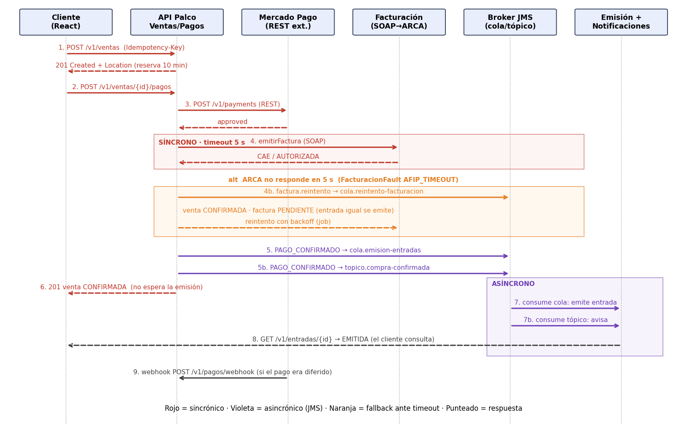

*Fuente: `actividad_integradora_clase10/diagrama_secuencia.png`. Rojo: síncrono; violeta: asincrónico (JMS); naranja: alternativa ante timeout; punteado: respuesta.*

Es el diagrama del taller de la clase 10, anterior a la implementación. Se conserva como antecedente del diseño; lo que hace hoy el sistema está en las secciones 13.3 a 13.8.

Paso a paso:

1. El cliente abre la compra con `POST /v1/ventas` e `Idempotency-Key`; la API responde 201 con `Location` y una reserva de 10 minutos.
2. El cliente paga con `POST /v1/ventas/{id}/pagos`.
3. La API cobra en Mercado Pago (`POST /v1/payments`) y recibe `approved`.
4. Con un tope de 5 s pide la factura a Facturación por SOAP y recibe el CAE. Alternativa: si ARCA no responde en 5 s, la factura pasa a `cola.reintento-facturacion`, la venta queda `CONFIRMADA` con factura `PENDIENTE` y un trabajo la reintenta.
5. Publica `PAGO_CONFIRMADO` en `cola.emision-entradas` y en `topico.compra-confirmada`.
6. Responde 201 con la venta `CONFIRMADA`, sin esperar la emisión.
7. Los consumidores emiten la entrada (cola) y avisan (tópico).
8. El cliente consulta la entrada.
9. Si el pago fuera diferido, Mercado Pago llama al webhook.

**Coincidencia con el código:**

| Paso | ¿Coincide? |
|---|---|
| 1, 2, 5, 6, 7 | Sí. Detalles: Ventas y Pagos son dos servicios (el diagrama los junta en "API Palco"); el pago responde 201 con `Location` al pago; el tópico tiene tres suscriptores (aviso, auditoría y facturación), no uno |
| 3 | No: el cobro va a `ServicioDePagos` por `POST /api/v1/pagos`, y Pagos cobra con `PagosFake`. Mercado Pago es diseño, pendiente |
| 4 | No: la factura se pide fuera de la compra, desde el suscriptor de Facturación al tópico (sección 13.7), sin `cola.reintento-facturacion`, y la venta no cambia su `facturaEstado` |
| 8 | Parcial: `GET /api/v1/entradas/{id}` devuelve la entrada `VALIDA`; `EMITIDA` es el estado de la venta, no de la entrada |
| 9 | No existe la ruta del webhook |

## 13.2 Cobro con Mercado Pago (diseño, pendiente)

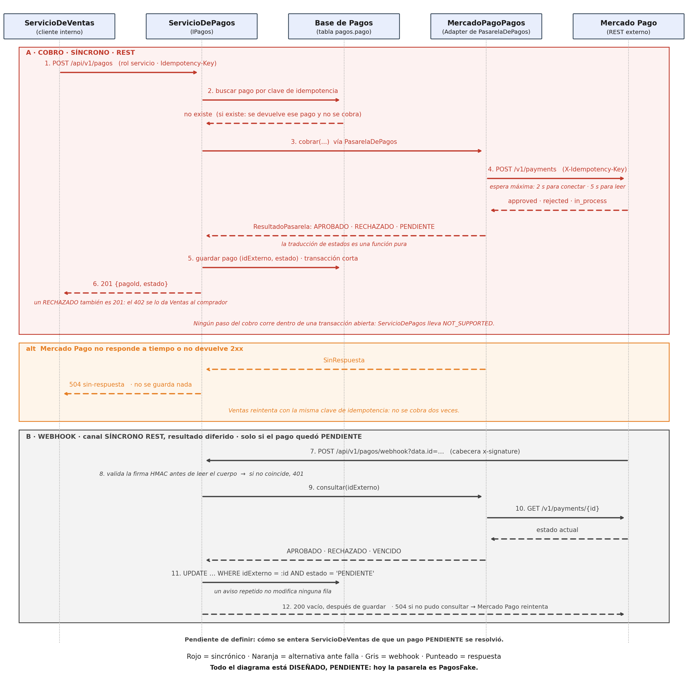

*Fuente: `docs/entrega-obligatoria-2/diagramas/diagrama_secuencia_mercadopago.png` (también en SVG, generado por `diagrama_secuencia_mercadopago.py`). Todo el diagrama es diseño, pendiente.*

Paso a paso:

- **A. Cobro, síncrono por REST.** (1) Ventas llama a `POST /api/v1/pagos` con rol `servicio` e `Idempotency-Key`. (2) Pagos busca un pago con esa clave; si existe, lo devuelve sin cobrar. (3) Cobra a través de `PasarelaDePagos`. (4) El adaptador `MercadoPagoPagos` llama a `POST /v1/payments` con `X-Idempotency-Key` y espera como máximo 2 s para conectar y 5 para leer; recibe `approved`, `rejected` o `in_process`, que traduce a `APROBADO`, `RECHAZADO` o `PENDIENTE`. (5) Guarda el pago en una transacción corta. (6) Responde 201; un rechazo también es 201 y el 402 se lo da Ventas al comprador. Ningún paso corre dentro de una transacción abierta (`NOT_SUPPORTED`).
- **Alternativa.** Si Mercado Pago no responde a tiempo, Pagos responde 504 `sin-respuesta` sin guardar nada y Ventas reintenta con la misma clave.
- **B. Webhook, solo si el pago quedó `PENDIENTE`.** (7) Mercado Pago llama a `POST /api/v1/pagos/webhook` con la cabecera `x-signature`. (8) Pagos valida la firma HMAC antes de leer el cuerpo (401 si no coincide). (9 y 10) Consulta el estado real con `GET /v1/payments/{id}`. (11) Actualiza con un `UPDATE` condicional sobre `estado = 'PENDIENTE'`, así que un aviso repetido no cambia nada. (12) Responde 200, o 504 si no pudo consultar, para que Mercado Pago reintente.

**Coincidencia con el código:** los pasos 1, 2, 5, 6 y la alternativa (504 sin guardar, reintento con la misma clave) coinciden con lo que hace hoy `ServicioDePagos` contra `PagosFake`. Los pasos 4 y 7 a 12 no existen. El diagrama deja explícitamente sin definir cómo se entera Ventas de que un pago `PENDIENTE` se resolvió.

## 13.3 Compra, parte 1: iniciar la compra y reservar el cupo (I1 y S1)

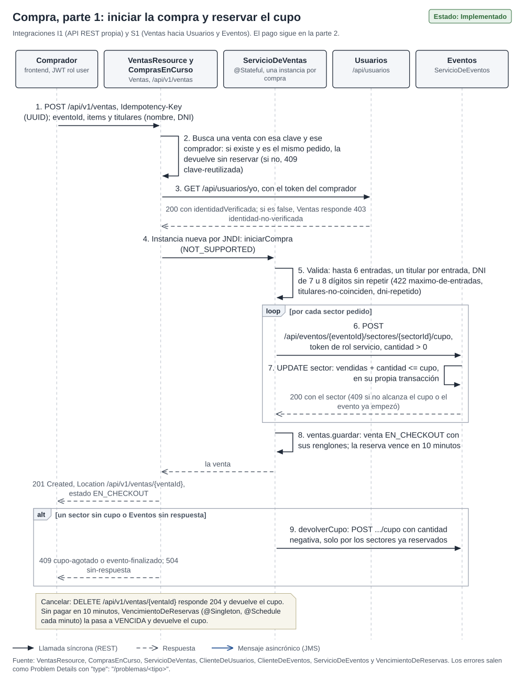

*Fuente: `docs/documentacion/diagramas/secuencia-compra-reserva-rest.svg`. Estado: Implementado. Sale de `VentasResource`, `ComprasEnCurso`, `ServicioDeVentas`, `ClienteDeUsuarios`, `ClienteDeEventos`, `ServicioDeEventos` y `VencimientoDeReservas`.*

Paso a paso:

1. El comprador (rol `user`) manda `POST /api/v1/ventas` con `Idempotency-Key`, el evento, los ítems y un titular (nombre y DNI) por entrada.
2. Ventas busca una venta de ese comprador con esa clave. Si existe y el pedido es el mismo, la devuelve sin reservar nada; si el pedido es otro, responde 409 `clave-reutilizada`.
3. Pide los datos del comprador a Usuarios con `GET /api/usuarios/yo` y su mismo token. Si la identidad no está verificada, responde 403 `identidad-no-verificada`.
4. `ComprasEnCurso` crea por JNDI una instancia nueva de `ServicioDeVentas` (`@Stateful`, una por compra) y llama a `iniciarCompra` (`NOT_SUPPORTED`).
5. Valida: hasta 6 entradas, un titular por entrada, DNI de 7 u 8 dígitos sin repetir (422 `maximo-de-entradas`, `titulares-no-coinciden` o `dni-repetido`).
6. Por cada sector pedido, reserva cupo en Eventos con `POST /api/eventos/{eventoId}/sectores/{sectorId}/cupo` y token de rol `servicio`.
7. Eventos hace un `UPDATE` condicional (`vendidas + cantidad <= cupo`) en su propia transacción y responde 200, o 409 si no alcanza el cupo o el evento ya empezó.
8. Ventas guarda la venta `EN_CHECKOUT` con sus renglones; la reserva vence a los 10 minutos.
9. Responde 201 con `Location` `/api/v1/ventas/{ventaId}`.

**Alternativa: un sector sin cupo o Eventos sin respuesta.** Ventas devuelve el cupo de los sectores que ya había reservado (el mismo `POST .../cupo` con cantidad negativa) y responde 409 `cupo-agotado` o `evento-finalizado`, o 504 `sin-respuesta`. Ante la duda, queda un lugar sin vender y nunca uno vendido dos veces.

**Cancelación y vencimiento** (nota del diagrama): `DELETE /api/v1/ventas/{ventaId}` responde 204 y devuelve el cupo; si la compra no se paga en 10 minutos, `VencimientoDeReservas` (`@Singleton` con `@Schedule` cada minuto) la pasa a `VENCIDA` y devuelve el cupo.

## 13.4 Compra, parte 2: pagar contra Pagos y confirmar (I1 y S1)

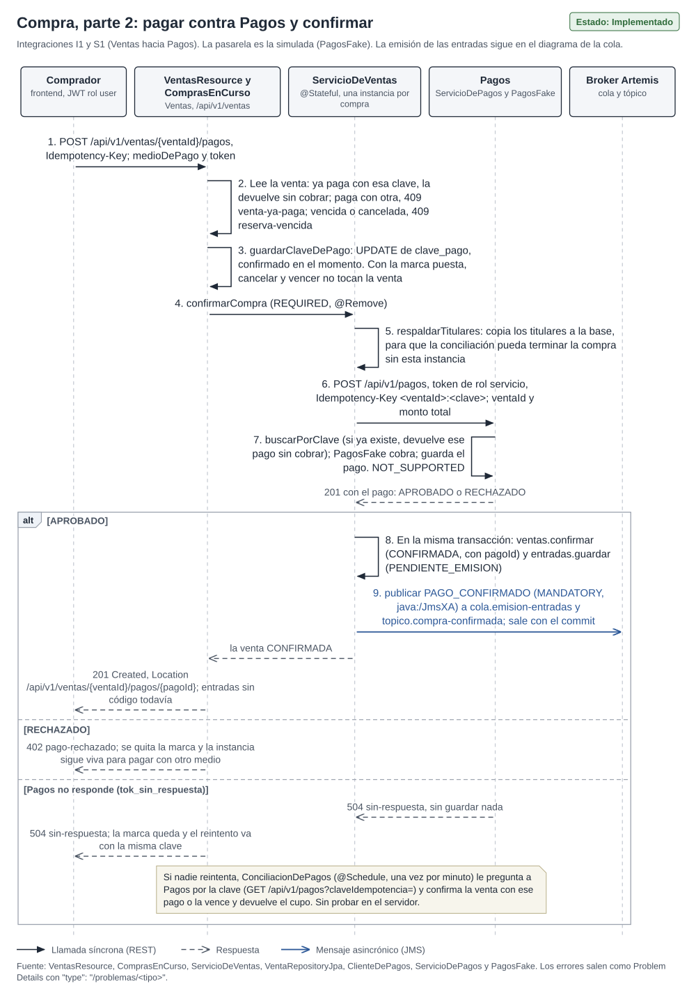

*Fuente: `docs/documentacion/diagramas/secuencia-compra-pago-rest.svg`. Estado: Implementado; la pasarela es la simulada (`PagosFake`). Sale de `VentasResource`, `ComprasEnCurso`, `ServicioDeVentas`, `VentaRepositoryJpa`, `ClienteDePagos`, `ServicioDePagos` y `PagosFake`.*

Paso a paso:

1. El comprador manda `POST /api/v1/ventas/{ventaId}/pagos` con `Idempotency-Key`, el medio de pago y su token.
2. Ventas lee la venta: si ya está paga con esa clave, la devuelve sin cobrar; paga con otra clave, 409 `venta-ya-paga`; vencida o cancelada, 409 `reserva-vencida`.
3. `guardarClaveDePago` guarda la clave del pago en la venta y la confirma en el momento. Con esa marca puesta, cancelar y vencer ya no tocan la venta.
4. Llama a `confirmarCompra` (`REQUIRED`, `@Remove`: al terminar se descarta la instancia stateful).
5. `respaldarTitulares` copia los titulares a la base, para que la compra pueda terminarse aunque esa instancia ya no exista. Es la pieza que necesita la conciliación de pagos (ver la nota del pie).
6. Cobra con `POST /api/v1/pagos`, token de rol `servicio`, la clave `<ventaId>:<clave>`, el id de la venta y el monto total.
7. Pagos busca un pago con esa clave (si existe, lo devuelve sin cobrar); si no, cobra con `PagosFake` y guarda el pago, sin transacción abierta mientras espera (`NOT_SUPPORTED`). Responde 201 con el pago `APROBADO` o `RECHAZADO`.
8. Si se aprobó, en la misma transacción Ventas pasa la venta a `CONFIRMADA` con el id del pago y guarda las entradas en `PENDIENTE_EMISION`.
9. Publica `PAGO_CONFIRMADO` (publicador `MANDATORY`, fábrica `java:/JmsXA`) a `cola.emision-entradas` y a `topico.compra-confirmada`; el mensaje sale con el commit.
10. Responde 201 con `Location` `/api/v1/ventas/{ventaId}/pagos/{pagoId}`; las entradas todavía no tienen código.

**Alternativas.** Pago rechazado: 402 `pago-rechazado`; se quita la marca y la instancia sigue viva para pagar con otro medio. Pagos sin respuesta: 504 `sin-respuesta`, Pagos no guarda nada, la marca queda y el reintento va con la misma clave.

La nota del pie describe la conciliación de pagos (`ConciliacionDePagos`), para el caso en que nadie reintenta, y el paso 5 la prepara. La nota todavía dice "sin probar en el servidor": la conciliación está implementada y se probó el 16/10 con el servidor armado desde cero (escenario 14, sección 7.8). Pendiente: actualizar esa leyenda del diagrama.

## 13.5 Emisión por la cola (I4)

**Parte 1: publicación y consumo.**

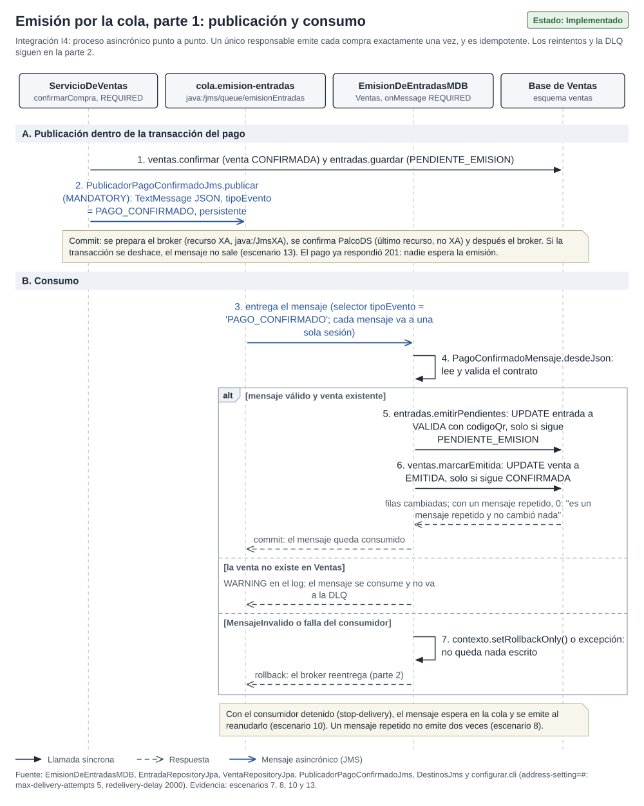

*Fuente: `docs/documentacion/diagramas/secuencia-emision-cola.svg`. Estado: Implementado. Sale de `EmisionDeEntradasMDB`, `EntradaRepositoryJpa`, `VentaRepositoryJpa`, `PublicadorPagoConfirmadoJms`, `DestinosJms` y `configurar.cli`. Evidencia: escenarios 7, 8, 10 y 13.*

Paso a paso:

- **A. Publicación dentro de la transacción del pago.** (1) `confirmarCompra` pasa la venta a `CONFIRMADA` y guarda las entradas en `PENDIENTE_EMISION`. (2) `PublicadorPagoConfirmadoJms.publicar` (`MANDATORY`) arma un `TextMessage` JSON persistente con `tipoEvento` = `PAGO_CONFIRMADO`. Al confirmar, se prepara el broker (recurso XA), se confirma `PalcoDS` (último recurso, no XA) y después el broker. Si la transacción se deshace, el mensaje no sale (escenario 13). El pago ya respondió 201: nadie espera la emisión.
- **B. Consumo.** (3) El broker entrega el mensaje a una sola sesión de `EmisionDeEntradasMDB`, con el selector `tipoEvento = 'PAGO_CONFIRMADO'`. (4) `PagoConfirmadoMensaje.desdeJson` lee y valida el contrato. (5) `emitirPendientes` pasa cada entrada a `VALIDA` con su código QR, solo si sigue `PENDIENTE_EMISION`. (6) `marcarEmitida` pasa la venta a `EMITIDA`, solo si sigue `CONFIRMADA`. Con un mensaje repetido no cambia ninguna fila y se loguea "es un mensaje repetido y no cambió nada". Al confirmar, el mensaje queda consumido.
- **Alternativas.** Si la venta no existe en Ventas, se escribe un `WARNING` y el mensaje se consume sin ir a la DLQ. Si el mensaje es inválido o el consumidor falla, (7) se marca `setRollbackOnly()` o sale una excepción: no queda nada escrito y el broker reentrega (parte 2).

Con el consumidor detenido (`stop-delivery`), el mensaje espera en la cola y se emite al reanudarlo (escenario 10). Un mensaje repetido no emite dos veces (escenario 8).

**Parte 2: reintentos, DLQ y recuperación.**

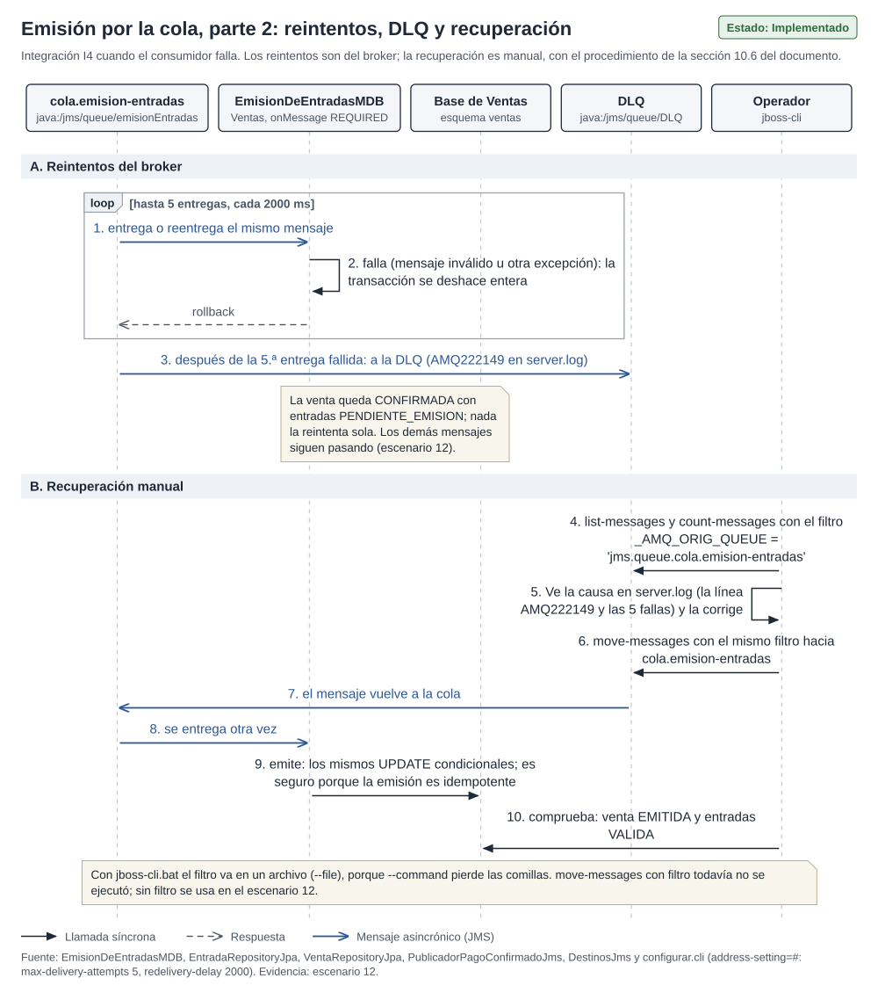

*Fuente: `docs/documentacion/diagramas/secuencia-emision-cola-dlq.svg`. Estado: Implementado. Evidencia: escenario 12.*

Paso a paso:

- **A. Reintentos del broker.** (1) El broker entrega o reentrega el mismo mensaje. (2) El consumidor falla y su transacción se deshace entera. Se repite hasta 5 entregas, cada 2000 ms (`address-setting=#` en `configurar.cli`). (3) Después de la quinta entrega fallida, el mensaje pasa a la DLQ (línea `AMQ222149` en `server.log`). La venta queda `CONFIRMADA` con entradas `PENDIENTE_EMISION` y nada la reintenta sola; los demás mensajes siguen pasando (escenario 12).
- **B. Recuperación manual** (procedimiento de la sección 10.6). (4) El operador busca el mensaje con `list-messages` y `count-messages`, filtrando por `_AMQ_ORIG_QUEUE` = `jms.queue.cola.emision-entradas`. (5) Ve la causa en `server.log` y la corrige. (6) Lo devuelve con `move-messages` y el mismo filtro. (7 y 8) El mensaje vuelve a la cola y se entrega otra vez. (9) Se emite con los mismos `UPDATE` condicionales: es seguro porque la emisión es idempotente. (10) Comprueba que la venta quedó `EMITIDA` y las entradas `VALIDA`.

`move-messages` con filtro todavía no se ejecutó; sin filtro se usa en el escenario 12.

## 13.6 Tópico de compra confirmada: aviso y auditoría (I5)

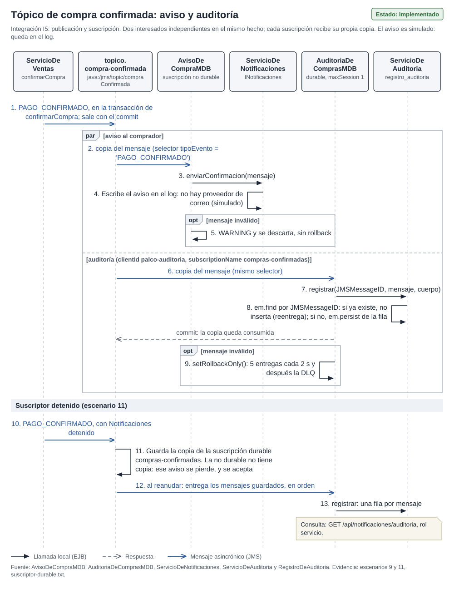

*Fuente: `docs/documentacion/diagramas/secuencia-topico-aviso-auditoria.svg`. Estado: Implementado; el aviso es simulado (queda en el log). Sale de `AvisoDeCompraMDB`, `AuditoriaDeComprasMDB`, `ServicioDeNotificaciones`, `ServicioDeAuditoria` y `RegistroDeAuditoria`. Evidencia: escenarios 9 y 11, `suscriptor-durable.txt`. El tercer suscriptor, Facturación, tiene su propio diagrama (sección 13.7).*

Paso a paso:

1. `confirmarCompra` publica `PAGO_CONFIRMADO` en el tópico, dentro de su transacción; sale con el commit.
2. En paralelo, cada suscripción recibe su propia copia, con el mismo selector:
   - **Aviso** (suscripción no durable). `AvisoDeCompraMDB` llama a `enviarConfirmacion`, que escribe el aviso en el log porque no hay proveedor de correo. Un mensaje inválido se descarta con un `WARNING`, sin rollback.
   - **Auditoría** (durable: `clientId` `palco-auditoria`, `subscriptionName` `compras-confirmadas`). `AuditoriaDeComprasMDB` llama a `registrar` con el `JMSMessageID`; si ya hay una fila con ese id (una reentrega), no inserta; si no, la guarda. Un mensaje inválido marca `setRollbackOnly()`: 5 entregas cada 2 s y después la DLQ.
3. **Suscriptor detenido** (escenario 11). Con Notificaciones detenido, el broker guarda la copia de la suscripción durable; la no durable no tiene copia y ese aviso se pierde, lo que se acepta. Al reanudar, el broker entrega los mensajes guardados en orden y auditoría guarda una fila por mensaje.

La auditoría se consulta con `GET /api/notificaciones/auditoria`, rol `servicio`.

## 13.7 Facturación por SOAP con el ARCA simulado (I3)

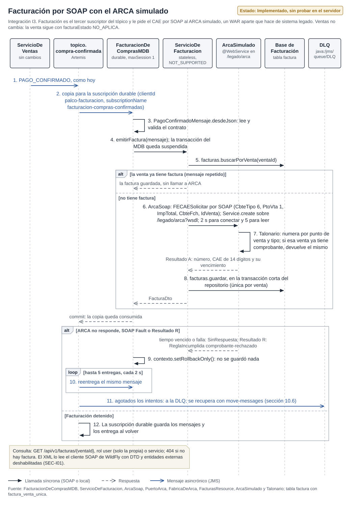

*Fuente: `docs/documentacion/diagramas/secuencia-facturacion-soap.svg`. Estado: Implementado; probado el 16/10 con el servidor armado desde cero (escenario 15). El encabezado del diagrama todavía dice "sin probar en el servidor" y queda por actualizar. Sale de `FacturacionDeComprasMDB`, `ServicioDeFacturacion`, `ArcaSoap`, `PuertoArca`, `FabricaDeArca`, `FacturasResource`, `ArcaSimulado` y `Talonario`, y de la tabla `factura` con `factura_venta_unica`.*

Paso a paso:

1. Ventas publica `PAGO_CONFIRMADO` en `topico.compra-confirmada`, como siempre: no cambió.
2. El broker entrega una copia a la suscripción durable de Facturación (`clientId` `palco-facturacion`, `subscriptionName` `facturacion-compras-confirmadas`, `maxSession` 1).
3. `FacturacionDeComprasMDB` lee y valida el contrato con `PagoConfirmadoMensaje.desdeJson`.
4. Llama a `emitirFactura`; mientras tanto, la transacción del MDB queda suspendida (`ServicioDeFacturacion` es `NOT_SUPPORTED`).
5. `buscarPorVenta`: si la venta ya tiene factura (mensaje repetido), la devuelve sin llamar a ARCA.
6. Si no tiene, `ArcaSoap` llama a `FECAESolicitar` por SOAP (`CbteTipo` 6, `PtoVta` 1, `ImpTotal`, `CbteFch`, `IdVenta`), con el cliente armado por `Service.create` sobre `/legado/arca?wsdl` y 2 s para conectar y 5 para leer.
7. En el ARCA simulado, el `Talonario` numera por punto de venta y tipo (si esa venta ya tenía comprobante, devuelve el mismo) y responde `A` con número, CAE de 14 dígitos y vencimiento.
8. `guardar` escribe la factura en la transacción corta del repositorio (única por venta) y vuelve el `FacturaDto`. Al confirmar, la copia queda consumida.

**Alternativa: ARCA no responde, SOAP Fault o `Resultado` R.** El tiempo vencido o la falla se traducen a `SinRespuesta`, y el rechazo a `ReglaIncumplida` `comprobante-rechazado`. (9) El MDB marca `setRollbackOnly()` sin haber guardado nada. (10) El broker reentrega el mismo mensaje, hasta 5 entregas cada 2 s. (11) Agotados los intentos, el mensaje va a la DLQ y se recupera con `move-messages` (sección 10.6).

**Alternativa: Facturación detenido.** (12) La suscripción durable guarda los mensajes y el broker los entrega cuando Facturación vuelve.

La factura se consulta con `GET /api/v1/facturas/{ventaId}`: rol `user` (solo la propia) o `servicio`; 404 si no hay factura. El XML lo lee el cliente SOAP de WildFly con la DTD y las entidades externas deshabilitadas (SEC-I01, sección 11.6).

## 13.8 Validación de una entrada en la puerta (S3)

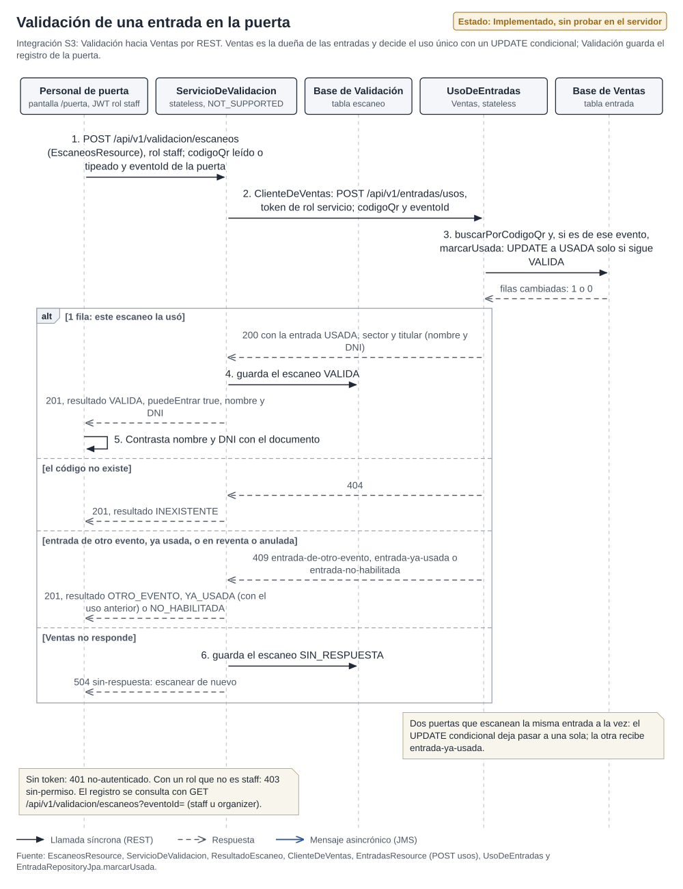

*Fuente: `docs/documentacion/diagramas/secuencia-validacion-puerta.svg`. Estado: Implementado; probado el 16/10 con el servidor armado desde cero (escenario 16 y carpeta 5 de Postman). La pantalla `/puerta` todavía no se probó en el navegador. El encabezado del diagrama todavía dice "sin probar en el servidor" y queda por actualizar. Sale de `EscaneosResource`, `ServicioDeValidacion`, `ResultadoEscaneo`, `ClienteDeVentas`, `EntradasResource` (`POST /entradas/usos`), `UsoDeEntradas` y `EntradaRepositoryJpa.marcarUsada`.*

Paso a paso:

1. El personal de puerta (rol `staff`, pantalla `/puerta`) manda `POST /api/v1/validacion/escaneos` con el código QR, leído o tipeado, y el evento que controla esa puerta. El código va en el cuerpo y no en la ruta, para que no quede en los logs de acceso.
2. `ServicioDeValidacion` (stateless, `NOT_SUPPORTED`) le pide a Ventas, a través de `ClienteDeVentas`, `POST /api/v1/entradas/usos` con token de rol `servicio`, el código y el evento.
3. `UsoDeEntradas` busca la entrada por código y, si es de ese evento, la marca como usada con un `UPDATE` condicional: pasa a `USADA` solo si sigue `VALIDA`. La base devuelve cuántas filas cambiaron, 1 o 0.
4. Con 1 fila, Ventas responde 200 con la entrada `USADA`, su sector y el titular (nombre y DNI). Validación guarda el escaneo `VALIDA`.
5. La puerta recibe 201 con `resultado` `VALIDA`, `puedeEntrar` `true`, nombre y DNI, y los contrasta con el documento de la persona.

**Alternativas.**

- **El código no existe:** Ventas responde 404 y la puerta recibe 201 con `INEXISTENTE`.
- **Entrada de otro evento, ya usada, o en reventa o anulada:** Ventas responde 409 `entrada-de-otro-evento`, `entrada-ya-usada` o `entrada-no-habilitada`, y la puerta recibe 201 con `OTRO_EVENTO`, `YA_USADA` (con el escaneo anterior que la usó, en `usoAnterior`) o `NO_HABILITADA`. Una entrada de otro evento no se marca: tiene que seguir sirviendo en el suyo. Un 409 con un tipo desconocido cuenta como `NO_HABILITADA`: ante la duda, no se deja entrar.
- **Ventas no responde:** (6) se guarda el escaneo `SIN_RESPUESTA` y la puerta recibe 504 `sin-respuesta` para escanear de nuevo. Si el primer intento sí llegó a usar la entrada, el escaneo siguiente da `YA_USADA` con `usoAnterior` apuntando a ese intento, y el mensaje le avisa al personal que puede ser el mismo titular.

**Por qué 201 con cualquier resultado.** Lo que se crea es el renglón del registro de la puerta; "no puede entrar" es un dato y no un error HTTP. Es el mismo criterio que Pagos con un cobro `RECHAZADO`.

**Dos puertas a la vez.** Si dos puertas escanean la misma entrada al mismo tiempo, el `UPDATE` condicional deja pasar a una sola y la otra recibe `entrada-ya-usada`. Lo prueba `UsoEnH2Test` con dos conexiones contra H2 en modo PostgreSQL.

Sin token, 401 `no-autenticado`; con un rol que no es `staff`, 403 `sin-permiso`. El registro se consulta con `GET /api/v1/validacion/escaneos?eventoId=` (roles `staff` u `organizer`), del más nuevo al más viejo y con el código recortado a sus últimos 6 caracteres (`codigoParcial`). Límites declarados: el código QR es el UUID al azar que genera Ventas, opaco pero sin firma; y cualquier `organizer` o `staff` ve el registro de cualquier evento, porque no se comprueba que sea dueño del evento o esté asignado a esa puerta.

## 13.9 Casos de uso


*Fuente: `docs/documentacion/diagramas/casos-de-uso.svg`. Óvalo blanco: implementado; celeste: implementado, sin probar en vivo; punteado: diseñado, pendiente. Los colores muestran el estado del código antes de la corrida del 16/10: los casos en celeste se probaron ese día contra el servidor armado desde cero (escenarios 14 a 17), salvo las pantallas de puerta, reventa y panel del organizador, que todavía no se probaron en el navegador. Pendiente: actualizar los colores del diagrama.*

La cátedra respondió el 16/10 que la documentación es técnica e incluye diagramas de casos de uso y casos de uso. El diagrama muestra los actores Comprador, Organizador y Personal de puerta, y los sistemas externos ARCA (simulado, por SOAP) y la pasarela de pago (`PagosFake`), con los diez casos CU-01 a CU-10. La descripción de cada uno (actor, precondición, flujo principal, flujos alternativos con los códigos y tipos de error reales, postcondición y estado) está en `docs/documentacion/casos-de-uso.md`. La consigna no pide Figma ni manual de usuario.

## 13.10 Otros diagramas y los que faltan

Los talleres de las clases 6, 8 y 9 (`docs/clases/`) tienen diagramas propios en PNG, que no son de secuencia o son anteriores a la implementación. El de la integración SOA está en la sección 8.1, con los tramos de Facturación, Validación y Reventa a actualizar.

Hay un diagrama de secuencia por cada integración implementada salvo la reventa (I1, S1, I3, I4, I5 y la validación de S3) y uno de diseño para I2. Faltan dos:

| Integración | Diagrama que falta | Debe mostrar |
|---|---|---|
| S2 | Autenticación | Login, JWT, JWKS y token de rol `servicio` entre servicios. La cancelación y el vencimiento de S1 hoy son una nota del diagrama de la sección 13.3 |
| S3 | Reventa | Publicar (Reventa → Ventas, entrada `PUBLICADA`), comprar (tomar la publicación, cobrar en Pagos con `<idPublicación>:<clave>`, transferir en Ventas) y retirar, con las alternativas de la sección 7.10. Reventa está implementada y probada (escenario 17); el texto de 7.10 hace de guía hasta tener el diagrama |

# 14. Seguridad

La seguridad se resuelve en tres lugares: el servicio de Usuarios (cuentas, contraseñas y emisión de tokens), la
librería compartida `backend/common` (verificación de tokens, CORS, formato de errores, protección del log) y la
configuración de WildFly (`backend/servidor/src/main/wildfly/configurar.cli`). Esta sección describe el código tal
como está hoy y marca lo débil. Los cambios de seguridad del 16/10 (límite de intentos de login, id de error en el
500, PBKDF2 a 600.000 iteraciones, 401 por token inválido en Problem Details y con CORS, y secreto de servicios
propio en desarrollo) están en el repo desde el 16/10 (commits df9f9ed a 0cbb2e9) y se verificaron ese día. Las
operaciones de Reventa, de la validación en puerta, de la consulta de facturas y las internas que esas funciones
agregaron en Ventas y en Pagos tienen sus roles y su control de dueño en 14.3, y el cliente SOAP de Facturación cubre
SEC-I01 (14.9). Estado de todo eso: **Implementado**. Pasan los tests (577, 0 fallas) y, en vivo, el 16/10 a las
11:04 con el servidor armado desde cero, los escenarios 14 a 17 y las carpetas 5 a 7 de Postman (sección 16.6).

## 14.1 Autenticación: registro, verificación del email y login

| Paso | Operación | Qué hace | Estado |
|---|---|---|---|
| Registro | `POST /api/usuarios/registro` (`@PermitAll`) | Crea la cuenta con la contraseña hasheada y genera un código de verificación. Edad mínima: 16 años (`EDAD_MINIMA`). | Implementado |
| Envío del código | — | El código se escribe en el log del servidor (`ServicioDeUsuarios.enviarCodigoNuevo`). No se manda ningún email. | Simulado |
| Verificación | `POST /api/usuarios/verificacion` (`@PermitAll`) | Compara el hash SHA-256 del código en tiempo constante. Vence a los 15 minutos (`VIGENCIA_CODIGO`) y admite 5 intentos (`MAX_INTENTOS_CODIGO`); después hay que pedir otro. Al verificar, la cuenta queda con el email y la identidad verificados, así que ya puede comprar. | Implementado |
| Reenvío | `POST /api/usuarios/verificacion/reenvio` (`@PermitAll`) | Renueva el código, con 30 segundos de espera mínima entre envíos (`ESPERA_REENVIO`). | Implementado |
| Login | `POST /api/usuarios/login` (`@PermitAll`) | Devuelve un JWT. Si el email no existe, igual calcula un hash contra `HASH_FALSO` para que el tiempo de respuesta no delate qué emails están registrados, y el mensaje de error es siempre el mismo ("Revisá el email y la contraseña."). | Implementado |
| Perfil | `GET /api/usuarios/yo` (`user`, `organizer`, `staff`) | Datos de la cuenta del token. El frontend lo usa para confirmar la sesión. | Implementado |
| Límite de intentos de login | `POST /api/usuarios/login` | Con 5 fallidos en 15 minutos para un mismo email (`MAX_INTENTOS_LOGIN`, `VENTANA_INTENTOS_LOGIN`), el pedido siguiente responde 429 Problem Details (`/problemas/demasiados-intentos`) con `Retry-After` en segundos, aunque la contraseña sea la correcta y también para un email que no existe. Un login correcto borra los fallidos de ese email. | Implementado y probado (tests y en vivo) |

**Límite de intentos de login (SEC-W04).** El control va antes de verificar la contraseña: si la correcta entrara
durante el bloqueo, el sexto intento acertado le abriría la cuenta a quien está probando. Se cuenta por email,
exista o no la cuenta, con el mismo texto en el 401 y en el 429, y el 429 no hace el cálculo PBKDF2, así que no
delata qué emails están registrados. La ventana es deslizante: el bloqueo se levanta cuando el más viejo de los 5
fallidos sale de los 15 minutos, y eso es lo que informa `Retry-After` (redondeado hacia arriba, nunca menos de 1);
los intentos bloqueados no se anotan, para que el bloqueo no se estire con cada reintento. Los fallidos se guardan
en la base, en la tabla `intento_login` (migración `V4__intentos_de_login.sql` de Usuarios), a través del
repositorio `datos/IntentoLoginRepository` (implementado por `IntentoLoginRepositoryJpa`, un Session Bean
stateless que se suma a la transacción del login), y no en memoria: así el límite vale igual con varias instancias y no se reinicia
con un redespliegue. La tabla guarda el SHA-256 del email normalizado y no el email, porque también anota emails sin
cuenta. Como los errores de negocio deshacen la transacción, el 401 del login es `CredencialesIncorrectas`, con
`@ApplicationException(rollback = false)`, para que el intento fallido quede guardado. Las constantes están en
`ServicioDeUsuarios` y no en `ReglasDeNegocio` porque son de seguridad de Usuarios, como `MAX_INTENTOS_CODIGO`, y no
reglas del negocio de venta de entradas. Lo prueban `LimiteDeIntentosDeLoginTest` (con un reloj inyectable),
`MigracionesEnH2Test`, `RepositoriosEnH2Test`, `ErroresDeNegocioTest` y el request SEC-W04 de Postman; en vivo, el 16/10, seis logins
fallidos de un mismo email dieron cinco 401 y un 429 con `Retry-After: 898`. Lo débil: el bloqueo es por email, así
que alguien que conoce el email de otra persona puede bloquearle el login 15 minutos. Se acepta para esta etapa;
contar también por IP lo atenuaría.

**Contraseñas.** `usuarios/seguridad/Contrasenas.java` usa PBKDF2-HMAC-SHA256, incluido en Java (sin
dependencias), con sal aleatoria de 16 bytes, 600.000 iteraciones (lo que recomienda hoy OWASP para PBKDF2-SHA256;
antes eran 310.000) y hash de 256 bits. Se guarda como `pbkdf2-sha256$<iteraciones>$<sal>$<hash>` y la verificación
compara en tiempo constante (`MessageDigest.isEqual`). Se eligió PBKDF2 porque viene en la JVM; bcrypt o Argon2
pedían una librería más. Como el formato guarda las iteraciones de cada hash, los hashes viejos de 310.000 siguen
verificando y subirlas no obligó a migrar datos. El hash falso del login (`HASH_FALSO`) se arma con
`Contrasenas.hashear`, así que cuesta lo mismo que uno nuevo; la migración
`V5__cuentas_de_prueba_con_600000_iteraciones.sql` rehashea las cuentas de prueba a 600.000, con la misma
contraseña, para que no verifiquen en la mitad de tiempo que el hash falso y esa diferencia no deje ver qué emails
existen. Lo débil: una cuenta registrada antes del cambio conserva su hash de 310.000 hasta que cambie la
contraseña; rehashear al iniciar sesión cerraría esa diferencia y queda propuesto. La contraseña nunca vuelve en una
respuesta: los DTO de `usuarios/api/Dtos.java` no la incluyen.

## 14.2 Tokens JWT

| Aspecto | Cómo está | Archivo |
|---|---|---|
| Algoritmo | RS256 (`SHA256withRSA`), con `kid` en la cabecera | `usuarios/seguridad/Tokens.java` |
| Claves | Par RSA de 2048 bits. Si existe `PALCO_JWT_CLAVE_PRIVADA` (PKCS#8 en base64) se usa esa; si no, se genera una al desplegar y los tokens anteriores dejan de valer. | `usuarios/seguridad/ClavesJwt.java` |
| Publicación | Clave pública como JWKS en `GET /api/usuarios/jwks` (`@PermitAll`) | `usuarios/api/UsuariosResource.java` |
| Verificación | Cada servicio usa MicroProfile JWT: descarga el JWKS de Usuarios y exige el emisor `palco`. Los roles salen del claim `groups`. | `common/src/main/resources/META-INF/microprofile-config.properties` |
| Duración del token de usuario | 8 horas (`DURACION_SESION`). Sin refresh token ni revocación al cerrar sesión. Vigencia decidida y justificada el 16/10 (ver abajo). | `usuarios/negocio/ServicioDeUsuarios.java` |
| Identidad en el código | `Sesion.usuarioId` toma el `sub` del token; ningún recurso recibe el id del usuario por parámetro. | `common/seguridad/Sesion.java` |

**Por qué RS256 y no HS256.** Con clave asimétrica solo Usuarios puede firmar; los otros siete servicios verifican
con la clave pública y no guardan ningún secreto. Con HS256 cada servicio tendría la clave con la que se fabrican
tokens.

**Token de servicio entre servicios.** Cuando un servicio llama a otro (por ejemplo, Ventas a Pagos) usa el esquema
de credenciales de cliente: presenta un secreto compartido en `POST /api/usuarios/servicios/token` y Usuarios le
firma un token con el rol `servicio` que dura 5 minutos (`DURACION_TOKEN_DE_SERVICIO`).
`common/seguridad/TokenDeServicio.java` lo guarda, lo renueva cuando le quedan menos de 30 segundos y, si el
servicio llamado responde 401 (pasa cuando se redespliega Usuarios y cambia la clave), lo invalida y reintenta una
sola vez. Es un bean `@ApplicationScoped` y no un Session Bean: hay un único token por servicio, compartido por
todos los pedidos (no es la conversación de un usuario, y un stateless no podría recordarlo), y sus métodos son
`synchronized`. Las operaciones internas llevan `@RolesAllowed("servicio")`: trece en el código (una en Eventos, tres
en Pagos, cinco en Ventas y cuatro en Notificaciones), más la consulta de facturas, que admite `user` o `servicio`
(14.3). Un usuario común no puede usarlas aunque conozca la ruta. Usan este token Ventas (para Eventos y Pagos),
Validación (su `ClienteDeVentas`, para usar una entrada) y Reventa (su `ClienteRest`, para Ventas y Pagos); los dos
clientes nuevos repiten el mismo criterio: ante un 401, piden un token nuevo y reintentan una sola vez.

**Vigencia de la sesión: 8 horas, sin refresh token (decidido el 16/10).** Se evaluó bajar el token a 15-30
minutos con un refresh token revocable, y el grupo decidió mantener las 8 horas y justificarlas. Una sesión de compra
o de un organizador dura una jornada. El token se firma con RS256 y cada servicio lo valida con la clave pública, sin
guardar ningún secreto; si no se define `PALCO_JWT_CLAVE_PRIVADA`, la clave se regenera al redesplegar Usuarios y
todos los tokens anteriores dejan de valer. El token entre servicios, que es el que habilita las operaciones
internas, dura 5 minutos. Lo débil queda: un token robado sirve hasta que vence, porque no hay revocación; ese riesgo
se acepta para el alcance del trabajo práctico. El criterio SEC-W05 pasa a "parcial, vigencia justificada" (14.9) y
el request SEC-W05c de Postman pasa a comprobar que el token dura 8 horas.

**Secreto de servicios: requisito de despliegue (decidido el 16/10).** Si falta `PALCO_SECRETO_SERVICIOS`, el
secreto vale `palco-desarrollo`, que está escrito en el repo: quien leyó el código podría pedir un token de servicio
a un servidor que arrancó así. El servicio lo avisa en el log al arrancar, pero no se niega a arrancar. Se evaluó que
un servidor fuera de desarrollo no arranque sin secreto (una variable `PALCO_ENTORNO` y una comprobación al desplegar
Usuarios) y no se implementa: tocaba `backend/common` para algo que se resuelve en el despliegue. Fuera de
desarrollo es un requisito de despliegue definir `PALCO_SECRETO_SERVICIOS` con el mismo valor en todos los servicios.
En desarrollo el servidor arranca con un secreto propio definido en `backend/.env` (que `dev.sh` carga y que no se
versiona); los guiones de demo, de escenarios y de evidencia lo toman de la variable o de `backend/.env`, y la
colección de Postman, de la variable `secretoServicios`. En la corrida del 16/10 el log no mostró el aviso del
secreto de desarrollo.

## 14.3 Autorización declarativa por rol

Cada operación de cada recurso lleva `@RolesAllowed` o `@PermitAll`, y `configurar.cli` activa
`resteasy-role-based-security` para que esas anotaciones se apliquen. Roles: `user` (comprador), `organizer`,
`staff` (puerta) y `servicio` (llamadas entre servicios).

| Operaciones | Rol |
|---|---|
| Registro, verificación, reenvío, login, JWKS, pedido del token de servicio, catálogo y detalle de eventos, publicaciones activas de un evento (`GET /api/v1/reventas?eventoId=`) | `@PermitAll` |
| Compra, pago, cancelación, `GET /api/v1/ventas`, `GET /api/v1/entradas/{id}` | `user` |
| Reventa: mis publicaciones (`GET /api/v1/reventas/mias`), publicar (`POST /api/v1/reventas`), retirar (`DELETE /api/v1/reventas/{id}`) y comprar (`POST /api/v1/reventas/{id}/compra`) | `user` |
| Factura de una compra (`GET /api/v1/facturas/{ventaId}`) | `user` o `servicio` |
| Alta de eventos (`POST /api/eventos`) | `organizer` |
| Escanear una entrada en la puerta (`POST /api/v1/validacion/escaneos`) | `staff` |
| Registro de la puerta (`GET /api/v1/validacion/escaneos?eventoId=` y `GET /api/v1/validacion/escaneos/{id}`) | `staff` u `organizer` |
| Operaciones internas: cupo de un sector en Eventos; cobrar, consultar un pago por id y consultar un pago por clave en Pagos (`GET /api/v1/pagos?claveIdempotencia=`); usar una entrada en Ventas (`POST /api/v1/entradas/usos`); consultar, publicar, retirar y transferir una entrada en Ventas (`/api/v1/operaciones-de-reventa/...`); endpoints de prueba y auditoría de Notificaciones | `servicio` |
| `GET /api/usuarios/yo` | `user`, `organizer`, `staff` |
| `health` de cada servicio | Sin anotación (abierto) |

Por qué cada rol nuevo:

- **`staff` en la puerta.** Escanear usa la entrada (la pasa a `USADA`), así que solo lo hace el personal de puerta.
  Quién escanea sale del `sub` del token y queda en cada renglón del registro. El organizador puede leer el registro
  de su puerta, pero no escanear.
- **`user` en la reventa.** El vendedor y el comprador salen siempre del token (`Sesion.usuarioId`); ningún pedido
  trae el id de una persona. El listado de un evento es público, como el catálogo, y no dice quién publicó.
- **`servicio` en lo interno.** Las operaciones de `/api/v1/operaciones-de-reventa` y `POST /api/v1/entradas/usos`
  cambian el estado de una entrada sin pasar por las reglas de Reventa o de Validación, así que solo las llama otro
  servicio. Reciben el id del vendedor o del comprador en el pedido porque el token de servicio no representa a
  ninguna persona; quien lo puso ahí es Reventa, que lo sacó del token del usuario. La consulta de Pagos por clave
  la usa la conciliación de Ventas para saber cómo terminó un cobro sin resultado: solo lee, pero devuelve un pago, y
  por eso tampoco la puede usar un usuario.
- **`user` o `servicio` en facturas.** El comprador consulta la factura de su compra; otro servicio, cualquiera.

Además de quién puede usar cada operación, se controla de quién es el dato. Una venta, una entrada, una publicación o
una factura de otra persona responde 404, igual que si no existiera, así no se puede averiguar qué ids existen
(BOLA):

| Dato | Control | Dónde | Test |
|---|---|---|---|
| Ventas y entradas | Filtro por el `compradorId` del token | `ComprasEnCurso` | `ComprasEnCursoTest.unaVentaAjenaRespondeLoMismoQueUnaQueNoExiste` |
| Entrada que se publica, se retira o se transfiere | El UPDATE condicional exige que la entrada sea de una venta del vendedor (subconsulta sobre `venta.compradorId`); ajena, 404 | `ReventaDeEntradasRepositoryJpa`, en Ventas | `ReventaDeEntradasEnH2Test.publicarYRetirarCambianElEstadoYUnaAjenaEsNoEncontrada` |
| Publicación que se retira | Tiene que ser del vendedor del token; ajena, 404 | `ServicioDeReventa.propia` | `ServicioDeReventaTest.retirarUnaAjenaEsNoEncontradaYUnaPropiaLaDevuelveAValida` |
| Publicación propia que se quiere comprar | 409 `compra-propia` | `ServicioDeReventa.comprar` | `ServicioDeReventaTest.nadieCompraSuPropiaPublicacion` |
| Factura | Con rol `user`, el `sub` tiene que ser el comprador guardado del mensaje `PAGO_CONFIRMADO`; ajena, inexistente o todavía sin facturar dan el mismo 404 | `FacturasResource` y `ServicioDeFacturacion` | `FacturasResourceTest` |

Lo débil: el registro de la puerta no controla dueño. Cualquier cuenta `organizer` ve el registro de cualquier
evento, y cualquier `staff` escanea en la puerta de cualquier evento, porque no se comprueba que el organizador sea
el dueño del evento ni hay asignación de personal a eventos. Para cerrarlo habría que preguntarle a Eventos quién es
el dueño y modelar esa asignación.

Riesgo de este enfoque: un método nuevo sin anotación queda abierto, y no hay un test que recorra los recursos y
falle si falta una. El `health` (`common/rest/HealthResource`) es justamente un método sin anotación: queda abierto,
que es lo que necesita un control de salud, pero lo es por omisión y no por un `@PermitAll`. Cada recurso nuevo
tiene su test de anotaciones (por ejemplo, `EscaneosResourceTest.escanearEsSoloParaElPersonalDePuerta` y
`FacturasResourceTest.laConsultaEsParaCompradoresYServiciosYEsLaUnicaOperacion`), pero eso no cubre un recurso que
se agregue sin test. El ARCA simulado (`/legado/arca`) no tiene autenticación: es un WAR aparte que no depende de
`backend/common` (14.9, SEC-I01).

**Endpoints de prueba de Notificaciones (decidido el 16/10).** `POST /api/notificaciones/pruebas/pago-confirmado`,
`.../pruebas/pago-confirmado-con-falla` y `.../pruebas/mensaje-invalido` publican mensajes sin hacer una compra. Se
mantienen porque los usan la demo, la evidencia y la colección de Postman. Son solo de desarrollo y piden rol
`servicio`, así que un usuario u organizador no puede publicar pagos falsos. Para producción habría que
deshabilitarlos.

## 14.4 CORS

`common/rest/CorsFilter.java` agrega las cabeceras CORS solo si el `Origin` del pedido está en
`PALCO_CORS_ORIGENES` (separados por coma; por defecto `http://localhost:5173`, el servidor de Vite). Permite las
cabeceras `Authorization`, `Idempotency-Key` e `If-None-Match`, y expone `Location` y `ETag`. No se usa el comodín
`*`: con credenciales el navegador no lo acepta y, además, abriría la API a cualquier sitio.

**El 401 por token inválido.** Cuando el token no se puede verificar (firma alterada, mal formado), lo rechaza el
mecanismo MP-JWT del servidor antes de llegar a la aplicación, así que ni `CorsFilter` ni `ManejadoresDeErrores`
intervienen. Hasta el 16/10 ese 401 salía en `text/html`, sin CORS y sin `WWW-Authenticate`, y el navegador lo
informaba como un error de red (se había observado el 14/10). Ahora `backend/common` trae un
`META-INF/web-fragment.xml` que registra una página de error para el 401, `ErrorDeAutenticacionServlet`: responde
`application/problem+json` con `type` `/problemas/token-invalido`, `WWW-Authenticate: Bearer error="invalid_token"`
(RFC 6750) y las cabeceras CORS, que arma el mismo `CorsFilter.cabecerasPara`, así hay una sola lista de orígenes.
Como viene en el jar compartido, vale para los 8 servicios sin tocar sus WAR. El 401 sin token y el 403 por rol ya
salían bien, porque los arma la aplicación. Estado: implementado y probado. Lo prueban
`ErrorDeAutenticacionServletTest` y `CorsFilterTest` y, en vivo el 16/10, `GET /api/v1/ventas` con un token
inválido y `Origin: http://localhost:5173` respondió 401, `application/problem+json`, `type`
`/problemas/token-invalido`, `WWW-Authenticate: Bearer error="invalid_token"` y
`Access-Control-Allow-Origin: http://localhost:5173`. Qué cambia para el frontend, en 15.4, punto 7.

## 14.5 Formato de errores

Todos los errores de la aplicación salen como Problem Details (RFC 9457, `application/problem+json`) desde
`common/rest/ManejadoresDeErrores.java`, que traduce cada excepción de `ErroresDeNegocio` a su código HTTP y a su
`type`. El 401 agrega `WWW-Authenticate: Bearer`, y un 403 sin usuario autenticado se convierte en 401. El 429 del
límite de intentos de login agrega `Retry-After` (14.1). El 401 por token inválido, que emite el servidor antes de
llegar a la aplicación, sale con el mismo formato desde `ErrorDeAutenticacionServlet` (14.4). Cualquier otra
excepción termina en un 500 genérico ("Ocurrió un error inesperado."): el detalle va solo al log, así que ninguna
respuesta lleva un stack trace. La validación corre antes que la lógica: por ejemplo, `VentasResource` rechaza una
clave de idempotencia inválida con 400 antes de reservar cupo.

**Id de error en el 500.** `ManejadoresDeErrores.Inesperado` genera un id nuevo por cada error inesperado (un UUID
al azar, que no dice nada del error), lo escribe en el log en el mismo renglón que la traza
(`Error no manejado (idError <id>)`) y lo devuelve como miembro de extensión `idError` del Problem. Quien reporta el
error pasa el id y la traza se encuentra en el log sin mandarle al cliente ningún detalle interno. Los demás errores
no cambian: `idError` solo se escribe cuando tiene valor. Estado: implementado y probado. Lo prueba
`ErrorInesperadoTest` (el id es un UUID, coincide con el del log, el log lleva la traza, dos errores tienen ids
distintos y un 409 no trae `idError`) y, en vivo el 16/10, el escenario 14 (sección 16.2): una falla provocada después
del cobro respondió 500 con `idError` y sin ningún detalle interno.

## 14.6 Protección del log

- **Renglones falsos.** `common/Textos.enUnaLinea` cambia los caracteres de control y los separadores de línea de
  Unicode por espacios. Se usa en cada línea de log que incluye un dato que vino de afuera (un nombre, un email, un
  id), para que nadie pueda hacer aparecer un renglón inventado en el log, que se usa como evidencia. Ventas, además,
  rechaza nombres e ids que traigan esos caracteres.
- **Datos personales.** Los logs no escriben el DNI (criterio SEC-D01, por la Ley 25.326 de protección de datos
  personales).
- **Código QR en la puerta.** El código viaja en el cuerpo de `POST /api/v1/validacion/escaneos` y no en la ruta,
  para que no quede en los logs de acceso, y Validación no lo escribe en sus logs. El registro de escaneos guarda el
  código completo pero lo devuelve recortado a sus últimos 6 caracteres (`codigoParcial`), porque un código de otro
  evento escaneado por error sigue sirviendo en el suyo. El registro no guarda nombre ni DNI: se llega a la entrada
  por `entradaId`. La respuesta del escaneo válido sí trae el nombre y el DNI del titular, porque el personal tiene
  que contrastarlos con el documento.
- **Excepción a propósito.** El código de verificación del email se escribe en el log porque es la forma simulada de
  mandarlo. Antes de producción hay que reemplazarlo por un envío real.

## 14.7 Secretos y variables de entorno

Ningún secreto de producción está en el código: todo sale de variables de entorno, y `.env` está en `.gitignore`.

| Variable | Para qué | Si falta |
|---|---|---|
| `PALCO_JWT_CLAVE_PRIVADA` | Clave con que Usuarios firma los tokens | Se genera una al desplegar: tras cada reinicio hay que volver a iniciar sesión |
| `PALCO_SECRETO_SERVICIOS` | Secreto para pedir el token de servicio. En desarrollo se define en `backend/.env`, que `dev.sh` carga | Vale `palco-desarrollo`, que es público (con aviso en el log; el servidor arranca igual). Fuera de desarrollo, definirla con el mismo valor en todos los servicios es requisito de despliegue (14.2) |
| `PALCO_URL_INTERNA` | Dirección de los otros servicios y del JWKS | `http://localhost:8080` |
| `PALCO_CORS_ORIGENES` | Orígenes que pueden llamar a la API | `http://localhost:5173` |
| `PALCO_DB_DRIVER`, `PALCO_DB_URL`, `PALCO_DB_USUARIO`, `PALCO_DB_PASSWORD` | Base de datos (Supabase) | H2 en memoria con `sa`/`sa` |

## 14.8 Broker de mensajería

`configurar.cli` crea la cola `cola.emision-entradas` y el tópico `topico.compra-confirmada`, con 5 entregas como
máximo, 2 segundos entre reintentos y cola de mensajes fallidos (DLQ). No define usuarios ni permisos por destino:
el broker queda con la configuración de fábrica de WildFly y cualquier componente desplegado puede publicar o
consumir en cualquier destino. No cumple mínimo privilegio.

**Riesgo aceptado (decidido el 16/10).** Se evaluó un usuario por servicio con permisos por destino y el grupo decidió
registrar el riesgo como aceptado. El broker está embebido en el mismo WildFly, los servicios se conectan por in-vm
y la interfaz pública del servidor queda en 127.0.0.1 por defecto: ningún sistema externo se conecta al broker. Se
revisa si el sistema se despliega fuera de una sola máquina. No hay nada aplicado en `configurar.cli`.

## 14.9 Matriz de criterios de seguridad (taller de la clase 11)

En la clase 11 el grupo armó una matriz de diez criterios (`actividad_integradora_clase11/`), cada uno con
Dado/Cuando/Entonces, referencia OWASP y veredicto por revisión de código y tests (`mvn test` del 16/10, antes de
los cambios de esta sección: 313 tests, 0 fallas). Como no hay app móvil, los dos criterios mobile se reemplazaron
por dos de datos sensibles. La
columna "Estado actual" sale de dos verificaciones del 16/10. La primera, de 09:17 a 09:23, con el servidor armado
desde cero con los cambios de seguridad: 333 tests, los 13 escenarios de entonces y Newman con 74 requests, 252
aserciones y 1 falla (SEC-W05c, que todavía exigía un token de 15 minutos o menos; después de la decisión sobre la
vigencia de la sesión, ese request comprueba que el token dura 8 horas). La última, desde las 11:04, con el servidor
armado desde cero con Facturación, Validación, Reventa y la conciliación de pagos (detalle en 16.6):

- `mvn clean install`: BUILD SUCCESS, 577 tests y 0 fallas; 9 de 9 WAR desplegados (los 8 servicios y el ARCA
  simulado), los 8 `health` en 200, el WSDL de `/legado/arca?wsdl` en 200 y 0 líneas `ERROR` en el log.
- Los 17 escenarios de `scripts/pruebas/escenarios.mjs`: 17 de 17.
- Newman con la colección completa: 126 requests ejecutados, 406 aserciones, 0 fallas.

Los requests de cada criterio forman parte de la colección generada en `docs/api/`: carpeta
"4 Seguridad (clase 11)", con 15 requests, todos dentro de la corrida.

| ID | Criterio | Referencia | Veredicto (clase 11) | Estado actual (16/10) |
|---|---|---|---|---|
| SEC-W01 | Una entrada ajena no se puede consultar | OWASP API1:2023 (BOLA) | Cumple, test en verde | Cumple, prueba en verde: filtro por `compradorId` y 404; tests `ComprasEnCursoTest.unaVentaAjenaRespondeLoMismoQueUnaQueNoExiste` y `laEntradaSoloLaVeQuienLaCompro`, y requests SEC-W01 y SEC-W01b |
| SEC-W02 | El rol decide quién usa cada operación | OWASP API5:2023 (BFLA) | Cumple en código | Cumple, prueba en verde: requests SEC-W02 (crear evento con rol `user`: 403) y SEC-W02b (sin token: 401 con `WWW-Authenticate`) |
| SEC-W03 | El login no revela si el email existe | A07:2025 | Cumple en código | Cumple en código; prueba parcial: SEC-W03a y SEC-W03b en verde (mismo `detail` con un email inexistente y con la clave mal). Las cuentas de prueba pasaron a 600.000 iteraciones como el hash falso (V5). Los tiempos no se midieron, y una cuenta registrada antes del cambio conserva 310.000 |
| SEC-W04 | Bloqueo tras 5 logins fallidos en 15 minutos | A07:2025 | No cumple | Cumple, prueba en verde: `LimiteDeIntentosDeLoginTest`, request SEC-W04 y en vivo (cinco 401 y el 6.º, 429 con `Retry-After: 898`). Límite conocido: se puede bloquear el login de otra persona conociendo su email |
| SEC-W05 | Tokens alterados, sin firma o de larga vida se rechazan | A07:2025 | Parcial | Parcial. Firma alterada y `alg: none` se rechazan con 401 Problem Details, `WWW-Authenticate: Bearer error="invalid_token"` y CORS (`TokensTest`, `ErrorDeAutenticacionServletTest`, SEC-W05a y SEC-W05b en verde, y en vivo). Vigencia justificada: el 16/10 el grupo decidió mantener el token en 8 h, sin refresh token ni revocación, y aceptar el riesgo de un token robado para el alcance del trabajo (14.2). SEC-W05c pasa a comprobar que el token dura 8 horas |
| SEC-W06 | Entrada inválida: 400 limpio y sin persistir | A05:2025 | Cumple, test en verde | Cumple, prueba en verde (SEC-W06). Además el 500 trae `idError` (`ErrorInesperadoTest`) |
| SEC-I01 | SOAP seguro y con estado controlado ante timeout | A02:2025 | No verificable | Implementado: cumple en código, con prueba parcial (ver abajo). Tiempos de espera de 2 s para conectar y 5 s para leer, cualquier falla del SOAP pasa a `SinRespuesta` y el MDB deshace la entrega para que el broker reintente y después la mande a la DLQ, y Facturación no crea el cliente si está habilitado el parser XML inseguro de CXF. Tests en verde: `ArcaSoapTest` y `FabricaDeArcaTest`. En vivo, el 16/10, el cliente CXF de WildFly facturó contra el ARCA simulado (escenario 15 y carpeta 7 de Postman). No se provocaron en vivo un tiempo vencido ni un sobre con DTD |
| SEC-I02 | Permisos por destino en el broker | A01:2025 | No cumple | No cumple, riesgo aceptado el 16/10: sin usuarios ni permisos por destino; el broker está embebido en el mismo WildFly, con conexión in-vm, y ningún sistema externo se conecta a él (14.8). Se revisa si el sistema se despliega fuera de una sola máquina |
| SEC-D01 | Los logs no contienen DNI | Ley 25.326 | Cumple en código | Sin cambios: cumple en código, sin prueba propia |
| SEC-D02 | Contraseñas con hash y nunca en respuestas | A04:2025 | Cumple en código | Cumple, prueba en verde: PBKDF2 con 600.000 iteraciones (`ContrasenasTest`, `MigracionesEnH2Test`) y request SEC-D02 (`/yo` sin contraseña ni hash) |

**SEC-I01 en el cliente SOAP de Facturación.** Facturación llama a `FECAESolicitar` del ARCA simulado
(`/legado/arca`) desde el adaptador `negocio/externos/ArcaSoap`, que arma la configuración en `FabricaDeArca`.
Estado: **Implementado**. Tests en verde y, en vivo el 16/10, el escenario 15: factura B con número `00001-00000001`
y CAE de 14 dígitos, una sola por venta, y la compra siguiente con el número siguiente.

| Parte del criterio | Cómo está | Dónde | Test |
|---|---|---|---|
| Tiempo de espera | 2 s para conectar y 5 s para leer, configurables (`palco.facturacion.arca.espera-conexion-ms` y `palco.facturacion.arca.espera-lectura-ms`). Se ponen con los nombres de CXF, el cliente de WildFly (`jakarta.xml.ws.client.connectionTimeout` y `receiveTimeout`), y con los de Metro, el cliente de los tests. Un valor de 0 o menos se rechaza, porque en los dos clientes es esperar para siempre | `ArcaSoap.puerto`, `FabricaDeArca.crear` | `ArcaSoapTest.siArcaTardaMasQueElTiempoDeLecturaFallaSinEsperarlo`, `FabricaDeArcaTest.unTiempoDeEsperaEnCeroSeRechazaPorqueSeriaEsperarParaSiempre` |
| Estado controlado ante una falla | Tiempo vencido, conexión rechazada, WSDL que no baja y SOAP Fault son todos `WebServiceException` y pasan a `SinRespuesta`; un rechazo del comprobante, a `comprobante-rechazado`. En los dos casos `FacturacionDeComprasMDB` hace `setRollbackOnly()` y el broker reintenta (5 entregas cada 2 s) y después deja el mensaje en la DLQ. No queda una factura a medias: se guarda solo con el CAE en la mano, y la reentrega busca primero la factura de la venta | `ArcaSoap.autorizar`, `FacturacionDeComprasMDB`, `ServicioDeFacturacion` | `ArcaSoapTest.unSoapFaultEsSinRespuesta`, `FacturacionDeComprasMDBTest` |
| XML sin DTD ni entidades externas (XXE) | La respuesta la lee el cliente SOAP de WildFly (JBossWS con Apache CXF). CXF arma su lector StAX con la DTD y las entidades externas deshabilitadas, salvo que se defina la propiedad de sistema `org.apache.cxf.stax.allowInsecureParser`; el cliente JAX-WS no tiene otra opción que configurar. Palco no la define, y `FabricaDeArca` se niega a crear el cliente si está en `true`. Además, SOAP prohíbe la DTD dentro de un mensaje | `FabricaDeArca.crear` | `FabricaDeArcaTest.conElParserInseguroDeCxfActivadoNoSeCreaElCliente` |
| Llamada fuera de la transacción | `ServicioDeFacturacion` es `NOT_SUPPORTED`: no retiene una conexión de la base mientras espera a ARCA, y la factura se guarda en una transacción corta del repositorio | `ServicioDeFacturacion` | `ServicioDeFacturacionTest` |

Lo que los tests no cubren: corren sobre Metro y no sobre CXF. La prueba en vivo del 16/10 mostró que el cliente CXF
de WildFly llama al ARCA simulado y guarda la factura, pero no forzó un tiempo vencido ni mandó un sobre con DTD o
entidad externa: que los cortes de tiempo de CXF funcionen como en Metro y que ese sobre se rechace sigue sin
probarse contra CXF. Lo débil: el ARCA
simulado no tiene autenticación (el WSFEv1 real usa WSAA). La interfaz pública de WildFly queda en 127.0.0.1 por
defecto; si el sistema se despliega fuera de una sola máquina, `/legado/arca` queda expuesto y hay que revisarlo
junto con SEC-I02.

Resumen al 16/10: 5 criterios cumplen con prueba en verde (W01, W02, W04, W06, D02), 3 cumplen en el código con
prueba parcial o sin prueba propia (W03, D01, I01), 1 es parcial con la vigencia justificada (W05) y 1 no cumple y
queda como riesgo aceptado (I02). La única aserción en rojo del 16/10 fue SEC-W05c en la corrida de las 09:17, que
comprobaba la vida corta que el grupo después descartó; en la corrida de las 11:04 la colección completa dio 0 fallas.

# 15. Frontend

## 15.1 Tecnología

React 19 con TypeScript 6, Vite 8 como servidor de desarrollo y empaquetador, React Router 7 para las rutas, Tailwind
CSS 3 para los estilos y Framer Motion para las transiciones. El lint es `oxlint`. No se usa una librería de datos
remotos (TanStack Query u otra): son pocas llamadas y se resuelven con `fetch` y `useEffect`, que el grupo puede
explicar entero. La URL del backend sale de `VITE_API_URL` (por defecto `http://localhost:8080`; ver
`frontend/.env.example`). El diseño es responsive; no hay app móvil.

| Carpeta de `frontend/src/` | Contenido |
|---|---|
| `lib/api.ts` | El único archivo que llama a `fetch`: agrega el token y la cabecera `Idempotency-Key`, y convierte los Problem Details en errores con su `type` |
| `servicios/` | `usuarios.ts`, `eventos.ts`, `ventas.ts`, `reventa.ts` y `validacion.ts`: una función por endpoint. `ventas.ts` es el único lugar que traduce una venta del backend a los tipos del frontend, y `reventa.ts`, el único que traduce una publicación |
| `lib/useReventas.ts` | Las publicaciones activas de uno o varios eventos, para el detalle del evento, el catálogo, `/reventa` y el panel del organizador |
| `store/` | `SesionContext` (sesión) y `AppContext` (catálogo en memoria y carrito de la compra en curso), separados porque son responsabilidades distintas |
| `pages/`, `components/` | Pantallas y componentes (entre ellos, `CompraReventaModal`, la compra de una publicación) |
| `data/` | Solo `events.ts`, con las fotos por categoría y por evento de prueba. Los datos fijos de reventa y del organizador (`listings.ts` y `organizer.ts`) se borraron al conectar esas pantallas |

## 15.2 Pantallas y recorridos

| Ruta | Pantalla | Datos |
|---|---|---|
| `/` | Catálogo con búsqueda y filtro por categoría, y franja de reventa | Backend (Eventos y Reventa) |
| `/evento/:slug` | Detalle del evento, selector de entradas por sector y sección "Reventa oficial" | Backend (Eventos y Reventa) |
| `/ingresar`, `/registro` | Ingreso; registro en dos pasos (datos y código) | Backend (Usuarios) |
| `/checkout` (con sesión) | Titulares, reserva con cuenta regresiva y pago | Backend (Ventas) |
| `/confirmacion/:ordenId` (con sesión) | Espera de la emisión y entradas con QR | Backend (Ventas) |
| `/mis-entradas` (con sesión) | Entradas emitidas, compras en curso, publicar y retirar en la reventa | Backend (Ventas y Reventa) |
| `/organizador` (rol `organizer`) | Alta de eventos y panel con ventas, reventa y accesos | Backend (Eventos, Reventa y Validación) |
| `/reventa` (pública; comprar pide sesión) | Listado de la reventa de todos los eventos, con filtros y compra | Backend (Reventa) |
| `/puerta` (rol `staff`) | Escaneo de entradas y registro de la puerta | Backend (Validación) |

El rol de cada ruta lo controla `ProtectedRoute` con el usuario de la sesión, pero eso solo ordena la navegación: lo
que protege los datos es el `@RolesAllowed` de cada operación del backend (14.3).

Recorrido del comprador: busca un evento, elige sectores y cantidades, ingresa, carga los titulares, la reserva
aparta el cupo por 10 minutos, paga, espera la emisión y ve sus entradas con QR en la confirmación y en "Mis
entradas". Desde ahí puede publicar una entrada en la reventa oficial o retirarla, y otro usuario la compra desde el
detalle del evento o desde `/reventa`. Recorrido del organizador: ingresa, crea un evento, que aparece en el
catálogo, y sigue en su panel las ventas, la reventa y los accesos. Recorrido del personal de puerta: elige el evento
y escanea cada entrada.

## 15.3 Qué usa el backend y qué sigue con datos locales

| Función | Estado | Detalle |
|---|---|---|
| Sesión (ingreso, registro con código y reenvío, perfil) | Implementado contra Usuarios | El token se confirma con `GET /api/usuarios/yo` al abrir la aplicación |
| Catálogo, búsqueda y detalle | Implementado contra Eventos | Sin filtros usa la lista ya cargada; con filtros busca el servidor, con 300 ms de demora y descartando respuestas viejas |
| Alta de eventos | Implementado contra Eventos | Usa la foto de la categoría, porque el backend no tiene subida de imágenes |
| Compra (reserva, pago, cancelación, emisión) | Implementado contra Ventas | El cobro lo hace la pasarela simulada de Pagos (PagosFake) |
| Mis entradas | Implementado contra Ventas y Reventa | Lee `GET /api/v1/ventas`; se ve igual desde otro navegador |
| Reventa | Implementado contra Reventa | Listar, publicar, retirar y comprar (detalle abajo) |
| Puerta | Implementado contra Validación | Escaneo y registro de la puerta (detalle abajo) |
| Panel del organizador | Implementado contra Eventos, Reventa y Validación | Solo muestra lo que tiene servicio (detalle abajo) |

Estado de reventa, puerta y panel del organizador: **Implementado, sin probar en el navegador**. El 16/10 el lint dio
0 errores y la compilación terminó bien (15.5), y los servicios que esas pantallas llaman pasaron en vivo (escenarios
16 y 17 y carpetas 5 y 6 de Postman), pero las pantallas todavía no se recorrieron en el navegador contra el backend.

En el navegador solo queda el carrito de la compra en curso, en `localStorage` bajo la clave `palco.state.v3` (más
la sesión, punto 8 de 15.4). Las entradas, las publicaciones y los escaneos ya no se copian al estado local: se piden
al servicio que es su dueño cada vez que se muestran. El estado guardado de una versión anterior se migra al abrir:
del `palco.state.v2` se conserva el carrito, que tiene el mismo formato, y las claves viejas se borran. Se quitaron
los usuarios y eventos de mentira que había antes, y también los datos fijos de reventa y del organizador:
mantenerlos escondía las fallas del backend.

**Reventa.** Tres pantallas usan las mismas funciones de `servicios/reventa.ts`:

| Dónde | Qué llama | Qué muestra |
|---|---|---|
| Detalle del evento ("Reventa oficial"), franja del catálogo y `/reventa` | `GET /api/v1/reventas?eventoId=`, una vez por evento (hook `useReventas`) | Las publicaciones activas, ordenadas por precio, con el tope (`precioMaximo`) que calcula el backend. `/reventa` filtra por evento y sector. Si falla el pedido de un evento, se muestran los demás y el error |
| "Comprar" (`CompraReventaModal`) | `POST /api/v1/reventas/{id}/compra` con `Idempotency-Key` | Titular (arranca con los datos de la sesión), medio de pago y tarjeta de prueba, con el mismo `tokenDePrueba` que el checkout. Si sale bien, va a "Mis entradas" |
| "Mis entradas" | `GET /api/v1/ventas`, `GET /api/v1/reventas/mias`, `POST /api/v1/reventas` y `DELETE /api/v1/reventas/{id}` | Cada entrada con su estado actual según Ventas (válida, publicada, usada), el formulario para publicar con el mínimo y el tope, el botón para retirar y el historial de las reventas vendidas |

- **Quién decide.** El rango de precio (del 50% al 110% de lo pagado) y el cierre 3 horas antes del evento se
  controlan también en la pantalla, para avisar sin ir al servidor, con una copia de `ReglasDeNegocio` en
  `src/types` (`MINIMO_REVENTA`, `TOPE_REVENTA`, `HORAS_LIMITE_REVENTA`). La validación que vale es la de Reventa:
  si rechaza, se muestra su `detail` debajo del precio.
- **Compra repetible.** La compra va con clave de idempotencia por la misma razón que el pago de una compra (punto 3
  de 15.4): ante un 504 o un corte de red se repite con la misma clave y el backend no cobra dos veces; ante
  cualquier otro error se usa una clave nueva.
- **Errores.** Con `publicacion-no-activa`, `reventa-cerrada`, `compra-propia` o `no-encontrado`, el modal muestra
  el mensaje y la pantalla vuelve a pedir el listado, porque esa publicación ya no está a la venta para ese usuario.
  Si Reventa no responde, "Mis entradas" muestra las entradas igual (salen de Ventas) y deshabilita publicar con el
  aviso "La reventa no está disponible ahora".
- **Qué se ve en "Mis entradas".** Una entrada comprada en la reventa llega como una venta `EMITIDA` más en
  `GET /api/v1/ventas`, así que la pantalla no distingue el origen. Una entrada vendida en la reventa o anulada ya no
  se muestra; la venta queda en el historial.

**Puerta.** `/puerta` es solo para el rol `staff`. El personal elige el evento de su puerta y tipea el código o lo
entrega un lector que escribe en el campo; el visor de cámara es una imagen fija. La pantalla manda
`POST /api/v1/validacion/escaneos` con `{codigoQr, eventoId}` y no decide nada: muestra el resultado y el `mensaje`
que escribe Validación, con un título propio para cada resultado (`VALIDA`, `YA_USADA`, `INEXISTENTE`, `OTRO_EVENTO`,
`NO_HABILITADA`). Con `VALIDA` muestra titular, DNI y sector, para contrastarlos con el documento; con `YA_USADA`,
la hora y quién hizo el escaneo anterior (`usoAnterior`). Escanear ya marca la entrada como usada, así que se sacaron
el segundo paso de "marcar ingreso" y los botones de demostración. Un 504 (Ventas no respondió y no se sabe si la
entrada quedó usada) se muestra como "No se pudo validar" con la indicación de escanear de nuevo. Los contadores de
ingresos y rechazos y los últimos seis escaneos salen de `GET /api/v1/validacion/escaneos?eventoId=` y se vuelven a
pedir después de cada escaneo; si ese pedido falla, la puerta sigue escaneando, porque el registro es informativo.

**Panel del organizador.** Todo lo que muestra sale del backend:

| Bloque | De dónde sale |
|---|---|
| Entradas vendidas, recaudado a precio de lista (sin el cargo de servicio ni la reventa) y cupo restante | Sectores de `GET /api/eventos`, ya cargados en el catálogo |
| Publicaciones activas, en total y por evento, con su precio promedio | Reventa (`useReventas`) |
| Ocupación por sector del evento elegido | Eventos |
| Accesos del evento elegido: ingresos, rechazos, por ingresar (vendidas menos ingresos) y tabla de escaneos | `GET /api/v1/validacion/escaneos?eventoId=` |

Lo que no tiene servicio (ventas por día, liquidación, puestos de staff, publicaciones rechazadas por tope) se sacó
del panel en vez de mostrarse con datos fijos. El panel muestra todos los eventos del catálogo y no solo los del
organizador, porque `GET /api/eventos` no filtra por dueño, y el registro de la puerta tampoco lo controla (14.3).

## 15.4 Decisiones de experiencia de uso

1. **La reserva se crea al terminar "Titulares".** El backend pide los titulares en el mismo pedido que reserva y no
   deja cambiarlos después. Por eso la cuenta regresiva aparece en "Pago" y, para corregir un titular, se cancela y
   se empieza de nuevo.
2. **Cuenta regresiva con la hora del servidor.** Cada segundo se calcula "vencimiento que mandó el backend menos la
   hora actual", en lugar de restarle uno a un contador, que se atrasa con la pestaña en segundo plano y se reinicia
   al recargar. Al recibir la reserva se mide el desfase entre el reloj del navegador y el del servidor (el
   vencimiento es "hora del servidor más 10 minutos") y se corrige; un desfase menor a 5 segundos se toma como cero.
   Sin esa corrección, con el reloj del navegador 11 minutos adelantado, la página cancelaba la reserva recién
   hecha. En cero la página cancela la compra para devolver el cupo, pero decide el servidor: si el pago responde
   `reserva-vencida`, se muestra lo mismo. Límite: el frontend supone que la reserva dura 10 minutos
   (`MINUTOS_RESERVA`).
3. **Doble clic y reintentos: claves de idempotencia.** Iniciar la compra y pagar viajan con `Idempotency-Key`, y el
   backend hace la operación una sola vez por clave. Deshabilitar el botón no alcanzaba, porque no cubre un corte de
   red en el que el pedido llegó pero la respuesta se perdió. La clave de la compra se mantiene mientras el pedido no
   cambie; la del pago se guarda en el carrito (sobrevive a recargar) y cambia solo después de un rechazo (402),
   cuando se sabe que no se cobró. Límite conocido: la clave de la compra vive en memoria; si se pierde la respuesta
   de la reserva y además se recarga antes de reintentar, esa primera reserva queda sin dueño hasta que vence a los
   10 minutos.
4. **Pago sin resultado.** Tras un 504 o un corte de red no se sabe si se cobró. La página consulta
   `GET /api/v1/ventas/{id}`: si sigue `EN_CHECKOUT`, dice que no se sabe si el pago se acreditó y que los lugares
   siguen reservados, sin cuenta regresiva y sin cancelar; si quedó paga, va a la confirmación; si se canceló o
   venció, lo dice. Ofrece "Reintentar pago" (mismos datos y misma clave, solo si la venta trae el enlace `pagar`),
   "Ver estado", "Ir a Mis entradas" y "Volver al catálogo". El aviso se guarda en el carrito y sigue después de
   recargar.
5. **Espera de la emisión.** Las entradas se emiten en un proceso asincrónico después del pago. La confirmación
   muestra "Emitiendo tus entradas…" y consulta la venta una vez por segundo, hasta 30 veces; si se agotan, avisa que
   el pago está aprobado y ofrece volver a consultar. "Mis entradas" repite el listado cada 2 segundos, hasta 15
   veces, mientras haya una compra emitiéndose. El backend no ofrece WebSockets.
6. **Errores.** Las páginas deciden por el `type` del Problem Details (`cupo-agotado`, `pago-rechazado`, etc.) y
   muestran el `detail` que manda el backend, así el texto del error se escribe en un solo lugar. Los sectores del
   alta de eventos se validan también en el navegador, porque el servidor no dice en qué fila está el error.
   Las pantallas nuevas siguen el mismo criterio: la compra en la reventa decide por `publicacion-no-activa`,
   `reventa-cerrada`, `compra-propia` y `no-encontrado`, y la puerta muestra el `mensaje` de Validación.
   Límite: `api.ts` solo muestra el `detail` para los estados que tiene en su lista (401, 402, 403, 404, 409, 422,
   429, 504 y los 400 con campos). El 429 del límite de intentos de login (14.1) está en la lista desde el 16/10, así
   que la pantalla de ingreso muestra el texto del backend, pero no usa `Retry-After` para decir cuánto esperar.
   Tampoco se muestra el `idError` de un 500 (14.5). Los dos quedan pendientes en el frontend.
7. **Un corte de red no cierra la sesión.** Hasta el 16/10 el 401 por token inválido llegaba sin CORS, y el
   navegador no distinguía "token rechazado" de "sin red". Por eso, si falla un pedido con token sin respuesta
   legible, `api.ts` prueba ese token con `GET /api/usuarios/yo`: si responde, el problema fue la red y la sesión
   sigue, con la misma clave para el reintento; solo si `/yo` tampoco se puede leer y el `health` de Usuarios
   responde, se cierra la sesión con un aviso. Cuesta un pedido más, y solo cuando algo falló. Desde el cambio del
   16/10 (14.4) el 401 llega con CORS y en Problem Details, así que el navegador lo deja leer y `api.ts` cierra la
   sesión por la rama común (`respuesta.status === 401` con token), sin pasar por esa prueba; la prueba queda para
   los cortes de red de verdad. El comentario de `tokenRechazado` en `api.ts` ya describe los dos casos; este
   recorrido no se volvió a probar en el navegador.
8. **Sesión en `localStorage`.** El token, el usuario y el vencimiento se guardan en `localStorage` para sobrevivir a
   recargar; una cookie HttpOnly exigía cambiar el backend. Es la opción más expuesta ante un XSS y queda como riesgo
   aceptado del alcance actual.
9. **Redirección segura después de ingresar.** El parámetro `next` solo acepta rutas internas simples, para que un
   enlace armado por otro no mande a un sitio externo.
10. **Teléfono.** El selector de entradas se ve en todos los anchos; en pantalla angosta el total y "Continuar" van
    en una barra fija abajo.
11. **Límites de reventa, puerta y panel.** Reventa lista por evento, así que el catálogo, `/reventa` y el panel
    hacen un pedido por cada evento del catálogo; si los eventos crecen, conviene que `GET /api/v1/reventas` acepte
    varios eventos. El listado público no dice quién publicó, así que "Comprar" también aparece en la publicación
    propia y el backend responde 409 `compra-propia`. El cargo de servicio del modal de compra es una estimación del
    10%: el importe lo calcula el backend y la respuesta de la compra no lo devuelve. El listado trae también las
    publicaciones de un evento al que le faltan menos de 3 horas; comprarlas responde 409 `reventa-cerrada`.

## 15.5 Cómo se prueba

- **Automático:** `cd frontend && npm run lint && npm run build` (lint con oxlint y compilación de TypeScript). El
  frontend no tiene tests unitarios propios. Última corrida: 16/10, lint con 0 errores y build terminado bien.
- **A mano contra el backend real** (`backend/dev.sh` y `npm run dev`, en `http://localhost:5173`), con las cuentas
  sembradas `titular@palco.test` y `organizador@palco.test` (contraseña `palco1234`): búsqueda, registro (el código
  queda en `backend/servidor/target/server/standalone/log/server.log`), alta de evento, compra de dos entradas,
  recarga durante el pago, tarjeta terminada en `0002` (rechazo) y en `0504` (pago sin resultado; `servicios/ventas.ts` las traduce a los tokens `tok_rechazado` y `tok_sin_respuesta` de PagosFake), confirmación con
  QR y "Mis entradas".
- **Recorridos de reventa, puerta y panel** (pendientes: todavía no se hicieron en el navegador; el backend que usan
  pasó en vivo el 16/10 con los escenarios 16 y 17), con las mismas cuentas más
  `otro.titular@palco.test` (segundo comprador) y `puerta@palco.test` (staff): publicar una entrada desde "Mis
  entradas" con un precio fuera de rango y dentro de él, retirarla, comprarla desde el detalle del evento con la otra
  cuenta y verla en sus "Mis entradas" con QR nuevo; escanear en `/puerta` ese QR dos veces (válida y ya usada), uno
  inexistente y uno de otro evento; y ver los accesos y la reventa en el panel del organizador.
- **En navegador automatizado (Playwright):** los casos que no se pueden provocar a mano en una sola computadora (el
  reloj del navegador adelantado 3 y 11 minutos, y la respuesta de la reserva cortada después de que el backend la
  procesó) se probaron así: la reserva siguió en pie, la sesión se conservó y hubo una
  sola venta y un solo pago. Esos guiones no están en el repo.

# 16. Pruebas y evidencia

El sistema se prueba en cuatro niveles. Cada uno contesta una pregunta distinta y necesita cosas distintas para
correr:

| Nivel | Qué contesta | Necesita | Dónde está |
|---|---|---|---|
| Tests unitarios (JUnit) | ¿Cada componente cumple sus reglas, aislado del resto? | Solo Maven y un JDK 25; no levantan WildFly | `backend/*/src/test` y `backend/servicios/*/src/test` |
| Escenarios de integración | ¿La compra, la mensajería, la conciliación de pagos, la facturación, la puerta y la reventa funcionan de punta a punta, entre servicios y con el broker real? | WildFly levantado con los 9 WAR (los 8 servicios y el ARCA simulado), Node 18+ y `jboss-cli` | `scripts/pruebas/` |
| Colección de Postman (Newman) | ¿La API responde lo que documenta el contrato, request por request? | WildFly levantado, Postman o Newman | `docs/api/` |
| Demo y guiones de evidencia | ¿Se puede mostrar el proceso asincrónico paso a paso, y dejar constancia? | WildFly levantado, Git Bash o Bash, `curl` | `scripts/demo-entrega3.sh`, `docs/entrega3/evidencia/` |

El frontend no tiene tests automáticos en el repo: se controla con `npm run lint` (oxlint) y `npm run build`, que
incluye el chequeo de tipos (`tsc -b`).

## 16.1 Tests unitarios por módulo

Se corren con `cd backend && mvn -q test` (o `mvn -f backend\pom.xml test` desde PowerShell). **Última corrida:
16/10/2026, 11:04, `mvn clean install` dentro de la verificación conjunta (sección 16.6): BUILD SUCCESS, 577 tests,
0 fallas.** El conteo por clase sale de contar las anotaciones `@Test` y `@ParameterizedTest` en cada `src/test`, y
el total por módulo coincide con el de esa corrida.

| Módulo | Tests | Clases de test y qué cubren |
|---|---|---|
| `common` | 52 | `PagoConfirmadoMensajeTest` (16: armado y lectura del mensaje del contrato), `TokenDeServicioTest` (7), `TextosTest` (5), `ErroresDeNegocioTest` (5), `ReglasDeNegocioTest` (4), `ProblemaTest` (4: cuerpo Problem Details), `ErrorInesperadoTest` (3: el 500 con `idError`), `CorsFilterTest` (3), `BaseDeDatosTest` (3), `ErrorDeAutenticacionServletTest` (2: el 401 por token inválido) |
| Usuarios | 45 | `RegistroYVerificacionTest` (17), `LimiteDeIntentosDeLoginTest` (8: el 429 después de 5 fallidos), `RepositoriosEnH2Test` (6), `ContrasenasTest` (5), `TokenDeServicioEmitidoTest` (3), `TokensTest` (2), `MigracionesEnH2Test` (2), `RegistroCompletoTest` (1), `CuentasDePruebaTest` (1) |
| Eventos | 50 (al 23/10) | `ServicioDeEventosTest` (35), `CupoEnH2Test` (10: la reserva y la devolución de cupo contra H2, con la clave repetida), `NuevoEventoDtoTest` (5: validación del alta) |
| Ventas | 291 (al 23/10) | `ComprasEnCursoTest` (57), `ServicioDeVentasTest` (54), `ClienteDePagosTest` (32), `ConciliacionDePagosTest` (20), `ClienteDeEventosTest` (19), `DevolucionDeCuposTest` (8), `DevolucionPendienteEnH2Test` (6), `ConciliacionEnH2Test` (12), `EmisionDeEntradasMDBTest` (11), `VencimientoDeReservasTest` (10), `EnlacesTest` (8), `VentasResourceTest` (8), `ClienteDeUsuariosTest` (6), `UsoDeEntradasTest` (6), `VentaTest` (6), `EntradasResourceTest` (5), `ConfirmacionConciliadaTest` (5), `ReventaDeEntradasEnH2Test` (5), `CobrosFakeTest` (5), `FabricaDeCobrosTest` (4), `UsoEnH2Test` (3), `EmisionEnH2Test` (1) |
| Pagos | 36 (al 23/10) | `ServicioDePagosTest` (24, con el reembolso), `PagosFakeTest` (5), `PagosResourceTest` (4), `FabricaDePasarelaTest` (3); el repositorio se reemplaza por `PagoRepositoryEnMemoria` |
| Validación | 26 | `ServicioDeValidacionTest` (12), `ClienteDeVentasTest` (8), `EscaneosResourceTest` (3: roles de cada operación), `RegistroEnH2Test` (3) |
| Reventa | 69 (al 23/10) | `ServicioDeReventaTest` (21: rango de precio, cierre, compra propia, dueño, la transferencia rechazada), `ConciliacionDeReventasTest` (15), `ClientesTest` (12), `PublicacionesEnH2Test` (9), `DevolucionDeCobrosTest` (8), `ReembolsosEnH2Test` (4: un reembolso por pago, también con dos a la vez) |
| Notificaciones | 33 | `ServicioDeAuditoriaTest` (6), `AuditoriaDeComprasMDBTest` (5), `PruebasDeMensajeriaTest` (5), `AvisoDeCompraMDBTest` (4), `LogEnUnSoloRenglonTest` (4), `ServicioDeNotificacionesTest` (4), `RegistroDeAuditoriaEnH2Test` (3), `MigracionesEnH2Test` (2) |
| Facturación | 38 | `ServicioDeFacturacionTest` (9), `FacturacionDeComprasMDBTest` (8), `ArcaSoapTest` (7: tiempo de espera y SOAP Fault), `FacturasResourceTest` (6), `FabricaDeArcaTest` (5: tiempos y parser inseguro de CXF), `FacturaEnH2Test` (3) |
| ARCA simulado | 11 | `ArcaSimuladoTest` (8), `ArcaSimuladoPorSoapTest` (3: el servicio publicado y llamado por SOAP) |
| **Total** | **577** | |

Ventas concentra casi la mitad de los tests porque es el componente con más reglas y estados: la compra en dos
llamadas, la reserva de cupo con vencimiento, la idempotencia, el cobro a Pagos, la emisión asincrónica, la
conciliación de pagos y las operaciones internas que usan Validación y Reventa. Las clases `...EnH2Test` corren las
migraciones Flyway y las consultas contra H2 en modo PostgreSQL.

Fuera de JUnit hay una prueba en vivo, `backend/servicios/ventas/src/test/en-vivo/pagos-simultaneos.mjs`, que sí
necesita el servidor levantado: paga varias compras en el mismo instante.

Los cambios de seguridad del 16/10 tienen sus tests: el límite de intentos de login (`LimiteDeIntentosDeLoginTest`),
el 401 por token inválido como Problem Details (`ErrorDeAutenticacionServletTest`), el `idError` del 500
(`ErrorInesperadoTest`) y las 600.000 iteraciones de PBKDF2 (`ContrasenasTest`). `MigracionesEnH2Test` de Usuarios
corre sus migraciones, V4 y V5 incluidas, contra H2.

## 16.2 Los escenarios de integración (17 al 16/10, 19 desde el 23/10)

`scripts/pruebas/escenarios.mjs` (con sus ayudas en `lib.mjs`) prueba la compra, la mensajería, la conciliación de
pagos, la facturación, la validación en puerta y la reventa de punta a punta, por la API REST y por `jboss-cli`,
contra el WildFly real. Usa el `fetch` de Node 18 o más nuevo y ningún paquete de npm. Cada comprobación imprime qué
esperaba y qué vio; al final hay un resumen por escenario. Sale con código 0 si todo pasa y con 1 si algo falla.

```bash
node scripts/pruebas/escenarios.mjs                                   # los 20 escenarios
node scripts/pruebas/escenarios.mjs 1 2 3 4 5 6 7 9 13 15 16 17       # solo los que no tocan el servidor compartido
node scripts/pruebas/escenarios.mjs 14                                # uno solo
```

| N.º | Escenario | Qué comprueba |
|---|---|---|
| 1 | Compra completa | Iniciar (201, reserva de cupo, vence a los 10 minutos), pagar contra Pagos, emisión asincrónica hasta `EMITIDA` con entradas `VALIDA`, el pago guardado en Pagos y el listado de compras propias |
| 2 | Idempotencia | La misma `Idempotency-Key` al iniciar y al pagar devuelve la misma venta y el mismo pago: un cupo, un cobro, un mensaje |
| 3 | Pago rechazado | 402 en Problem Details, la venta sigue `EN_CHECKOUT` y no sale ningún mensaje; un segundo intento con clave nueva la completa |
| 4 | Reglas de negocio | Máximo de entradas, DNI repetido, titulares que no coinciden, sector inexistente, cupo agotado, datos inválidos (400) y una línea falsa inyectada en el log |
| 5 | Seguridad | 401 sin token o con firma alterada, 404 con el token de otro usuario, 403 con un rol que no corresponde, operaciones internas solo con rol `servicio` |
| 6 | Cancelación | Cancelar libera el cupo una sola vez y la venta ya no se puede pagar |
| 7 | Un mensaje por pago | Un mensaje en `cola.emision-entradas` y una copia por suscripción en `topico.compra-confirmada` (tres: aviso, auditoría y facturación), con el selector `tipoEvento = 'PAGO_CONFIRMADO'` y el cuerpo del contrato |
| 8 | Mensaje repetido | Se pasa una copia ya procesada a la cola de emisión con `move-messages`: el consumidor la reconoce y no cambia nada |
| 9 | Los suscriptores del aviso y la auditoría | El aviso (línea en el log) y la auditoría (fila en la base) reciben cada uno su copia |
| 10 | Consumidor detenido | Con `stop-delivery` el mensaje espera en la cola y la venta queda `CONFIRMADA`; con `start-delivery` se emite |
| 11 | Suscripción durable | Con la auditoría detenida se publican dos mensajes; al reanudarla los recibe |
| 12 | Mensaje inválido | Se reintenta 5 veces, cada 2 segundos, y termina en la DLQ sin trabar las compras: 2 copias, una por suscriptor durable (auditoría y facturación); el aviso, que no es durable, lo descarta una vez |
| 13 | Transacción deshecha | Si la transacción se deshace después de publicar, el mensaje no sale; sin la falla, sí |
| 14 | Falla después del cobro | Con la propiedad `palco.ventas.fallar-despues-del-cobro` activada por `jboss-cli`, el pago responde 500 con `idError` y nada interno; la venta sigue `EN_CHECKOUT`, sin entradas ni mensaje, con el cupo reservado, y el pago queda `APROBADO` en Pagos. La conciliación la confirma con ese mismo pago y emite la entrada; queda un solo pago para la venta |
| 15 | Facturación | La compra confirmada se factura una sola vez: factura B por el total cobrado, número `00001-00000001` y CAE de 14 dígitos de ARCA (simulado); consultada de nuevo es la misma, y la compra siguiente lleva el número siguiente y otro CAE |
| 16 | Validación en puerta | En la puerta de otro evento, `OTRO_EVENTO` y la entrada sigue `VALIDA`; el primer escaneo, `VALIDA` y la entrada queda `USADA`; el segundo, `YA_USADA` con el uso anterior; un código que no existe, `INEXISTENTE`; un comprador, 403; el registro no muestra el código completo |
| 17 | Reventa | Publicar al tope exacto (201 `ACTIVA`), la entrada `PUBLICADA` en Ventas y en el listado público, `NO_HABILITADA` en la puerta, la compra con otra cuenta (publicación `VENDIDA`, entrada nueva y su venta), la misma clave sin cobrar de nuevo y la entrada original `VENDIDA` |
| 18 | Devolución de cupo con Eventos caído (desde el 23/10) | Con el WAR de Eventos sacado de servicio por `jboss-cli`, cancelar una compra de 2 entradas responde 204 y Ventas avisa que reintenta (un 404 del servidor no se toma como rechazo); al volver a desplegar Eventos, el barrido `DevolucionDeCupos` devuelve las 2 entradas, y repetir la misma devolución con su clave no resta otra vez. Pasó el 23/10 (13 de 13 comprobaciones). Mientras corre nadie puede usar el catálogo: no va en la lista de los que no tocan el servidor compartido |
| 19 | Reventa con Pagos sin respuesta (desde el 23/10) | Dos compras de reventa con `tok_sin_respuesta` (504); en una no hay cobro y en la otra se registra en Pagos un cobro aprobado con la misma clave. Mientras no se sabe, otra cuenta no compra y el vendedor no retira (409). La conciliación libera la primera (otra cuenta la compra) y transfiere la segunda al titular de la compra, sin cobrar de nuevo. Pasó el 23/10 (14 de 14 comprobaciones). Tarda entre 2 y 4 minutos |
| 20 | Reventa cobrada y sin entrada (desde el 23/10) | Con la entrada devuelta a `VALIDA` en Ventas por detrás de Reventa (`/operaciones-de-reventa/retiros` con el token de servicio), la compra cobra y Ventas rechaza la transferencia: 409 con "Te devolvimos el pago", el pago `REEMBOLSADO` por el total, la publicación `ANULADA` y fuera del listado, y ni el reintento, ni otra cuenta, ni el vendedor la mueven. Una segunda, cobrada sin que Reventa lo supiera, la anula la conciliación y devuelve el pago. Pasó el 23/10 (20 de 20 comprobaciones). Tarda entre 2 y 4 minutos |

**Última corrida: 16/10/2026, desde las 11:04, con el servidor armado desde cero con Facturación, Validación,
Reventa y la conciliación de pagos: 17 de 17 escenarios.** Del 1 al 13 pasaron en la primera corrida. El 12, el 14,
el 15 y el 16 se repitieron después de corregir el guion de prueba, y pasaron: el token de servicio del guion vencía
durante la espera del 14, la DLQ ahora recibe 2 copias del mensaje inválido (una por suscriptor durable) y el
registro de la puerta se busca por el id del escaneo. El 14 mostró la conciliación en vivo: confirmó la venta con
ese mismo pago y emitió la entrada en menos de 3 minutos. La salida guardada en
`docs/entrega3/evidencia/integracion-13-escenarios.txt` es la de los 13 escenarios del 14/10 (de 17:58 a 18:00, con
el servidor armado desde el tag `entrega-parcial-2`), que es la que acompaña a la Entrega Parcial N.º 2; la del
16/10 no está archivada. El secreto de servicios lo toman de `PALCO_SECRETO_SERVICIOS` o de `backend/.env`
(sección 17.4).

Decisiones de diseño de la prueba, porque condicionan cómo leer el resultado:

- **Crea su propio evento** (como organizador), con un sector igual a Platea B y otro de 3 lugares. Así el cupo se
  compara exacto aunque otra persona compre en otros eventos.
- **Los contadores del broker son de todo el servidor.** Si alguien compra mientras corre, la prueba busca esas
  ventas en el `server.log` y las descuenta.
- **Los escenarios 8, 10, 11 y 12 detienen un consumidor o mueven mensajes entre colas, y el 14 hace fallar por unos
  segundos todo pago después del cobro**; si hay otra persona probando contra el mismo servidor se corren solo los
  otros doce. Cada uno vuelve a dejar el servidor como estaba (arranca el consumidor que detuvo o quita la propiedad),
  aunque falle.
- **El 14 tarda entre 2 y 4 minutos**, porque espera a la conciliación, que corre una vez por minuto y solo toma
  ventas con más de 2 minutos desde el intento de pago.
- **Deja datos**: ventas emitidas y canceladas de `titular@palco.test`, una cuenta nueva por corrida, el evento de
  prueba con sus facturas y escaneos, una publicación de reventa vendida a `otro.titular@palco.test` y el mensaje
  inválido del escenario 12 en la DLQ. Con H2 en memoria eso se borra al reiniciar.

## 16.3 Colección de Postman y Newman

`docs/api/palco-api.postman_collection.json` tiene 123 requests en siete carpetas: "1 Usuarios (implementado)",
"2 Eventos (implementado)", "3 Diseño v1 (Ventas implementado)", "4 Seguridad (clase 11)" (15 requests que prueban
criterios de la matriz de seguridad), "5 Validación en puerta (implementado)", "6 Reventa (implementado)" y
"7 Facturación (implementado)". Dos requests, en la subcarpeta "Pasos manuales (fuera de la corrida)" de Usuarios,
no se ejecutan. Los que esperan la emisión o la factura se repiten hasta ver el resultado, por eso una corrida
ejecuta más requests que los que tiene la colección. No se edita a mano: la genera `scripts/postman/generar.js` (solo
Node). No usa ids fijos: los `V-…`, `T-…` y `P-…` se toman de las respuestas, así que se corre entera, en orden y sin
environment. El único valor que puede hacer falta pasar es el secreto de servicios, en la variable de colección
`secretoServicios` (sección 17.4). La guía es `docs/api/GUIA_POSTMAN.md`.

```bash
npx newman run docs/api/palco-api.postman_collection.json --env-var secretoServicios=<el de backend/.env>
npx newman run docs/api/palco-api.postman_collection.json --folder "3 Diseño v1 (Ventas implementado)"
```

| Corrida | Resultado |
|---|---|
| 14/10, Newman 6.2.3, con un servidor desplegado antes de que existiera la cuenta `otro.titular@palco.test` (registrada en `GUIA_POSTMAN.md`) | 53 requests, 201 tests, 9 tests fallados y un script cortado, todos en los tres requests que usan esa cuenta (su login respondía 401). El resto, 0 fallados |
| 14/10, alrededor de las 16:55, con el servidor redesplegado | 54 requests, 206 aserciones, 0 fallas. La salida no está guardada en el repo |
| 16/10, de 09:17 a 09:23, servidor armado desde cero con los cambios de seguridad, colección completa de entonces | 74 requests ejecutados, 252 aserciones, 1 falla: SEC-W05c, que entonces pedía una vigencia de 15 minutos. Ese mismo día el grupo decidió mantener la sesión en 8 horas (sección 18.5) y SEC-W05c pasó a comprobar esa vigencia |
| **16/10, desde las 11:04, servidor armado desde cero con Facturación, Validación, Reventa y la conciliación, colección completa** | **126 requests ejecutados, 406 aserciones, 0 fallas**, con las carpetas 5, 6 y 7 incluidas. La salida no está guardada en el repo |

Pendiente: repetir la corrida en la ventana de Postman (Runner) para sacar la captura que va en el documento.

## 16.4 La demo

`scripts/demo-entrega3.sh` hace una compra de punta a punta con `curl` y muestra, paso por paso, el proceso de negocio
con su parte asincrónica. Cada paso comprueba lo que muestra; si algo no da lo esperado corta, dice qué esperaba y
qué llegó y sale con código 1. Cada corrida usa claves de idempotencia nuevas, así que se puede repetir.

| Modo | Pasos | Qué se ve |
|---|---|---|
| `bash scripts/demo-entrega3.sh` | 12 | Login, contadores del broker, cupo, inicio de la compra (`EN_CHECKOUT`, cupo reservado), pago, `CONFIRMADA` con entradas `PENDIENTE_EMISION`, espera, `EMITIDA` con entradas `VALIDA`, una entrada con su código, cupo después, la fila de auditoría y los contadores otra vez (cola +1, tópico +3: una copia por suscripción, aviso, auditoría y facturación) |
| `bash scripts/demo-entrega3.sh rechazado` | 9 | El pago responde 402 `pago-rechazado`, la venta sigue `EN_CHECKOUT` sin pago ni entradas, no hay fila de auditoría ni suben los contadores; al final cancela y comprueba que el cupo volvió |

Última corrida: 16/10/2026, en la verificación desde las 11:04, código de salida 0 en los dos modos. La demo lee
del broker cuántas suscripciones tiene el tópico, así que el +3 no está escrito en el guion. Se configura con
variables de entorno (`PALCO_URL`, `EVENTO_SLUG`, `SECTOR_ID`, `COMPRADOR_EMAIL`, `COMPRADOR_CLAVE`,
`SECRETO_SERVICIO`, `ESPERA_MAXIMA`, `DETALLE=1`, `JBOSS_CLI`, `NO_COLOR=1`), documentadas en `scripts/LEEME.md`. Si
`SECRETO_SERVICIO` no está definida, la demo usa `PALCO_SECRETO_SERVICIOS` o la línea de `backend/.env`.

**Qué no muestra:** el cobro es el simulado (`PagosFake`: `tok_test` aprueba y `tok_rechazado` rechaza) y Mercado
Pago está diseñado, pendiente. La factura SOAP, la validación en puerta y la reventa están implementadas, pero la
demo no tiene un paso para ellas: lo prueban los escenarios 15, 16 y 17 y las carpetas 5 a 7 de Postman. Para el
13/11 falta sumarle a la demo el tramo de la factura.

## 16.5 Evidencia del proceso asincrónico

`docs/entrega3/evidencia/` es la evidencia que acompaña a la Entrega Parcial N.º 2. Las tomas principales son del
**14/10/2026, de 17:56 a 18:00**, con el servidor armado desde cero desde el commit `580dd05` (el del tag
`entrega-parcial-2`). Cada archivo dice arriba qué muestra y, por paso, la fecha, el comando exacto y su salida sin
retocar. Los tokens no se guardan: se guarda el comando con que se pidieron. `LEEME.txt` explica cada archivo. Es
anterior a Facturación: por eso muestra el tópico con dos suscripciones.

**La compra de la toma** (venta `V-25d98b55`, pago `P-dbe21ef4`), escrita por `tomar-evidencia.sh`, que se puede
repetir:

| Archivo | Qué muestra |
|---|---|
| `broker-antes.txt` | Cola, tópico y DLQ antes de la compra (todo en 0: el servidor recién arrancaba) |
| `compra.txt` | Abrir la compra (201, `EN_CHECKOUT`) y pagarla (201, `CONFIRMADA`, entradas `PENDIENTE_EMISION`) |
| `venta.txt` | La venta segundos después: `EMITIDA`, con sus entradas `VALIDA` y sus códigos |
| `entrada.txt` | Una entrada: `VALIDA`, con `codigoQr` y fecha de emisión |
| `broker-despues.txt` | Cola +1 sin pendientes, tópico +2 (una copia por suscriptor de entonces: aviso y auditoría), DLQ sin cambios |
| `server-log-extracto.txt` | Las líneas del log con el id de la venta: compra, pago guardado por `ServicioDePagos` y los tres consumidores |
| `auditoria.txt` | La fila que guardó la auditoría por ese mensaje |

**Guiones que repiten el proceso:**

| Archivo | Qué muestra |
|---|---|
| `reproducir.sh` / `reproduccion.txt` | Configuración del broker (5 entregas, 2000 ms entre una y otra, las de `configurar.cli`), una compra completa con la línea de `FabricaDeCobros` que dice quién cobra, la transacción deshecha (409 y contadores sin cambios), control por rol (401, 403, 200) y la reserva de cupo (+1 con la compra abierta, vuelve al cancelar) |
| `suscriptor-durable.sh` / `suscriptor-durable.txt` | Con la auditoría detenida (`stop-delivery`) los 2 mensajes esperan en la suscripción durable mientras el aviso y la emisión siguen; al reanudarla aparecen las 2 filas |
| `integracion-13-escenarios.txt` | La salida de los 13 escenarios del 14/10 (sección 16.2) |
| `compras-simultaneas.mjs` / `compras-simultaneas.txt` | Del 13/10, con código anterior al tag. 80 compras a la vez, 20 pedidos con la misma clave de idempotencia y 30 pagos a la vez: todos 201. Incluye el antes (28 abiertas y 52 sin respuesta con una versión anterior de Ventas) y muestra que Ventas no retiene una conexión de la base mientras espera a Eventos o a Pagos |

**Tomas de la mañana del 13/10** (servidor anterior, con código anterior al tag; su log ya no existe):

| Archivo | Qué muestra | Límite |
|---|---|---|
| `venta-inexistente.txt` | El mensaje de una venta que no existe se descarta con un aviso, sin volver a la cola ni ir a la DLQ | |
| `mensajes-pendientes.txt` | 64 mensajes esperando antes de que existiera el consumidor; al desplegarlo quedaron 0 | Un paso está resumido |
| `mensaje-repetido-y-reintentos.txt` | Un mensaje repetido no emite dos veces; un mensaje que no se entiende va a reintentos y DLQ | Salida de un guion que no está en el repo; no se puede repetir solo con el repo. Ventas cobraba con su simulador local |
| `vencimiento-de-reserva.txt` | Una compra sin pagar pasa a `VENCIDA` a los 10 minutos, el cupo vuelve de 521 a 520 y pagarla después da 409 | Es un resumen sin comandos; no se repitió porque exige esperar 10 minutos |

**Límites de la evidencia:** no se mueve plata (pasarela simulada, `PagosFake`, sin llamadas a Mercado Pago); la base
es H2 en memoria y las ventas se pierden al reiniciar (el broker sí guarda sus mensajes); los contadores
`messages-added` son acumulados desde el arranque, así que vale la diferencia entre antes y después; y **no se probó
una caída del servidor entre el commit de la base y el del broker**. La conciliación de pagos no cubre ese caso: solo
toma ventas que siguen `EN_CHECKOUT` con un intento de pago anotado, es decir, la falla después del cobro y antes de
confirmar (escenario 14). Una venta que quedó `CONFIRMADA` en la base sin que su mensaje llegara al broker no la
toma la conciliación.

## 16.6 Resumen de la última corrida conocida

La última verificación conjunta fue el **16/10/2026, desde las 11:04**, con el servidor armado desde cero con
Facturación, Validación, Reventa y la conciliación de pagos. Las filas de la cuenta nueva, el 401 por token inválido
y el límite de intentos son de la verificación anterior de ese día (de 09:17 a 09:23), con los cambios de seguridad.

| Qué | Comando | Última corrida | Resultado |
|---|---|---|---|
| Tests del backend | `mvn -f backend/pom.xml clean install` | 16/10, 11:04 | BUILD SUCCESS, 577 tests, 0 fallas (common 52, Usuarios 45, Eventos 41, Ventas 273, Pagos 31, Validación 26, Reventa 27, Notificaciones 33, Facturación 38, ARCA simulado 11) |
| Armado desde cero | `mvn -f backend/pom.xml clean install` y `backend/dev.sh` | 16/10, 11:04 | 9 de 9 WAR desplegados (los 8 servicios y el ARCA simulado), 0 líneas `ERROR` en el log al arrancar |
| Health de los 8 servicios | `curl` a cada `health` (17.2) | 16/10, 11:04 | Los 8 en 200: `/api/usuarios`, `/api/eventos`, `/api/v1`, `/api/v1/pagos`, `/api/v1/validacion`, `/api/v1/reventas`, `/api/notificaciones`, `/api/v1/facturas` |
| WSDL del ARCA simulado | `curl "localhost:8080/legado/arca?wsdl"` | 16/10, 11:04 | 200 |
| 17 escenarios | `node scripts/pruebas/escenarios.mjs` | 16/10, desde las 11:04 | 17 de 17 (el 12, 14, 15 y 16 repetidos después de corregir el guion de prueba; 16.2) |
| Postman | `npx newman run docs/api/palco-api.postman_collection.json` | 16/10, desde las 11:04 | 126 requests ejecutados, 406 aserciones, 0 fallas |
| Demo | `bash scripts/demo-entrega3.sh [rechazado]` | 16/10, desde las 11:04 | código 0 en los dos modos; el tópico suma 3 copias por compra |
| Lint del frontend | `npm run lint --prefix frontend` | 16/10 | 0 errores |
| Build del frontend | `npm run build --prefix frontend` | 16/10 | código 0 |
| Pantallas de puerta, reventa y panel del organizador | A mano en el navegador (15.5) | Sin correr | No se recorrieron todavía en el navegador contra el backend |
| Cuenta nueva de punta a punta | Registro, verificación, login y compra | 16/10, 09:17 a 09:23 | La compra llegó a `EMITIDA` |
| 401 por token inválido, en vivo | `GET /api/v1/ventas` con un token inválido y `Origin: http://localhost:5173` | 16/10, 09:17 a 09:23 | 401, `application/problem+json`, `type` `/problemas/token-invalido`, `WWW-Authenticate: Bearer error="invalid_token"`, `Access-Control-Allow-Origin: http://localhost:5173` |
| Límite de intentos, en vivo | Seis logins fallidos con un mismo email | 16/10, 09:17 a 09:23 | Los 5 primeros, 401; el 6.º, 429 con `Retry-After: 898` |

Estado: **Implementado** para todo lo de la tabla, salvo las pantallas de puerta, reventa y panel del organizador,
que están implementadas pero sin probar en el navegador. De los tests del backend, de Newman y de las verificaciones
del 16/10 no hay salida guardada en el repo: el resultado está anotado, no archivado. La evidencia archivada en
`docs/entrega3/evidencia/` sigue siendo la del 14/10. Pendiente: recorrer en el navegador las pantallas de puerta,
reventa y panel; archivar la salida de los 17 escenarios y la captura de Postman; probar una caída entre el commit
de la base y el del broker, que la conciliación no cubre (16.5); y tests automáticos del frontend.

# 17. Cómo levantar y probar el sistema

## 17.1 Requisitos

| Para | Qué hace falta | Nota |
|---|---|---|
| Backend | JDK 25 y Maven 3.9+ | WildFly 41 no se instala: lo descarga Maven la primera vez. En Windows, cualquier JDK 25 (por ejemplo Temurin) con `JAVA_HOME` apuntando a él |
| Frontend | Node.js `^20.19.0` o `>=22.12.0` (lo exige Vite 8) y npm | |
| Escenarios y Postman | Node 18+ (los escenarios no usan paquetes); Newman se instala aparte o se usa con `npx` | |
| Guiones | `bash`, `curl`, `grep`, `sed` y `od` | En Windows, Git Bash. La demo no usa `jq` |

## 17.2 Backend

```bash
cd backend
cp .env.example .env   # solo la primera vez
./dev.sh
```

`dev.sh` carga el `.env`, corre `mvn -q -B install` (compila los 9 WAR, los 8 servicios y el ARCA simulado, y arma WildFly en
`backend/servidor/target/server`, aplicando `configurar.cli`) y levanta el servidor en `http://localhost:8080`. La
primera vez tarda unos minutos por la descarga. Para recompilar y redesplegar un solo servicio sin reiniciar:
`./redesplegar.sh <servicio>`.

Comprobación:

```bash
curl localhost:8080/api/usuarios/health
curl localhost:8080/api/eventos/health
curl localhost:8080/api/notificaciones/health
curl localhost:8080/api/v1/health          # Ventas
curl localhost:8080/api/v1/pagos/health    # Pagos
curl localhost:8080/api/v1/validacion/health   # Validación
curl localhost:8080/api/v1/reventas/health     # Reventa
curl localhost:8080/api/v1/facturas/health     # Facturación
curl "localhost:8080/legado/arca?wsdl"         # WSDL del ARCA simulado
```

Los 8 tienen que responder 200, y el WSDL también. En la verificación del 16/10 a las 11:04 respondieron así los
nueve (16.6).

**En Windows**, desde Git Bash:

```bash
export JAVA_HOME="/c/Users/<usuario>/.jdks/temurin-25"   # o donde esté el JDK 25
cd backend && ./dev.sh
```

Los tests también corren desde PowerShell: `mvn -f backend\pom.xml test`.

**En Linux y macOS**, los mismos comandos en una terminal Bash (en macOS: `brew install openjdk@25 maven`).

## 17.3 Frontend

```bash
cd frontend
npm install
npm run dev      # http://localhost:5173
npm run lint
npm run build
```

Hay que abrir la app en `http://localhost:5173` tal cual: el backend solo acepta los orígenes de
`PALCO_CORS_ORIGENES`, así que con `127.0.0.1:5173` o con `npm run preview` (puerto 4173) las llamadas fallan. Sin
backend, el catálogo muestra un error con el botón "Reintentar".

## 17.4 Variables de entorno

Ninguna es obligatoria en desarrollo: sin `.env` el sistema arranca con H2 en memoria y valores de desarrollo.

| Variable | Dónde | Para qué | Por defecto |
|---|---|---|---|
| `PALCO_CORS_ORIGENES` | `backend/.env` | Orígenes que pueden llamar a la API | `http://localhost:5173` |
| `PALCO_DB_DRIVER`, `PALCO_DB_URL`, `PALCO_DB_USUARIO`, `PALCO_DB_PASSWORD` | `backend/.env` | Base PostgreSQL (Supabase) | Sin definir: H2 en memoria, que se borra al reiniciar |
| `PALCO_JWT_CLAVE_PRIVADA` | `backend/.env` | Clave RSA con que Usuarios firma los tokens | Se genera una nueva en cada arranque (hay que volver a iniciar sesión) |
| `PALCO_URL_INTERNA` | `backend/.env` | Dónde encuentran los servicios a Usuarios para validar tokens | `http://localhost:8080` |
| `PALCO_SECRETO_SERVICIOS` | `backend/.env` | Secreto compartido para pedir el token de rol `servicio`. Conviene definir uno propio: el servidor de desarrollo del grupo ya arranca con el suyo | `palco-desarrollo`, público; el log lo avisa |
| `PALCO_PAGOS_PROVEEDOR` | `backend/.env` | Pasarela de Pagos | `fake` (único valor posible hoy) |
| `PALCO_VENTAS_COBROS` | `backend/.env` | Quién cobra en Ventas: `pagos` (REST a Pagos) o `fake` (simulador local, sin pago guardado) | `pagos` |
| `PALCO_FACTURACION_ARCA_WSDL` | `backend/.env` | Dirección del WSDL de ARCA que usa Facturación | `${PALCO_URL_INTERNA}/legado/arca?wsdl`, el ARCA simulado del mismo servidor |
| `VITE_API_URL` | `frontend/.env` | URL del backend | `http://localhost:8080` |

El `.env` no se sube al repo. Supabase está **diseñado, pendiente**: las migraciones están escritas para correr en
las dos bases, pero nunca corrieron contra un PostgreSQL real.

**El secreto de servicios fuera del servidor.** Si `backend/.env` define `PALCO_SECRETO_SERVICIOS`, quien pida un
token de rol `servicio` desde afuera tiene que usar ese mismo valor:

- La demo, los 17 escenarios y los guiones de evidencia lo leen solos: primero de la variable de entorno
  `PALCO_SECRETO_SERVICIOS` y, si no está, de la línea de `backend/.env`; si no hay ninguna de las dos, usan
  `palco-desarrollo`.
- La colección de Postman lo toma de la variable de colección `secretoServicios` (por defecto `palco-desarrollo`).
  Con Newman se pasa con `--env-var secretoServicios=<valor>`; en Postman se cambia en las variables de la colección.

**Fuera de desarrollo** (decidido el 16/10): no se implementa que el servidor se niegue a arrancar sin secreto. Es un
requisito de despliegue: hay que definir `PALCO_SECRETO_SERVICIOS` con el mismo valor en todos los servicios, y si
falta, el log lo avisa al arrancar. En desarrollo se usa el de `backend/.env`.

## 17.5 Cuentas de prueba

Las cargan las migraciones de Usuarios. Todas usan la contraseña `palco1234`.

| Email | Rol | Acceso |
|---|---|---|
| `titular@palco.test` | `user` | Compra, mis entradas, reventa |
| `organizador@palco.test` | `organizer` | Lo anterior y el panel `/organizador` |
| `puerta@palco.test` | `staff` | Lo anterior y `/puerta` |
| `otro.titular@palco.test` | `user` | Segunda cuenta compradora |

La colección de Postman y los escenarios usan `otro.titular@palco.test` para probar que nadie ve compras ajenas y
para comprar en la reventa una entrada publicada por `titular@palco.test`. Las cuentas nuevas se crean desde `/registro` con rol `user`; el código de verificación de 6 dígitos
se escribe en el log del servidor, porque el envío de emails no existe (**Simulado**).

Para el cobro simulado: `tok_test` (o cualquier otro token) aprueba, `tok_rechazado` rechaza y `tok_sin_respuesta` no
contesta.

Desde el 16/10, 5 logins fallidos en 15 minutos con un mismo email bloquean ese email: el pedido siguiente responde
429 con `Retry-After`, aunque la contraseña sea la correcta. Si una cuenta de prueba queda bloqueada, se espera lo que
dice `Retry-After` o se reinicia el servidor (con H2 en memoria, la tabla `intento_login` se vacía).

## 17.6 Recorrido de prueba completo

```bash
cd backend && mvn -q test                      # 1. tests unitarios (577)
cd backend && ./dev.sh                         # 2. servidor (otra terminal)
curl localhost:8080/api/v1/health              # 3. health de cada servicio y el WSDL (lista en 17.2)
node scripts/pruebas/escenarios.mjs            # 4. 17 escenarios (el 14 tarda entre 2 y 4 minutos)
npx newman run docs/api/palco-api.postman_collection.json --env-var secretoServicios=<el de backend/.env>   # 5. contrato de la API
bash scripts/demo-entrega3.sh                  # 6. demo, pago aprobado
bash scripts/demo-entrega3.sh rechazado        # 7. demo, pago rechazado
bash docs/entrega3/evidencia/reproducir.sh     # 8. evidencia repetible
cd frontend && npm run lint && npm run build   # 9. frontend
```

En Windows, los pasos 2 y 6 a 8 van en Git Bash, con `JAVA_HOME` en un JDK 25. Si la terminal es PowerShell, para la
demo primero `chcp 65001` (la salida es UTF-8). Los escenarios 8, 10, 11 y 12 detienen consumidores y el 14 hace
fallar por unos segundos todo pago después del cobro: no conviene correrlos si otra persona está probando contra el
mismo servidor (16.2). Las pantallas de puerta, reventa y panel del organizador se recorren a mano (15.5).

# 18. Gestión del proyecto

## 18.1 Integrantes y responsabilidades

El grupo es de cinco integrantes. La consigna fija de 3 a 4, y el 16/10 la cátedra aceptó el grupo de cinco. El
criterio del reparto es que cada integrante tenga al menos un componente del backend propio que defender.

| Integrante | Hecho (09/10 al 13/10) | 14/10 al 05/11 | 13/11 al 26/11 | Parte que defiende |
|---|---|---|---|---|
| Sebastian Deya | Ventas core; errores y CORS | Sus pendientes pasan a Julian Zuchowicki (16/10) | — | Ventas: el componente stateful, la transacción y la emisión |
| Julian Zuchowicki | Mensajería; integración Ventas–Pagos; token de servicio | Revisión de la facturación por SOAP; guion de demo; plan y arranque de Reventa. Desde el 16/10, además: la conciliación de pagos con una prueba repetible de una falla a mitad de la compra, y la capa de datos en Usuarios, Eventos y Notificaciones con los tests de Eventos | Reventa; lo que Reventa y Mercado Pago necesiten de Ventas | Mensajería y Notificaciones; el cobro de Ventas a Pagos; Reventa |
| Valentina Frisoli | Pagos; frontend (sesión, catálogo y compra) | Pantalla de puerta; diagrama de secuencia de Mercado Pago (diseño) | Reventa y panel del organizador en el frontend | Pagos; el frontend |
| Joaquin Molina | Documento de la Entrega Parcial N.º 2 (con Santiago) | Validación QR; documento técnico | Documentación final | Validación; el documento técnico |
| Santiago Loto | Puesta a punto del 09/10; cambios compartidos de `backend/common` y del servidor; coordinación y revisión | Facturación SOAP contra el ARCA simulado, para el 13/11; OpenAPI; revisión | Revisión; armado desde cero y tag de cada entrega | Facturación y el servicio SOAP |

- La revisión de cada tramo de trabajo la hace alguien distinto de quien escribió el código. La facturación por SOAP
  la revisa Julian, porque es de Santiago.
- Lo que Sebastian Deya ya hizo (Ventas core, errores y CORS) queda a su nombre; desde el 16/10 sus pendientes los
  tiene Julian Zuchowicki.
- La facturación por SOAP no lleva una cola de reintento propia: si ARCA no responde, se usan los reintentos del
  broker (decidido el 16/10, sección 1.4).
- Los diagramas de casos de uso y los casos de uso, que la cátedra pidió el 16/10 para la documentación técnica,
  todavía no existen y no tienen responsable asignado.
- Usuarios y Eventos se construyeron antes del reparto y todavía no tienen dueño asignado para la defensa.
- Del 06/11 al 12/11 nadie tiene tarea nueva: se cierra, se revisa y se ensaya.
- La tabla es el reparto de responsabilidades y de defensa. Al 16/10 ya están implementados Facturación, Validación,
  Reventa (que estaba prevista para el tramo del 13/11) y la conciliación de pagos, y las pantallas de puerta,
  reventa y panel del organizador usan el backend; el estado de cada uno está en 16.6.

## 18.2 Calendario de la comisión del viernes

El grupo cursa los viernes de 08:45 a 11:45. La consigna está escrita para la comisión del lunes, así que sus fechas
no son las del grupo. **Cada entrega se sube el jueves anterior a la clase**, porque la hora límite (13:30, según la
consigna) es de la otra comisión y no está confirmada.

| Viernes | Hito | Cómo lo llama la consigna | Se congela | Se sube |
|---|---|---|---|---|
| 04/09 y 18/09 | 1.er checkpoint y 1.ª entrega parcial (ya pasaron) | Entrega Parcial N.º 1 y Entrega Obligatoria N.º 1 | | |
| **23/10** | Checkpoint sin defensa. **Fecha sin confirmar** | Entrega Parcial N.º 2 | Tag `entrega-parcial-2` (14/10) | Jue 22/10 |
| **06/11** | Entrega del diseño del TP Obligatorio. Contenido a confirmar | No figura | Mié 04/11 | Jue 05/11 |
| **13/11** | 2.ª entrega parcial, con defensa oral | Entrega Obligatoria N.º 2 | Lun 09/11 | Jue 12/11 |
| **20/11** | 3.er checkpoint. Contenido a confirmar | No figura | Mié 18/11 | Jue 19/11 |
| **27/11** | Prueba del TP Obligatorio: límite para el sistema completo | No figura con ese nombre | Mar 24/11 | Jue 26/11 |
| **04/12** | Final adelantado: defensa de la Entrega Final (decidido el 16/10) | Entrega Final (la consigna da fechas contradictorias) | Sistema completo el 27/11 | Jue 03/12 |

El 16/10, el 23/10 y el 30/10 hay clase. El grupo decidió el 16/10 defender la Entrega Final el 04/12 (final
adelantado), no el 11/12 (final regular).

**Consultas a la cátedra respondidas el 16/10:**

- El grupo de cinco integrantes está aceptado.
- Las integraciones con ARCA son simuladas por ahora, y la pasarela de pagos simulada también se acepta.
- Se entrega con las fechas del cronograma de la comisión del viernes.
- La documentación es técnica, con diagramas de casos de uso y casos de uso (pendiente nuevo: no existen todavía).
  La consigna no pide Figma ni manual de usuario.
- Las 8 a 12 páginas del documento técnico son de contenido, sin contar los anexos.

**Siguen abiertas:** la hora límite de subida (por eso se sigue subiendo el jueves anterior), si una cola y un tópico
que salen del mismo evento cuentan como dos procesos asincrónicos, si se acepta la transacción con la base como último
recurso en lugar de un datasource XA, la confirmación del 23/10 y qué se entrega el 06/11 y el 20/11.

**Líneas de corte decididas de antemano**, para no discutirlas sobre la fecha: si el 23/10 el WSDL de Facturación no
responde, la facturación por SOAP se reduce al mínimo de la consigna; si los patrones y tests de Ventas no cierran el
05/11, pasan al tramo del 13/11 al 26/11; Reventa y Mercado Pago entran el 13/11 solo si están cerradas el 08/11; si
Mercado Pago no funciona el 19/11 queda como "diseñado, pendiente"; el panel del organizador es lo último y, si no
llega el 24/11, sigue con datos locales. Estado al 16/10: el WSDL de `/legado/arca` responde y Facturación factura
contra él, Reventa está implementada y el panel del organizador ya usa el backend (sin recorrer en el navegador),
así que esas tres líneas de corte no hizo falta aplicarlas; las de Mercado Pago y de los patrones y tests de Ventas
siguen en pie.

## 18.3 Organización por etapas y tareas

El trabajo se ordena en etapas con fecha. Una etapa agrupa tareas que pueden avanzar en paralelo porque tocan módulos
distintos; una tarea no arranca si su dependencia no está mergeada. Cada tarea tiene un nombre corto que coincide con
su rama.

| Fechas | Tareas | Estado |
|---|---|---|
| 09/10 | Puesta a punto: convenciones, entorno, decisión del proceso asincrónico (`PAGO_CONFIRMADO`) y de la base (H2) | Hecha, salvo la identidad de git de cada integrante y el `.mailmap` |
| 09/10 | Cambios compartidos: errores Problem Details, CORS, token de servicio, entre otros | Hechos |
| 10/10 al 13/10 | Ventas core, mensajería, Pagos, documento de la Entrega Parcial N.º 2 | Hechas |
| 13/10 | Integración Ventas–Pagos, frontend | Hechas. La validación QR y los patrones y tests de Ventas pasaron a la etapa siguiente |
| 14/10 al 05/11 | Facturación SOAP, documento técnico, transacciones, validación QR; después patrones y tests de Ventas, OpenAPI, pantalla de puerta; sin bloquear, Reventa y Mercado Pago | En curso. Implementados y probados en vivo el 16/10: Facturación SOAP contra el ARCA simulado, la conciliación de pagos, Validación QR con su pantalla de puerta y Reventa, que se adelantó; las pantallas nuevas, sin recorrer en el navegador (16.6). Faltan el documento técnico, los patrones y tests de Ventas que queden, OpenAPI y Mercado Pago. Se suman los diagramas de casos de uso y los casos de uso |
| 06/11 al 12/11 | Congelar, revisar contra la consigna, armado desde cero, demo, documento, ensayo con preguntas cruzadas | Pendiente |
| 13/11 al 26/11 | Mercado Pago y webhook, resto del frontend, documentación final | Pendiente. Reventa ya está implementada (backend y pantallas) |

El orden de lo que falta sigue un criterio explícito: primero lo que la consigna exige para el 13/11 y todavía no
está (el documento técnico con diagramas de secuencia y los casos de uso; el SOAP con WSDL ya responde), después lo
que cierra componentes implementados y por último el resto.

Cada tarea sigue el mismo ciclo:

1. **Plan antes de código.** Se escribe el plan (qué archivos, qué decisiones) y se aprueba antes de implementar.
2. **Archivos disjuntos y un dueño por módulo.** Si una tarea necesita cambiar el módulo de otra persona, se acuerda
   antes. `backend/common` y `backend/servidor` se tocan en un paso aparte, con un solo dueño, y terminan con los 8
   servicios redesplegados y sus 8 `health` comprobados. El contrato del mensaje `PAGO_CONFIRMADO`
   (`docs/api/mensajeria-pago-confirmado.md`) no se cambia sin avisar al grupo.
3. **Verificar antes de dar por hecho.** Toda tarea termina con `mvn -q test` y el `curl` de su servicio, con el
   resultado real anotado.
4. **Aviso al grupo.** Al terminar una tarea se avisa qué cambió, qué archivos se tocaron, cómo se probó (comando y
   resultado real) y qué quedó pendiente o dudoso.

## 18.4 Flujo de trabajo con git

| Regla | Cómo se aplica |
|---|---|
| Una tarea, una rama, un dueño | Rama `feat/<servicio>-<tema>` (por ejemplo `feat/ventas-core`), de preferencia en su propio `git worktree` para avanzar en paralelo |
| Commits chicos, en español | Formato `tipo: qué cambió` (`feat:`, `fix:`, `docs:`, `test:`), uno por paso verificable |
| Identidad propia | Cada integrante commitea con su `user.name` y `user.email`; nadie commitea con la identidad de otra persona |
| Sin reescribir historia | No se hace `push --force`; los commits viejos con identidades mal configuradas se atribuyen con un `.mailmap` |
| Sin secretos | No se commitean `.env`, certificados ni tokens |
| Cada entrega sale de un tag | Se congela en la fecha del calendario; desde ahí solo entran arreglos |

**Tag `entrega-parcial-2`:** apunta al commit `580dd05` (14/10/2026, 17:50). La evidencia de la Entrega Parcial N.º 2
se tomó con el servidor armado desde cero desde ese commit, y se agregó en el commit siguiente (`ea5422b`). Para el
13/11 está previsto el tag `entrega-obligatoria-2`.

**Estado del historial, sin maquillar.** La consigna pide un historial incremental y participación visible de todos.
Al 19/10 el repositorio tiene una sola rama (`master`) y 40 commits: 24 con la identidad `santttii`, 6 con
`vfrisoli`, 5 con `Improvement` (una identidad mal configurada que hay que atribuir a su dueño real), 3 de Sebastian
Deya y 2 de Julián Zuchowicki. No hay commits a nombre de Joaquin Molina. Lo construido entre el 09/10 y el 14/10
entró en pocos commits grandes de una sola identidad, y lo mismo pasó con Facturación, la conciliación de pagos,
Validación, Reventa y las pantallas conectadas, que entraron juntas en un commit del 19/10 (`bcbc26a`). El `.mailmap`
todavía no existe. El grupo lo registra como el primer riesgo
no técnico y fija que, desde el 14/10, cada dueño o dueña commitea su tarea en su máquina, con su identidad y en pasos
chicos.

## 18.5 Tablero de tareas en Notion

Las tareas se siguen en un tablero de Notion ("Tablero de Tareas D Apps 2"): una tarjeta por tarea, que se
corresponde con una rama. Los diez criterios de seguridad de la matriz de la clase 11 están cargados como tarjetas
con la etiqueta "seguridad". El tablero no está en el repositorio, y el 09/10 estaba atrasado respecto del código
(Eventos y Usuarios figuraban "Sin empezar"); su puesta al día quedó pendiente desde la puesta a punto. La fuente de
verdad del estado es `TODO.md` (por fases).

Las dos decisiones de seguridad que estaban abiertas se tomaron el 16/10:

- **Vigencia de la sesión (SEC-W05, Joaquin Molina):** se mantiene en 8 horas, sin refresh token. Una sesión de
  compra o de un organizador dura una jornada. El token se firma con RS256 y cada servicio lo valida con la clave
  pública; la clave se regenera al redesplegar Usuarios si no se define `PALCO_JWT_CLAVE_PRIVADA`, y el token entre
  servicios dura 5 minutos. El riesgo de un token robado se acepta para el alcance del trabajo. SEC-W05 queda como
  "parcial, vigencia justificada", y la prueba SEC-W05c de Postman pasa a comprobar que el token dura 8 horas.
- **Permisos por destino en el broker (SEC-I02, Julian Zuchowicki):** riesgo aceptado. El broker está embebido en el
  mismo WildFly, los servicios se conectan por in-vm y la interfaz pública del servidor queda en 127.0.0.1 por
  defecto; ningún sistema externo se conecta al broker. Se revisa si el sistema se despliega fuera de una sola
  máquina.

# 19. Evolución del diseño

Entre lo que se presentó (la Entrega Parcial N.º 1, los talleres de las clases 6, 8 y 9 y la actividad de la clase 10) y lo que hoy está construido hay diferencias. En todas vale el código, y cada una tiene su motivo. Esta sección parte de la sección 5 del documento de la Entrega Parcial N.º 2 (`docs/entrega3/Entrega_Parcial_2_Integracion.md`) y la amplía con lo que cambió después y con diferencias que ese documento no listaba.

## 19.1 Componentes e interfaces

| Tema | Qué se presentó | Qué vale hoy | Motivo |
|---|---|---|---|
| `IUsuarios` | Entrega Parcial N.º 1: `registrar`, `login`, `obtenerPerfil`, `asignarRol` | `registrar`, `verificarEmail`, `reenviarCodigo`, `iniciarSesion`, `obtener` y `emitirTokenDeServicio`. `asignarRol` no existe | Hizo falta verificar el email antes de habilitar la cuenta y emitir un token para las llamadas entre servicios (rol `servicio`). Ningún flujo implementado cambia roles: las cuentas de organizador y de staff están sembradas |
| `IVentas` | Cuatro operaciones: `iniciarCompra`, `agregarEntrada`, `confirmarCompra`, `cancelarCompra` | Tres: `iniciarCompra`, `confirmarCompra`, `cancelarCompra`. Las entradas y sus titulares van en el pedido inicial. El uso de una entrada en la puerta (`UsoDeEntradas`) y las operaciones de reventa (`ReventaDeEntradas`) son beans aparte, no operaciones de `IVentas` | El cupo se reserva de una sola vez en Eventos, al iniciar. Agregar entradas de a una obligaba a reservar en varios pasos y a deshacer reservas parciales. `IVentas` es la conversación stateful de una compra, y usar o transferir una entrada no tiene que ver con ella |
| Cómo se ata el componente stateful al usuario | Entrega Parcial N.º 1: "una instancia dedicada por cliente mientras dura el checkout", sin decir el mecanismo | Un índice por `ventaId` (`ComprasEnCurso`), validado con el `sub` del token. `ServicioDeVentas` es `@Stateful(passivationCapable = false)` con `@StatefulTimeout` de 10 minutos (`ReglasDeNegocio.MINUTOS_RESERVA`) | La identidad queda en un solo mecanismo, el token. Una sesión HTTP solo vale dentro de un WAR y los servicios son WAR separados |
| Quién vence la reserva | No estaba definido | Un barrido periódico (`VencimientoDeReservas`, `@Singleton` con `@Schedule`) sobre `vence_reserva`. Los pagos sin resultado los cierra otro barrido, `ConciliacionDePagos` | La especificación avisa que `@PreDestroy` puede no ejecutarse; un solo reloj evita dos caminos para lo mismo |
| `IPagos` | Entrega Parcial N.º 1: `procesarPago`, `confirmarPago`, `reembolsar`, como integración directa con Mercado Pago | `procesarPago`, `obtener`, `buscarPorClave` y `reembolsar`. La pasarela va detrás de `PasarelaDePagos`, con `FabricaDePasarela` eligiendo la implementación; hoy solo existe `PagosFake` | `IPagos` es el componente (guarda y deduplica una sola vez) y la pasarela es lo intercambiable. `buscarPorClave` la usa la conciliación de Ventas para saber si un pago sin resultado se cobró. `reembolsar` existe desde el 23/10 y la usa Reventa (L2). `confirmarPago` depende del webhook de Mercado Pago, que quedó como diseño (decisión del grupo del 13/10 sobre Mercado Pago real) |
| `INotificaciones` | `enviarConfirmacion`, `enviarRecordatorio`, `enviarAlertaCancelacion`, "multicanal" | Solo `enviarConfirmacion`, que escribe una línea en el log. La auditoría va aparte, en `IAuditoria` | No hay proveedor de email elegido ni canal definido. Los recordatorios y las alertas no tienen hoy un evento que los dispare |
| `IFacturacion` | `emitirFactura`, `consultarEstado`, `reintentar` contra ARCA (ex AFIP) | `emitirFactura`, `consultarFactura` y `consultarFacturaDelComprador`, contra un ARCA simulado por SOAP | `consultarEstado` quedó como las dos consultas (la del comprador filtra por dueño). `reintentar` no hace falta como operación: si ARCA no responde, reintenta el broker (19.2) |
| `IValidacion` | `validarEntrada` y `marcarComoUsada` | Una sola operación de escaneo, `escanear(codigoQr, eventoId, escaneadoPor)`, más `listar` y `obtener` para el registro de la puerta | Con dos pasos, entre "es válida" y "marcala" otra puerta podría usar la misma entrada. El uso único lo decide Ventas, dueña de la entrada, con un UPDATE condicional |
| `IReventa` | `publicarReventa`, `comprarReventa`, `cancelarPublicacion` | `listarActivas`, `listarDelVendedor`, `publicar`, `retirar` y `comprar` | Las pantallas necesitan listar las publicaciones de un evento y las propias. Reventa guarda las publicaciones; las entradas siguen siendo de Ventas, que las publica, retira y transfiere cuando Reventa se lo pide por REST |
| Invalidación del QR anterior en la reventa | Entrega Parcial N.º 1: la invalida Validación | La transferencia en Ventas deja la entrada original `VENDIDA` y crea una entrada nueva con otro código QR; en la puerta, la original da `NO_HABILITADA` | Validación no lleva estado propio de las entradas: lo decide la dueña de los datos, en una sola transacción |
| Capa de datos | Entrega Parcial N.º 1: `EventoRepository` vía JPA, y "tres capas separadas" en Eventos | Los 8 componentes tienen `api/`, `negocio/`, `datos/` y `dominio/`, con un repositorio por entidad. Ningún Session Bean usa el `EntityManager` directo. `negocio/IntentosDeLogin` de Usuarios pasó a `datos/IntentoLoginRepository` | Ventas y Pagos nacieron con la capa separada; Usuarios, Eventos y Notificaciones la sumaron el 16/10, y Validación, Reventa y Facturación se escribieron así desde el principio |
| Verificación de identidad | Entrega Parcial N.º 1: DNI obligatorio para comprar y publicar | Al verificar el email se marca también `identidadVerificada` (desde el 14/10), así que una cuenta registrada puede comprar. No hay un paso aparte de verificación de identidad | El backend no tenía ninguna operación que pusiera ese dato en verdadero, y solo podía comprar la cuenta sembrada. El DNI de cada titular sigue siendo obligatorio en la compra, y en la puerta un escaneo `VALIDA` devuelve el nombre y el DNI del titular para que el staff los contraste con el documento |

## 19.2 Integración y mensajería

| Tema | Qué se presentó | Qué vale hoy | Motivo |
|---|---|---|---|
| Broker | Entrega Parcial N.º 1 y clase 6: entre los sistemas externos | ActiveMQ Artemis embebido en WildFly, configurado en `backend/servidor/src/main/wildfly/configurar.cli`. Es infraestructura propia; los externos son Mercado Pago y ARCA | Viene con el servidor de aplicaciones y no hay que operar otro proceso |
| Modelo de integración | Clase 6: bus de integración (ESB) conceptual | REST directo entre servicios, el broker para lo asincrónico y un adaptador por sistema externo | Con ocho servicios y dos externos, un bus suma una pieza más sin resolver un problema que hoy exista |
| Quién publica | Diagrama de la Entrega Parcial N.º 1: la flecha asincrónica sale de Notificaciones | Publica Ventas (`PublicadorPagoConfirmadoJms`, en `common`), en la misma transacción que confirma la venta. Consumen Ventas (la cola), Notificaciones y Facturación (el tópico) | El hecho que dispara todo es la confirmación del pago, que ocurre en Ventas |
| Emisión de la entrada | Clase 8: "hoy es una llamada síncrona interna" | Va por la cola `cola.emision-entradas`. Las entradas nacen `PENDIENTE_EMISION` en la transacción del pago y `EmisionDeEntradasMDB` las pasa a `VALIDA` | La respuesta del pago no espera la emisión, y la cola garantiza que se procese una sola vez aunque haya varias instancias del consumidor. Que las entradas se creen en la transacción del pago (y no en el MDB) permite que `GET /entradas/{id}` responda apenas vuelve el pago |
| Suscriptores del tópico | Clase 9: aviso y auditoría | Tres: el aviso (no durable), la auditoría (durable) y la facturación (durable). Cada compra deja 3 copias en `topico.compra-confirmada` | Sumar un suscriptor no cambia al productor. La facturación es durable por la misma razón que la auditoría: no se puede perder una compra sin facturar |
| A quién se avisa | Clase 9: al comprador y al organizador. Clase 8: por email o SMS | Solo al comprador, con una línea en el log (`AvisoDeCompraMDB`) | El mensaje `PAGO_CONFIRMADO` no trae al organizador, y no hay proveedor de email |
| Garantía entre la venta y el mensaje | No estaba definida | La base no es XA y participa como último recurso; los consumidores son idempotentes (UPDATE condicionales). Un cobro sin resultado lo cierra la conciliación de pagos, pero una caída entre el commit de la base y el del broker no la cubre nadie (L3) | La consigna pide transacciones declarativas y explicar las fallas, no un commit en dos fases. Una base XA no está verificada contra Supabase |
| Facturación con ARCA | Clases 9 y 10: SOAP síncrono con espera de 5 segundos y cola de reintento. La clase 9 dice que es "el que vamos a implementar" para la Entrega Parcial N.º 2 | Implementada el 16/10, contra un ARCA simulado: un servicio SOAP propio (`ArcaSimulado`, POJO con `@WebService`) en un WAR aparte, `/legado/arca`, cuyo WSDL publica WildFly desde la clase (el servidor suma la capa `webservices`). Facturación se suscribe de forma durable a `topico.compra-confirmada` (`FacturacionDeComprasMDB`) y, por cada compra confirmada, le pide el CAE al simulado por SOAP y guarda número y CAE en su esquema. La numeración la asigna el ARCA simulado. Si ARCA no responde o rechaza, el MDB deshace la entrega y reintenta el broker (5 entregas cada 2 segundos y después la `DLQ`): no hay espera de 5 segundos ni cola de reintento aparte. El cliente SOAP se arma con una interfaz anotada (`PuertoArca`) y `Service.create` sobre el WSDL, sin generar código | La consigna exige SOAP con WSDL para el 13/11 y la cátedra confirmó el 16/10 que, por ahora, la integración con ARCA puede ser simulada. Se eligió el diseño más simple: reusa el tópico, la suscripción durable y los reintentos del broker, y Ventas no cambia |
| Por qué la llamada a ARCA es síncrona | Clase 9: "la venta no puede darse por válida sin un CAE autorizado" | Desde la clase 10 la compra se confirma aunque ARCA no responda, porque el pago ya está cobrado. Desde el 16/10 la factura se pide fuera de la compra: Ventas no cambia, la factura se consulta en Facturación (`GET /api/v1/facturas/{ventaId}`) y `facturaEstado` de la venta sigue en `NO_APLICA`. La llamada a ARCA es síncrona porque SOAP es pedido y respuesta; lo asincrónico es cómo llega la compra confirmada a Facturación (el tópico) | Bloquear una compra cobrada por una falla de un tercero es peor que facturar después |
| Llamadas de Reventa y Validación | Entrega Parcial N.º 1: Reventa usa Pagos, Ventas y Validación | REST síncrono con el token de servicio: Validación llama a Ventas para usar la entrada; Reventa llama a Ventas (publicar, retirar, transferir), a Pagos (cobrar) y a Eventos (la fecha del evento) | La puerta necesita el resultado en el momento, y la compra en la reventa necesita saber si se cobró antes de transferir |
| Aviso de Mercado Pago (webhook) | Clase 10: tratado como asincrónico | Se clasifica por su canal, REST; para la compra, el resultado llega de forma asincrónica. Es "Diseñado, pendiente" (`docs/entrega-obligatoria-2/diagramas/diagrama_secuencia_mercadopago.svg`) | La clasificación de la consigna es por mecanismo de integración |

## 19.3 API REST

| Tema | Qué se presentó | Qué vale hoy | Motivo |
|---|---|---|---|
| Rutas | Clase 10: todo bajo `/api/v1` | `/api/v1` en Ventas, Pagos (`/api/v1/pagos`), Validación (`/api/v1/validacion`), Reventa (`/api/v1/reventas`) y Facturación (`/api/v1/facturas`). Usuarios, Eventos y Notificaciones siguen en `/api/<servicio>`. El ARCA simulado queda fuera de `/api`, en `/legado/arca` | Los servicios nuevos se escribieron bajo `/api/v1`. Pasar los que ya funcionaban cambiaba rutas que usan el frontend, Postman, los guiones y la evidencia, y la consigna no lo pide |
| Operaciones de Ventas | Catálogo de la clase 10: cuatro operaciones | Además existen `GET /ventas` (las compras de quien pregunta), `GET` y `DELETE /ventas/{id}` y `GET /entradas/{id}`, y para otros servicios (rol `servicio`) `POST /entradas/usos` y `/operaciones-de-reventa/*`. La venta trae `items`, `entradas`, `subtotal`, `cargoServicio`, `pagoId` y `eventoId` | El frontend necesitaba listar las compras ("Mis entradas") y cancelar desde el checkout; Validación y Reventa necesitan que la dueña de las entradas las use y las transfiera |
| Operaciones de Pagos | Clase 10: cobrar y consultar | Además `GET /api/v1/pagos?claveIdempotencia=` (rol `servicio`) | La usa la conciliación de pagos de Ventas |
| Pago pendiente | Clase 10: el pago responde 202 si queda pendiente | No hay 202: el pago responde aprobado, rechazado (402) o sin respuesta (504) | Con `PagosFake` no hay pagos diferidos. El 202 vuelve con el webhook de Mercado Pago, que está diseñado |
| Quién ve la entrada | Clase 10: "solo el titular" | La ve el comprador. Una venta, entrada o factura ajena responde 404, igual que una inexistente | El titular puede no tener cuenta en Palco: es una persona con nombre y DNI cargada por el comprador |
| Idempotencia | Clase 10: el servidor guarda clave → respuesta | La clave (`Idempotency-Key`) se guarda en la venta y se devuelve la venta en su estado actual. La compra en la reventa también pide la cabecera | Devolver el estado actual es más útil que repetir una respuesta vieja, y no exige otra tabla |
| Identificadores | Clases 8 y 10: correlativos, como `V-00231` | Un prefijo y 8 caracteres al azar, como `V-e022b63c` | Con H2 en memoria la numeración vuelve a 1 en cada reinicio mientras el broker conserva mensajes viejos, y se podían repetir ids |
| Formato de los errores | Clase 10, para Eventos: `{estado, mensaje, campos}`, con Problem Details como pendiente | Problem Details (RFC 9457) en todos los servicios: `common/rest/Problema.java` y `ManejadoresDeErrores`. Desde el 16/10 también salen en Problem Details el 401 por token inválido, que antes emitía el servidor en `text/html`, y el 429 del límite de intentos; el 500 suma el miembro `idError` | Un solo formato para los ocho servicios, adoptado antes de que Ventas y Pagos sumaran el suyo. El documento de la clase 10 (`actividad_integradora_clase10`) se corrigió el 16/10: dice que Eventos ya responde en Problem Details y que Ventas y Pagos están en `/api/v1` |
| Contrato OpenAPI | Clase 10: contract-first, `openapi-palco-v1.yaml` | `docs/api/openapi.yaml` describe los ocho servicios, incluidas Validación, Reventa, Facturación y las operaciones internas de Ventas | La implementación se adelantó al contrato en la primera tanda de trabajo; la diferencia se cerró después |

## 19.4 Nombres

Los documentos viejos usan un nombre interno para la Entrega Parcial N.º 2 y escriben "AFIP/ARCA". Hoy se usa el nombre de la consigna (Entrega Parcial N.º 2, Entrega Obligatoria N.º 2) y "ARCA (ex AFIP)". Las carpetas que ya existían conservan su nombre (`docs/entrega3/`, `scripts/demo-entrega3.sh`).

# 20. Qué es real y qué es simulado hoy

Estado leído en el código y probado en el servidor el 16/10, con WildFly armado desde cero a las 11:04: `mvn clean install` con 577 tests y 0 fallas, los 9 WAR desplegados (los 8 servicios y el ARCA simulado) con sus 8 `health` en 200, el WSDL de `/legado/arca?wsdl` en 200 y 0 líneas `ERROR` en el log; los 17 escenarios de `scripts/pruebas/escenarios.mjs`; la colección de Postman con Newman (126 requests, 406 aserciones, 0 fallas), y la demo (`scripts/demo-entrega3.sh`) en sus dos modos, con código 0. "Implementado" quiere decir que funciona contra el servidor y tiene evidencia o tests; "Simulado", que funciona con una pieza que reemplaza a un sistema externo; "Diseñado, pendiente", que solo existe en documentos.

| Parte | Estado | Detalle |
|---|---|---|
| Usuarios: registro, verificación de email, inicio de sesión, JWT RS256, token de servicio | Implementado | El código de verificación no se envía: queda en el log del servidor, porque no hay proveedor de email (simulado). 45 tests |
| Eventos: catálogo, alta por el organizador, cupo por sector | Implementado | Con capa `datos/` desde el 16/10. 41 tests (`ServicioDeEventosTest`, `CupoEnH2Test` y `NuevoEventoDtoTest`) |
| Ventas: reserva stateful, pago, cancelación, vencimiento, idempotencia | Implementado | `facturaEstado` vale siempre `NO_APLICA`: la factura está en Facturación. 273 tests |
| Pagos: API, guardado, deduplicación por clave, consulta por clave, control por rol | Implementado | La pasarela es `PagosFake`: `tok_rechazado` rechaza, `tok_sin_respuesta` no contesta y cualquier otro aprueba. No mueve plata. La cátedra aceptó la pasarela simulada el 16/10. Desde el 23/10 devuelve un pago aprobado (`reembolsar`). 36 tests |
| `CobrosFake` en Ventas | Simulado, apagado en el servidor | Existe para trabajar en Ventas sin Pagos (`palco.ventas.cobros=fake`). No está activo en la evidencia, y con él no hay conciliación |
| Broker, cola, tópico, reintentos (5 entregas cada 2000 ms) y `DLQ` | Implementado | ActiveMQ Artemis embebido, configurado en `configurar.cli`. En el servidor, un mensaje inválido llegó a la DLQ en 2 copias, una por cada suscriptor durable (auditoría y facturación) |
| Emisión de entradas por cola (`EmisionDeEntradasMDB`) | Implementado | Idempotente: un `PAGO_CONFIRMADO` repetido no emite de nuevo (`EmisionEnH2Test`) |
| Auditoría por suscripción durable (`AuditoriaDeComprasMDB`) | Implementado | Recibe lo pendiente al volver. Notificaciones tiene 33 tests |
| Aviso de compra por suscripción no durable (`AvisoDeCompraMDB`) | Simulado | Escribe una línea en el log; no envía email |
| Endpoints `/api/notificaciones/pruebas/*` | Implementado, solo para desarrollo | Publican mensajes de prueba (`ventaId` que empieza con `prueba-`); van en el WAR que se despliega y piden rol `servicio`. Se mantienen (decisión del 16/10) porque los usan la demo, la evidencia y la colección de Postman; para producción habría que deshabilitarlos (L9) |
| Transacción declarativa de `confirmarCompra` | Implementado | `REQUIRED` en la compra, `MANDATORY` en el publicador. Prueba repetible en el servidor: el escenario 13 deshace una transacción después de publicar y el mensaje no sale; el 14 hace fallar la compra después del cobro con la propiedad de desarrollo `palco.ventas.fallar-despues-del-cobro` |
| Conciliación de pagos sin resultado (`ConciliacionDePagos`) | Implementado | En el escenario 14: 500 con `idError`, la venta siguió `EN_CHECKOUT` sin entradas ni mensaje, el pago quedó `APROBADO` en Pagos, y la conciliación confirmó la venta con ese mismo pago y emitió la entrada en menos de 3 minutos. Solo toma ventas `EN_CHECKOUT`: no cubre la caída entre los dos commits (L3) |
| Facturación por SOAP | Implementado, contra un ARCA simulado | En el escenario 15: factura B con número `00001-00000001` y CAE de 14 dígitos, una sola por venta, y la compra siguiente con el número siguiente; la carpeta 7 de Postman pasó sin fallas. 38 tests. No se provocaron en el servidor ARCA sin respuesta (reintentos y DLQ), ARCA sin desplegar ni un sobre con DTD |
| ARCA (ex AFIP) | Simulado | `ArcaSimulado` en un WAR aparte, `/legado/arca`, con su WSDL generado por WildFly. Sin autenticación (el real usa WSAA) y con la numeración en memoria. 11 tests |
| Mercado Pago real y su webhook | Diseñado, pendiente (fuera del alcance) | Diagrama de secuencia en `docs/entrega-obligatoria-2/diagramas/`. Los estados `PENDIENTE` y `VENCIDO` existen en `EstadoPago` y nadie los escribe |
| Validación en puerta | Implementado | En el escenario 16: `OTRO_EVENTO`, `VALIDA` (la entrada quedó `USADA`), `YA_USADA`, `INEXISTENTE` y 403 para un comprador; la carpeta 5 de Postman pasó sin fallas. 26 tests. No se provocó en el servidor Ventas sin respuesta (504 y renglón `SIN_RESPUESTA`) |
| Reventa oficial | Implementado | En el escenario 17: publicar dentro del rango, la compra de otra cuenta y la entrada nueva; la carpeta 6 de Postman pasó sin fallas. 69 tests al 23/10. Desde el 23/10 tiene conciliación de las compras sin resultado (escenario 19) y devuelve el pago de una compra que Ventas no pudo transferir (escenario 20). Las reglas (mínimo 50 %, tope +10 %, cierre 3 horas antes) están en `common/ReglasDeNegocio`. Desde el 23/10 la compra en la reventa publica `REVENTA_CONFIRMADA` (aviso, auditoría y factura) |
| Código QR de la entrada | Implementado, sin firma | Es un UUID al azar que genera Ventas: no se puede adivinar, pero no lleva firma |
| Base de datos | Implementado en desarrollo | H2 en memoria en modo PostgreSQL: se vacía al reiniciar WildFly. Las migraciones no se corrieron contra PostgreSQL (Supabase) |
| Frontend: sesión, catálogo, alta de eventos, compra y "Mis entradas" | Implementado | Llaman al backend (`frontend/src/servicios/`) y se recorrieron a mano en el navegador contra el backend |
| Frontend: reventa, puerta y panel del organizador | Implementado, sin probar en el navegador | Llaman a Reventa, Validación y Eventos. El 16/10 el lint dio 0 errores y la compilación terminó bien, y los servicios que usan pasaron en el servidor, pero las pantallas no se recorrieron en el navegador. En `localStorage` solo queda el carrito de la compra en curso y la sesión; se quitaron los datos fijos de reventa y del organizador |
| Panel del organizador | Implementado con los servicios que existen | No tiene backend propio: se arma con Eventos, Reventa y Validación. Lo que no tiene servicio (ventas por día, liquidación) se sacó del panel. Muestra todos los eventos, no solo los del organizador (L18) |
| Seguridad: roles declarativos, recurso ajeno como 404, contraseñas PBKDF2 (600.000 iteraciones para los hashes nuevos; la migración V5 de Usuarios rehashea las cuentas de prueba) | Implementado | Matriz de la clase 11 al 16/10 (sección 14.9): 5 criterios cumplen con prueba en verde (W01, W02, W04, W06, D02), 3 cumplen en el código con prueba parcial o sin prueba propia (W03, D01, I01), 1 es parcial con la vigencia justificada (W05) y 1 no cumple y queda como riesgo aceptado (I02) |
| Límite de intentos de login (SEC-W04) | Implementado | 5 fallidos en 15 minutos para un mismo email → 429 `/problemas/demasiados-intentos` con `Retry-After`, aunque la clave sea correcta y también para emails sin cuenta. Tabla `intento_login` (migración V4, guarda el SHA-256 del email), repositorio `datos/IntentoLoginRepository`; un login correcto borra los fallidos. Probado con `LimiteDeIntentosDeLoginTest`, en vivo (el 6.º intento dio 429 con `Retry-After: 898`) y con la petición SEC-W04 de Postman |
| 401 por token inválido en Problem Details | Implementado | `web-fragment.xml` y `ErrorDeAutenticacionServlet` en `backend/common`: `application/problem+json` (`/problemas/token-invalido`), `WWW-Authenticate: Bearer error="invalid_token"` y cabeceras CORS. Probado en vivo contra `GET /api/v1/ventas` y con SEC-W05a y SEC-W05b de Postman |
| Id de error en el 500 | Implementado | `ManejadoresDeErrores.Inesperado` genera un UUID, lo escribe en el log con la traza y lo devuelve como `idError`. Probado con `ErrorInesperadoTest` y en el servidor con el escenario 14, que recibe el 500 con su `idError` |
| Vigencia del token (SEC-W05) | Parcial, vigencia justificada (16/10) | La sesión se mantiene en 8 horas, sin refresh token: una sesión de compra o de un organizador dura una jornada. El token se firma con RS256 y cada servicio lo valida con la clave pública; la clave se regenera al redesplegar Usuarios si no se define `PALCO_JWT_CLAVE_PRIVADA`, y el token entre servicios dura 5 minutos. El riesgo de un token robado se acepta para el alcance del trabajo. La prueba SEC-W05c de Postman comprueba que el token dura 8 horas |
| Permisos por destino en el broker (SEC-I02) | Riesgo aceptado (16/10) | El broker está embebido en el mismo WildFly, los servicios se conectan por in-vm y la interfaz pública del servidor queda en 127.0.0.1 por defecto: ningún sistema externo se conecta al broker. Se revisa si el sistema se despliega fuera de una sola máquina |

# 21. Limitaciones conocidas

Cada limitación sale del código, de las secciones de componentes y transacciones (4 y 7.12) o del documento de integración (`docs/entrega3/Entrega_Parcial_2_Integracion.md`). Se ordenan por impacto. Ya no figuran las que se resolvieron el 16/10: el cobro sin resultado retenido hasta resolverlo a mano (lo cierra la conciliación de pagos, 7.8) y las capas sin separar en Usuarios, Eventos y Notificaciones (los ocho componentes tienen `datos/`). Tampoco la L1, la L2, la L4 y la L13, resueltas el 23/10. La L2: si el cobro salía aprobado y Ventas rechazaba la transferencia, la publicación volvía a `ACTIVA` y el pago se devolvía a mano; ahora se anula y Pagos devuelve el pago (7.10). La L13: la compra en la reventa no generaba aviso, auditoría ni factura; ahora publica `REVENTA_CONFIRMADA` en el tópico (10.1). La L1: si Pagos no respondía al cobrar una publicación, la toma vencía a los 2 minutos y otra persona podía comprar una entrada ya cobrada; ahora la toma no vence y la resuelve la conciliación de reventas (7.10). La L4: la devolución de cupo que fallaba no se reintentaba y esos lugares quedaban sin vender; ahora la reintenta el barrido `DevolucionDeCupos` con una devolución segura de repetir (7.5). Los números de las demás no cambian.

| N.º | Limitación | Impacto | Cómo se resolvería | Tarea |
|---|---|---|---|---|
| L3 | **La caída entre el commit de la base y el del broker no está cubierta ni probada.** Con la base como último recurso, una caída en ese instante dejaría una venta `CONFIRMADA` con entradas `PENDIENTE_EMISION` y sin mensaje. La conciliación de pagos no la ve: solo toma ventas `EN_CHECKOUT` | Las entradas no se emiten y la compra no se avisa, no se audita ni se factura | Una base XA o una tabla de salida (outbox) con un proceso que publica. No está planificado | Transacciones (Julian) la documenta |
| L5 | **Reserva sin dueño ante una caída.** Si el servidor se cae entre la reserva en Eventos y el guardado de la venta, el cupo queda tomado sin venta | La conciliación no la ve, porque no hay venta guardada. Ventana corta; queda en el log | Registrar la reserva antes de llamar a Eventos | Sin tarea |
| L6 | **Redesplegar Ventas corta las compras en curso.** El índice y los titulares viven en memoria | Una compra sin intento de pago se puede consultar y cancelar, y pagarla la cancela y devuelve el cupo. Una con un intento sin resultado ya tiene la copia de los titulares y la cierra la conciliación | Aceptado: la reserva dura 10 minutos y el stateful es el diseño elegido | — |
| L7 | **La base de desarrollo es H2 en memoria.** Las migraciones no se corrieron contra PostgreSQL | Todo se borra al reiniciar WildFly; un error de SQL en Supabase aparecería recién al conectarla | Conectar Supabase y correr las migraciones | Fase 13 de `TODO.md`, sin dueño |
| L8 | **El secreto de servicios todavía tiene un valor de desarrollo escrito en el repo** (`palco-desarrollo`, `TokenDeServicio.java:57`), y el servidor arranca con él si no hay otro. El servidor de desarrollo del grupo ya arranca con un `PALCO_SECRETO_SERVICIOS` propio en `backend/.env` (que no se versiona), y los guiones y Postman lo toman de ahí | Fuera de desarrollo, un servidor sin la variable aceptaría el secreto público y quien lea el repo podría pedir un token de servicio | Decidido el 16/10: no se implementa el bloqueo del arranque. Es un requisito de despliegue: definir `PALCO_SECRETO_SERVICIOS` con el mismo valor en todos los servicios; si falta, el log lo avisa al arrancar | Requisito de despliegue |
| L9 | **Los endpoints `/pruebas/*` van en el WAR que se despliega** | Cada prueba deja un aviso en el log, una fila de auditoría con `ventaId` `prueba-…`, una copia en la cola y, si es inválido, un mensaje en la `DLQ` por cada suscriptor durable. Por el código, un mensaje de prueba válido también se factura: Facturación no comprueba que la venta exista y el ARCA simulado le asigna un número del talonario | Decidido el 16/10: se mantienen, porque los usan la demo, la evidencia y la colección de Postman; son solo de desarrollo y piden rol `servicio`. Para producción habría que deshabilitarlos (por ejemplo, con una variable de entorno que dé 404 si falta) y excluir de la auditoría y de la facturación las ventas de prueba | Solo para producción |
| L10 | **La sesión dura 8 horas sin refresh token ni revocación** (SEC-W05, "parcial, vigencia justificada") | Un token robado vale hasta 8 horas; cerrar sesión no lo invalida | Decidido el 16/10: se mantienen las 8 horas, porque una sesión de compra o de un organizador dura una jornada; el token se valida con la clave pública en cada servicio y el de servicio dura 5 minutos. Un refresh revocable queda para un despliegue real | Riesgo aceptado |
| L11 | **El broker no tiene permisos por destino** (SEC-I02, riesgo aceptado), y `/legado/arca` no tiene autenticación | Una conexión al broker podría publicar o consumir en cualquier cola o tópico; cualquiera que llegue al servidor podría pedirle un CAE al ARCA simulado | Decidido el 16/10: riesgo aceptado, porque el broker está embebido en el mismo WildFly, los servicios se conectan por in-vm y la interfaz pública queda en 127.0.0.1 por defecto. Si el sistema se despliega fuera de una sola máquina, un usuario por servicio con `security-setting` por destino en `configurar.cli`, y revisar `/legado/arca` junto con eso | Riesgo aceptado; se revisa si cambia el despliegue |
| L12 | **El DNI del titular viaja completo en el mensaje** y queda en la columna `cuerpo` de auditoría (la consulta no lo devuelve). Llega también a Facturación, que no lo guarda | Un dato sensible queda guardado fuera de Ventas | Mandar solo ids y que quien necesite el DNI lo pida | Fase 12 de `TODO.md` |
| L14 | **Las facturas no tienen anulación ni nota de crédito**, y el ARCA simulado numera en memoria: vuelve a 1 al redesplegarlo | Una reventa o una devolución no corrige la factura original. Tras redesplegar el ARCA simulado se repiten números (por eso no hay restricción única sobre el número) | Fuera del alcance (sección 1.5) | — |
| L15 | **El cliente SOAP solo se probó en el servidor en el caso feliz.** Los tests corren sobre Metro y no sobre CXF, el cliente de WildFly | No está comprobado contra CXF que los tiempos de espera corten igual ni que un sobre con DTD o entidad externa se rechace (SEC-I01, prueba parcial) | Provocar en el servidor ARCA sin respuesta (`palco.arca.simular-sin-respuesta=true`), ARCA sin desplegar y un sobre con DTD | Facturación por SOAP (Santiago) |
| L16 | **Pagos y la clave de idempotencia.** Tras un rechazo, la misma clave devuelve siempre ese rechazo; si la pasarela cobra y falla el guardado, el pago queda sin registro hasta el reintento; Pagos no tiene un tiempo de espera propio con la pasarela | Con `PagosFake` no hay impacto. Con Mercado Pago dependería de que deduplique por la clave, y una pasarela que tardara más de 2 minutos podría hacer que la conciliación venza una venta con el cobro en curso | Guardar el pedido antes de llamar a la pasarela, deduplicar con Mercado Pago por su clave de idempotencia y un tiempo de espera menor que `ConciliacionDePagos.MINUTOS_DE_MARGEN` | Mercado Pago real (Valentina), fuera del alcance |
| L17 | **Validación y el panel no controlan a quién pertenece el evento.** No se verifica que el organizador sea dueño del evento cuyo registro de la puerta consulta ni que el staff esté asignado a ese evento | Un organizador ve los accesos de eventos ajenos; un staff puede escanear en cualquier puerta | Guardar el dueño del evento y la asignación del staff, y filtrar por ellos | Sin tarea |
| L18 | **El panel del organizador muestra todos los eventos del catálogo** | `GET /api/eventos` no filtra por dueño | Un filtro por organizador en Eventos | Sin tarea |
| L19 | **Exclusión en memoria entre la conciliación y un reintento.** La marca de "ocupada" de `ComprasEnCurso` vale para un solo servidor | Con varios servidores, un reintento y una conciliación que confirman a la vez el mismo pago dejarían un `SEVERE` falso | Una marca en la base, si el sistema corre en varios servidores. Hoy hay un solo WildFly | — |
| L20 | **El monto que recibe Pagos se convierte antes de validarse**: el conversor de JSON trunca decimales y recorta números que no entran en un `long` | Pagos confía en sus dos clientes, Ventas y Reventa, que calculan el monto en el servidor. Un cliente nuevo podría cobrar otro monto | Recibir el monto como `BigDecimal` y rechazar lo que no sea entero | Sin tarea |
| L21 | **Dos pedidos simultáneos con la misma clave reservan los dos** en Ventas | Si queda lugar para uno, el otro recibe 409 `cupo-agotado`; al repetirlo recibe la venta | Aceptado | — |
| L22 | **La clave de la compra vive en la memoria de la página** | Si la respuesta de la reserva se pierde y se recarga la página antes de reintentar, el reintento lleva otra clave y la primera reserva queda sin dueño hasta que la vence el barrido | Guardar la clave con el carrito | Sin tarea |
| L23 | **El listado de auditoría no ordena dentro del mismo segundo** (`recibido_en` truncada a segundos) | Tras una caída de la auditoría, varias filas quedan con la misma hora | Una columna de orden en una migración nueva | Sin tarea |
| L24 | **Sin probar bajo carga:** más de 80 compras o 60 pagos a la vez, el arranque en frío de WildFly, Eventos o Usuarios caídos (solo con tests) | Desconocido | Pruebas de carga y de caída en el servidor | Fase 11 de `TODO.md` |
| L25 | **El límite de intentos de login es por email** | Quien conozca el email de otra persona puede bloquearle el login 15 minutos con 5 intentos fallidos | Contar también por IP. Aceptado para esta etapa | Sin tarea |
| L26 | **Los tiempos de espera de los clientes REST y SOAP son fijos** (2 s de conexión y entre 5 y 10 s de lectura, según el cliente; detalle en 7.12) | No se midieron contra un servicio lento | Ajustarlos con mediciones | Sin tarea |

# 22. Trabajo futuro

Ordenado por importancia: primero lo que falta para las entregas de la comisión del viernes que vienen (23/10, sin confirmar; 06/11 y 13/11), después lo que hace falta para el sistema completo del 27/11 (Prueba del TP Obligatorio). La Entrega Final se defiende el viernes 04/12 (final adelantado). Cada entrega se sube el jueves anterior. Los responsables salen del reparto del grupo (sección 18.1); los pendientes que tenía Sebastian Deya pasaron el 16/10 a Julian Zuchowicki.

Lo que antes figuraba acá y ya está hecho y probado en el servidor el 16/10: el servicio SOAP con su WSDL, la validación en puerta, el backend de la reventa, la conciliación de pagos con la prueba repetible de una falla a mitad de la compra, las capas explícitas en los ocho componentes, `openapi.yaml` al día, los diagramas de casos de uso con los casos de uso, y las pantallas de puerta, reventa y panel conectadas al backend (estas, sin probar en el navegador).

## 22.1 Para la Entrega Parcial N.º 2 (23/10, sin confirmar) y la Entrega Obligatoria N.º 2 (13/11)

| Orden | Qué falta | Por qué es prioritario | Responsable | Fecha de cierre prevista |
|---|---|---|---|---|
| 1 | Revisar entre los cinco el paquete de la Entrega Parcial N.º 2 (`docs/entrega3/`, tag `entrega-parcial-2`) y subirlo | El checkpoint del 23/10 se entrega con lo que se congeló el 14/10 | Joaquin y Santiago, que escribieron el documento | Jue 22/10 |
| 2 | Llevar a git lo construido el 16/10 (Facturación, el ARCA simulado, Validación, Reventa, la conciliación, las capas de datos, los cambios del frontend, los guiones y la colección), cada parte con la identidad de su dueño o dueña, en commits chicos, y sumar el `.mailmap` | Hoy esos cambios no están en el historial. La consigna pide un historial incremental con la participación visible de todos, y no hay commits a nombre de Joaquin Molina | Cada dueño su parte; el `.mailmap`, Santiago | Antes del congelamiento del 09/11 |
| 3 | Probar en el navegador, contra el backend, las pantallas de puerta, reventa y panel del organizador, con el recorrido de la sección 15.5 | El backend que usan pasó en el servidor, pero las pantallas no se recorrieron. La defensa del 13/11 pide una demo que cruce componentes, mensajería y servicios web | Valentina; la puerta, con Joaquin | Antes del 06/11 |
| 4 | Diagrama de secuencia de autenticación: login, JWT, JWKS y token de rol `servicio` entre servicios (S2) | La consigna pide un diagrama de secuencia por integración y es uno de los dos que faltan (13.10) | A definir: Usuarios no tiene dueño para la defensa | Con el borrador del 31/10 |
| 5 | Diagrama de secuencia de la reventa: publicar, tomar, cobrar en Pagos y transferir en Ventas (S3) | Es el otro diagrama que falta, y Reventa ya está implementada | A reasignar (Julian lo liberó el 23/10 para hacer el escenario 18 y la conciliación de Reventa) | Con el borrador del 31/10 |
| 6 | Actualizar el diagrama de integración SOA con Facturación y el ARCA simulado por SOAP, el tercer suscriptor del tópico, Validación y Reventa, como versión nueva para el documento técnico (el de `docs/entrega3/` queda como se entregó) | El diagrama de la sección 8.1 es del 14/10 y le faltan esos tramos | Joaquin, con Santiago | Con el borrador del 31/10 |
| 7 | Documento técnico de 8 a 12 páginas de contenido (los anexos no cuentan, lo confirmó la cátedra el 16/10), recortado de este documento, con un diagrama de secuencia por integración y los casos de uso | La consigna lo exige para el 13/11. Este documento es la base, pero es mucho más largo | Joaquin integra; cada dueño revisa su parte | Borrador el 31/10; PDF el 11/11 |
| 8 | Declaración del uso de IA | La consigna la pide en el documento de cada entrega obligatoria | La escribe el grupo | Con el PDF del 11/11 |
| 9 | Provocar en el servidor los casos de falla que solo tienen tests: ARCA sin respuesta (reintentos y DLQ), ARCA sin desplegar con la compra confirmándose igual, un sobre con DTD contra CXF (L15), y Validación con Ventas caída (504 y renglón `SIN_RESPUESTA`) | La defensa pregunta qué pasa si algo falla a mitad del flujo, y SEC-I01 tiene prueba parcial | Santiago (Facturación); Joaquin (Validación) | Antes del congelamiento del 09/11 |
| 10 | ~~Reintento de la devolución de cupo (L4)~~ Hecho el 23/10 (sección 7.5) | Era el último hueco conocido del flujo de compra que deja lugares sin vender | Julian | Hecho |
| 11 | ~~Poner al día `TODO.md`~~ Hecho el 23/10: cada fase revisada contra el código | Es la fuente de verdad del estado por fases | Julian | Hecho |
| 12 | Armado desde cero, demo y tag `entrega-obligatoria-2` | Cada entrega sale de un tag y su evidencia se toma desde ese tag | Santiago | Congelamiento el 09/11; subida el jue 12/11 |

Lo que quedaba de la seguridad de la clase 11 se decidió el 16/10 y no lleva implementación: la sesión sigue en 8 horas (L10), los permisos por destino en el broker son un riesgo aceptado (L11) y el secreto de servicios es un requisito de despliegue (L8).

Siguen sin respuesta de la cátedra: la hora límite de subida; la confirmación del 23/10 y qué se entrega el 06/11 y el 20/11; si una cola y un tópico que salen del mismo evento cuentan como dos procesos asincrónicos (la suscripción de Facturación también sale de `PAGO_CONFIRMADO`); si cuenta como integración síncrona por SOAP una llamada síncrona disparada desde un consumidor del tópico; y si se acepta la base como último recurso en lugar de un datasource XA.

## 22.2 Para el sistema completo (27/11)

| Orden | Qué falta | Por qué | Responsable | Fecha de cierre prevista |
|---|---|---|---|---|
| 1 | Documentación final de 10 a 15 páginas, recortada de este documento, con la reflexión del equipo (los aprendizajes los escribe el grupo) | La exige la Entrega Final, que se defiende el 04/12 | Joaquin integra, con los cinco | 25/11 |
| 2 | ~~Conciliación en Reventa (L1), reembolso de la compra sin entrada (L2) y mensaje de la compra en la reventa (L13)~~ hechos el 23/10 (7.10 y 10.1) | Son los dos huecos de la reventa que dejan un cobro sin entrada o una compra sin factura | Julian; L13 se decide con el grupo porque cambia el contrato de mensajería | Para el checkpoint del 20/11 |
| 3 | Control de dueño en el panel y en la puerta: filtrar los eventos por organizador y asignar el staff a cada evento (L17 y L18) | Hoy un organizador ve los datos de eventos ajenos | A definir | — |
| 4 | Pruebas de frontend y de punta a punta (Vitest, Playwright) | El frontend no tiene tests propios; los recorridos con Playwright que se hicieron no están en el repo (Fase 11 de `TODO.md`) | A definir | — |
| 5 | Base en PostgreSQL (Supabase), CI y hosting | La base de desarrollo se borra al reiniciar (L7) | A definir | — |
| 6 | Aviso de compra por email | Hoy es una línea en el log. Falta elegir proveedor y pedirle a Usuarios el email del comprador | Julian, solo si sobra tiempo | Sin fecha |
| 7 | Al menos 2 ADR (desafío opcional de la consigna) | Las decisiones ya están escritas con su porqué en la sección 5, pero no en formato ADR | A definir | Sin fecha |
| 8 | Mercado Pago real con su webhook | Decidido el 13/10 como "Diseñado, pendiente": el requisito REST lo cubre la API propia. La cátedra aceptó la pasarela simulada el 16/10, así que queda fuera del alcance | Valentina | Fuera del alcance |

# Aprendizajes del equipo

Sección a completar por el grupo.

# Declaración de uso de herramientas de IA generativa

Sección a completar por el grupo.

# Anexos

## A. Endpoints de la API

Generado desde los recursos JAX-RS y el `context-root` de cada WAR del commit `bcbc26a`. El contrato completo, con cuerpos y errores, está en `docs/api/openapi.yaml`.

| Servicio | Método | Ruta | Rol |
|---|---|---|---|
| arca | GET | `/legado/arca/health` | público (sin anotación de rol) |
| eventos | GET | `/api/eventos/health` | público (sin anotación de rol) |
| eventos | GET | `/api/eventos` | público (@PermitAll) |
| eventos | GET | `/api/eventos/{slug}` | público (@PermitAll) |
| eventos | POST | `/api/eventos` | organizer |
| eventos | POST | `/api/eventos/{eventoId}/sectores/{sectorId}/cupo` | servicio |
| facturacion | GET | `/api/v1/facturas/health` | público (sin anotación de rol) |
| facturacion | GET | `/api/v1/facturas/{ventaId}` | user, ROL_SERVICIO |
| notificaciones | GET | `/api/notificaciones/health` | público (sin anotación de rol) |
| notificaciones | POST | `/api/notificaciones/pruebas/pago-confirmado` | servicio |
| notificaciones | POST | `/api/notificaciones/pruebas/pago-confirmado-con-falla` | servicio |
| notificaciones | POST | `/api/notificaciones/pruebas/mensaje-invalido` | servicio |
| notificaciones | GET | `/api/notificaciones/auditoria` | servicio |
| pagos | GET | `/api/v1/pagos/health` | público (sin anotación de rol) |
| pagos | POST | `/api/v1/pagos` | servicio |
| pagos | GET | `/api/v1/pagos` | servicio |
| pagos | GET | `/api/v1/pagos/{pagoId}` | servicio |
| reventa | GET | `/api/v1/reventas/health` | público (sin anotación de rol) |
| reventa | GET | `/api/v1/reventas` | público (@PermitAll) |
| reventa | GET | `/api/v1/reventas/mias` | user |
| reventa | POST | `/api/v1/reventas` | user |
| reventa | DELETE | `/api/v1/reventas/{publicacionId}` | user |
| reventa | POST | `/api/v1/reventas/{publicacionId}/compra` | user |
| usuarios | GET | `/api/usuarios/health` | público (sin anotación de rol) |
| usuarios | POST | `/api/usuarios/registro` | público (@PermitAll) |
| usuarios | POST | `/api/usuarios/verificacion` | público (@PermitAll) |
| usuarios | POST | `/api/usuarios/verificacion/reenvio` | público (@PermitAll) |
| usuarios | POST | `/api/usuarios/login` | público (@PermitAll) |
| usuarios | GET | `/api/usuarios/yo` | user, organizer, staff |
| usuarios | POST | `/api/usuarios/servicios/token` | público (@PermitAll) |
| usuarios | GET | `/api/usuarios/jwks` | público (@PermitAll) |
| validacion | GET | `/api/v1/validacion/health` | público (sin anotación de rol) |
| validacion | POST | `/api/v1/validacion/escaneos` | staff |
| validacion | GET | `/api/v1/validacion/escaneos` | staff, organizer |
| validacion | GET | `/api/v1/validacion/escaneos/{escaneoId}` | staff, organizer |
| ventas | GET | `/api/v1/health` | público (sin anotación de rol) |
| ventas | GET | `/api/v1/entradas/{entradaId}` | user |
| ventas | POST | `/api/v1/entradas/usos` | servicio |
| ventas | GET | `/api/v1/operaciones-de-reventa/entradas/{entradaId}` | servicio |
| ventas | POST | `/api/v1/operaciones-de-reventa/publicaciones` | servicio |
| ventas | POST | `/api/v1/operaciones-de-reventa/retiros` | servicio |
| ventas | POST | `/api/v1/operaciones-de-reventa/transferencias` | servicio |
| ventas | POST | `/api/v1/ventas` | user |
| ventas | GET | `/api/v1/ventas` | user |
| ventas | GET | `/api/v1/ventas/{ventaId}` | user |
| ventas | POST | `/api/v1/ventas/{ventaId}/pagos` | user |
| ventas | DELETE | `/api/v1/ventas/{ventaId}` | user |

## B. Contrato del mensaje PAGO_CONFIRMADO

El contrato completo está en `docs/api/mensajeria-pago-confirmado.md`. Lo publica `PublicadorPagoConfirmadoJms` (`backend/common`) dentro de la transacción que confirma la venta, con la propiedad `tipoEvento = PAGO_CONFIRMADO`, a la cola `cola.emision-entradas` y al tópico `topico.compra-confirmada`. La sección de mensajería explica sus consumidores.

## C. Glosario

| Término | Significado en este documento |
|---|---|
| **Venta** | Una compra de un comprador para un evento. Tiene estados: `EN_CHECKOUT` (reserva tomada), `CONFIRMADA` (pago aprobado), `EMITIDA` (entradas emitidas), `CANCELADA` y `VENCIDA`. Su id tiene la forma `V-e022b63c` |
| **Entrada nominativa** | Entrada ligada a una persona con nombre y DNI. La identidad se contrasta en la puerta. Sus estados: `PENDIENTE_EMISION`, `VALIDA`, `USADA`, `PUBLICADA`, `VENDIDA` y `ANULADA` |
| **Titular** | La persona cuyo nombre y DNI figuran en la entrada. Puede no ser el comprador ni tener cuenta en Palco |
| **Comprador** | Usuario con rol `user` que inicia y paga la venta. Es quien puede consultar la venta, sus entradas y su factura |
| **Organizador** | Usuario con rol `organizer`: da de alta eventos y consulta el panel y el registro de la puerta |
| **Staff** | Usuario con rol `staff`: valida entradas en la puerta |
| **Rol `servicio`** | Rol del token que un servicio pide a Usuarios para llamar a otro servicio (por ejemplo, Ventas a Eventos y a Pagos, o Validación a Ventas). Dura 5 minutos |
| **Sector** | Parte de un evento con su precio y su capacidad |
| **Cupo** | Lugares disponibles de un sector. Eventos lo descuenta al reservar y lo devuelve al cancelar o vencer |
| **Reserva** | El cupo tomado al iniciar una compra. Dura 10 minutos (`ReglasDeNegocio.MINUTOS_RESERVA`); si no se paga, el barrido la vence |
| **Checkout** | El proceso de compra en pasos (titulares, pago, confirmación). En el backend lo mantiene el componente stateful `ServicioDeVentas` |
| **Stateful / stateless** | Un componente stateful guarda estado de un cliente entre llamadas (la compra en curso); uno stateless no recuerda nada entre llamadas y el servidor atiende con un pool de instancias |
| **Barrido** | Tarea periódica (`VencimientoDeReservas`) que vence las reservas no pagadas y devuelve su cupo |
| **Reventa oficial** | Venta de una entrada entre usuarios dentro de Palco, entre el 50 % y el 110 % del precio pagado, hasta 3 horas antes del evento. La entrada original queda `VENDIDA` y el comprador recibe una entrada nueva con otro código QR |
| **Publicación** | Una entrada ofrecida en la reventa. Estados: `ACTIVA`, `VENDIDA`, `RETIRADA` y `ANULADA` (cobrada y sin transferir: el pago se devuelve) |
| **Tope** | Precio máximo de reventa: el precio pagado más 10 % (`ReglasDeNegocio.TOPE_REVENTA_PORCENTAJE`) |
| **Cargo por servicio** | Lo que cobra Palco sobre el subtotal de la venta: 10 % (`TASA_SERVICIO_PORCENTAJE`) |
| **Emisión** | Paso de las entradas de `PENDIENTE_EMISION` a `VALIDA`, con su código QR. La hace `EmisionDeEntradasMDB` desde la cola |
| **Escaneo** | Lectura del código de una entrada en la puerta. Da `VALIDA`, `YA_USADA`, `INEXISTENTE`, `OTRO_EVENTO` o `NO_HABILITADA` (o `SIN_RESPUESTA` si Ventas no contesta), y cada uno queda en el registro de la puerta |
| **`PAGO_CONFIRMADO`** | El mensaje que publica Ventas cuando se aprueba el pago. Su contrato está en `docs/api/mensajeria-pago-confirmado.md` |
| **Broker** | Servidor de mensajería. Acá, ActiveMQ Artemis embebido en WildFly |
| **Cola** | Destino de mensajería donde cada mensaje lo procesa un solo consumidor (`cola.emision-entradas`) |
| **Tópico** | Destino de mensajería donde cada suscripción recibe su copia del mensaje (`topico.compra-confirmada`, con tres suscriptores: aviso, auditoría y facturación) |
| **MDB** | Message-Driven Bean: componente del servidor que consume mensajes de una cola o un tópico |
| **Suscripción durable** | Suscripción a un tópico que el broker conserva mientras el consumidor está caído: al volver recibe lo pendiente (auditoría y facturación). Una no durable pierde lo que llegó mientras no estaba (aviso) |
| **Selector** | Filtro del consumidor sobre las propiedades del mensaje (`tipoEvento = 'PAGO_CONFIRMADO'`) |
| **DLQ** | Dead Letter Queue: cola donde el broker deja un mensaje que falló en todas sus entregas (5, cada 2000 ms) |
| **Idempotencia** | Propiedad de una operación que, repetida, deja el mismo resultado. En la API se pide con la cabecera `Idempotency-Key`; en los consumidores se logra con UPDATE condicionales |
| **UPDATE condicional** | Sentencia que cambia una fila solo si sigue en el estado esperado (por ejemplo, `where estado = 'EN_CHECKOUT'`). Evita aplicar dos veces el mismo cambio |
| **Transacción declarativa** | Transacción que define el contenedor según una anotación (`REQUIRED`, `MANDATORY`, `NOT_SUPPORTED`), sin código de commit ni rollback |
| **Último recurso** | Forma en que un recurso no XA (la base) participa en una transacción junto con uno XA (el broker): se confirma al final. Si el servidor cae entre los dos commits, el resultado puede quedar a medias |
| **XA / commit en dos fases** | Protocolo que confirma varios recursos a la vez de forma atómica. No se usa |
| **Conciliación** | Barrido (`ConciliacionDePagos`) que le pregunta a Pagos por la clave de cada venta `EN_CHECKOUT` con un pago sin resultado y, según la respuesta, la confirma o la vence y devuelve el cupo |
| **Problem Details** | Formato estándar de errores HTTP (RFC 9457), con `type`, `title`, `status`, `detail` e `instance`, en `application/problem+json` |
| **JWT** | Token firmado (RS256) que lleva la identidad (`sub`) y los roles (`groups`) del usuario. Los servicios lo validan con la clave pública de `/api/usuarios/jwks` |
| **Pasarela de pago** | Sistema externo que cobra. Hoy es `PagosFake` (simulada); Mercado Pago está diseñado |
| **Webhook** | Aviso que la pasarela manda por REST cuando un pago cambia de estado. Diseñado, pendiente |
| **SOAP / WSDL** | Protocolo de servicios web basado en XML y el documento que describe su contrato. Lo usa la facturación contra el ARCA simulado (`/legado/arca?wsdl`) |
| **ARCA (ex AFIP)** | Organismo que autoriza las facturas electrónicas y devuelve un CAE. En Palco es un sistema simulado: no hay conexión con el ARCA real |
| **CAE** | Código de Autorización Electrónico con que ARCA autoriza una factura |
| **Sistema legado** | Sistema existente con tecnología previa (SOAP) que hay que integrar sin cambiarlo. En Palco lo representa ARCA, simulado con un servicio SOAP propio en un WAR aparte (`ArcaSimulado`) |
| **Adapter, Factory, Repository, Facade** | Patrones aplicados: Adapter traduce una interfaz ajena a una propia (`ClienteDePagos`, `ArcaSoap`; `MercadoPagoPagos`, diseñado); Factory elige una implementación por configuración (`FabricaDePasarela`, `FabricaDeCobros`, `FabricaDeArca`); Repository aísla el acceso a la base (un repositorio por entidad en los ocho componentes); Facade ofrece una entrada simple a un subsistema (`ComprasEnCurso`) |
| **Health** | Endpoint `GET .../health` que responde 200 si el servicio está desplegado |
| **WAR** | Archivo con el que se despliega cada servicio en WildFly. Hay nueve: uno por cada uno de los ocho componentes y el del ARCA simulado |

## D. Documentos del repo

| Documento | Qué contiene |
|---|---|
| `docs/consigna/` | La consigna de la cátedra |
| `docs/entrega1/` | Entrega Parcial N.º 1: arquitectura y diagrama de capas |
| `docs/entrega3/` | Entrega Parcial N.º 2: documento de integración, diagrama SOA y evidencia |
| `docs/entrega-obligatoria-2/` | Material para el 13/11: diagrama de secuencia de Mercado Pago |
| `docs/clases/` | Talleres de las clases 6, 8 y 9 |
| `actividad_integradora_clase10/`, `actividad_integradora_clase11/` | Actividades de las clases 10 (integración) y 11 (seguridad) |
| `docs/api/` | OpenAPI, contrato del mensaje PAGO_CONFIRMADO, colección de Postman y su guía |
| `TODO.md` | Estado del proyecto por fases y calendario de entregas |
| `README.md`, `scripts/LEEME.md` | Cómo levantar y probar el sistema, y los guiones de prueba y demo |
