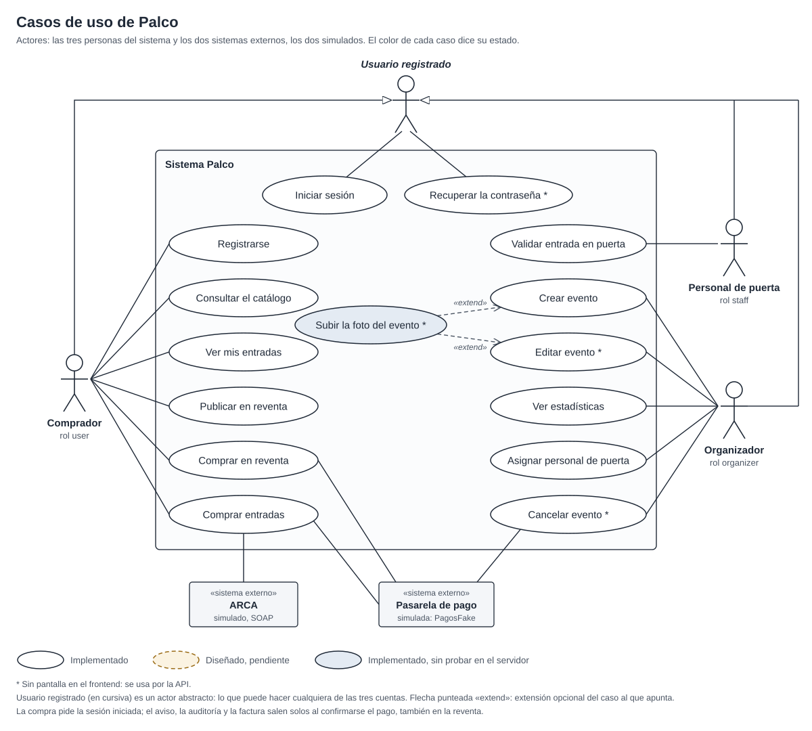

# Casos de uso de Palco

*Fuente: `docs/documentacion/diagramas/casos-de-uso.svg`. Óvalo blanco: implementado y probado en el servidor;
óvalo celeste: implementado, sin probar en el servidor; óvalo punteado: diseñado, pendiente. Con asterisco: no
tiene pantalla en el frontend y se usa por la API.*

## Actores

| Actor | Rol | Tipo |
|---|---|---|
| Comprador | `user` | Persona. Puede además revender una entrada propia: no es otra cuenta, es una capacidad del comprador |
| Organizador | `organizer` | Persona |
| Personal de puerta | `staff` | Persona |
| Usuario registrado | cualquiera de los tres | Actor abstracto (en cursiva en el diagrama): lo que comparten las tres cuentas, iniciar sesión y recuperar la contraseña. Comprador, organizador y personal de puerta lo heredan |
| Pasarela de pago | — | Sistema externo, **simulado** (`PagosFake`, dentro de Pagos): cobra y devuelve |
| ARCA | — | Sistema externo legado, **simulado** (`ArcaSimulado`, un servicio SOAP en un WAR aparte, `/legado/arca`) |

Los errores salen como Problem Details (`application/problem+json`) con `"type": "/problemas/<tipo>"`; en cada flujo
alternativo se da el código HTTP y el tipo. Una operación con `@RolesAllowed` responde 401 `no-autenticado` sin
token y 403 `sin-permiso` con un rol que no corresponde; eso vale para todos los casos que piden sesión y no se
repite en cada uno. Lo ajeno (un evento de otro organizador, una entrada o una venta de otro comprador) responde
404 `no-encontrado`, igual que lo que no existe.

Los emails (código de verificación, código para la contraseña nueva, compra confirmada y evento cancelado) salen
por SMTP si el servidor tiene `PALCO_SMTP_HOST`; si no, quedan en el log del servidor como
`Email para <email> — <asunto>: <cuerpo>`.

## Resumen

| N.º | Caso de uso | Actor principal | Estado |
|---|---|---|---|
| CU-01 | Registrarse | Comprador | Implementado |
| CU-02 | Iniciar sesión | Comprador, organizador, personal de puerta | Implementado |
| CU-03 | Consultar el catálogo | Comprador (también sin sesión) | Implementado |
| CU-04 | Comprar entradas | Comprador | Implementado |
| CU-05 | Ver mis entradas | Comprador | Implementado |
| CU-06 | Publicar en reventa | Comprador | Implementado |
| CU-07 | Comprar en reventa | Comprador | Implementado |
| CU-08 | Crear evento | Organizador | Implementado |
| CU-09 | Ver estadísticas | Organizador | Implementado |
| CU-10 | Validar entrada en puerta | Personal de puerta | Implementado |
| CU-11 | Cancelar evento | Organizador | Implementado, sin pantalla (por la API) |
| CU-12 | Editar evento | Organizador | Implementado, sin pantalla (por la API) |
| CU-13 | Recuperar la contraseña | Comprador, organizador, personal de puerta | Implementado, sin pantalla (por la API) |
| CU-14 | Asignar personal de puerta | Organizador | Implementado |
| CU-15 | Subir la foto del evento (extiende CU-08 y CU-12) | Organizador | Implementado, sin probar en el servidor; sin pantalla |

---

## CU-01 Registrarse

- **Actor:** comprador (todavía sin cuenta).
- **Precondición:** no tiene una cuenta con ese email ni con ese DNI.
- **Flujo principal:**
  1. Carga nombre, apellido, DNI, email, teléfono, fecha de nacimiento y contraseña en `/registro`.
  2. El frontend llama a `POST /api/usuarios/registro` (`@PermitAll`).
  3. Usuarios valida los datos, guarda la cuenta con rol `user`, pendiente de verificar, y manda un código de 6
     dígitos que vence en 15 minutos (asunto "Tu código de Palco"). Responde 201.
  4. El comprador ingresa el código; el frontend llama a `POST /api/usuarios/verificacion`.
  5. Usuarios marca el email y la identidad como verificados y responde 200 con la sesión (JWT).
- **Flujos alternativos:**
  - 2a. DNI que no tiene 7 u 8 dígitos, menor de 16 años, email ya registrado o DNI ya registrado: 400
    `datos-invalidos`, con el campo.
  - 2b. Falta un dato o tiene un formato inválido (Bean Validation): 400 `datos-invalidos`, con el detalle por campo.
  - 4a. Código incorrecto, vencido o con 5 intentos fallidos: 400 `datos-invalidos` (campo `codigo`).
  - 4b. El email ya estaba verificado: 409 `conflicto`.
  - 4c. Pide otro código (`POST /api/usuarios/verificacion/reenvio`, 204); si lo pide antes de 30 segundos: 409
    `conflicto` ("Esperá unos segundos").
- **Postcondición:** cuenta con rol `user`, email e identidad verificados, y sesión abierta. Ya puede comprar.
- **Estado:** Implementado. La verificación de identidad con foto del DNI no existe: al verificar el email la cuenta
  queda con la identidad verificada.

## CU-02 Iniciar sesión

- **Actores:** comprador, organizador y personal de puerta.
- **Precondición:** tiene una cuenta con el email verificado. Las cuentas de organizador y de puerta las cargan las
  migraciones de Usuarios; el registro solo crea compradores.
- **Flujo principal:**
  1. Ingresa email y contraseña en `/ingresar`.
  2. El frontend llama a `POST /api/usuarios/login` (`@PermitAll`).
  3. Usuarios verifica la contraseña (PBKDF2) y responde 200 con un JWT firmado con RS256, con el rol en el claim
     `groups` y 8 horas de vigencia.
  4. El frontend confirma el token con `GET /api/usuarios/yo` al abrir la aplicación.
- **Flujos alternativos:**
  - 3a. Email o contraseña incorrectos: 401 `no-autenticado`. El intento fallido queda guardado.
  - 3b. Cinco intentos fallidos en 15 minutos para el mismo email: el pedido siguiente responde 429
    `demasiados-intentos` con `Retry-After`, aunque la contraseña sea correcta. Vale también para emails sin cuenta.
  - 3c. Email sin verificar: 409 `conflicto` ("Verificá tu email antes de iniciar sesión").
  - 3d. Olvidó la contraseña: CU-13.
- **Postcondición:** sesión abierta con el rol de la cuenta; los demás servicios validan el token con la clave
  pública de `GET /api/usuarios/jwks`.
- **Estado:** Implementado.

## CU-03 Consultar el catálogo

- **Actor:** comprador, con o sin sesión.
- **Precondición:** ninguna.
- **Flujo principal:**
  1. Abre `/`; el frontend llama a `GET /api/eventos` (`@PermitAll`), con `categoria` y `q` si filtra o busca.
  2. Eventos responde la lista, sin los eventos cancelados. La franja de reventa oficial sale de
     `GET /api/v1/reventas?eventoId=`.
  3. Elige un evento; el frontend llama a `GET /api/eventos/{slug}` y muestra los sectores con precio y cupo, y las
     publicaciones de la reventa de ese evento.
- **Flujos alternativos:**
  - 3a. El evento no existe: 404 `no-encontrado`.
  - 3b. El evento está cancelado: el detalle responde 200 con `cancelado` en true y el motivo (CU-11).
  - 1a. Sin resultados: 200 con una lista vacía; la pantalla muestra el estado vacío.
- **Postcondición:** ninguna (solo lectura).
- **Estado:** Implementado.

## CU-04 Comprar entradas

- **Actor:** comprador. **Sistemas externos:** pasarela de pago (simulada) y ARCA (simulado).
- **Precondición:** sesión iniciada con rol `user` e identidad verificada; el evento no empezó, no está cancelado y
  hay cupo.
- **Flujo principal** (diagramas de secuencia de la compra, partes 1 y 2):
  1. Elige sectores y cantidades y carga un titular (nombre y DNI) por entrada, hasta 6 por compra.
  2. El frontend llama a `POST /api/v1/ventas` con `Idempotency-Key`. Ventas consulta a Usuarios (`/yo`), abre la
     compra en una instancia de `ServicioDeVentas` (`@Stateful`), reserva el cupo en Eventos sector por sector y
     guarda la venta `EN_CHECKOUT`. Responde 201 con la reserva, que vence en 10 minutos.
  3. El comprador paga: `POST /api/v1/ventas/{ventaId}/pagos` con `Idempotency-Key`, medio de pago y token.
  4. Ventas cobra a través de Pagos (`POST /api/v1/pagos`, rol `servicio`), que usa la pasarela simulada.
  5. Con el cobro aprobado, en una sola transacción: la venta pasa a `CONFIRMADA`, se crean las entradas en
     `PENDIENTE_EMISION` y se publica `PAGO_CONFIRMADO`. Responde 201.
  6. La emisión es asincrónica: `EmisionDeEntradasMDB` (cola) pone el código QR a cada entrada, que pasa a
     `VALIDA`, y la venta a `EMITIDA`. Por el tópico salen el email al comprador, el registro de auditoría y la
     factura: `FacturacionDeComprasMDB` le pide el CAE al ARCA simulado por SOAP y la guarda; se consulta con
     `GET /api/v1/facturas/{ventaId}`.
- **Flujos alternativos:**
  - 2a. Más de 6 entradas: 422 `maximo-de-entradas`. Distinta cantidad de titulares que de entradas: 422
    `titulares-no-coinciden`. Dos titulares con el mismo DNI: 422 `dni-repetido`. Sector que no es del evento: 422
    `sector-inexistente`. Nombre vacío o DNI sin 7 u 8 dígitos: 400 `datos-invalidos`.
  - 2b. Identidad sin verificar: 403 `identidad-no-verificada`, antes de reservar.
  - 2c. Sin cupo: 409 `cupo-agotado`; el evento ya empezó: 409 `evento-finalizado`. Se devuelve el cupo de los
    sectores ya reservados. Con el evento cancelado, Eventos no reserva (409 `evento-cancelado`) y Ventas lo
    responde como `cupo-agotado`.
  - 2d. Falta la cabecera `Idempotency-Key` o no es un UUID: 400 `datos-invalidos`. La misma clave con otro pedido:
    409 `clave-reutilizada`. El mismo pedido repetido devuelve la misma venta, sin reservar otra vez.
  - 2e/4a. Eventos, Usuarios o Pagos no responden: 504 `sin-respuesta`. En el pago, el reintento con la misma clave
    no cobra dos veces; si nadie reintenta, la conciliación de pagos consulta a Pagos y confirma o vence la venta.
  - 3a. Pasaron los 10 minutos o la compra se canceló: 409 `reserva-vencida`. Ya estaba paga con otra clave: 409
    `venta-ya-paga`. Otra llamada en curso sobre la misma compra: 409 `operacion-en-curso`.
  - 4b. Pago rechazado (`tok_rechazado`): 402 `pago-rechazado`; la compra sigue abierta para pagar con otro medio.
  - 5a. El comprador cancela antes de pagar: `DELETE /api/v1/ventas/{ventaId}`, 204, y el cupo vuelve a Eventos.
    Si deja pasar los 10 minutos, `VencimientoDeReservas` la pasa a `VENCIDA` y devuelve el cupo.
  - 6a. La emisión falla: el broker reintenta 5 veces cada 2 segundos y después el mensaje va a la DLQ, desde donde
    se devuelve a mano (sección 10.6). ARCA no responde: la factura se reintenta con la misma política.
- **Postcondición:** venta `EMITIDA`, entradas `VALIDA` con su código QR, una fila de auditoría y la factura con
  número y CAE.
- **Estado:** Implementado, con pasarela simulada.

## CU-05 Ver mis entradas

- **Actor:** comprador.
- **Precondición:** sesión iniciada con rol `user`.
- **Flujo principal:**
  1. Abre `/mis-entradas`; el frontend llama a `GET /api/v1/ventas` y a `GET /api/v1/reventas/mias`.
  2. Ventas responde las compras del dueño del token, de la más nueva a la más vieja, con sus entradas; Reventa,
     sus publicaciones.
  3. Abre una entrada: `GET /api/v1/entradas/{entradaId}` devuelve la entrada con su `codigoQr` cuando ya está
     `VALIDA`.
- **Flujos alternativos:**
  - 2a. Sin compras: 200 con una lista vacía.
  - 3a. La entrada no existe o es de otro usuario: 404 `no-encontrado` (las dos responden lo mismo).
  - 3b. Recién pagada, todavía `PENDIENTE_EMISION`: la entrada viene sin código; la pantalla espera la emisión.
  - 3c. Su evento se canceló: la venta figura `CANCELADA` y la entrada `ANULADA` (CU-11).
- **Postcondición:** ninguna (solo lectura).
- **Estado:** Implementado.

## CU-06 Publicar en reventa

- **Actor:** comprador (vendedor).
- **Precondición:** sesión con rol `user`; es el dueño de una entrada `VALIDA` y faltan más de 3 horas para el evento.
- **Flujo principal:**
  1. En `/mis-entradas` elige una entrada propia y el precio.
  2. El frontend llama a `POST /api/v1/reventas`. Reventa le pregunta a Ventas por la entrada (rol `servicio`) y
     valida el precio en el servidor: entre el 50 % (`MINIMO_REVENTA_PORCENTAJE`) y el 110 %
     (`TOPE_REVENTA_PORCENTAJE`) de lo pagado, con `ReglasDeNegocio.topeReventa` y `minimoReventa`.
  3. Reventa le pide a Ventas que marque la entrada como `PUBLICADA`
     (`POST /api/v1/operaciones-de-reventa/publicaciones`) y responde 201 con la publicación `ACTIVA`.
- **Flujos alternativos:**
  - 2a. Precio sobre el tope o bajo el mínimo: 422 `precio-fuera-de-rango`, con el rango en el detalle.
  - 2b. Faltan 3 horas o menos para el evento (`HORAS_LIMITE_REVENTA`): 409 `reventa-cerrada`.
  - 2c. La entrada no existe o no es del vendedor: 404 `no-encontrado`. No está `VALIDA` (usada, ya publicada,
    vendida o sin emitir): 409 `entrada-no-disponible`.
  - 2d. Ventas no responde: 504 `sin-respuesta`.
  - 4. El vendedor retira la publicación (`DELETE /api/v1/reventas/{publicacionId}`, 204): pasa a `RETIRADA` y la
    entrada vuelve a `VALIDA`. Si ya se vendió o la está comprando otra persona: 409 `publicacion-no-activa`.
- **Postcondición:** publicación activa; la entrada `PUBLICADA` no sirve para entrar (la puerta responde
  `NO_HABILITADA`).
- **Estado:** Implementado.

## CU-07 Comprar en reventa

- **Actor:** comprador. **Sistema externo:** pasarela de pago (simulada). La factura de la venta nueva sale sola,
  como en CU-04.
- **Precondición:** sesión con rol `user`; hay una publicación activa de otro usuario y faltan más de 3 horas para el
  evento.
- **Flujo principal:**
  1. En `/reventa` (o en el detalle del evento) elige una publicación y carga el titular (nombre y DNI).
  2. El frontend llama a `POST /api/v1/reventas/{publicacionId}/compra` con `Idempotency-Key`. Reventa toma la
     publicación con un `UPDATE` condicional (de dos compras a la vez, cobra una sola) y cobra el precio más el
     cargo de servicio a través de Pagos.
  3. Con el cobro aprobado, Ventas (`POST /api/v1/operaciones-de-reventa/transferencias`) deja la entrada original
     `VENDIDA` y emite una entrada nueva, `VALIDA`, a nombre del titular, en una venta nueva del comprador. Publica
     `REVENTA_CONFIRMADA`: email al comprador, auditoría y factura. La publicación queda `VENDIDA`. Responde 201.
- **Flujos alternativos:**
  - 2a. La publicación ya se vendió, se retiró o la está comprando otro: 409 `publicacion-no-activa`. Es propia: 409
    `compra-propia`. Faltan 3 horas o menos: 409 `reventa-cerrada`.
  - 2b. Nombre vacío o DNI sin 7 u 8 dígitos: 400 `datos-invalidos`.
  - 2c. Pago rechazado: 402 `pago-rechazado`; la publicación sigue activa.
  - 2d. Pagos o Ventas no responden: 504 `sin-respuesta`. La publicación queda tomada: el mismo comprador reintenta
    con la misma clave sin que se cobre dos veces y, si no reintenta, la resuelve la conciliación de reventas.
  - 3a. Se cobró y Ventas rechaza la transferencia (la entrada ya no está publicada): la publicación queda `ANULADA`,
    Reventa devuelve el pago y responde 409 `publicacion-no-activa`.
- **Postcondición:** entrada nueva del comprador, la original `VENDIDA` (la puerta responde `NO_HABILITADA`),
  publicación `VENDIDA` y factura de la venta nueva.
- **Estado:** Implementado, con pasarela simulada.

## CU-08 Crear evento

- **Actor:** organizador.
- **Precondición:** sesión con rol `organizer`.
- **Flujo principal:**
  1. En `/organizador`, con "+ Crear evento", carga título, categoría, lugar, fecha, descripción y los sectores con
     precio y cupo.
  2. El frontend llama a `POST /api/eventos` (rol `organizer`).
  3. Eventos valida, genera un slug único y guarda el evento a nombre del organizador. Responde 201 con `Location`.
  4. El evento aparece en el catálogo y en "Mis eventos", con la foto de su categoría.
- **Punto de extensión:** subir la foto del evento (CU-15) y mandar su URL como `imagenUrl`.
- **Flujos alternativos:**
  - 3a. Falta un dato, un sector sin nombre, o precio o cupo menor que 1: 400 `datos-invalidos`, con el campo.
  - 3b. La fecha no es futura: 400 `datos-invalidos` (campo `fechaISO`). Categoría que no existe: 400
    `datos-invalidos` (campo `categoria`).
- **Postcondición:** evento publicado con sus sectores y `vendidas` en 0.
- **Estado:** Implementado.

## CU-09 Ver estadísticas

- **Actor:** organizador.
- **Precondición:** sesión con rol `organizer`.
- **Flujo principal:**
  1. Abre el panel de `/organizador`; el frontend pide sus eventos (`GET /api/eventos/mios`) y, por cada uno, el
     resumen de ventas (`GET /api/v1/resumenes?eventoId=`) y las publicaciones activas
     (`GET /api/v1/reventas?eventoId=`).
  2. El panel muestra las entradas vendidas, lo recaudado sin el cargo de servicio (lo que se le liquida), el cupo
     restante y las entradas en reventa, y la tabla de sus eventos.
  3. Elige un evento: ve la ocupación por sector, la reventa activa, los accesos en puerta
     (`GET /api/v1/validacion/escaneos?eventoId=`) y su equipo de puerta (CU-14).
- **Flujos alternativos:**
  - 1a. Sin eventos propios: el panel lo dice y ofrece crear uno.
  - 1b. Un evento de otro organizador: no aparece, y pedir su resumen o su registro de puerta responde 404
    `no-encontrado`.
  - 1c. Un servicio no responde: esa tarjeta muestra el error con "Reintentar" y el resto del panel sigue.
- **Postcondición:** ninguna (solo lectura).
- **Estado:** Implementado. Ventas cuenta solo las compras pagadas y vigentes: una compra anulada por la
  cancelación del evento no se liquida. `GET /api/v1/resumenes` devuelve también las ventas por día (`porDia`), que
  el panel no muestra.

## CU-10 Validar entrada en puerta

- **Actor:** personal de puerta.
- **Precondición:** sesión con rol `staff` y la puerta del evento asignada a su cuenta (CU-14).
- **Flujo principal** (diagrama de secuencia de la validación en puerta):
  1. En `/puerta` elige uno de sus eventos (`GET /api/v1/validacion/puertas/mias`) y escanea el QR o tipea el
     código.
  2. El frontend llama a `POST /api/v1/validacion/escaneos` con `codigoQr` y `eventoId`.
  3. `ServicioDeValidacion` le pide a Ventas `POST /api/v1/entradas/usos` (rol `servicio`). `UsoDeEntradas` busca la
     entrada por código y la pasa a `USADA` con un `UPDATE` condicional (solo si sigue `VALIDA`).
  4. Validación guarda el escaneo y responde 201 con `resultado` `VALIDA`, `puedeEntrar` `true` y el nombre y DNI
     del titular.
  5. El personal contrasta nombre y DNI con el documento y deja entrar.
- **Flujos alternativos** (los cinco resultados responden 201: el escaneo queda registrado y el resultado dice si
  entra):
  - 3a. El código no existe: `INEXISTENTE` (Ventas respondió 404).
  - 3b. La entrada es de otro evento: `OTRO_EVENTO` (409 `entrada-de-otro-evento`); la entrada sigue sirviendo en
    el suyo.
  - 3c. Ya se usó, también si dos puertas la escanean a la vez: `YA_USADA` (409 `entrada-ya-usada`), con el escaneo
    anterior.
  - 3d. Está publicada o vendida en la reventa, o anulada: `NO_HABILITADA` (409 `entrada-no-habilitada`).
  - 3e. Ventas no responde: el escaneo se guarda como `SIN_RESPUESTA` y la respuesta es 504 `sin-respuesta`; hay que
    escanear de nuevo.
  - 2a. Falta el código o el evento: 400 `datos-invalidos`.
  - 2b. La cuenta no tiene la puerta de ese evento: 403 `puerta-no-asignada`, sin llamar a Ventas y sin registro.
- **Postcondición:** con `VALIDA`, la entrada queda `USADA` y no vuelve a servir. En todos los casos menos 2a y 2b
  queda un renglón en el registro de la puerta, con el código completo, el resultado, quién y cuándo, sin nombre
  ni DNI; la consulta (`GET /api/v1/validacion/escaneos?eventoId=`) devuelve solo el final del código
  (`codigoParcial`).
- **Estado:** Implementado. `SIN_RESPUESTA` tiene tests, pero no se provocó en el servidor.

## CU-11 Cancelar evento

- **Actor:** organizador. **Sistema externo:** pasarela de pago (simulada), para los reembolsos.
- **Precondición:** sesión con rol `organizer`; el evento es suyo, no está cancelado y no empezó.
- **Flujo principal:**
  1. El organizador cancela el evento con un motivo opcional: `POST /api/eventos/{eventoId}/cancelacion` con
     `{"motivo": "..."}` (o `{}`).
  2. En una sola transacción, Eventos marca el evento (`cancelado`, `cancelacionMotivo`) y publica
     `EVENTO_CANCELADO` en `topico.eventos-cancelados`. Responde 200 con el evento.
  3. El resto es asincrónico (`docs/api/mensajeria-cancelacion-de-eventos.md`). `CancelacionDeEventoMDB`, en Ventas,
     toma cada compra pagada del evento y, en una transacción por compra, la pasa a `CANCELADA`, anula sus
     entradas, le pide a Pagos el reembolso (`POST /api/v1/pagos/{pagoId}/reembolso`, que devuelve contra la
     pasarela) y publica un `COMPRA_ANULADA`.
  4. Por cada `COMPRA_ANULADA`, Notificaciones le manda el email al comprador (asunto "Se canceló <evento>", con el
     motivo y si el dinero ya volvió) y guarda la fila de auditoría.
- **Flujos alternativos:**
  - 1a. El evento no existe o es de otro organizador: 404 `no-encontrado`.
  - 1b. Ya estaba cancelado: 409 `evento-cancelado`, y no sale un segundo mensaje. Ya empezó: 409
    `evento-finalizado`.
  - 1c. Motivo de más de 500 caracteres o pedido sin cuerpo: 400 `datos-invalidos`; sin
    `Content-Type: application/json`: 415.
  - 3a. Pagos no responde: la compra se anula igual y el aviso dice que la devolución está en trámite
    (`reembolsado` en false).
  - 3b. El broker reentrega `EVENTO_CANCELADO`: las compras ya anuladas no se tocan, no se reembolsa dos veces ni se
    repite el aviso.
- **Postcondición:** el evento sale del catálogo y no vende más (Eventos no reserva cupo; una compra nueva
  responde 409), pero su detalle sigue respondiendo con el motivo. Sus compras pagadas quedan `CANCELADA` y reembolsadas, y sus
  entradas `ANULADA` (la puerta responde `NO_HABILITADA`). Las `USADA` y `VENDIDA` no cambian.
- **Estado:** Implementado, sin pantalla: el panel no tiene el botón y se usa por la API (la colección de Postman lo
  recorre).

## CU-12 Editar evento

- **Actor:** organizador.
- **Precondición:** sesión con rol `organizer`; el evento es suyo, no está cancelado y no empezó.
- **Flujo principal:**
  1. El organizador manda el evento completo: `PUT /api/eventos/{eventoId}` con título, categoría, lugar, fecha,
     descripción, `imagenUrl` y la lista de sectores.
  2. Eventos lo reemplaza: lo que no viene se borra. Los sectores con `id` se cambian, los que vienen sin `id` se
     agregan y los que no están se quitan. El slug y el dueño no cambian.
  3. Responde 200 con el evento editado, que el catálogo muestra en el acto.
- **Punto de extensión:** subir una foto nueva (CU-15).
- **Flujos alternativos:**
  - 1a. El evento no existe o es de otro organizador: 404 `no-encontrado`.
  - 2a. Falta un dato, la fecha no es futura, la categoría no existe o un sector trae un `id` que no es de este
    evento: 400 `datos-invalidos`, con el campo.
  - 2b. Un sector con entradas vendidas no se puede quitar, ni bajarle el cupo por debajo de las vendidas, ni
    cambiarle el precio (el tope de la reventa se calcula sobre lo que pagó cada comprador): 409
    `sector-con-ventas`.
  - 2c. El evento está cancelado: 409 `evento-cancelado`; ya empezó: 409 `evento-finalizado`.
- **Postcondición:** el evento queda con los datos nuevos; las ventas hechas no cambian.
- **Estado:** Implementado, sin pantalla: se usa por la API (la colección de Postman lo recorre).

## CU-13 Recuperar la contraseña

- **Actores:** comprador, organizador y personal de puerta.
- **Precondición:** tiene una cuenta con el email verificado.
- **Flujo principal:**
  1. Pide un código con su email: `POST /api/usuarios/password/olvide` (`@PermitAll`).
  2. Usuarios responde 204 y le manda un código de 6 dígitos que vence en 15 minutos (asunto "Volvé a poner tu
     contraseña de Palco"). Se guarda aparte del código de verificación: uno no sirve para lo otro.
  3. Manda el email, el código y la contraseña nueva: `POST /api/usuarios/password/reinicio`.
  4. Usuarios cambia la contraseña, borra el código y olvida los inicios de sesión fallidos de ese email. Responde
     204.
  5. Inicia sesión con la contraseña nueva (CU-02).
- **Flujos alternativos:**
  - 1a. El email no tiene cuenta o no está verificado: responde 204 igual y no manda nada, para no revelar qué
    emails están registrados.
  - 1b. Lo pide de nuevo antes de 30 segundos: 204 y no sale otro código (un 409 diría que la cuenta existe).
  - 3a. Código incorrecto: 400 `datos-invalidos` (campo `codigo`), y suma un intento. Vencido o sin pedir: 400
    ("El código venció. Pedí uno nuevo."). Con 5 intentos fallidos: 400 ("Demasiados intentos. Pedí un código
    nuevo.").
  - 3b. Contraseña sin 8 caracteres con letras y números: 400 `datos-invalidos` (campo `password`).
  - 3c. Reusar el código después del cambio: 400; ya no existe.
- **Postcondición:** la contraseña vieja deja de servir y la cuenta puede entrar enseguida, aunque estuviera con 429.
- **Estado:** Implementado, sin pantalla: `/ingresar` no ofrece "Olvidé mi contraseña" y se usa por la API.

## CU-14 Asignar personal de puerta

- **Actor:** organizador.
- **Precondición:** sesión con rol `organizer` y un evento propio.
- **Flujo principal:**
  1. En el detalle de un evento de `/organizador`, en "Equipo de puerta", ve las cuentas asignadas
     (`GET /api/v1/validacion/puertas?eventoId=`).
  2. Escribe el email de una cuenta de puerta y la asigna: `PUT /api/v1/validacion/puertas/{eventoId}/{email}`.
     Validación le pregunta a Eventos de quién es el evento (`GET /api/eventos/{eventoId}/organizador`, rol
     `servicio`), guarda la asignación con el email en minúsculas y responde 200.
  3. Esa cuenta ve el evento en `/puerta` (`GET /api/v1/validacion/puertas/mias`) y puede escanear (CU-10).
- **Flujos alternativos:**
  - 2a. El evento es de otro organizador o no existe: 404 `no-encontrado`.
  - 2b. Email inválido: 400 `datos-invalidos`. Eventos no responde: 504 `sin-respuesta`.
  - 2c. La cuenta ya estaba asignada: 200 con la misma asignación, sin duplicarla.
  - 2d. El email no es de una cuenta `staff`: se guarda igual y no deja escanear a nadie.
  - 4. Quita una cuenta: `DELETE /api/v1/validacion/puertas/{eventoId}/{email}`, 204 aunque no estuviera
    asignada. Desde ahí, esa cuenta recibe 403 `puerta-no-asignada` al escanear o leer el registro de ese evento.
- **Postcondición:** la cuenta queda (o deja de estar) habilitada para la puerta de ese evento. Las migraciones de
  Validación asignan `puerta@palco.test` a los seis eventos de prueba; `otra.puerta@palco.test` no tiene ninguno.
- **Estado:** Implementado.

## CU-15 Subir la foto del evento

- **Actor:** organizador. Extiende CU-08 y CU-12.
- **Precondición:** sesión con rol `organizer`; el servidor tiene configurado el almacén (`PALCO_SUPABASE_URL`,
  `PALCO_SUPABASE_BUCKET` y `PALCO_SUPABASE_CLAVE`).
- **Flujo principal:**
  1. Manda la imagen cruda, con su tipo en `Content-Type`: `POST /api/eventos/imagenes`.
  2. Eventos le pone un nombre propio (un UUID con la extensión del tipo), la guarda en Supabase Storage y responde
     200 con la URL pública.
  3. Esa URL va como `imagenUrl` al crear (CU-08) o editar (CU-12) el evento.
- **Flujos alternativos:**
  - 1a. Un tipo que no es JPG, PNG ni WEBP (por ejemplo un SVG, que puede traer scripts): 415.
  - 1b. Imagen vacía o de más de 2 MB: 400 `datos-invalidos` (campo `imagen`).
  - 2a. Sin almacén configurado, o Supabase Storage no responde: 504 `sin-respuesta`. El evento se puede crear igual,
    con la foto de su categoría.
- **Postcondición:** la imagen queda pública en el almacén y el evento la muestra.
- **Estado:** Implementado, sin probar en el servidor: tiene tests con dobles, y en el servidor solo se probaron el
  504 sin almacén y el 415, porque el bucket real todavía no existe. Sin pantalla: el alta usa la foto de la
  categoría.
