# Palco: documento técnico de la Entrega Obligatoria N.º 2

**Desarrollo de Aplicaciones II (3.4.218) · UADE · 2.º cuatrimestre de 2026**

| | |
|---|---|
| Proyecto | Palco, plataforma de venta de entradas nominativas con reventa oficial (tope de +10 %) |
| Integrantes | Santiago Loto, Sebastian Deya, Julian Zuchowicki, Valentina Frisoli y Joaquin Molina |
| Entrega | Entrega Obligatoria N.º 2 (2.º Parcial), defendida el 13/11/2026 |
| Repositorio | https://github.com/santttii/deapps2 |
| Versión que se describe | `master` al 13/11/2026, commit `b70d939` |

Este documento describe el sistema tal como está en esa versión: lo que se muestra en la demo está implementado y se prueba contra el servidor. Qué partes son simuladas está en la sección 11. Las rutas de archivos son relativas a la raíz del repositorio, y los diagramas de secuencia de cada integración están en el anexo A.

## 1. Qué pide la consigna y dónde está cada punto

### 1.1 Entrega Obligatoria N.º 2 (consigna, sección 5)

| Pedido de la consigna | Sección | Evidencia en el código | Prueba |
|---|---|---|---|
| Al menos 2 procesos de negocio con mensajería asincrónica funcionando de punta a punta: 1 con cola punto a punto y 1 con tópico publicación/suscripción | 4 | Destinos en `backend/servidor/src/main/wildfly/configurar.cli`. Cola: `ventas/.../mensajeria/EmisionDeEntradasMDB.java`. Tópico de la compra: `notificaciones/.../mensajeria/AvisoDeCompraMDB.java`, `AuditoriaDeComprasMDB.java` y `facturacion/.../mensajeria/FacturacionDeComprasMDB.java`. Tópico de la cancelación: `ventas/.../mensajeria/CancelacionDeEventoMDB.java`, `notificaciones/.../mensajeria/AvisoDeCancelacionMDB.java` y `AuditoriaDeCancelacionesMDB.java` | Escenarios 7 a 13; carpeta 8 de Postman (cancelación con anulación y reembolso) |
| Al menos 1 servicio SOAP, con su WSDL, justificado como integración con un sistema externo "legado" del dominio | 5 | `backend/servicios/arca/` (ARCA simulado, WSDL en `/legado/arca?wsdl`, copia en `docs/api/arca.wsdl`); cliente en `facturacion/.../negocio/externos/ArcaSoap.java` | Escenario 15; tests de Facturación y del ARCA simulado |
| Al menos 1 servicio REST, justificado como integración con un partner moderno o como API de consumo externo | 6 | `docs/api/openapi.yaml`; los recursos `api/*Resource.java` de cada servicio; los clientes REST en `negocio/externos/` | Colección de Postman (154 pedidos); escenarios 1 a 6 |
| Transacciones declarativas en al menos un flujo de negocio crítico de varios pasos (reservar, cobrar y confirmar) | 7 | `ventas/.../negocio/ServicioDeVentas.java` (`confirmarCompra`, `REQUIRED`), `ComprasEnCurso.java` y `common/.../mensajeria/PublicadorPagoConfirmadoJms.java` (`MANDATORY`) | Escenarios 13 y 14 |
| Documento técnico actualizado (8 a 12 páginas) con diagramas de secuencia de cada integración | Todo el documento; anexo A | Este documento (`docs/entrega-obligatoria-2/`) y `docs/documentacion/diagramas/` | No aplica |
| Defensa: demo de punta a punta de un flujo que cruce componentes internos, mensajería y servicios web | 10.3 | La compra: REST, cola, tópico, SOAP y la validación en la puerta | Escenarios 1, 15 y 16 |
| Defensa: por qué cada integración externa es síncrona o asincrónica | 3 | Tabla de la sección 3 | No aplica |
| Defensa: comportamiento transaccional ante una falla a mitad del flujo crítico | 7.2 | `palco.ventas.fallar-despues-del-cobro` provoca la falla; `ventas/.../negocio/ConciliacionDePagos.java` la resuelve | Escenario 14 |

Las rutas que empiezan con el nombre de un servicio (`ventas/...`) están en `backend/servicios/`. Las que empiezan con `common/...` están en `backend/common/src/main/java/com/palco/`.

### 1.2 Lo que la cátedra pidió para el 13/11

| Pedido | Sección | Evidencia | Prueba |
|---|---|---|---|
| Componentes en capas desplegados y un primer flujo de punta a punta | 2 y 10.3 | Paquetes `api/`, `negocio/`, `datos/` y `dominio/` en cada servicio; `docker-compose.yml` | CI: `docker compose up` y 21 escenarios en verde |
| Patrones implementados en el código; State en la entidad central con 409 ante una transición inválida | 8 | `ventas/.../dominio/estado/EstadoDeVenta.java` y `TransicionInvalida.java` | `EstadoDeVentaTest`; `scripts/pruebas/patron-state.mjs` |
| Seguridad base: autenticación con JWT y control de acceso por rol | 9 | `usuarios/.../seguridad/Tokens.java`; `@RolesAllowed` en cada `api/*Resource.java` | Escenario 5; carpeta 4 de Postman |
| Mensajería funcionando en al menos un proceso | 4 | Ver la tabla 1.1 | Escenarios 7 a 13 |
| Primeros tests unitarios | 10 | `src/test/java` de cada servicio | `mvn verify`: 776 tests, 0 fallas |

### 1.3 Requisitos transversales (consigna, sección 6)

| Requisito | Cómo se cumple |
|---|---|
| Mínimo 6 componentes de negocio con interfaz explícita y documentada | 8 componentes, cada uno con su interfaz `I<Servicio>` y su API documentada en `docs/api/`: `openapi.yaml` y los contratos de mensajería (sección 2.1) |
| Al menos 1 componente stateful y 1 stateless, justificados por escrito | `ServicioDeVentas` (`@Stateful`) y los demás `@Stateless`; la justificación está en la sección 2.1 y en el comentario de cada clase |
| Arquitectura en capas explícita en cada componente | Sección 2.3 |
| Al menos 3 patrones de diseño aplicados y justificados | State, Facade, Adapter, Factory, Strategy, Repository, DTO y Singleton (sección 8) |
| Integración SOAP con WSDL y REST | Secciones 5 y 6 |
| 2 procesos con mensajería: cola y tópico | Sección 4 |
| Seguridad declarativa en al menos 2 operaciones sensibles | `@RolesAllowed` o `@PermitAll` en todas las operaciones de `api/` (sección 9) |
| Transacciones declarativas en un flujo crítico | Sección 7 |
| Stack consistente y justificado | Jakarta EE 11 en WildFly 41, Java 25 (sección 2.4) |
| Repositorio Git con historial incremental | https://github.com/santttii/deapps2, con commits de los cinco integrantes desde el 16/09 |

## 2. Arquitectura

### 2.1 Componentes

Palco está construido con componentes: cada componente de negocio es un WAR propio, con su ruta y su esquema de base de datos, y se despliega en un único WildFly 41 (Jakarta EE 11, Java 25). Los componentes no usan clases ni tablas de otro componente: se hablan solo por REST o por mensajería JMS.

| Componente | Ruta | Tipo | Responsabilidad |
|---|---|---|---|
| Usuarios | `/api/usuarios` | Stateless | Registro con verificación del email, ingreso, emisión de tokens JWT, token de servicio para las llamadas internas, recuperación de la contraseña |
| Eventos | `/api/eventos` | Stateless | Catálogo, alta, edición y cancelación de eventos; cupo por sector con reserva atómica |
| Ventas | `/api/v1` (`/ventas`, `/entradas`) | **Stateful** (`ServicioDeVentas`) | La compra en curso, el cobro, la emisión de las entradas, el uso en la puerta, la transferencia de la reventa y la anulación por cancelación |
| Pagos | `/api/v1/pagos` | Stateless | Cobro con idempotencia y reembolso, contra una pasarela intercambiable |
| Validación | `/api/v1/validacion` | Stateless | El escaneo en la puerta, el registro de escaneos y las puertas asignadas por evento |
| Reventa | `/api/v1/reventas` | Stateless | Publicación con tope de precio, compra de una publicación y su conciliación |
| Notificaciones | `/api/notificaciones` | Stateless | El aviso al comprador por email y la auditoría de los mensajes |
| Facturación | `/api/v1/facturas` | Stateless | La factura electrónica de cada compra, con el CAE de ARCA |
| ARCA simulado | `/legado/arca` | No aplica | El sistema externo legado: no es un componente de Palco y no comparte código con él |

**Por qué Ventas es stateful.** Una compra es una conversación con un mismo comprador en varios pasos: abrir la compra con la reserva del cupo, cargar los titulares, pagar e incluso reintentar el pago con otro medio. `ServicioDeVentas` es `@Stateful` con `@StatefulTimeout` de 10 minutos, que es lo que dura la reserva. La instancia guarda la venta calculada y sus titulares, y el pago se valida contra ese estado sin volver a leer la base. `@Remove` termina la conversación cuando la compra se paga o se cancela, y `ComprasEnCurso` es la fachada que ubica la instancia de cada compra.

**Por qué los demás son stateless.** Cada operación llega con todo lo que necesita (el token, el pedido y los ids) y no depende de la anterior. El contenedor reutiliza un pool de instancias y el estado vive en la base. Cada clase deja escrita en su comentario por qué es stateless o stateful.

### 2.2 Sistemas externos

| Sistema | Canal | En esta versión |
|---|---|---|
| ARCA (AFIP), factura electrónica | SOAP | Simulado: un WAR aparte en `/legado/arca` que publica su WSDL y numera los comprobantes |
| Pasarela de pago | Por la interfaz `PasarelaDePagos` de Pagos | Simulada (`PagosFake`): según el token, aprueba, rechaza (`tok_rechazado`, que el frontend manda con las tarjetas terminadas en 0002) o no responde (`tok_sin_respuesta`, con las terminadas en 0504) |
| Servidor de correo | SMTP (`CorreoSmtp`) | Opcional: sin `PALCO_SMTP_HOST`, `FabricaDeCorreos` elige `CorreoAlLog` y el email se escribe en el log |
| Supabase Storage, fotos de los eventos | REST | Opcional: sin credenciales, la subida se rechaza y el evento usa la foto de su categoría |

### 2.3 Capas dentro de cada componente

Todos los componentes siguen la misma estructura de paquetes:

| Paquete | Qué contiene | Regla |
|---|---|---|
| `api/` | Recurso JAX-RS y DTOs (`Dtos.java`) | Capa delgada: valida la entrada con Bean Validation, declara el rol (`@RolesAllowed` o `@PermitAll`) y delega. No tiene lógica de negocio |
| `negocio/` | Interfaz `I<Servicio>` y su Session Bean; en `negocio/externos/`, los clientes REST y SOAP de otros componentes y sistemas | Acá están las reglas y las transacciones |
| `datos/` | Una interfaz `<Entidad>Repository` y su implementación `<Entidad>RepositoryJpa` por entidad | El único lugar que usa el `EntityManager` |
| `dominio/` | Entidades JPA y estados | Sin dependencias de la API |
| `mensajeria/` | Message-Driven Beans | Puntos de entrada delgados, como el recurso REST: leen el mensaje y delegan |

`backend/common` es una biblioteca que va adentro de cada WAR, no un servicio. Tiene las reglas de negocio (`ReglasDeNegocio`), los errores (`ErroresDeNegocio`, traducidos a Problem Details por `ManejadoresDeErrores`), los contratos de los mensajes y el envío de emails.

### 2.4 Despliegue

El servidor se arma con Maven y Galleon: un WildFly con las capas `jaxrs-server`, `ejb`, `embedded-activemq`, `microprofile-jwt`, `webservices`, `mail`, `h2-driver` y `postgresql-driver`. `configurar.cli` agrega el datasource `PalcoDS` y los destinos JMS. En desarrollo la base es H2 en modo PostgreSQL. Con `docker compose up --build` el sistema completo levanta con un solo comando: PostgreSQL, WildFly con los 9 WAR y nginx con TLS, que sirve el frontend y la API. Cada servicio tiene sus migraciones Flyway, que corren en las dos bases.

## 3. Clasificación de las integraciones

La regla para elegir: la integración es **síncrona** cuando la respuesta cambia lo que pasa después y alguien la está esperando, y **asincrónica** cuando el trabajo puede hacerse después y no tiene que frenar a quien lo dispara.

| Integración | Canal | Por qué |
|---|---|---|
| Frontend → API de Palco | REST, síncrona | El comprador espera la respuesta en pantalla: la compra, el pago y el resultado del escaneo se muestran en el momento |
| Ventas → Eventos (reservar y devolver el cupo) | REST, síncrona | Si no hay cupo, la compra no se abre: la respuesta decide si sigue |
| Ventas → Pagos (cobrar) | REST, síncrona | El cobro decide si la venta se confirma; con un pago sin respuesta, la conciliación pregunta después (sección 7.2) |
| Ventas → Usuarios (identidad del comprador) | REST, síncrona | Sin identidad verificada no se vende: se controla antes de reservar |
| Validación → Ventas (usar la entrada) | REST, síncrona | El personal de puerta necesita saber en el momento si la persona entra |
| Reventa → Ventas, Pagos y Eventos | REST, síncrona | Publicar, cobrar y transferir deciden el paso siguiente de la compra en la reventa |
| Notificaciones → Usuarios (email del comprador) | REST, síncrona | Es una consulta puntual dentro del consumidor, que ya corre en segundo plano |
| Facturación → ARCA | SOAP, síncrona dentro de un consumidor asincrónico | ARCA es un sistema legado con WSDL y responde en la misma llamada. Pero la factura se dispara desde el tópico: la compra no espera a ARCA |
| Emisión de las entradas | Cola, asincrónica | Un único responsable tiene que emitir cada compra una sola vez; el comprador no tiene que esperar la emisión |
| Aviso, auditoría y factura de la compra | Tópico, asincrónica | Varios interesados que no se conocen entre sí reaccionan al mismo hecho; sumar uno nuevo no cambia a quien publica |
| Cancelación de un evento | Tópico, asincrónica | Un hecho del evento afecta a cada compra; las anulaciones, los reembolsos y los avisos pueden tardar y no frenan al organizador |

Entre servicios no hay transacción distribuida: lo que confirma un servicio queda confirmado allá aunque después falle el que llamó. Por eso cada llamada se protege con idempotencia, se compensa o se concilia (sección 7).

## 4. Procesos de negocio con mensajería asincrónica

### 4.1 Broker y destinos

El broker es ActiveMQ Artemis, embebido en el mismo WildFly. `configurar.cli` crea los destinos y fija los reintentos: cada mensaje se entrega hasta 5 veces, con 2 segundos entre intentos, y después pasa a la cola de mensajes fallidos (DLQ).

| Destino | Tipo | Mensajes | Consumidores |
|---|---|---|---|
| `cola.emision-entradas` | Cola punto a punto | `PAGO_CONFIRMADO` | `EmisionDeEntradasMDB` (Ventas) |
| `topico.compra-confirmada` | Tópico | `PAGO_CONFIRMADO` y `REVENTA_CONFIRMADA` | `AvisoDeCompraMDB` (no durable) y `AuditoriaDeComprasMDB` (durable) de Notificaciones; `FacturacionDeComprasMDB` (durable) de Facturación |
| `topico.eventos-cancelados` | Tópico | `EVENTO_CANCELADO` y `COMPRA_ANULADA` | `CancelacionDeEventoMDB` (Ventas, durable), `AvisoDeCancelacionMDB` (no durable) y `AuditoriaDeCancelacionesMDB` (durable) de Notificaciones |

Los mensajes son JSON con su contrato escrito en `docs/api/mensajeria-pago-confirmado.md` y `docs/api/mensajeria-cancelacion-de-eventos.md`. Cada uno lleva la propiedad `tipoEvento`, y cada consumidor la filtra con un selector: un MDB solo recibe el tipo de mensaje que sabe procesar.

### 4.2 Proceso 1: la confirmación de una compra (cola y tópico)

Diagramas A.3, A.4 y A.5.

1. Cuando el cobro se aprueba, `ServicioDeVentas.confirmarCompra` pasa la venta a `CONFIRMADA`, crea una entrada por titular en `PENDIENTE_EMISION` y publica `PAGO_CONFIRMADO`, todo en la misma transacción. El publicador (`PublicadorPagoConfirmadoJms`) es `MANDATORY`: si no hay transacción, falla, y si la transacción se deshace, el mensaje no sale.
2. El mensaje va a la cola y al tópico. Lleva `ventaId`, `compradorId`, `eventoId`, las entradas con su sector y su titular, `montoTotal` en pesos enteros y `timestamp`.
3. **Cola:** `EmisionDeEntradasMDB` genera el código de cada entrada, las pasa a `VALIDA` y la venta a `EMITIDA`. Si el mensaje llega dos veces, la segunda entrega no cambia nada: la emisión es un `UPDATE` condicional sobre las entradas pendientes.
4. **Tópico:** cada suscriptor recibe su copia.
   - El aviso le pide a Usuarios el email del comprador y le manda la confirmación.
   - La auditoría guarda una fila por mensaje.
   - Facturación pide la factura a ARCA (sección 5).

   La auditoría y Facturación son durables: si están detenidas cuando se publica, reciben el mensaje al volver.

La reventa reusa el mismo tópico: cuando una entrada cambia de dueño, Ventas publica `REVENTA_CONFIRMADA`, que se factura y se avisa igual que una compra, pero no pasa por la cola porque la entrada nueva ya se emite en la transferencia.

### 4.3 Proceso 2: la cancelación de un evento (tópico)

Diagrama A.7.

1. El organizador dueño del evento lo cancela (`POST /api/eventos/{id}/cancelacion`). `ServicioDeEventos` marca el evento como cancelado y publica `EVENTO_CANCELADO` en la misma transacción: si el mensaje no sale, el evento no queda cancelado.
2. Ventas lo consume con `CancelacionDeEventoMDB`, durable. Por cada compra pagada del evento:
   - pasa la venta a `CANCELADA` con un `UPDATE` condicional y sus entradas a `ANULADA`;
   - le pide el reembolso a Pagos por REST;
   - publica `COMPRA_ANULADA` con el comprador, el monto y si el reembolso ya se hizo.
3. Notificaciones consume `COMPRA_ANULADA`: el aviso le manda al comprador un email que dice si el dinero ya volvió o si está en camino, y la auditoría guarda una fila por compra.

**Por qué dos mensajes y no uno.** Eventos no sabe quién compró: su mensaje lleva solo los datos del evento: el id, el título y el motivo. Ventas, que es la dueña de las ventas, abre un mensaje por compra con lo que necesita el aviso (a quién, cuánto y si se reembolsó). Los dos tipos viajan por el mismo tópico y el selector por `tipoEvento` evita que Ventas reciba sus propias anulaciones.

### 4.4 Garantías

- **Consumidores idempotentes:** emitir, auditar, facturar y anular no se repiten si el mensaje llega dos veces. La emisión y la anulación usan `UPDATE` condicionales, y la auditoría y la factura tienen una restricción única en la base.
- **Mensaje inválido:** si no se puede leer, se reintenta y termina en la DLQ, sin trabar a los demás mensajes; los avisos, que no son durables, lo descartan.
- **Suscripciones durables:** la auditoría y la factura no pierden mensajes si su consumidor estuvo detenido.

## 5. Servicio SOAP: Facturación con ARCA, el sistema legado

Diagrama A.6.

**Por qué SOAP.** En la Argentina, la factura electrónica se pide al web service de ARCA (ex AFIP), que es SOAP con WSDL: es el ejemplo típico de sistema legado del dominio. Para el trabajo práctico, ARCA está simulado en un WAR aparte (`backend/servicios/arca`), que publica su WSDL en `/legado/arca?wsdl` (copia en `docs/api/arca.wsdl`) con la operación `FECAESolicitar`. Ese WAR no recibe `palco-common` ni ninguna clase de Palco: Facturación lo conoce solo por el contrato, como a un sistema de verdad.

**Cómo funciona.**

1. `FacturacionDeComprasMDB` está suscripto de forma durable a `topico.compra-confirmada` y procesa las compras de a una.
2. `ServicioDeFacturacion` arma la factura y llama a ARCA a través de `ArcaSoap`, un Adapter: traduce la interfaz propia `Arca` al cliente JAX-WS (Apache CXF) que se arma en tiempo de ejecución sobre el WSDL. El resto de Facturación no sabe que del otro lado hay SOAP. `FabricaDeArca` crea el cliente con la dirección del WSDL y los timeouts de conexión y de lectura.
3. ARCA devuelve el número de comprobante (por ejemplo, Factura B 00001-00000001) y un CAE de 14 dígitos, que se guardan en el esquema de Facturación. La factura se consulta en `GET /api/v1/facturas/{ventaId}`.
4. Hay una sola factura por venta, garantizada por una restricción única: si el mensaje llega dos veces, la segunda entrega no factura de nuevo.
5. Si ARCA no responde, el consumidor deshace la transacción y el broker reintenta (5 intentos cada 2 segundos), y después el mensaje pasa a la DLQ. La compra no se ve afectada: ya estaba confirmada.
6. El XML se procesa sin DTD ni entidades externas, para que no se pueda leer un archivo del servidor con una respuesta armada.

## 6. Servicios REST

### 6.1 La API de Palco

Es la API de consumo externo: la usan el frontend (React) y la colección de Postman, y está descripta en `docs/api/openapi.yaml` (OpenAPI 3.1.0, versión 1.3.0). Las operaciones principales:

| Servicio | Operaciones |
|---|---|
| Usuarios | Registro, verificación del email, ingreso, perfil, recuperación de la contraseña |
| Eventos | Catálogo con búsqueda y filtro, detalle, alta, edición, cancelación, eventos del organizador |
| Ventas | Abrir la compra, pagarla, cancelarla, ver una venta y las compras del comprador, ver una entrada, resumen y liquidación por evento |
| Reventa | Publicar, retirar, listar por evento, mis publicaciones, comprar una publicación |
| Validación | Escanear, registro de escaneos, puertas asignadas |
| Facturación | La factura de una venta |

Convenciones:

- **Problem Details (RFC 9457):** todo error sale con `type`, `title`, `status` y `detail`, y con `errores` por campo cuando es de validación. Nunca devuelve un stack trace: un error inesperado responde 500 con un `idError` que se busca en el log.
- **`Idempotency-Key`:** es obligatoria al abrir la compra y al pagarla. Si se repite el pedido con la misma clave, se devuelve la misma venta o el mismo pago, sin cobrar dos veces.
- **Códigos:** la API usa 201 con `Location` al crear y 409 ante conflictos de estado. Para los recursos ajenos responde 404, y no 403, para no revelar que existen.

### 6.2 REST entre servicios

Cada servicio llama a otro con un cliente propio en `negocio/externos/` (por ejemplo, `ClienteDeEventos` y `ClienteDePagos` en Ventas), con timeouts de conexión y de lectura. Son llamadas internas: llevan un token con el rol `servicio`, que `TokenDeServicio` consigue de Usuarios presentando un secreto compartido (dura 5 minutos), o el token del propio comprador cuando la operación es en su nombre. Las llamadas son:

- Ventas → Usuarios, Eventos y Pagos.
- Reventa → Ventas, Pagos y Eventos.
- Validación → Ventas y Eventos.
- Notificaciones → Usuarios.

Los diagramas A.1, A.2, A.8 y A.9 muestran la compra, la validación en la puerta y la reventa.

Pagos cumple el papel del partner moderno de cobros: Ventas lo usa por REST a través de la interfaz `Cobros`, y Pagos, a su vez, habla con la pasarela a través de `PasarelaDePagos`. La pasarela real (Mercado Pago, diseñada en `docs/entrega-obligatoria-2/diagramas/`) se puede sumar como otra implementación sin tocar la compra.

## 7. Transacciones declarativas en la compra

Las transacciones las abre y cierra el contenedor según el `@TransactionAttribute` de cada operación. La compra es el flujo crítico: reservar el cupo en Eventos, cobrar en Pagos y confirmar la venta con sus entradas y su mensaje.

### 7.1 Los pasos y su transacción

Diagramas A.1 y A.2.

| Paso | Operación | Atributo | Qué entra en la transacción |
|---|---|---|---|
| Abrir la compra | `ServicioDeVentas.iniciarCompra` | `NOT_SUPPORTED` | Nada propio. La reserva en Eventos es un `UPDATE` condicional (`vendidas + cantidad <= cupo`) en la transacción de Eventos; la venta se guarda en la transacción corta del repositorio |
| Anotar el intento de pago | `VentaRepositoryJpa.guardarClaveDePago` | `REQUIRED` (por defecto), sin transacción de quien llama | Un `UPDATE` que marca que hay un cobro en curso; se confirma antes de cobrar |
| Copiar los titulares | `VentaRepositoryJpa.respaldarTitulares` | `REQUIRES_NEW` | Los titulares, confirmados antes del cobro, para que la conciliación pueda terminar la compra si algo falla |
| Cobrar y confirmar | `ServicioDeVentas.confirmarCompra` | `REQUIRED` | La venta a `CONFIRMADA`, las entradas y la publicación de `PAGO_CONFIRMADO` |
| Publicar | `PublicadorPagoConfirmadoJms.publicar` | `MANDATORY` | Se suma a la de `confirmarCompra`; la fábrica `java:/JmsXA` hace que el broker participe como recurso XA |
| Emitir | `EmisionDeEntradasMDB.onMessage` | `REQUIRED` | Recibir el mensaje y emitir; si falla, el mensaje vuelve a la cola |

**Por qué `NOT_SUPPORTED` al abrir.** Con Eventos no hay nada que una transacción de la base de Ventas pueda deshacer: la reserva se compensa devolviendo el cupo. Así ninguna llamada a otro servicio espera con una conexión tomada.

**Por qué cobrar antes de escribir.** Un rollback no devuelve la plata. El cobro va primero y, si se aprueba, la confirmación, las entradas y el mensaje se escriben juntos: o quedan todos o no queda ninguno.

### 7.2 Qué pasa ante una falla a mitad del flujo

Diagrama A.10.

| Falla | Comportamiento | Prueba |
|---|---|---|
| Falla una reserva o el guardado de la venta | Se devuelve el cupo de los sectores ya reservados (compensación). Si la devolución falla, la venta queda marcada y `DevolucionDeCupos` la reintenta cada minuto, aplicándola una sola vez | Escenarios 4 y 18 |
| El cobro se rechaza | 402: no se escribe nada y la compra sigue abierta para pagar con otro medio | Escenario 3 |
| Pagos cobró, pero falla la confirmación en Ventas | La transacción se deshace: la venta queda `EN_CHECKOUT`, sin entradas y sin mensaje. `ConciliacionDePagos` (`@Singleton` con `@Schedule`, cada minuto) le pregunta a Pagos por la clave del intento y confirma la venta con ese mismo pago: no cobra dos veces | Escenario 14 |
| Falla algo después de publicar, en la misma transacción | El mensaje no sale: la cola, el tópico y los consumidores no reciben nada | Escenario 13 |
| Llega dos veces el mismo pedido o el mismo mensaje | La `Idempotency-Key` devuelve la misma venta o pago, y los consumidores no repiten el trabajo | Escenarios 2 y 8 |

La falla después del cobro se puede provocar a propósito: la propiedad de sistema `palco.ventas.fallar-despues-del-cobro` hace que la confirmación falle después de cobrar. En el escenario 14 la entrada se emite entre 2 y 4 minutos después (la conciliación corre cada minuto y le da 2 minutos de margen al pago), con un solo cobro.

La base (`PalcoDS`) no es XA y entra a la transacción como último recurso: el administrador de transacciones prepara el broker, confirma la base y después confirma el broker. No es un commit en dos fases completo: si el servidor se cayera justo entre las dos confirmaciones, quedaría una venta confirmada sin mensaje. Por eso los consumidores son idempotentes.

### 7.3 Otras transacciones

- **Uso de la entrada en la puerta (`UsoDeEntradas.marcarUsada`, `REQUIRED` por defecto):** un `UPDATE` condicional de `VALIDA` a `USADA`. Si dos puertas escanean la misma entrada a la vez, pasa una sola y la otra responde `YA_USADA`.
- **Transferencia de la reventa (`ReventaDeEntradas.transferir`, `REQUIRED` por defecto):** la entrada original pasa a `VENDIDA`, nace una venta nueva con una entrada nueva y otro código, y sale `REVENTA_CONFIRMADA`, todo junto.
- **Compra en la reventa (`ServicioDeReventa.comprar`, `NOT_SUPPORTED`):**
  - tomar la publicación es un `UPDATE` condicional: de dos compradores, uno solo llega a cobrar;
  - si Pagos no responde, `ConciliacionDeReventas` pregunta después y transfiere o libera;
  - si Ventas rechaza la transferencia, `DevolucionDeCobros` devuelve el pago.

## 8. Patrones de diseño

| Patrón | Dónde | Qué resuelve |
|---|---|---|
| **State** | `ventas/.../dominio/estado/`: `EstadoDeVenta` con `EnCheckout`, `Confirmada`, `Emitida`, `Cancelada` y `Vencida` | Cada estado decide si la venta se puede pagar o cancelar. Una transición inválida lanza `TransicionInvalida`, que la API responde con **409** en Problem Details (`venta-ya-paga`, `reserva-vencida`). El cambio en la base lo sigue haciendo un `UPDATE` condicional, para que de dos pedidos simultáneos cambie la fila uno solo. Lo prueban `EstadoDeVentaTest` y `scripts/pruebas/patron-state.mjs` |
| **Facade** | `ComprasEnCurso` (Ventas) | Un solo punto de entrada para la compra: ubica la instancia stateful de cada compra, aplica la idempotencia y deja una sola llamada a la vez por compra |
| **Adapter** | `ArcaSoap` (Facturación), `ClienteDePagos` y `ClienteDeEventos` (Ventas) | Traducen SOAP y HTTP a una interfaz propia: el negocio no sabe qué protocolo hay del otro lado |
| **Factory** | `FabricaDeCobros`, `FabricaDePasarela`, `FabricaDeArca`, `FabricaDeCorreos` y `FabricaDeAlmacen` | Eligen la implementación por configuración: cobro contra Pagos o simulado, SMTP o log, Supabase o ninguno. El negocio no lee propiedades |
| **Strategy** | `Cobros` (`ClienteDePagos` o `CobrosFake`), `PasarelaDePagos` (`PagosFake`) y `Correos` (`CorreoSmtp` o `CorreoAlLog`) | Cambiar cómo se cobra o cómo sale un email sin tocar la compra ni el aviso |
| **Repository** | `<Entidad>Repository` y `<Entidad>RepositoryJpa` en los 8 servicios | Operaciones con nombre en lugar de JPQL suelto; el negocio se prueba con dobles en memoria |
| **DTO** | `api/Dtos.java` de cada servicio | Lo que entra y sale de la API nunca es la entidad JPA |
| **Singleton** | `ConciliacionDePagos`, `VencimientoDeReservas` y `DevolucionDeCupos` (`@Singleton` con `@Schedule`) | Un solo barrido por servicio, con la concurrencia a cargo del contenedor |
| **Receptor idempotente y DLQ** | Los consumidores de la sección 4 | Un mensaje repetido no emite, audita ni factura dos veces; uno inválido no traba la cola |

## 9. Seguridad

Diagrama A.11.

- **Autenticación:** Usuarios firma tokens JWT con RS256, que duran 8 horas. Cada servicio los valida con MicroProfile JWT contra la clave pública que publica Usuarios (`GET /api/usuarios/jwks`). Un token alterado, sin firma (`alg=none`) o vencido recibe 401 en Problem Details.
- **Autorización por rol, declarativa:** cada operación de los recursos de `api/` lleva `@RolesAllowed` o `@PermitAll`. Hay cuatro roles:
  - `user`: compra, Mis entradas y reventa.
  - `organizer`: sus eventos y su panel.
  - `staff`: la puerta de los eventos a los que lo asignaron.
  - `servicio`: las llamadas internas.
- **Datos ajenos:** una venta, una entrada o un evento de otro responde 404. Un organizador solo ve y modifica sus eventos, y el personal de puerta solo escanea en los eventos asignados.
- **Contraseñas:** se guardan con PBKDF2 a 600.000 iteraciones y nunca vuelven en una respuesta. El ingreso no revela si el email existe.
- **Fuerza bruta:** después de 5 ingresos fallidos en 15 minutos, la API responde 429 con `Retry-After`.
- **Secretos:** el secreto entre servicios, la clave de los tokens y las credenciales de correo y almacenamiento van en variables de entorno, nunca en el repositorio. La CI corre gitleaks sobre todo el historial.

## 10. Pruebas y evidencia

### 10.1 Qué se prueba

| Prueba | Qué cubre | Resultado en esta versión |
|---|---|---|
| Tests unitarios y de la capa de datos (`mvn verify`) | Reglas, transacciones con dobles, el patrón State, los consumidores, el cliente SOAP contra un ARCA publicado en el test y los repositorios contra H2 con las migraciones | 776 tests, 0 fallas |
| Escenarios de integración (`scripts/pruebas/escenarios.mjs`) | 21 escenarios contra el servidor en marcha: compra, idempotencia, rechazo, reglas, seguridad, mensajería, DLQ, conciliación, factura, puerta, reventa y dueño del evento | 21 de 21 |
| Colección de Postman (`docs/api/palco-api.postman_collection.json`) | Cada operación de la API, con su caso de éxito y sus errores | 154 pedidos y 501 tests, 500 en verde |
| CI (`.github/workflows/ci.yml`) | gitleaks, `mvn verify`, lint y build del frontend, y la integración: `docker compose up` y los 21 escenarios contra PostgreSQL | En verde sobre `b70d939` |

### 10.2 Cómo se repite

```bash
docker compose up --build                 # todo el sistema: https://localhost
cd backend && mvn verify                  # los tests
node scripts/pruebas/escenarios.mjs       # los escenarios, con el servidor en marcha
```

Usuarios de prueba (contraseña `palco1234`):
- `titular@palco.test` y `otro.titular@palco.test`: compradores.
- `organizador@palco.test` y `otro.organizador@palco.test`: organizadores.
- `puerta@palco.test` y `otra.puerta@palco.test`: personal de puerta.

### 10.3 Recorrido de la demo

1. `titular@palco.test` elige un evento, carga los titulares y paga: la compra cruza Usuarios, Eventos y Pagos por REST.
2. La confirmación muestra "emitiendo tus entradas" hasta que la cola las emite, con un QR por entrada.
3. El tópico dispara el email (en el log, sin SMTP), la auditoría y la factura con su CAE, pedida por SOAP a ARCA.
4. `puerta@palco.test` escanea el código: el primer escaneo da `VALIDA` con nombre y DNI, y el segundo, `YA_USADA`.
5. Para mostrar la falla a mitad del flujo, se prende la falla después del cobro y se ve cómo la conciliación termina la compra (escenario 14).

## 11. Qué es simulado

- **ARCA y la pasarela de pago:** simulados, por las razones de la sección 2.2. Las dos integraciones están detrás de una interfaz propia (`Arca` y `PasarelaDePagos`), así que el servicio real se suma como otra implementación sin tocar el negocio.
- **Los emails:** sin un servidor SMTP configurado, quedan escritos en el log.
- **Las fotos de los eventos:** sin Supabase configurado, cada evento usa la foto de su categoría.

## Anexo A. Diagramas

Los diagramas son SVG y están en `docs/documentacion/diagramas/`. Cada uno trae su leyenda, que distingue las llamadas síncronas, las respuestas y los mensajes asincrónicos, y en el título dice qué integración muestra.

### A.1 Compra: abrir la compra y reservar el cupo (REST)

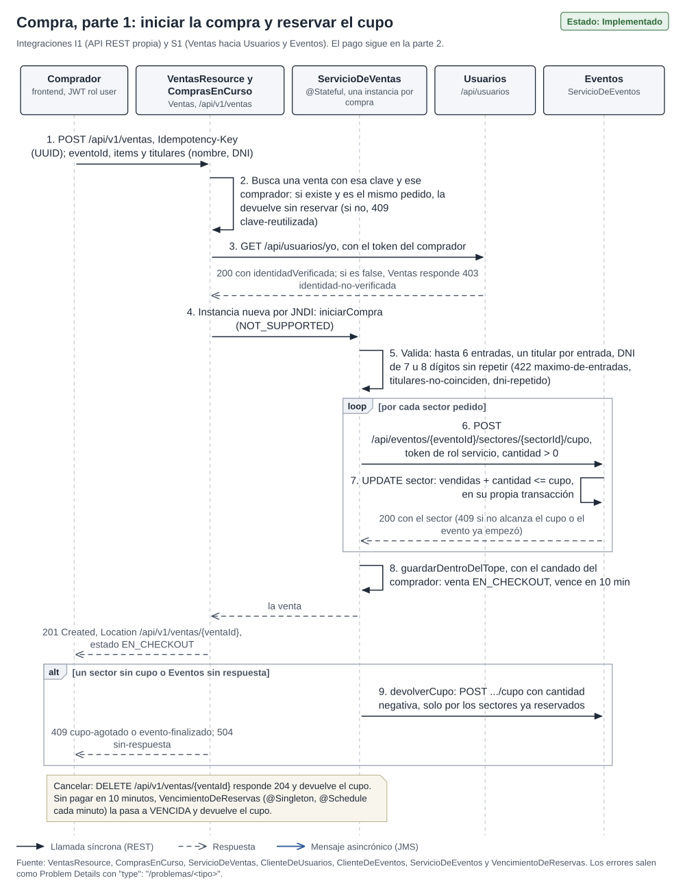

### A.2 Compra: pagar y confirmar (REST y transacción)

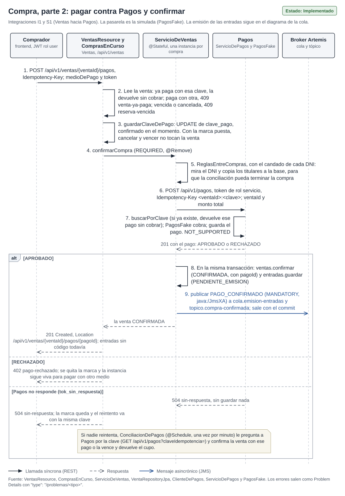

### A.3 Emisión de las entradas (cola)

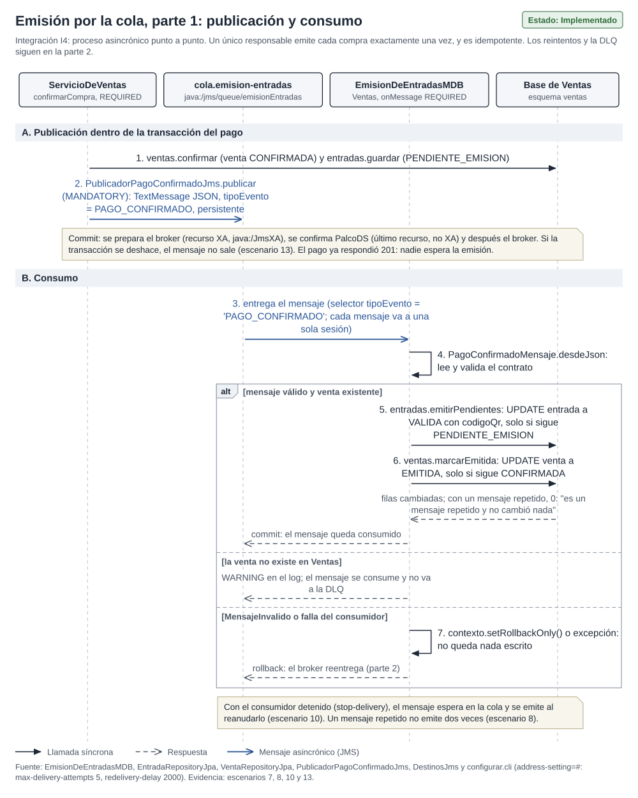

### A.4 Emisión con un mensaje inválido: reintentos y DLQ (cola)

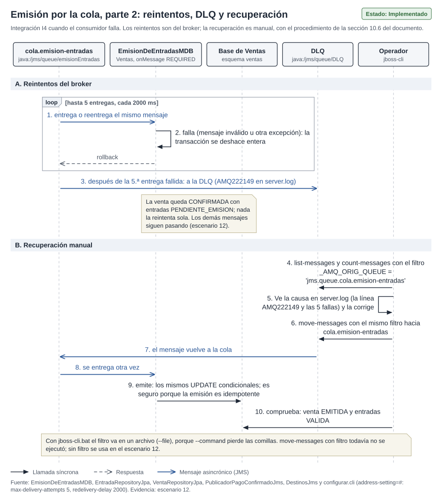

### A.5 Aviso y auditoría de la compra (tópico)

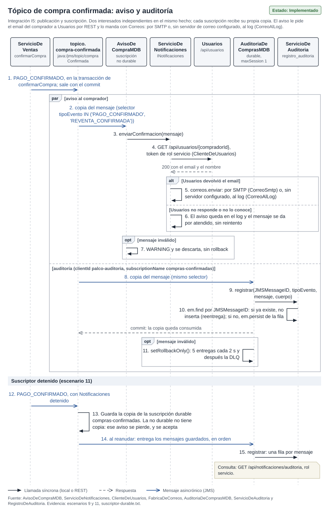

### A.6 Facturación con ARCA (tópico y SOAP)

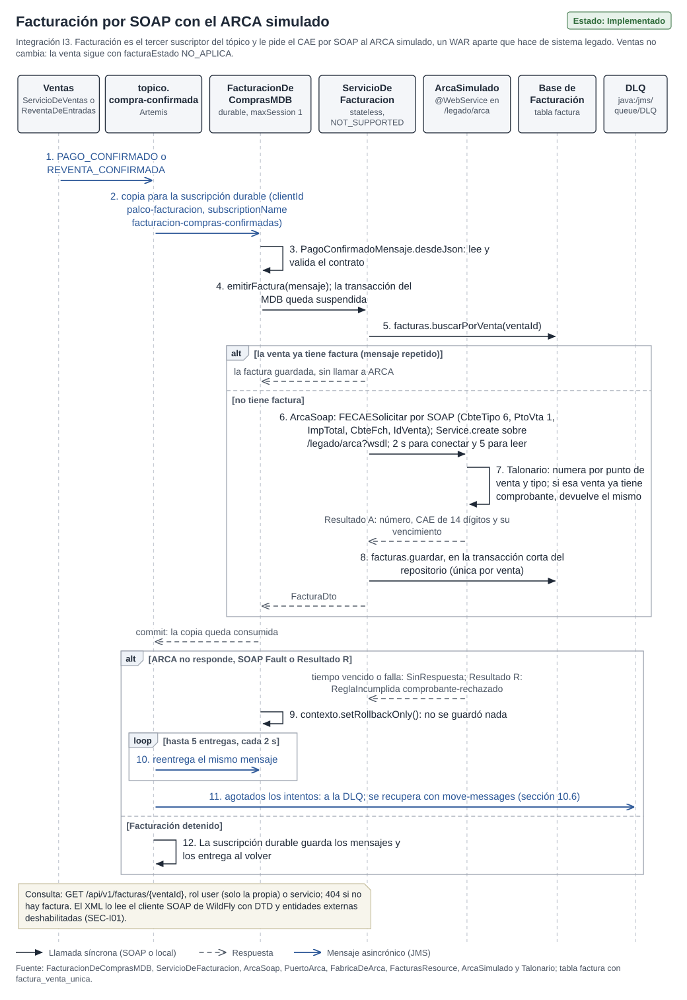

### A.7 Cancelación de un evento (tópico y REST)

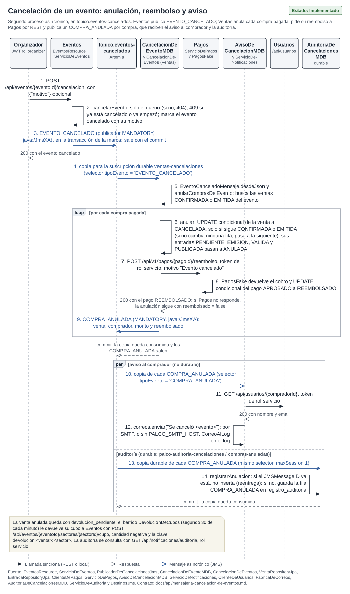

### A.8 Validación en la puerta (REST)

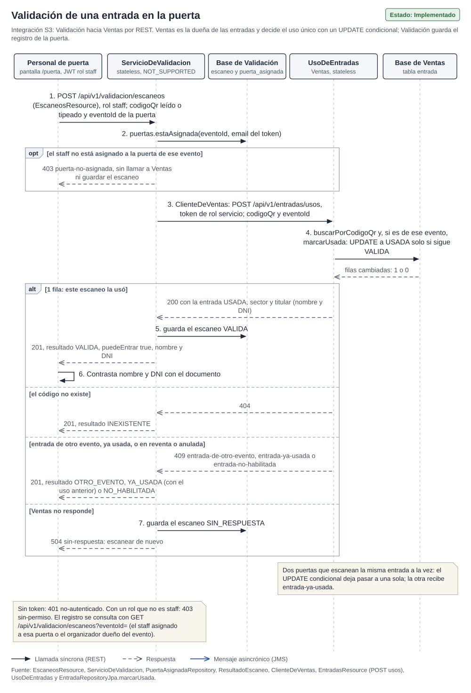

### A.9 Reventa oficial (REST y tópico)

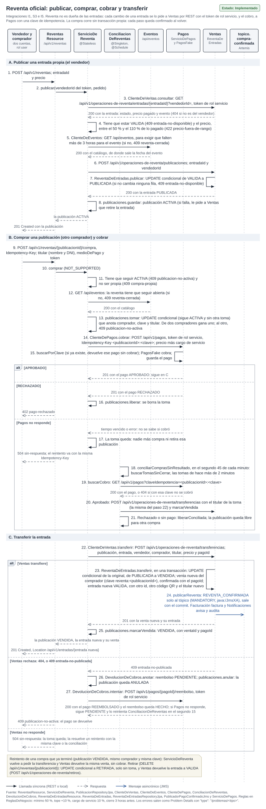

### A.10 Falla después del cobro y conciliación (transacción)

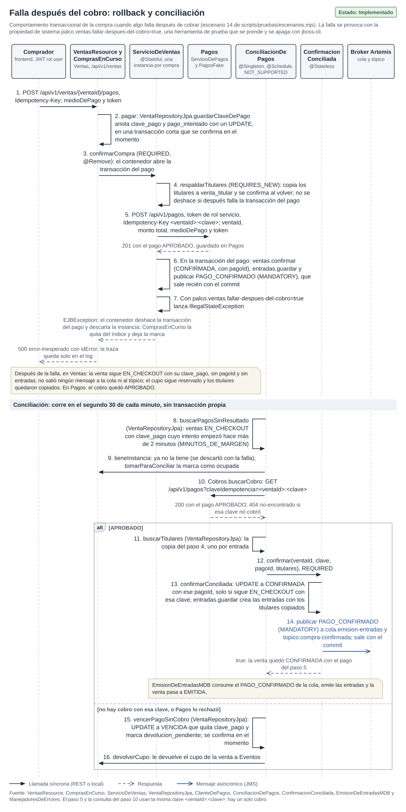

### A.11 Autenticación con JWT y token de servicio (REST)

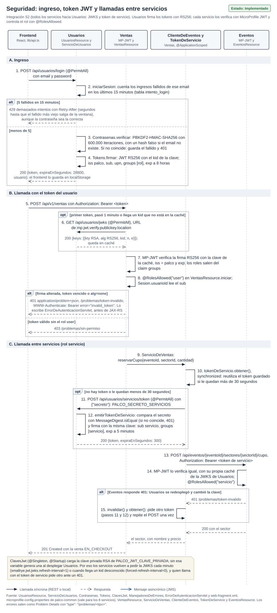
