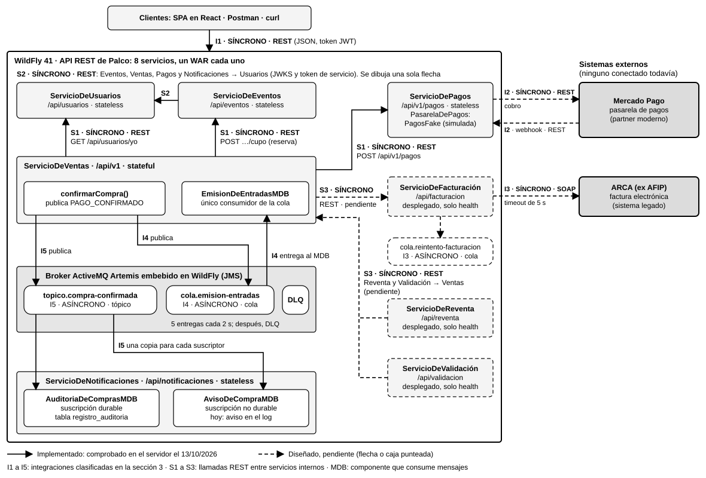

# Palco — Entrega Parcial N.º 2: arquitectura de integración y primer proceso asincrónico

**Desarrollo de Aplicaciones II (3.4.218) · UADE · 2.º cuatrimestre de 2026**

| | |
|---|---|
| Proyecto | Palco, plataforma de venta de entradas nominativas con reventa oficial |
| Integrantes | Santiago Loto, Sebastian Deya, Julian Zuchowicki, Valentina Frisoli y Joaquin Molina |
| Entrega | Entrega Parcial N.º 2, 23/10/2026 |
| Repositorio | https://github.com/santttii/deapps2 |
| Versión entregada | Etiqueta (tag) `entrega-parcial-2`, en el commit `580dd05` |
| Estado que se describe | El del servidor de desarrollo el 14/10/2026 entre las 17:56 y las 18:00. Se armó desde cero ese día desde el commit `580dd05`, el del tag `entrega-parcial-2`, y a las 17:55 estaba en marcha con los 8 WAR desplegados |

<!-- PENDIENTE antes de exportar el PDF: confirmar con la cátedra la fecha de esta entrega. La fila "Entrega" dice 23/10/2026, que es una fecha de trabajo sin confirmar. La consigna está escrita para la comisión del lunes y dice 19/10; el grupo cursa en la de los viernes, y el cronograma de esa comisión no nombra este checkpoint. El 23/10 sale de sumarle los cuatro días que separan a las otras fechas de las dos comisiones. Si la cátedra da otra fecha, se cambia en esa fila. También falta confirmar la hora límite: la consigna dice 13:30, que es la de la comisión del lunes. -->

**Cómo leer este documento.** Describe lo que el sistema hace hoy, no lo que planeamos que haga. Cada integración tiene uno de dos estados:

- **Implementado:** hay código que lo hace y lo comprobamos el 14/10/2026 contra el servidor en marcha. La afirmación cita el archivo de `docs/entrega3/evidencia/` o el comando que la respalda. Algunas afirmaciones se apoyan en `integracion-13-escenarios.txt`, la salida de una prueba de integración. Su guion es `scripts/pruebas/escenarios.mjs`, que está en el repositorio y se repite con `node scripts/pruebas/escenarios.mjs`.
- **Diseñado, pendiente:** está decidido y documentado, pero todavía no hay código que lo haga.

Las rutas de archivos son relativas a la raíz del repositorio.

## 1. Qué pide la consigna y dónde está cada punto

| Pedido de la consigna para esta entrega | Dónde se responde | Estado |
|---|---|---|
| Diagrama de arquitectura de integración (SOA, arquitectura orientada a servicios): qué componentes internos y qué sistemas externos se conectan, y por qué canal | Sección 2, figura 1 | Completo. El diagrama distingue lo implementado de lo pendiente |
| Clasificación justificada de cada integración externa en síncrona (SOAP o REST) o asincrónica (cola o tópico) | Sección 3 | Completa para los dos sistemas externos del diseño, Mercado Pago y ARCA. Ninguno de los dos está conectado todavía: su clasificación es de diseño. El envío de email no se clasifica, porque todavía no tiene proveedor ni canal elegidos (sección 6.2) |
| Al menos un proceso de negocio funcionando de punta a punta con mensajería asincrónica real y broker configurado | Sección 4 | Implementado: un proceso de negocio (la confirmación de la compra) que usa una cola para emitir las entradas y un tópico para el aviso y la auditoría. El aviso se escribe en el log del servidor; no se envía. El cobro que dispara ese evento pasa por una pasarela simulada (sección 6.1) |

La sección 5 lista en qué se aparta este documento de lo que presentamos antes, y la sección 6 separa lo real de lo simulado y lista lo que falta para la próxima entrega.

## 2. Arquitectura de integración

### 2.1 Diagrama



*Figura 1. Arquitectura de integración de Palco al 13/10/2026. Fuente editable: `docs/entrega3/Diagrama_Integracion_SOA.drawio`.*

Cómo se lee:

- **Línea llena:** implementado y comprobado. **Línea o caja punteada:** diseñado, pendiente. Los tres servicios de borde punteado (Facturación, Reventa y Validación) están desplegados, pero solo responden su control de estado.
- Cada flecha lleva su número, la palabra SÍNCRONO o ASÍNCRONO y el canal. En las flechas de mensajería, esa etiqueta está escrita en la caja del destino (la cola o el tópico).
- Las flechas **I1 a I5** son las integraciones que clasifica la sección 3. Las flechas **S1 a S3** son llamadas entre servicios internos.
- De S2 se dibuja una sola flecha, la de Eventos a Usuarios, para no cruzar líneas: la misma llamada la hacen Ventas, Pagos y Notificaciones. De S3 se dibujan tres. La tabla de la sección 3.2 las lista todas.

### 2.2 Componentes internos

El backend son ocho servicios sobre Jakarta EE. Cada uno es un archivo desplegable propio (WAR) dentro del mismo servidor de aplicaciones, WildFly 41. Los cinco implementados exponen una interfaz de negocio y una API REST; los otros tres solo tienen su control de estado. El 14/10 los ocho responden ese control: `curl localhost:8080/api/<servicio>/health` devuelve `"estado":"ok"` (para Ventas la ruta es `/api/v1/health` y para Pagos, `/api/v1/pagos/health`).

| Componente | Interfaz | Ruta base | Qué hace hoy |
|---|---|---|---|
| `ServicioDeUsuarios` (stateless) | `IUsuarios` | `/api/usuarios` | Registro, verificación de email, inicio de sesión y perfil. Firma los tokens de sesión y publica la clave para verificarlos |
| `ServicioDeEventos` (stateless) | `IEventos` | `/api/eventos` | Catálogo, detalle, alta de eventos por el organizador y reserva de cupo por sector |
| `ServicioDeVentas` (stateful) | `IVentas` | `/api/v1` | Compra en dos llamadas (abrir con reserva de cupo y pagar), consulta de una venta y de las compras propias, cancelación y consulta de la entrada. Publica el evento de pago confirmado y emite las entradas. Para cobrar llama a `ServicioDePagos` |
| `ServicioDePagos` (stateless) | `IPagos` | `/api/v1/pagos` | Cobra contra una pasarela y guarda el resultado. Lo llama Ventas, con rol `servicio`. La pasarela es simulada (`PagosFake`) |
| `ServicioDeNotificaciones` (stateless) | `INotificaciones`, `IAuditoria` | `/api/notificaciones` | Recibe el evento de pago confirmado: escribe el aviso al comprador en el log y guarda un registro de auditoría |
| `ServicioDeFacturación`, `ServicioDeReventa`, `ServicioDeValidación` | Sin implementar | `/api/facturacion`, `/api/reventa`, `/api/validacion` | Están desplegados y solo responden `health`. Diseñados, pendientes |

Un componente *stateless* no recuerda nada entre una llamada y la siguiente; uno *stateful* mantiene una conversación con un cliente. `ServicioDeVentas` es stateful porque una compra son dos pedidos (abrir y pagar) y entre uno y otro guarda a nombre de quién va cada entrada.

### 2.3 Sistemas externos

| Sistema | Naturaleza | Estado |
|---|---|---|
| Mercado Pago, pasarela de pagos | Partner moderno, con API REST | Diseñado, pendiente |
| ARCA (ex AFIP), factura electrónica | Sistema legado, que solo ofrece SOAP (servicio web con mensajes XML y un contrato llamado WSDL) | Diseñado, pendiente |

Hoy no hay ninguna llamada a un sistema externo. El código no tiene cliente SOAP, ni WSDL, ni cliente de Mercado Pago, ni envío de correo.

Mandar el aviso de compra por email necesitaría un tercer sistema externo, un proveedor de correo. No lo listamos ni lo dibujamos porque todavía no elegimos el proveedor ni el canal: queda como trabajo futuro (sección 6.2).

El **broker de mensajería no es un sistema externo.** Es ActiveMQ Artemis 2.54, que viene dentro de WildFly y corre en el mismo proceso: es infraestructura propia. Está configurado y en uso (sección 4.2).

### 2.4 Modelo de integración

No usamos un bus de integración (ESB) como producto. La integración se resuelve con tres piezas:

1. **REST directo entre servicios** para lo que necesita respuesta inmediata (flechas S1 a S3). Cada llamada sale de una clase cliente propia. Las tres están en Ventas: `ClienteDeEventos` y `ClienteDeUsuarios`, con 2 segundos de espera para conectar y 5 para leer, y `ClienteDePagos`, con 2 y 10, porque Pagos espera a su pasarela.
2. **El broker** para lo que puede resolverse después (flechas I4 e I5). Quien publica no conoce a quienes consumen.
3. **Un adaptador por sistema externo,** detrás de una interfaz propia. Hoy existe la interfaz `PasarelaDePagos` en `ServicioDePagos`, con una implementación simulada; el adaptador de Mercado Pago va a ser otra implementación de esa misma interfaz, elegida por configuración en `FabricaDePasarela`.

En el taller de la clase 6 contamos 11 nodos (los 8 servicios, Mercado Pago, ARCA y el broker, que en ese taller figuraba como sistema externo) y 55 conexiones posibles entre ellos. Son los mismos 11 nodos de la figura 1, sin contar a los clientes. El diseño usa 18 de esas 55 y hoy funcionan 8: Usuarios con Eventos, Ventas, Pagos y Notificaciones; Ventas con Eventos y con Pagos; y Ventas y Notificaciones con el broker. Con esa cantidad, un producto de ESB sumaría una pieza de infraestructura sin resolver un problema que hoy tengamos.

### 2.5 Servicio reutilizable: `ServicioDeUsuarios`

Es el servicio que consumen más flujos distintos, siempre con el mismo contrato:

- **Los clientes** inician sesión en `POST /api/usuarios/login` y reciben un JWT, el token firmado de sesión.
- **Los cinco servicios con operaciones protegidas** (Usuarios, Eventos, Ventas, Pagos y Notificaciones) verifican ese token con la clave pública que Usuarios publica en `/api/usuarios/jwks` (flecha S2; JWKS es el formato estándar para publicar esa clave). La dirección está en un solo lugar, `backend/common/src/main/resources/META-INF/microprofile-config.properties`. Ningún otro servicio guarda contraseñas ni firma tokens.
- **Ventas** consulta `GET /api/usuarios/yo` con el token del comprador, para obtener sus datos antes de abrirle una compra (flecha S1).
- **Las llamadas entre servicios** usan un token de rol `servicio`, que Usuarios entrega en `POST /api/usuarios/servicios/token` a quien presenta un secreto compartido. Con ese token Ventas reserva cupo en Eventos y cobra en Pagos.

Comprobado el 14/10 (`reproduccion.txt`, paso 9): `GET /api/notificaciones/auditoria` responde 401 sin token, 403 con el token de un comprador y 200 con el token de servicio. `POST /api/v1/pagos` responde 401 sin token y 403 con el token de un comprador. Con el token de servicio cobra: es la llamada que hace Ventas en cada compra (paso 6 del mismo archivo).

## 3. Clasificación de las integraciones

Criterio que aplicamos en todas: una integración es **síncrona** cuando quien llama necesita la respuesta para decidir cómo sigue y la operación es corta. Es **asincrónica** cuando quien publica puede responderle a su cliente sin esperar el resultado, y conviene que una demora o una caída del otro lado no lo afecte. Dentro de lo asincrónico, va por **cola** lo que tiene que resolver un único responsable y por **tópico** lo que les interesa a varios que no se conocen entre sí.

Dos integraciones no entran limpias en ese criterio, y su fila lo dice. La columna "Tipo y canal" nombra el canal por el que viaja la llamada, porque la consigna admite como canal asincrónico solo la cola o el tópico. El aviso de Mercado Pago (webhook, en I2) viaja por REST y se contesta en el acto, aunque para la compra su contenido llega más tarde. Con ARCA (I3) el canal es SOAP porque es lo único que ARCA ofrece, pero la compra no necesita esa respuesta para confirmarse.

La mensajería usa JMS, la interfaz estándar de mensajería de Jakarta EE. Un MDB (Message-Driven Bean) es el componente que consume mensajes.

### 3.1 Integraciones con clientes, sistemas externos y mensajería

| N.º | Integración | Tipo y canal | Por qué | Qué pasa si el otro lado no responde | Estado |
|---|---|---|---|---|---|
| I1 | Clientes → API REST de Palco | SÍNCRONA · REST (JSON sobre HTTP) | La persona espera la respuesta en pantalla: necesita saber en el momento si hay lugar y si el pago pasó. Es una API REST propia, consumida por el frontend y descripta en OpenAPI y Postman para terceros. Todavía no tiene un consumidor externo y el contrato OpenAPI no está al día (sección 5) | El cliente repite el pedido. Abrir una compra y pagarla exigen la cabecera `Idempotency-Key`: repetir con la misma clave devuelve la misma venta y no reserva ni cobra de nuevo. Los errores salen en formato Problem Details (el estándar RFC 9457) | **Implementado.** Evidencia: `reproduccion.txt`, pasos 2 a 4 |
| I2 | `ServicioDePagos` → Mercado Pago: cobro | SÍNCRONA · REST | El comprador no puede quedarse sin saber si pagó: Pagos necesita el resultado para responderle a Ventas. Mercado Pago es un partner moderno, con API REST | Pagos responde 504 y no guarda nada; la venta sigue abierta y se reintenta con la misma clave, sin cobrar dos veces. Ese camino hoy existe solo contra el simulador | **Diseñado, pendiente.** Hoy cobra `PagosFake`, detrás de la interfaz `PasarelaDePagos` |
| I2 | Mercado Pago → `ServicioDePagos`: aviso de la pasarela (webhook) | Canal SÍNCRONO · REST, para un resultado que la compra recibe de forma asincrónica | Es para los pagos que la pasarela no resuelve en el momento: el resultado llega después, sin que la compra lo esté esperando. El canal es una llamada HTTP entrante que Pagos contesta en el acto. Figura como REST porque la consigna solo admite cola o tópico como canal asincrónico | Diseño de la clase 10: la pasarela reenvía el aviso si no recibe respuesta, y Pagos descarta los repetidos por el id del pago | **Diseñado, pendiente.** Pagos no tiene la ruta del webhook |
| I3 | `ServicioDeFacturación` → ARCA (ex AFIP) | SÍNCRONA · SOAP, con WSDL. Reintento ASÍNCRONO por la cola `cola.reintento-facturacion` | ARCA es un sistema legado que solo ofrece SOAP, que es pedido y respuesta. La factura se pide dentro de la compra, con un tope de 5 segundos, para entregarla ya autorizada en la misma respuesta cuando ARCA contesta a tiempo. La compra no depende de esa respuesta para confirmarse | Diseño de las clases 9 y 10: si pasan los 5 segundos, la compra no se cae, porque el pago ya está cobrado. La factura queda pendiente y ese tramo pasa a la cola de reintento, que la vuelve a pedir | **Diseñado, pendiente** para el 13/11. No hay cliente SOAP, WSDL ni cola. Toda venta responde `facturaEstado` `NO_APLICA` |
| I4 | `ServicioDeVentas` → `cola.emision-entradas` → `EmisionDeEntradasMDB` | ASÍNCRONA · cola punto a punto (JMS) | Emitir la entrada no tiene por qué demorar el pago ni hacerlo fallar. La tiene que emitir un único responsable y una sola vez: por eso es una cola | El mensaje espera guardado en el broker y se procesa cuando el consumidor vuelve. Si el consumidor falla, el broker lo entrega hasta 5 veces y después lo aparta en la cola de mensajes fallidos (DLQ) | **Implementado.** Evidencia: sección 4 |
| I5 | `ServicioDeVentas` → `topico.compra-confirmada` → `AvisoDeCompraMDB` y `AuditoriaDeComprasMDB` | ASÍNCRONA · tópico de publicación y suscripción (JMS) | Al aviso y a la auditoría les interesa el mismo hecho y no se conocen entre sí. Sumar otro interesado no obliga a tocar Ventas | La compra no se entera. Auditoría tiene una suscripción durable: el broker le guarda lo que no recibió. El aviso no es durable: si Notificaciones está caído ese aviso se pierde, y lo aceptamos | **Implementado.** Evidencia: sección 4. El aviso es una línea en el log: no se manda email |

El envío del aviso por email no figura en esta tabla. Todavía no elegimos el proveedor ni el canal, así que no hay una integración que clasificar; queda como trabajo futuro (sección 6.2).

### 3.2 Llamadas entre servicios internos

Todas son SÍNCRONAS por REST: quien llama necesita el resultado para seguir.

| N.º | Llamada | Para qué | Estado |
|---|---|---|---|
| S1 | Ventas → Eventos: `POST /api/eventos/{eventoId}/sectores/{sectorId}/cupo`, rol `servicio` | Reservar el cupo al abrir la compra y devolverlo si se cancela o vence | **Implementado.** `reproduccion.txt`, paso 10: al abrir una compra de 1 entrada las vendidas del sector pasaron de 1444 a 1445, y al cancelarla volvieron a 1444. El vencimiento está en `vencimiento-de-reserva.txt`, un resumen de la prueba sin los comandos ni la salida completa: una compra sin pagar pasó a `VENCIDA` y las vendidas volvieron de 521 a 520 |
| S1 | Ventas → Usuarios: `GET /api/usuarios/yo` | Consultar los datos del comprador, con su token, antes de abrirle una compra | **Implementado.** Lo hace `ComprasEnCurso` con `ClienteDeUsuarios` (`backend/servicios/ventas/src/main/java/com/palco/ventas/negocio/`). Toda cuenta que completa el registro puede comprar. `reproduccion.txt`, pasos 1 a 4, muestra una compra que pasa por esa consulta. En el escenario 5 de `integracion-13-escenarios.txt`, una cuenta recién registrada consulta `GET /api/usuarios/yo` con su token y abre una compra sin ningún paso más |
| S1 | Ventas → Pagos: `POST /api/v1/pagos`, rol `servicio` | Cobrar la compra | **Implementado.** `reproduccion.txt`, paso 6: el log de `ServicioDePagos` dice "Pago P-cb9578d8 de la venta V-e022b63c: APROBADO (pasarela fake)" y Ventas confirma la compra con ese pago. La llamada la hace `ClienteDePagos`, detrás de la interfaz `Cobros`; `FabricaDeCobros` lo elige por defecto. El simulador anterior, `CobrosFake`, sigue en el código y solo cobra si la propiedad `palco.ventas.cobros` vale `fake` (variable de entorno `PALCO_VENTAS_COBROS`), que ningún archivo del repositorio define |
| S2 | Eventos, Ventas, Pagos y Notificaciones → Usuarios: clave pública y token de servicio. Usuarios verifica sus tokens con la misma clave | Verificar tokens y autenticar llamadas entre servicios | **Implementado** (sección 2.5). En `reproduccion.txt`: Ventas acepta el token del comprador (paso 2), Notificaciones y Pagos distinguen los roles (paso 9) y Eventos acepta el token de servicio con que Ventas reserva el cupo (paso 10) |
| S3 | Ventas → Facturación; Reventa → Usuarios, Pagos y Ventas; Validación → Ventas | Facturar, revender y validar en puerta | **Diseñado, pendiente** |

Entre servicios no hay una transacción compartida: cada llamada REST confirma por su cuenta. La regla para el cupo es que, ante la duda, queda un lugar sin vender y nunca uno vendido dos veces.

## 4. Proceso de negocio con mensajería asincrónica real

### 4.1 Qué proceso es

Cuando se aprueba el pago de una compra, `ServicioDeVentas` publica el evento `PAGO_CONFIRMADO`. El cobro que lo dispara pasa por `ServicioDePagos`, con una pasarela simulada que no mueve plata (sección 6.1). Ese único evento tiene dos destinos:

- **Emisión de entradas, por cola.** `EmisionDeEntradasMDB` le pone a cada entrada su código QR, la pasa de `PENDIENTE_EMISION` a `VALIDA` y pasa la venta de `CONFIRMADA` a `EMITIDA`.
- **Aviso y auditoría de la compra, por tópico.** `AvisoDeCompraMDB` le avisa al comprador (hoy, una línea en el log) y `AuditoriaDeComprasMDB` guarda una fila en la tabla `registro_auditoria`.

El comprador recibe la respuesta del pago sin esperar a ninguno de los dos.

### 4.2 Broker configurado

El broker es ActiveMQ Artemis 2.54.0, embebido en WildFly 41.0.1. Los destinos se crean en `backend/servidor/src/main/wildfly/configurar.cli`, que está versionado para que todo el grupo tenga la misma configuración. Lo que sigue se leyó del servidor en marcha (`reproduccion.txt`, paso 0).

| Qué | Valor |
|---|---|
| Cola `cola.emision-entradas` | Nombre JNDI `java:/jms/queue/emisionEntradas`. JNDI es el nombre con que el servidor publica un recurso |
| Tópico `topico.compra-confirmada` | Nombre JNDI `java:/jms/topic/compraConfirmada`. Tiene 2 suscripciones: una durable (`palco-auditoria.compras-confirmadas`) y una no durable |
| Cola de mensajes fallidos | `DLQ`, la que trae el servidor |
| Persistencia | Activada (`persistence-enabled` = `true`): los mensajes pendientes quedan en disco |
| Reintentos | 5 entregas como máximo, con 2 segundos entre una y otra (`max-delivery-attempts` = 5, `redelivery-delay` = 2000); después, el mensaje pasa a la `DLQ` |
| Fábrica de conexiones para publicar | `java:/JmsXA`, transaccional (`transaction` = `xa`) |

Los nombres JNDI están en una sola clase, `DestinosJms` (módulo `backend/common`), que usan quien publica y quienes consumen.

### 4.3 El mensaje

Es un `TextMessage` de JMS con el cuerpo en JSON y la propiedad `tipoEvento` = `PAGO_CONFIRMADO`, que los consumidores usan como filtro. A la cola y al tópico va exactamente el mismo texto. La clase es `PagoConfirmadoMensaje`, en `backend/common`. Este es un mensaje real, tal como estaba en la cola (`mensaje-repetido-y-reintentos.txt`, parte A):

```json
{"compradorId":"user-titular","entradas":[{"entradaId":"T-85978d5b","sector":"Platea B","titular":{"dni":"30123456","nombre":"Ana Gomez"}},{"entradaId":"T-05a46f05","sector":"Platea B","titular":{"dni":"31234567","nombre":"Luis Perez"}}],"eventoId":"ev-1","montoTotal":60500,"timestamp":"2026-10-13T13:29:14Z","ventaId":"V-23e99353"}
```

### 4.4 Quién publica y quién consume

| Componente | Servicio | Papel | Qué hace |
|---|---|---|---|
| `ServicioDeVentas.confirmarCompra`, con `PublicadorPagoConfirmadoJms` | Ventas | Productor | Publica una vez por venta, en la cola y en el tópico, dentro de la transacción que deja la venta `CONFIRMADA` |
| `EmisionDeEntradasMDB` | Ventas | Consumidor único de la cola | Emite las entradas y pasa la venta a `EMITIDA`. Está en Ventas porque Ventas es el dueño de las entradas |
| `AuditoriaDeComprasMDB` | Notificaciones | Suscriptor durable del tópico | Guarda una fila por mensaje. La clave de la fila es el identificador del mensaje, así que una entrega repetida no inserta dos veces |
| `AvisoDeCompraMDB` | Notificaciones | Suscriptor no durable del tópico | Arma el aviso al comprador y hoy lo escribe en el log |

El broker informa 15 consumidores en la cola (`consumer-count`). No son 15 componentes: es el mismo MDB con las 15 sesiones que el servidor le abre por defecto, y el broker entrega cada mensaje a una sola.

### 4.5 El recorrido de una compra, con sus tiempos

Compra `V-e022b63c`, del 14/10/2026 (`reproduccion.txt`, pasos 1 a 7). Las horas son las del log del servidor.

1. **17:57:05,415.** El comprador abre la compra con `POST /api/v1/ventas`. Ventas reserva el cupo en Eventos y responde 201 con la venta `EN_CHECKOUT`.
2. **17:57:06,093.** El comprador paga con `POST /api/v1/ventas/V-e022b63c/pagos`. Ventas llama a `ServicioDePagos`, que cobra con la pasarela simulada y guarda el pago `P-cb9578d8`.
3. **17:57:06,107.** Ventas pasa la venta a `CONFIRMADA`, crea las dos entradas en `PENDIENTE_EMISION` y publica `PAGO_CONFIRMADO`. El log dice: "Compra V-e022b63c confirmada con el pago P-cb9578d8. Entradas creadas: 2. PAGO_CONFIRMADO publicado en la misma transacción". Responde 201 al comprador con las entradas todavía sin emitir.
4. **17:57:06,246 y 17:57:06,253.** `AuditoriaDeComprasMDB` y `AvisoDeCompraMDB` procesan su copia del tópico. El aviso se escribe en el log del servidor y no se envía: su línea dice "registrado en el log; no se envía: no hay proveedor de correo".
5. **17:57:06,265.** `EmisionDeEntradasMDB` procesa el mensaje de la cola: "Entradas emitidas: 2. La venta pasó a EMITIDA". Son 158 milisegundos después de la confirmación.
6. Unos segundos después, `GET /api/v1/ventas/V-e022b63c` devuelve `EMITIDA` y `GET /api/v1/entradas/T-58f48393` devuelve `VALIDA`, con su `codigoQr` y su fecha de emisión.

Tres datos muestran que el proceso es asincrónico y pasa por el broker:

- **Hilos distintos.** La compra corre en un hilo de pedidos HTTP (`default task-2`) y los tres consumidores, en hilos del cliente del broker (`Thread-0`, `Thread-1` y `Thread-2 (activemq-client-global)`). El cobro corre en otro hilo de pedidos HTTP (`default task-3`), porque es una llamada REST de un WAR a otro.
- **Contadores del broker.** Entre antes y después de la compra, la cola sumó 1 mensaje y no quedó ninguno pendiente; el tópico sumó 2, una copia por suscripción; la `DLQ` no cambió.
- **Auditoría.** `GET /api/notificaciones/auditoria` trae la fila de esa venta, con el identificador que el broker le dio al mensaje (`ID:d05ed137-c811-11f1-b9dc-0a0027000009`).

Unos segundos antes, la primera compra del servidor recién armado muestra el mismo recorrido, paso por paso y con el comando de cada uno: venta `V-25d98b55`, pago `P-dbe21ef4` y entradas `T-126c2e33` y `T-72d36133` (`broker-antes.txt`, `compra.txt`, `venta.txt`, `entrada.txt`, `broker-despues.txt`, `server-log-extracto.txt` y `auditoria.txt`). En esa toma la cola y el tópico arrancan en 0 y terminan en 1 y 2.

### 4.6 Garantía transaccional y comportamiento ante fallas

Confirmar la venta, crear las entradas y publicar el mensaje ocurren en una sola transacción declarativa, que abre y cierra el servidor: `ServicioDeVentas.confirmarCompra` lleva `@TransactionAttribute(REQUIRED)` y el publicador, `MANDATORY`, que le impide publicar fuera de la transacción de quien lo llama. XA es el protocolo con el que un recurso participa de una transacción distribuida: primero se prepara y después confirma. El broker es un recurso XA y la base de datos no: entra a la transacción como último recurso. Como la base no tiene fase de preparación, **no es un commit en dos fases completo.** En la configuración se ve que la fábrica `java:/JmsXA` tiene `transaction` = `xa` (`reproduccion.txt`, paso 0) y que `PalcoDS` es un datasource común, no XA (`backend/servidor/src/main/wildfly/configurar.cli`). El orden, con la base confirmando antes que el broker, es el que la documentación del servidor describe para un recurso que no es XA: no lo observamos en ejecución ni en una caída real.

| Caso | Qué hace el sistema | Cómo lo comprobamos |
|---|---|---|
| La transacción que publica se deshace | El mensaje no sale: no llega a la cola ni al tópico | `reproduccion.txt`, paso 8. Se probó con un endpoint de prueba de Notificaciones (`PruebasDeMensajeria`) que el publicador no publica si la transacción de quien lo llama se deshace: responde 409, los contadores no cambian y ningún consumidor escribe en el log. Una falla dentro de `confirmarCompra` no se probó en vivo |
| El consumidor de la cola no está | Los mensajes esperan en el broker y se procesan cuando vuelve | `mensajes-pendientes.txt`. Había 64 mensajes pendientes y ningún consumidor; al desplegarlo quedaron 0, con 39 ventas emitidas y 25 mensajes de prueba descartados. Con el servidor del 14/10, el escenario 10 de `integracion-13-escenarios.txt` lo repite deteniendo y reanudando `EmisionDeEntradasMDB` |
| El mismo mensaje llega más de una vez | Se emite una sola vez. Cada cambio es un `UPDATE` que exige que la entrada siga `PENDIENTE_EMISION`; la segunda vez no cambia ninguna fila | `integracion-13-escenarios.txt`, escenario 8, con el código entregado y repetible con `node scripts/pruebas/escenarios.mjs 8`: la copia del mensaje que esperaba en la suscripción de auditoría se pasa con `move-messages` a la cola, el consumidor la reconoce como repetida y los códigos, las fechas de emisión y la `DLQ` no cambian. Como complemento, `mensaje-repetido-y-reintentos.txt`, partes A y B, con una versión modificada del servicio que no está en el repositorio: con 8 copias a la vez hubo una emisión y 7 mensajes reconocidos como repetidos |
| El consumidor falla al procesar | Su transacción se deshace entera, sin dejar entradas emitidas a medias, y el broker reentrega a los 2 segundos. Después de 5 entregas, el mensaje pasa a la `DLQ` y la venta queda `CONFIRMADA`, con sus entradas `PENDIENTE_EMISION`. Para recuperarla se revisa la causa, se la corrige y se mueve el mensaje de la `DLQ` a `cola.emision-entradas` con `move-messages`, filtrando por la cola de origen; es seguro porque la emisión es idempotente | `integracion-13-escenarios.txt`, escenario 12, con el código entregado y repetible con `node scripts/pruebas/escenarios.mjs 12`: el consumidor de la cola devuelve un mensaje que no puede procesar 5 veces, el mensaje vuelve a la `DLQ` y las compras hechas mientras tanto se emiten igual. Como complemento, `mensaje-repetido-y-reintentos.txt`, partes D y E, con una versión modificada del servicio que fuerza la falla después de emitir: no quedan entradas emitidas a medias, la venta queda `CONFIRMADA` y, devuelto el mensaje a la cola, se emite |
| Llega un texto que no es un `PAGO_CONFIRMADO` | 5 entregas y `DLQ`, sin frenar a los demás mensajes | El mismo archivo, parte C |
| El mensaje nombra una venta que no existe | Se descarta con una advertencia; no vuelve a la cola ni va a la `DLQ` | `venta-inexistente.txt` |
| El suscriptor durable (auditoría) está detenido durante una compra | La compra no se entera y el broker le guarda los mensajes a auditoría hasta que vuelve. El aviso, que no es durable, sigue recibiendo su copia; si el que estuviera caído fuera el aviso, ese aviso se perdería | `suscriptor-durable.txt`. Con `AuditoriaDeComprasMDB` detenido (`stop-delivery`) se publicaron una compra real (`V-2f682d6d`) y un mensaje de prueba (`prueba-377393d9`): la suscripción durable guardó 2 mensajes pendientes y no hubo filas de auditoría, mientras el aviso recibió sus dos copias y las escribió en el log del servidor (la línea dice que el aviso quedó registrado en el log y no se envía) y la venta quedó `EMITIDA`. Al reanudarlo (`start-delivery`) aparecieron las 2 filas y no quedó nada pendiente. Se detuvo ese MDB, no el WAR entero de Notificaciones; la pérdida del aviso no se probó |
| El servidor se cae entre el commit de la base y el del broker | Quedaría una venta `CONFIRMADA`, con entradas `PENDIENTE_EMISION` y sin mensaje | **No probado.** Es el caso que esta garantía no cubre |

Las pruebas de `mensaje-repetido-y-reintentos.txt` complementan los escenarios 8 y 12 y no se pueden repetir solo con el repositorio: se corrieron con una copia temporal del servicio que permite reenviar un mensaje y forzar una falla. El archivo lo explica y muestra que después se restauró el servicio original.

La transacción cubre el tercer paso de la compra. Los dos anteriores se protegen de otra forma: la reserva de cupo es una llamada REST que Ventas compensa devolviendo el cupo si algo falla después, y el cobro, que es otra llamada REST, se protege con la clave de idempotencia, que Ventas le pasa a Pagos. Entre Ventas y Pagos no hay transacción compartida: el pago queda guardado en Pagos aunque después falle la confirmación en Ventas, y ese caso no lo probamos. Las dos protecciones tienen un límite conocido, que describimos en la sección 6.2: un cobro sin resultado cuya compra ya no tiene instancia queda retenido con su cupo, y una devolución de cupo que Eventos no contesta no se reintenta. La tabla completa de fallas del flujo es parte de la entrega del 13/11.

### 4.7 Cómo reproducirlo

Con WildFly levantado y los ocho servicios desplegados, desde la raíz del repositorio, en Git Bash:

```bash
bash docs/entrega3/evidencia/reproducir.sh
```

El guion lee la configuración del broker, hace una compra con la cuenta de prueba `titular@palco.test`, muestra la venta y la entrada, compara los contadores del broker, busca la venta en el log y en la auditoría, prueba la transacción deshecha y termina con el control por rol y la reserva de cupo. Necesita `curl`, `node` y un JDK. No detiene servicios ni vacía colas. Su salida del 14/10 a las 17:56 está en `docs/entrega3/evidencia/reproduccion.txt`. Solo se corrió en Windows.

Los contadores del broker son acumulados desde que arrancó el servidor e incluyen las compras anteriores: lo que se compara es la diferencia entre antes y después. En esa corrida la `DLQ` está en 0, porque el servidor estaba recién armado.

### 4.8 Archivos de evidencia

Todos están en `docs/entrega3/evidencia/`, y `LEEME.txt` explica el orden. No todos tienen el mismo detalle: la última columna dice cuáles traen el comando exacto con su salida y cuáles un resumen.

| Archivo | Qué prueba | Qué trae |
|---|---|---|
| `reproducir.sh` y `reproduccion.txt` | El proceso completo, la configuración del broker, la transacción deshecha, el control por rol y la reserva de cupo, en una corrida que se puede repetir | El guion y su salida completa, con la fecha de cada paso |
| `broker-antes.txt`, `compra.txt`, `venta.txt`, `entrada.txt`, `broker-despues.txt`, `server-log-extracto.txt`, `auditoria.txt` | La primera compra del servidor recién reiniciado, paso por paso, con el cobro en `ServicioDePagos`. Se repite con `tomar-evidencia.sh` | Fecha, comando exacto y salida |
| `suscriptor-durable.sh` y `suscriptor-durable.txt` | Con el suscriptor durable de auditoría detenido el broker guarda los mensajes y se los entrega al reanudarlo | El guion y su salida completa, con la fecha de cada paso |
| `integracion-13-escenarios.txt` | La compra completa, la idempotencia, el pago rechazado, las reglas de negocio, la seguridad, la cancelación y la mensajería, en 13 escenarios con 177 comprobaciones | La salida completa de `scripts/pruebas/escenarios.mjs`, corrido contra el servidor armado desde el tag |
| `compras-simultaneas.mjs` y `compras-simultaneas.txt` | 80 compras, 20 pedidos con la misma clave de idempotencia y 30 pagos a la vez, sin pedidos sin respuesta. No es parte del proceso asincrónico | El guion y su salida |
| `venta-inexistente.txt` | Qué hace el consumidor con un mensaje de una venta que no existe | Fecha, comando exacto y salida |
| `mensajes-pendientes.txt` | Los mensajes esperan en la cola mientras no hay consumidor | Fecha, comando y salida; la del paso 3 está resumida |
| `mensaje-repetido-y-reintentos.txt` | Complementa los escenarios 8 y 12 de `integracion-13-escenarios.txt`, que prueban la entrega repetida y los reintentos con la `DLQ` sobre el código entregado: ocho copias del mismo mensaje a la vez y una falla forzada después de emitir | La salida de un guion de prueba que no está en el repositorio, corrido con una versión modificada del servicio |
| `vencimiento-de-reserva.txt` | Una compra sin pagar vence a los 10 minutos, devuelve el cupo y ya no se puede pagar (409) | Un resumen de la prueba, sin los comandos ni la salida completa |

## 5. Diferencias con lo que presentamos antes

Entre la Entrega Parcial N.º 1, los talleres de las clases 6, 8 y 9 y la actividad de la clase 10 hay diferencias con lo que hoy está construido. Seguimos el código y lo más reciente, y dejamos anotado cada cambio.

| Tema | Qué decía el documento anterior | Qué vale hoy |
|---|---|---|
| Facturación con ARCA | Clases 9 y 10: SOAP síncrono con espera de 5 segundos y cola de reintento. La clase 9 dice: "es el que vamos a implementar para la Entrega 3" | **No está implementado.** Sigue siendo el diseño, pendiente para el 13/11. Hoy no se factura: `facturaEstado` vale `NO_APLICA` |
| Por qué la llamada a ARCA es síncrona | Clase 9: "la venta no puede darse por válida sin un CAE autorizado, y la respuesta (CAE o rechazo) se necesita antes de decidir cómo continúa el proceso". El CAE es el código con que ARCA autoriza una factura | Cambiamos la justificación. Desde la clase 10 la compra se confirma aunque ARCA no responda, porque el pago ya está cobrado. La llamada es síncrona porque SOAP es pedido y respuesta, y se hace dentro de la compra para entregar la factura en la misma respuesta cuando ARCA contesta a tiempo (fila I3) |
| Aviso de Mercado Pago (webhook) | Clase 10: lo tratamos como asincrónico ("202 se usaría si el cobro mismo fuera asincrónico (pago diferido con webhook)") | Lo clasificamos por su canal, que es REST, y aclaramos que para la compra el resultado llega de forma asincrónica (fila I2) |
| Emisión de la entrada | Clase 8: "hoy es una llamada síncrona interna" | Va por cola. Las entradas nacen `PENDIENTE_EMISION` al confirmarse el pago y el MDB las pasa a `VALIDA`. `EMITIDA` es un estado de la venta, no de la entrada |
| Broker | Entrega Parcial N.º 1 y clase 6: figura entre los sistemas externos | Es ActiveMQ Artemis embebido en WildFly: infraestructura propia. Los externos son Mercado Pago y ARCA |
| Quién publica | Diagrama de la Entrega Parcial N.º 1: la flecha asincrónica sale de Notificaciones | Publica Ventas. Notificaciones consume |
| A quién se avisa | Clase 9: Notificaciones avisa al comprador y al organizador. Clase 8: por email o SMS | Solo al comprador, porque el mensaje no trae al organizador. El aviso es una línea en el log; el email queda como trabajo futuro (sección 6.2) |
| Modelo de integración | Clase 6: bus de integración (ESB) conceptual, con clientes detrás de interfaces propias (`IFacturacion`, `IPagos`) | REST directo, broker y un adaptador por sistema externo, detrás de `PasarelaDePagos` (sección 2.4). `IPagos` es la interfaz del componente, no la del adaptador |
| Interfaces | Entrega Parcial N.º 1: `IUsuarios` con `registrar`, `login`, `obtenerPerfil` y `asignarRol`; `IVentas` con 4 operaciones, `INotificaciones` con 3, `IPagos` con 3 | `IUsuarios` con `registrar`, `verificarEmail`, `reenviarCodigo`, `iniciarSesion`, `obtener` y `emitirTokenDeServicio`: se sumaron la verificación de email y el token de servicio, y `asignarRol` no existe. `IVentas` con 3 (`iniciarCompra`, `confirmarCompra`, `cancelarCompra`): las entradas van en el pedido inicial. `INotificaciones` con `enviarConfirmacion`, y la auditoría aparte, en `IAuditoria`. `IPagos` con `procesarPago` y `obtener` |
| Rutas de la API | Clase 10: todo bajo `/api/v1` | `/api/v1` en Ventas y Pagos. Usuarios, Eventos y Notificaciones siguen en `/api/<servicio>` |
| Catálogo de la clase 10 y contrato OpenAPI (`docs/api/openapi.yaml`) | El contrato describe 4 operaciones. Según el catálogo, el pago responde 202 si queda pendiente y la entrada la ve "solo el titular" | Además existen `GET /ventas` (las compras de quien pregunta), `GET` y `DELETE /ventas/{id}` y `GET /entradas/{id}`, y la venta trae campos de más (`items`, `entradas`, `subtotal`, `cargoServicio`, `pagoId`, `eventoId`). No hay 202. La entrada la ve el comprador. El archivo todavía no se actualizó |
| Idempotencia | Clase 10: el servidor guarda clave → respuesta | Guarda la clave en la venta y devuelve la venta en su estado actual |
| Identificadores | Clases 8 y 10: correlativos, como `V-00231` | Un prefijo y 8 caracteres al azar, como `V-e022b63c` |
| Nombres | "Entrega 3" y "AFIP/ARCA" | "Entrega Parcial N.º 2", como la llama la consigna, y "ARCA (ex AFIP)" |

## 6. Qué es real y qué es simulado, y pendientes

### 6.1 Real y simulado

| Parte | Hoy |
|---|---|
| Broker, cola, tópico, reintentos, `DLQ` y los tres MDB | Reales |
| Base de datos | H2 en memoria, para desarrollo: se vacía al reiniciar WildFly. El broker conserva sus mensajes |
| Cobro | Ventas llama a `ServicioDePagos` (`ClienteDePagos`, `POST /api/v1/pagos`) y Pagos guarda el pago: eso es real. La pasarela sigue simulada (`PagosFake`): el token `tok_test` aprueba y `tok_rechazado` rechaza. No mueve plata |
| Simulador local de Ventas (`CobrosFake`) | Sigue en el código para trabajar en Ventas sin Pagos desplegado. No está activo en el servidor de la evidencia: el paso 6 de `reproduccion.txt` muestra la línea de `FabricaDeCobros` que lo dice |
| `ServicioDePagos` | Real en su API, su guardado y su control por rol; la pasarela es simulada (`PagosFake`) |
| Aviso al comprador | Una línea en el log. No se manda email |
| Factura | No se emite |
| Reventa y validación en puerta | No existen en el backend |
| Frontend (aplicación web en React) | En el código, el registro, el inicio de sesión y el catálogo llaman a la API (`frontend/src/servicios/usuarios.ts` y `eventos.ts`). En el código, la compra (reserva, pago, emisión y cancelación) llama a Ventas (`frontend/src/servicios/ventas.ts`). La reventa, la puerta y las estadísticas del organizador siguen con datos locales. Para este documento no probamos el frontend en el navegador: toda la evidencia se tomó contra la API |

### 6.2 Qué falta para la Entrega Obligatoria N.º 2 (13/11)

| Requisito de la consigna | Situación |
|---|---|
| Dos procesos con mensajería: uno por cola y uno por tópico | Funcionan la cola y el tópico sobre el mismo evento (sección 4). El aviso todavía es una línea en el log |
| Un servicio SOAP con su WSDL, para un sistema legado | Pendiente: `ServicioDeFacturación` contra ARCA (I3) |
| Un servicio REST con un partner moderno o como API de consumo externo | La API propia funciona (I1), pero todavía no tiene un consumidor externo y el contrato OpenAPI no está al día. Mercado Pago, pendiente (I2) |
| Transacciones declarativas en un flujo crítico | Existe en `confirmarCompra` (sección 4.6). Falta una prueba en vivo y reproducible de una falla dentro de la transacción después del cobro, la compensación del pago aprobado si falla la confirmación y la caída entre los dos commits. También, cerrar los dos límites de la compra que siguen a esta tabla |
| Diagramas de secuencia de cada integración | Pendientes |

Dos límites conocidos de la compra, que se cierran con el trabajo de conciliación de pagos y transacciones, previsto para presentarse el 13/11:

- **Un cobro sin resultado cuya compra ya no tiene instancia queda retenido.** Si Pagos no contesta (504 `sin-respuesta`) o la confirmación falla de forma inesperada, la venta queda `EN_CHECKOUT` con la clave del intento anotada en `clave_pago`. Mientras viva la instancia stateful de la compra, el reintento con la misma clave funciona y Pagos devuelve el pago que ya hubiera guardado, sin cobrar dos veces. Pero la instancia muere a los 10 minutos sin llamadas (`@StatefulTimeout`) o al redesplegar Ventas, y con ella los titulares de las entradas: desde ahí el reintento responde 409 `operacion-en-curso` con el aviso de no volver a pagar, cancelar también responde 409 y el barrido la saltea (solo vence ventas sin `clave_pago`). La venta queda `EN_CHECKOUT` y su cupo, tomado. Se diseñó así a propósito: Ventas no sabe si Pagos llegó a cobrar, y vencerla podría liberar el lugar de una compra cobrada y venderlo dos veces. Pagos no tiene una consulta por clave ni por venta (`GET /api/v1/pagos/{pagoId}` pide el id del pago), así que hoy se resuelve a mano: se busca en la tabla de Pagos un pago de esa venta y, si no hay ninguno aprobado, se pasa la venta a `VENCIDA` con un `UPDATE` condicional y se devuelve el cupo a Eventos con el token de servicio. Si hay un pago aprobado, la venta no se toca: confirmarla exige crear las entradas y publicar el mensaje, que no se hace a mano. En desarrollo la base es H2 en memoria dentro de WildFly y no acepta conexiones de afuera, así que ahí esas sentencias no se pueden correr. Ese trabajo lo reemplaza por una conciliación con Pagos que confirma la venta o libera su cupo.
- **La devolución de cupo no se reintenta.** Al cancelar o vencer una venta, Ventas le devuelve el cupo a Eventos una sola vez, después de que el cambio de estado quedó confirmado en su base. Si Eventos no responde, queda un `WARNING` en el log con la venta, el evento, el sector y la cantidad, y esos lugares siguen contados como vendidos: la venta ya está `CANCELADA` o `VENCIDA` y nada en la base recuerda que falta devolver. Lo aceptamos para esta entrega porque es el lado seguro (un lugar queda sin vender, ninguno se vende dos veces) y porque el log trae los datos para devolverlo a mano. Lo resolvería una marca de devolución pendiente en la venta, que se pone cuando la devolución falla y que el barrido revisa en cada corrida hasta que Eventos la acepte.

Además queda, como trabajo futuro, mandar el aviso de compra por email. Hace falta elegir el proveedor y el canal, y pedirle a Usuarios el email del comprador, porque el mensaje trae solo `compradorId`. Cuando esté elegido, se suma a la sección 3 como una integración más, con su clasificación.
