# Palco: documentación final

**Desarrollo de Aplicaciones II (3.4.218) · UADE · 2.º cuatrimestre de 2026**

| | |
|---|---|
| Proyecto | Palco, plataforma de venta de entradas nominativas con reventa oficial (tope de +10 %) |
| Integrantes | Santiago Loto, Valentina Frisoli, Sebastian Deya, Julián Zuchowicki y Joaquin Molina |
| Entrega | Entrega Final del TP Integrador, viernes 27/11/2026, exposición a las 08:40 |
| Repositorio | https://github.com/santttii/deapps2 |
| Versión que se describe | Tag `v1.0-final` |

El detalle de cada tema está en el documento único del proyecto
(`docs/documentacion/Palco_Documentacion_Completa.md`, citado como **DU** con el número de sección), en los ADR
(`docs/adr/`), en `docs/api/` y en `docs/testing/`. En las rutas de código, `<servicio>/.../` abrevia
`backend/servicios/<servicio>/src/main/java/com/palco/<servicio>/`, y `common/.../`,
`backend/common/src/main/java/com/palco/common/`. Los escenarios citados son los de `scripts/pruebas/escenarios.mjs` y los diagramas están en el
anexo A.

## 1. Qué es Palco y alcance

Palco vende entradas para recitales, partidos y otros eventos masivos, con **reventa oficial dentro de la misma
plataforma**. Ataca dos problemas: **la reventa especulativa**, porque quien no puede ir revende solo dentro de Palco,
entre el 50 % y el 110 % del precio de lista de su sector, y **el fraude y la entrada duplicada**, porque cada entrada
es nominativa (nombre y DNI de su titular) y en la puerta el mismo escaneo comprueba que sea auténtica y no usada, y
la marca como usada.

| Actor | Rol | Qué hace |
|---|---|---|
| Comprador | `user` | Compra para sí o para otros titulares, ve sus entradas y su factura, revende y consulta al asistente |
| Organizador | `organizer` | Crea, edita y cancela sus eventos, ve el resumen de ventas y arma su equipo de puerta |
| Personal de puerta | `staff` | Escanea la entrada y contrasta nombre y DNI con el documento |

Las reglas numéricas están en un solo lugar, `common/.../ReglasDeNegocio.java`: tope de reventa de +10 % y mínimo
del 50 % sobre el precio de lista del sector; tasa de servicio del 10 % sobre el subtotal; hasta 6 entradas por compra
y hasta 6 por comprador y evento, sumando sus compras; cierre de la reventa 3 horas antes del evento, y reserva del
cupo por 10 minutos. Un DNI tiene una sola entrada en pie por evento, y los montos viajan en pesos enteros (`long`).

**Flujos principales** (DU 1.3): la **compra**, con reserva del cupo, cobro y confirmación (sección 5.4); la
**reventa**, en la que la entrada original queda `VENDIDA` y nace otra, con otro código, a nombre del titular nuevo; la
**puerta**, donde de dos escaneos simultáneos pasa uno solo; los **eventos**, cuya cancelación anula las compras,
devuelve los pagos y avisa, y el **asistente**, que responde dudas sin poder operar sobre el sistema.

**Alcance.** Los 8 componentes de negocio de la Entrega Parcial N.º 1 y el asistente, cada uno un WAR, y el
frontend, que usa el backend en todas sus pantallas. **Simulados**, con la aceptación de la cátedra del 16/10: ARCA, un
servicio SOAP propio en un WAR aparte, y la pasarela de pago (`PagosFake`); el modelo de IA es simulado por defecto y
real con un proveedor (DU 20). **Fuera del alcance** (DU 1.5): el cobro y la facturación reales, la verificación
documental del DNI, el QR firmado, la puerta sin conexión, la liquidación al vendedor y el despliegue en la nube.

## 2. Arquitectura

### 2.1 Stack

Jakarta EE 11 (JAX-RS, CDI, EJB, JPA, JMS y JAX-WS) sobre WildFly 41.0.1 armado con Galleon, con Java 25 y Maven
multimódulo; ActiveMQ Artemis 2.54.0 embebido en WildFly; PostgreSQL 17 (H2 en modo PostgreSQL para desarrollar), con
un esquema por servicio y 36 migraciones Flyway que corren en las dos; MicroProfile JWT con RS256; React 19, Vite 8 y
TypeScript 6, servido por nginx con TLS, y JUnit 6, Testcontainers, JaCoCo, PIT, SonarCloud, Playwright y Newman en
GitHub Actions (sección 9).

**Por qué este stack.** Jakarta EE es el de los laboratorios de la materia y trae en el contenedor lo que la consigna
pide como requisito transversal: Session Beans stateful y stateless, transacciones y seguridad declarativas,
consumidores de mensajes y SOAP, sin bibliotecas aparte (DU 3.1).

### 2.2 Componentes

Cada componente es un WAR propio con su esquema, y los diez WAR (nueve servicios y el ARCA simulado) se despliegan en
un único WildFly. Ninguno usa clases ni tablas de otro: se hablan solo por REST o JMS (diagrama A.2). La interfaz de
cada uno (`I<Servicio>`) y sus operaciones están en DU 4.1 a 4.10 y en `docs/api/openapi.yaml`.

| Componente | Ruta | Tipo | Responsabilidad |
|---|---|---|---|
| Usuarios | `/api/usuarios` | Stateless | Registro, ingreso, tokens JWT y de servicio |
| Eventos | `/api/eventos` | Stateless | Catálogo, alta, edición y cancelación; cupo por sector con reserva atómica |
| Ventas | `/api/v1` (`/ventas`, `/entradas`, `/resumenes`, `/operaciones-de-reventa`) | **Stateful** | La compra, la emisión, el uso en la puerta, la transferencia de la reventa y la anulación |
| Pagos | `/api/v1/pagos` | Stateless | Cobro con idempotencia y reembolso, contra una pasarela intercambiable |
| Validación | `/api/v1/validacion` | Stateless | El escaneo en la puerta y el equipo de puerta |
| Reventa | `/api/v1/reventas` | Stateless | Publicación con tope, compra y retiro por cancelación |
| Notificaciones | `/api/notificaciones` | Stateless | El aviso por email y la auditoría de los mensajes |
| Facturación | `/api/v1/facturas` | Stateless | La factura de cada compra, con el CAE de ARCA |
| Asistente | `/api/v1/asistente` | Stateless | Dudas sobre Palco por su gateway de IA (sección 8) |
| ARCA simulado | `/legado/arca` | No aplica | El sistema externo legado: no es un componente de Palco y no usa `common` |

**Por qué Ventas es stateful.** Una compra es una conversación en varios pasos: reservar el cupo, cargar los
titulares, pagar e incluso reintentar con otro medio. `ServicioDeVentas` es `@Stateful`, con `@StatefulTimeout` de 10
minutos (lo que dura la reserva), y guarda la venta calculada y sus titulares mientras no están en la base; `@Remove`
termina la conversación al pagar o cancelar. Con un stateless, el pago podría caer en otra instancia del pool, que no
conoce a los titulares, y `@SessionScoped` se descartó porque una sesión HTTP vale solo dentro de un WAR. **Los demás
son stateless**: cada operación trae lo que necesita y el estado vive en la base; el comentario de cada clase lo
justifica.

### 2.3 Capas

Cada servicio tiene `api/` (recurso JAX-RS y DTOs: valida, declara el rol y delega), `negocio/` (la interfaz
`I<Servicio>` y su Session Bean, con las reglas y las transacciones), `datos/` (un `<Entidad>Repository` por entidad
principal, el único que usa el `EntityManager`), `dominio/` (entidades JPA) y, si consume mensajes, `mensajeria/`
(MDB delgados). `backend/common` es una biblioteca que va adentro de cada WAR, no un servicio: las reglas de negocio,
los errores, los contratos de los mensajes y el token de servicio (DU 3.3 y 3.4).

### 2.4 Despliegue

`docker compose up --build --wait` levanta tres contenedores: `db` (PostgreSQL 17), `backend` (WildFly con los 10 WAR
y el broker) y `web` (nginx con TLS, que sirve el frontend y pasa `/api` al backend). El ARCA simulado no se publica
hacia afuera. Para desarrollar, `backend/dev.sh` levanta el mismo servidor con H2 (DU 3.5 y 17).

## 3. Decisiones de diseño

Las cinco decisiones que ordenan el resto tienen su ADR en `docs/adr/`, con las alternativas descartadas; la lista
completa está en DU 5, y las decisiones con riesgo aceptado, en DU 21.

| Decisión | Descartado | Por qué |
|---|---|---|
| Un WAR por componente, con su esquema, en un solo WildFly | Un único WAR con módulos | Un servicio no ve las clases de otro: la integración es explícita. No hay transacción compartida entre servicios (6) |
| Una fachada, `ComprasEnCurso`, coordina la compra (**ADR-001**) | Lógica en el recurso | El orden de los pasos y una operación a la vez por compra quedan en un lugar y se prueban sin HTTP |
| Una clase por estado de la venta (**ADR-002**) | `if` sobre el enum | Cada estado decide si se puede pagar o cancelar; el cambio lo hace un `UPDATE` condicional |
| `PAGO_CONFIRMADO` por cola y tópico, dentro de la transacción que confirma (**ADR-004**) | REST a cada interesado; tabla de salida (*outbox*) | La compra no depende de sus consumidores y el mensaje sale solo si la venta se confirma; Facturación se sumó sin cambiar Ventas |
| ARCA detrás de una interfaz propia y la factura fuera de la compra (**ADR-003**) | SOAP desde el negocio; cola de reintento propia | El negocio no sabe que hay SOAP; si ARCA no responde, alcanzan los reintentos del broker y la DLQ |
| Broker embebido, con el journal en un volumen (**ADR-005**) | Artemis en su contenedor; RabbitMQ | Un proceso que operar y conexión `in-vm`; con un solo servidor, separarlo no gana disponibilidad |
| La base como último recurso y consumidores idempotentes | Un datasource XA | La consigna pide transacciones declarativas, no un commit en dos fases; el broker puede entregar dos veces y cada consumidor que escribe se protege (DU 7.4) |
| Cada cambio de estado, un `UPDATE` con la condición adentro | Leer y después escribir | Pagar, cancelar, vencer, dos escaneos o el último lugar de un sector: decide la base en una sentencia |
| Las reglas entre compras, con un candado en la transacción que escribe (DEF-46) | Mirarlas solo antes de cobrar | El tope por comprador y el DNI por evento suman filas de varias compras: un `SELECT ... FOR UPDATE` hace esperar a la segunda de dos compras que se cruzan |
| No retener una conexión mientras se espera a otro servicio | Agrandar el pool | Los servicios comparten 10 conexiones. Guardando antes de reservar, de 80 compras simultáneas 52 dieron 504; reservando primero, las 80 dieron 201 (`docs/entrega3/evidencia/compras-simultaneas.txt`) |
| Tope de la reventa sobre el precio de lista | Sobre lo pagado | Cada reventa subiría el tope otro 10 % |
| JWT de Usuarios y token de servicio (7) | Cookie de sesión | Un token vale en todos los servicios y cada uno lo valida con la clave pública |

**Decisiones que cambiaron** (DU 5.8 y 19): `IVentas` pasó de cuatro operaciones a tres, para no deshacer reservas
parciales; validar y marcar como usada se unieron en `escanear`, para que otra puerta no use la entrada entre los dos
pasos, y el ESB conceptual de la clase 6 se reemplazó por REST directo y el broker (5.1).

## 4. Patrones aplicados

Solo se cuentan los que están en el código; el detalle de cada uno, en DU 6.

| Patrón | Dónde | Qué resuelve |
|---|---|---|
| **State** | `ventas/.../dominio/estado/`: la interfaz sellada `EstadoDeVenta` y una clase por estado | Cada estado decide si la venta se puede pagar o cancelar; un estado nuevo sin su clase no compila (ADR-002) |
| **Facade** y **Controlador** (GRASP) | `ComprasEnCurso` (Ventas); `AsistenteIA` (Asistente) | Un punto de entrada: para la compra, con su instancia stateful y el orden de los pasos (ADR-001); para el modelo de IA, con guardrails y fallback |
| **Adapter** | `ArcaSoap` detrás de `Arca` (ADR-003); los clientes de `negocio/externos/`; los modelos detrás de `ModeloDeLenguaje` | Traducen SOAP, HTTP o la API de un proveedor a una interfaz propia |
| **Factory** | `FabricaDeCobros`, `FabricaDeArca`, `FabricaDeModelo` y otras tres | Eligen la implementación por configuración con un `@Produces` de CDI: el negocio no sabe cuál le tocó |
| **Strategy** | `Cobros`, `PasarelaDePagos`, `Correos` y `AlmacenDeImagenes` | Cambiar cómo se cobra, cómo sale un email o dónde se guarda una foto sin tocar a quien lo usa |
| **Repository** | Un `<Entidad>Repository` por entidad principal | Operaciones con nombre (`confirmar`, `marcarUsada`) en lugar de JPQL en el negocio, que se prueba con dobles |
| **DTO** | Los `record` de `api/` | La API nunca expone la entidad JPA |
| **Singleton** | Los barridos con `@Schedule` y las tareas `@Startup` | Una sola corrida por servicio, sin sincronización propia |

**Patrones de mensajería** (5.4): punto a punto, publicación y suscripción, suscriptor durable, consumidor dirigido
por mensajes, selector, canal de mensajes fallidos (DLQ), receptor idempotente y publicación transaccional.

## 5. Estrategia de integración

### 5.1 Criterio

Una integración es **síncrona** cuando quien llama necesita la respuesta para decidir cómo sigue y alguien la espera,
y **asincrónica** cuando el trabajo puede hacerse después sin frenar a quien lo dispara. Dentro de lo asincrónico,
**cola** para lo que resuelve un único responsable una vez y **tópico** para lo que les interesa a varios que no se
conocen. No hay un ESB: con nueve servicios y pocos sistemas externos, sumaba una pieza que operar sin resolver un
problema del sistema (DU 8.4; clasificación completa en DU 8.6).

| Integración | Canal | Por qué |
|---|---|---|
| Frontend → API y llamadas entre servicios | REST, síncrona | La respuesta decide el paso siguiente: el cupo, el cobro, si la persona entra o la transferencia |
| Facturación → ARCA | SOAP, síncrona, desde un consumidor del tópico | ARCA responde en la misma llamada, pero la compra no la espera |
| Asistente → proveedor de IA | REST, síncrona, con 5 s como máximo y fallback | La persona espera la respuesta en pantalla |
| Emisión de las entradas | Cola | Un único responsable emite cada compra una vez |
| Aviso, auditoría y factura; cancelación de un evento | Tópico | Varios interesados en el mismo hecho; sumar uno no cambia a quien publica |

### 5.2 SOAP: Facturación con ARCA, el sistema legado

En la Argentina, la factura electrónica se pide al web service SOAP de ARCA (ex AFIP): el sistema legado típico del
dominio. Está simulado en un WAR aparte (`backend/servicios/arca`), que publica su WSDL en `/legado/arca?wsdl` (copia
en `docs/api/arca.wsdl`) con la operación `FECAESolicitar`. Facturación consume el tópico de compras con una
suscripción durable y llama a ARCA por el Adapter `ArcaSoap`, un cliente JAX-WS con 2 s para conectar y 5 s para leer
(diagrama A.8). ARCA devuelve un CAE de 14 dígitos; la factura se ve en "Ver factura" de Mis entradas y hay una sola
por venta. Si ARCA no responde, el broker reentrega hasta pasar el mensaje a la DLQ, con la compra ya confirmada: en la
prueba del 19/11 (`docs/testing/evidencia/checkpoint-3/arca-lento-dlq.txt`), el pago respondió en 129 ms y, devuelto
el mensaje desde la DLQ, salió una sola factura (DU 11).

### 5.3 REST: API de consumo externo y llamadas entre servicios

La API la consumen el frontend y la colección de Postman, y está descripta en `docs/api/openapi.yaml`. Pagos cumple el
papel del partner moderno de cobros: Ventas lo usa por la interfaz `Cobros`, y una pasarela real se suma como otra
implementación de `PasarelaDePagos`. Todo error sale en Problem Details (RFC 9457), sin detalles internos;
`Idempotency-Key` es obligatoria al abrir la compra, al pagarla, en el cobro y en la compra en la reventa (escenario
2), y editar un evento con un `If-Match` viejo responde 412. Las demás convenciones están en DU 9.3.

### 5.4 Mensajería asincrónica

El broker es el Artemis embebido: cada mensaje se entrega hasta 5 veces, con 2 segundos entre entregas, y después
pasa a la DLQ. Los mensajes son persistentes y cada MDB filtra por la propiedad `tipoEvento`. Los contratos están en
`docs/api/mensajeria-pago-confirmado.md` y `docs/api/mensajeria-cancelacion-de-eventos.md`, y el detalle, en DU 10.

**Proceso 1, la confirmación de una compra (cola y tópico).** `ServicioDeVentas.confirmarCompra` pasa la venta a
`CONFIRMADA`, crea las entradas y publica `PAGO_CONFIRMADO` en la misma transacción. De `cola.emision-entradas` lo
toma la emisión, que genera los códigos y pasa la venta a `EMITIDA`; de `topico.compra-confirmada`, el aviso, la
auditoría y la factura (diagramas A.5 a A.8).

**Proceso 2, la cancelación de un evento (tópico).** Eventos publica `EVENTO_CANCELADO` en
`topico.eventos-cancelados`, porque no sabe quién compró. Ventas anula cada compra en su propia transacción, pide el
reembolso a Pagos y publica un `COMPRA_ANULADA` por compra; Reventa retira las publicaciones y Notificaciones avisa y
audita (diagrama A.9).

**Garantías.** Los consumidores que escriben son idempotentes (escenarios 8 y 15); un mensaje que falla termina en la
DLQ sin trabar a los demás (escenario 12), y uno pendiente no se pierde al reiniciar el servidor (`broker-apagado.mjs`).

### 5.5 Resiliencia: tiempo máximo y fallback

Los clientes REST entre servicios tienen, en general, 2 s para conectar y 5 s para leer; si vence, la API responde 504,
salvo donde la tabla dice otra cosa (tiempos de cada integración en DU 8.8):

| Integración | Si no responde |
|---|---|
| Ventas → Eventos | 504 y se devuelve el cupo ya reservado; una devolución fallida la reintenta `DevolucionDeCupos` (escenario 18) |
| Ventas → Pagos | La venta queda `EN_CHECKOUT` y la cierra `ConciliacionDePagos` (escenario 14) |
| Reventa → Ventas y Pagos | `ConciliacionDeReventas` transfiere o libera y, si hace falta, devuelve el pago (escenarios 19 y 20) |
| Validación → Ventas | 504 ("Escaneá de nuevo"): ante la duda, no se deja entrar |
| Facturación → ARCA | Reentregas del broker y la DLQ, sin frenar la compra (5.2) |

No hay circuit breaker: con tiempos cortos, reintentos espaciados y una sola sesión consumiendo en Facturación, una
caída de ARCA no genera una avalancha de llamadas (ADR-003).

## 6. Transacciones y fallas a mitad del flujo

Entre servicios no hay transacción distribuida: lo que confirma un servicio queda confirmado aunque después falle el
que llamó. Por eso cada llamada se protege con idempotencia, se compensa o se concilia. Dentro de cada servicio, las
transacciones son declarativas (diagramas A.3, A.4 y A.10; todos los atributos en DU 7.1):

| Paso de la compra | Operación | Atributo | Por qué |
|---|---|---|---|
| Abrir la compra | `ServicioDeVentas.iniciarCompra` | `NOT_SUPPORTED` | La reserva es un `UPDATE` condicional en Eventos y se compensa devolviendo el cupo; ninguna llamada espera con una conexión tomada |
| Guardar la venta | `ReglasEntreCompras.guardarDentroDelTope` | `REQUIRED` | Con el candado del comprador y el evento; si pasa el tope, 409 `tope-por-evento` y se devuelve el cupo |
| Anotar el intento de pago | `VentaRepositoryJpa.guardarClaveDePago` | `REQUIRED`, en su propia transacción | Queda confirmado antes de cobrar: con la marca puesta, nadie cancela ni vence la venta |
| Mirar los DNI y copiar los titulares | `ReglasEntreCompras.exigirDnisSinEntradaYCopiarTitulares` | `REQUIRES_NEW` | La copia sobrevive a una falla posterior del pago, que es cuando la necesita la conciliación |
| Cobrar y confirmar | `ServicioDeVentas.confirmarCompra` | `REQUIRED` | La venta a `CONFIRMADA`, las entradas y `PAGO_CONFIRMADO`: todo o nada |
| Publicar | `PublicadorPagoConfirmadoJms.publicar` | `MANDATORY` | Se suma a la transacción de la confirmación; sin transacción, falla |
| Emitir | `EmisionDeEntradasMDB.onMessage` | `REQUIRED` | Si falla, el mensaje vuelve a la cola |

Se cobra antes de escribir porque un rollback no devuelve la plata. Si Pagos cobró y falla la confirmación, la
transacción se deshace: la venta queda `EN_CHECKOUT` sin entradas ni mensaje, y la conciliación le pregunta a Pagos
por la clave del intento y confirma con ese mismo pago, sin cobrar dos veces. El escenario 14 provoca esa falla con
la propiedad `palco.ventas.fallar-despues-del-cobro`. Si el cobro se rechaza, responde 402 y la compra sigue abierta
para otro medio. La cancelación de un evento anula cada compra en su propia transacción (`REQUIRES_NEW`): la
reentrega retoma solo lo que falta.

## 7. Seguridad

La seguridad es declarativa y se apoya en el contenedor (diagrama A.12):

- **Autenticación.** Usuarios firma tokens JWT con RS256 y publica su clave pública en `/api/usuarios/jwks`; cada
  servicio los valida con MicroProfile JWT y exige el emisor `palco`. La sesión dura 15 minutos y no hay token de
  renovación (DEF-38): cada servicio valida el JWT sin consultar a Usuarios, así que no se revoca, y lo que acota una
  sesión robada es la vigencia corta. Cubre la reserva de 10 minutos si la compra empieza dentro de los primeros 5
  minutos de la sesión; si vence antes, el frontend pide ingresar de nuevo y la compra se retoma mientras dure la
  reserva, porque el id de la venta queda en el carrito. Un token alterado o mal formado responde 401.
- **Autorización.** `@RolesAllowed` o `@PermitAll` en cada operación de los recursos, con los roles `user`,
  `organizer`, `staff` y `servicio`; `SeguridadDeclarativaTest` falla si una operación queda sin anotar. Una venta,
  entrada o factura ajena responde 404, igual que una que no existe.
- **Entre servicios.** El token con rol `servicio` lo entrega Usuarios a cambio del secreto compartido
  (`PALCO_SECRETO_SERVICIOS`), dura 5 minutos y se renueva solo.
- **Contraseñas y entradas.** PBKDF2-HMAC-SHA256 con 600.000 iteraciones y, después de 5 ingresos fallidos en 15
  minutos para un email, 429. Bean Validation en los DTO; fotos solo JPG, PNG o WEBP de hasta 2 MB, comprobadas por
  su firma, y XML sin DTD ni entidades externas (XXE) en el cliente SOAP.
- **Transporte.** nginx con TLS 1.2 y 1.3, HSTS y las cabeceras de seguridad; por CORS, el backend acepta solo la
  dirección pública de la aplicación. El token viaja en `Authorization`, sin cookies.
- **Datos personales, secretos y logs.** Los mensajes llevan a cada titular solo con su nombre, sin el DNI (DEF-37).
  Los secretos van en variables de entorno; la CI corre gitleaks sobre todo el historial y controla que el log del
  servidor no tenga tokens ni contraseñas de prueba (DU 14.6).
- **Riesgo aceptado.** El broker no tiene usuarios ni permisos por destino (DEF-39): está embebido en el mismo
  WildFly y ningún sistema externo llega a él (ADR-005, DU 14.8).

Lo prueban los tests, los escenarios 5 y 21, la carpeta "4 Seguridad (clase 11)" de Postman y los workflows de 9.2.
El detalle está en DU 14, y los criterios del taller de la clase 11 (OWASP y Ley 25.326), con su evidencia, en
`docs/testing/informe-de-seguridad.md`.

## 8. IA en el producto: el asistente

El asistente responde dudas sobre Palco desde la pantalla `/asistente`. Es un WAR propio con una operación,
`POST /api/v1/asistente/preguntas`, para los roles `user`, `organizer` y `staff`, que devuelve la `respuesta` y su
`origen` (`MODELO`, `FALLBACK` o `BLOQUEADA`) (diagrama A.11; detalle en DU 4.10 y 5.14).

**Por qué un gateway.** Toda llamada al modelo pasa por `AsistenteIA` (Facade): en un solo lugar quedan las
protecciones que no dependen del proveedor, la clave vive solo en el servidor y cambiar de modelo no toca a quien
pregunta. Es de **solo lectura**: no tiene base y de otro servicio solo lee el catálogo público de Eventos, así que no
puede comprar, publicar ni cancelar aunque se lo pidan.

**Guardrails.** Bloquean la pregunta vacía o de más de 500 caracteres, la inyección de prompt (OWASP LLM01), también
la indirecta en los textos de un evento, y el pedido de datos personales de otra persona. Tarjetas, DNI y emails se
enmascaran antes de salir hacia el modelo y en el log (LLM02), y una respuesta con datos personales o que copia las
instrucciones del sistema (LLM07) no se muestra.

**Tiempo máximo y modelos.** El gateway espera al modelo hasta 5 segundos; si vence o falla, responde una de siete
respuestas fijas que toman sus números de `ReglasDeNegocio`. Con el modelo demorado 8 s, el fallback llegó a los
5003 ms en la CI del 21/11 (`docs/testing/evidencia/final/ci-fbd31dc.txt`). Por defecto usa `ModeloSimulado`, sin red ni clave;
con `PALCO_ASISTENTE_MODELO=openai`, cualquier proveedor con la API de chat de OpenAI (DU 17.4).

**Evaluación.** `EvaluacionDelAsistenteTest` corre en cada `mvn verify` 26 casos contra el gateway completo (15
funcionales y 11 adversariales) y da 26 de 26; el criterio para habilitarlo es que fallen 2 como mucho y ninguno
adversarial. Lo completan `GuardrailsTest` (95 casos) y `RiesgosDelAsistenteTest` (60 casos sobre el OWASP Top 10
para LLM).

## 9. Calidad y pruebas

El plan (`docs/testing/plan-de-pruebas.md`) define niveles, técnicas de diseño de casos, entornos, criterios y
riesgos. La corrida final es la de `9caa865` (26/11), el último commit de código antes del tag: el código del tag es
el mismo. Tiene su informe (`docs/testing/informe-de-ejecucion.md`, versión 2.0) y su evidencia en
`docs/testing/evidencia/final/`; los workflows del tag `v1.0-final` la repiten.

### 9.1 Niveles y resultados

"CI" es el run 45889485001 sobre `9caa865`.

| Nivel | Herramienta | Resultado |
|---|---|---|
| Unitarias e integración con base | JUnit 6, Mockito y H2 (`*EnH2Test`) | 1277 tests (1153 unitarios y 124 con base) en los 11 módulos del backend, 0 fallas (CI) |
| Integración con dependencias reales | Testcontainers (`*EnPostgresIT` y `FacturacionDeComprasEnArtemisIT`) | 61 tests contra PostgreSQL 17 y Artemis 2.54.0, 0 fallas y ninguno salteado (CI) |
| Cobertura | JaCoCo | 82,2 % de las líneas y 78,7 % de las ramas; `negocio` y `dominio` juntos, 96,4 % y 92,4 %. Umbral de 80 % y 70 % en cada módulo (CI) |
| Mutación | PIT sobre el `dominio` | 93,8 % de los mutantes muertos (226 de 241); mínimo, 60 % por módulo (run 45889484994) |
| Análisis estático | PMD y SonarCloud | Quality Gate aprobado |
| Integración de sistema | `escenarios.mjs` contra el sistema levantado | 24 de 24, 389 comprobaciones (CI) |
| Resiliencia | `broker-apagado.mjs`, `etag.mjs` y `patron-state.mjs` | 10 de 10, 19 de 19 y 10 de 10 (CI) |
| IA | Los tests del asistente (sección 8) y `asistente.mjs` | 26 de 26, 95 y 60 casos sin fallas; 11 de 11 (CI) |
| API | Newman con `docs/api/palco-api.postman_collection.json` | 221 pedidos y 685 aserciones, 0 fallas (CI) |
| Interfaz | Playwright (`frontend/e2e/`) | 39 de 39, con accesibilidad (axe) a 360, 768 y 1280 px y en los tres temas (CI) |

### 9.2 La CI

`.github/workflows/ci.yml` corre en cada push a `master` o `main`, en cada pull request y en los tags `v*`, con 10
jobs en paralelo; sobre `9caa865` (26/11), los 22 checks terminaron en verde y el pipeline entero tardó 7 min 03 s. Los
análisis que atacan al sistema o tardan más van en workflows propios, con estos resultados sobre `9caa865`:

| Workflow | Criterio | Resultado |
|---|---|---|
| `mutacion.yml` (PIT) | 60 % de mutantes muertos por módulo | 93,8 % (226 de 241) |
| `contrato.yml` (Schemathesis, una vez por rol) | Sin 5xx y cuerpos que cumplen el esquema | 5633 casos sin fallas |
| `pruebas-seguridad.yml` | Tokens manipulados: 401; HTML como texto; XXE rechazado | 64 de 64 y 2 de 2 |
| `zap.yml` (OWASP ZAP) | Ninguna alerta High; cada Medium justificada | 0 High y 0 Medium, descontados los falsos positivos verificados en `.zap/reglas.tsv`; 2 Low, justificadas |
| `seguridad.yml` (Trivy) | Ninguna crítica o alta fuera de `.trivyignore` | 0 críticas o altas fuera de `.trivyignore` |
| `carga.yml` (k6, 50 usuarios virtuales durante 5 minutos) | p95 menor a 500 ms y menos de 1 % de errores | 15044 pedidos, 0 % de errores; el p95 más alto, 17,3 ms |
| `lighthouse.yml` | Accesibilidad de 90 o más | 100 en accesibilidad y en buenas prácticas en las 5 pantallas, en teléfono y escritorio |
| `estabilidad.yml` (`mvn test` tres veces) | Resultado idéntico test por test | 3 corridas idénticas de 1277 tests |
| SonarCloud (job del CI) | Quality Gate aprobado | Aprobado, sin hallazgos Blocker |

### 9.3 Casos, trazabilidad y defectos

Las 16 historias de usuario (`docs/documentacion/historias-de-usuario.md`) tienen 89 criterios de aceptación; los 281
casos de `docs/testing/especificacion-de-casos.md` son 241 negativos o de borde y 272 automatizados, y la matriz de
trazabilidad (`docs/testing/evidencia/matriz-de-trazabilidad.md`), armada con los reportes de la corrida de
`9caa865`, da los 89 criterios en verde, cada caso con su evidencia y sus defectos. El registro de defectos
(`docs/testing/registro-de-defectos.md`) tiene, al 26/11, 81 defectos: 75 cerrados, ninguno bloqueante, crítico ni
mayor sin cerrar, los cinco menores abiertos aceptados como riesgo, con su motivo, y DEF-02 a verificar en una máquina
lenta. El criterio de salida
está en la sección 4 del plan.

## 10. Documentación funcional, manual, prototipo e interfaz

Los casos de uso, con flujos alternativos y sus códigos, están en `docs/documentacion/casos-de-uso.md` (diagrama
A.1), y las historias, en la sección 9.3. El manual de usuario (`docs/manual/manual-de-usuario.md`) recorre comprar y
revender, el asistente, la administración de eventos y la puerta, con capturas y errores frecuentes. Fuera del
repositorio quedan el prototipo navegable, aprobado por la cátedra, y el tablero de tareas en Notion (DU 18.5). La
aplicación tiene tres temas (normal, claro y oscuro) y se prueba a 360, 768 y 1280 px sin desborde horizontal
(`frontend/e2e/temas.spec.ts` y `frontend/e2e/accesibilidad.spec.ts`).

## 11. Aprendizajes del equipo

Trabajar en **Palco** nos permitió consolidar una arquitectura de 9 servicios en WAR (más el servicio SOAP simulado de ARCA) sobre Jakarta EE 11 y WildFly 41.0.1, combinando REST síncrono, SOAP con JAX-WS y mensajería asincrónica persistente en ActiveMQ Artemis 2.54.0 con PostgreSQL 17 y 36 migraciones Flyway. Uno de los aprendizajes centrales fue entender que, sin transacciones distribuidas XA entre servicios, la consistencia se logra combinando operaciones atómicas en la base de datos (`UPDATE` condicionales y bloqueos de fila como `SELECT ... FOR UPDATE`), idempotencia en los consumidores y mecanismos de conciliación o compensación (`ConciliacionDePagos`, `ConciliacionDeReventas`, `DevolucionDeCupos`, `REQUIRES_NEW`) ante fallos parciales.

También incorporamos la calidad y la seguridad como parte del flujo continuo del proyecto y no como una etapa final: automatizar verificaciones en GitHub Actions, medir cobertura con JaCoCo (82,1 % de líneas en el run 45866572543 sobre `c5d3fd8`) y mutación con PIT (93,8 % en dominio, 226 de 241 mutantes muertos en el run 45866572586), validar escenarios de concurrencia y resiliencia, y contrastar el sistema con 24 escenarios de integración, 221 pedidos en Newman, 39 pruebas en Playwright y 5.575 casos de contrato en Schemathesis nos ayudó a detectar problemas de diseño y borde antes del cierre. Finalmente, el uso de herramientas de IA aceleró tareas repetitivas, borradores y exploraciones, pero reforzó la necesidad de revisar cada propuesta con criterio técnico, verificarla con evidencia ejecutable y asegurar que todo el equipo pueda explicar y defender el diseño y el código.

## 12. Reflexión: qué decisión de arquitectura cambiaríamos

Si empezáramos de nuevo, revisaríamos **mantener la compra en curso (`ServicioDeVentas` `@Stateful`) y el broker ActiveMQ Artemis embebidos en el mismo proceso de WildFly**. Si bien esa decisión simplificó el arranque local con un solo comando (`docker compose up --build --wait` o `backend/dev.sh` con H2) y la operación con un único servidor y conexión `in-vm`, ata el estado conversacional de la compra (con `@StatefulTimeout` de 10 minutos en memoria) y el broker al ciclo de vida y la memoria de una única instancia.

Con mayor escala o múltiples réplicas del backend, separar el broker en un servicio propio con políticas de acceso por destino y externalizar o coordinar mejor el estado de las compras en curso facilitaría escalar horizontalmente los servicios de mayor demanda sin depender de afinidad de instancia ni de un único nodo.

## 13. Trabajo futuro

La lista completa, con lo que haría falta en cada caso, está en DU 22.

| Mejora | Por qué | Qué cambia |
|---|---|---|
| Pasarela de pago real (Mercado Pago) | Hoy cobra el simulador `PagosFake` | Otra implementación de `PasarelaDePagos`, con el diseño de DU 12.1 y 13.2 |
| ARCA real | El simulado no tiene autenticación | WSAA y la numeración real; el negocio, que depende de `Arca`, no cambia |
| Tabla de salida (*outbox*) | Una caída entre los dos commits podría dejar una venta confirmada sin mensaje | Publicar desde la base, con los mismos consumidores |
| Más de un servidor | Un solo WildFly corre los servicios y el broker, y la compra en curso vive en su memoria | Broker aparte con permisos por destino, afinidad de cada compra con su servidor y escalar los servicios más usados |
| Sesión revocable | La sesión dura 15 minutos, no se renueva y cerrar sesión no la revoca (DEF-38) | Un token de acceso corto y uno de renovación que se revoque al salir |
| QR firmado | El código de la entrada es un UUID al azar, sin firma | Validarlo sin consultar a Ventas, para la puerta sin conexión |
| Producto | Fuera del alcance (DU 1.5) | El pago de la liquidación al vendedor, verificación documental del DNI y despliegue en la nube |

## Anexo A. Diagramas

Los diagramas son SVG y están en `docs/documentacion/diagramas/`. Cada uno trae sus referencias; los de secuencia
distinguen llamadas síncronas, respuestas y mensajes asincrónicos.

### A.1 Casos de uso

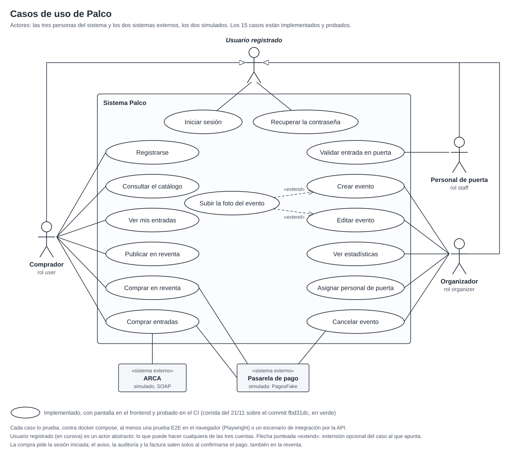

### A.2 Arquitectura de integración

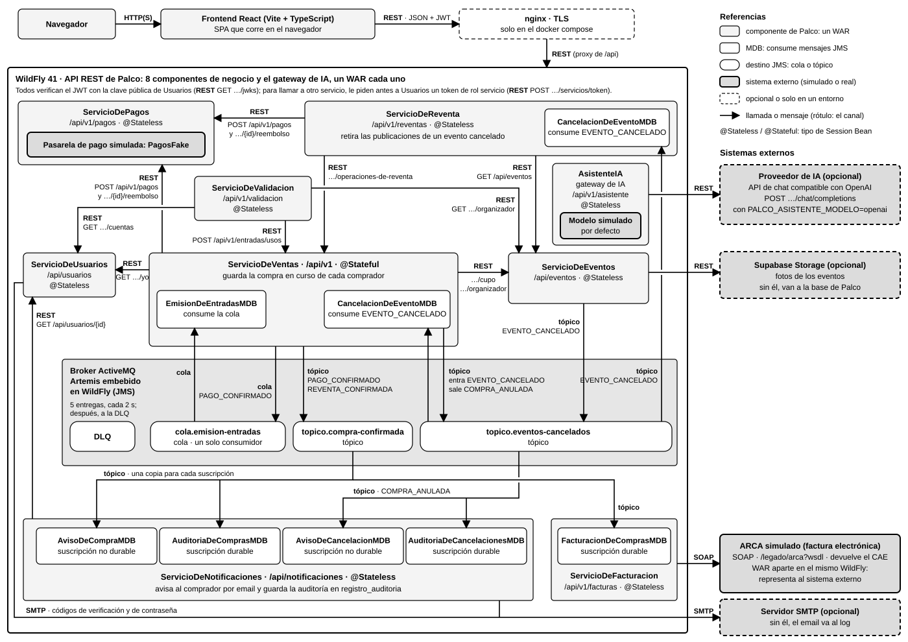

### A.3 Compra: abrir la compra y reservar el cupo (REST)

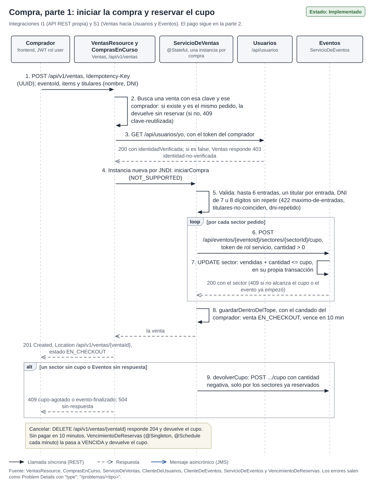

### A.4 Compra: pagar y confirmar (REST y transacción)

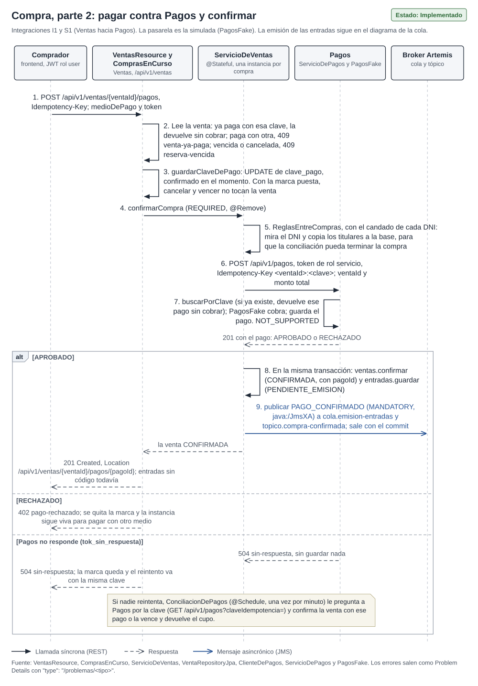

### A.5 Emisión de las entradas (cola)

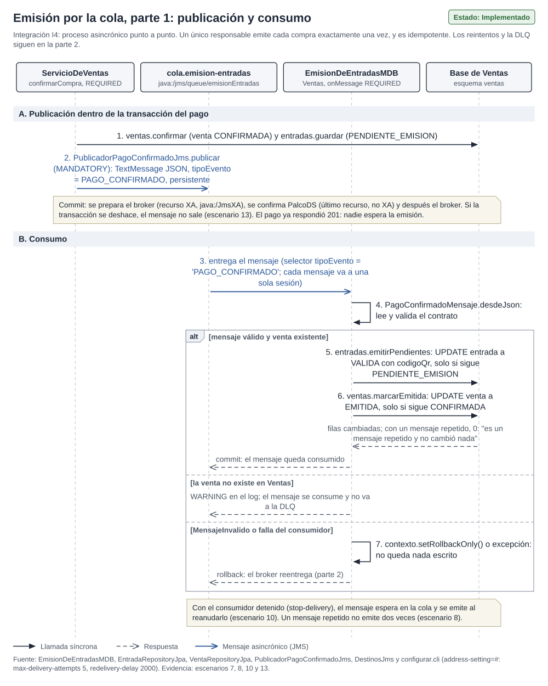

### A.6 Emisión con un mensaje inválido: reintentos y DLQ (cola)

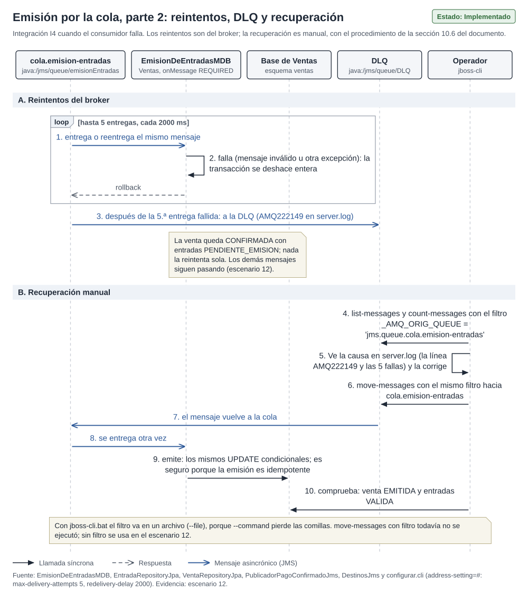

### A.7 Aviso y auditoría de la compra (tópico)

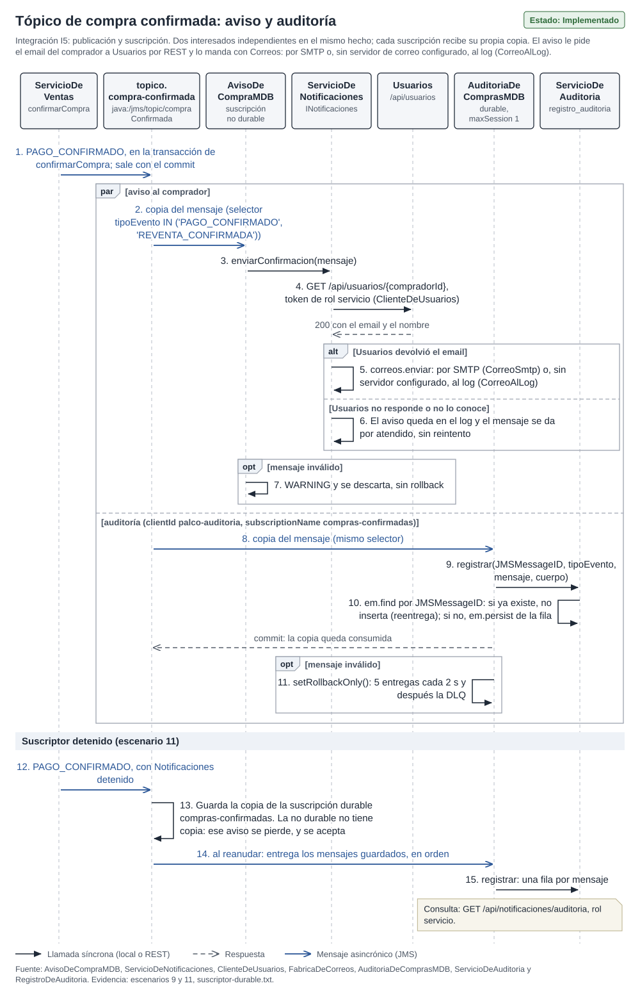

### A.8 Facturación con ARCA (tópico y SOAP)

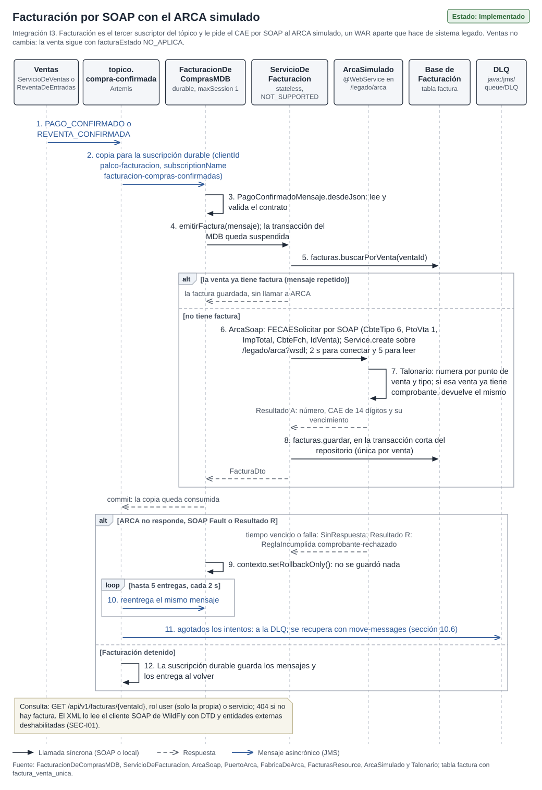

### A.9 Cancelación de un evento (tópico y REST)

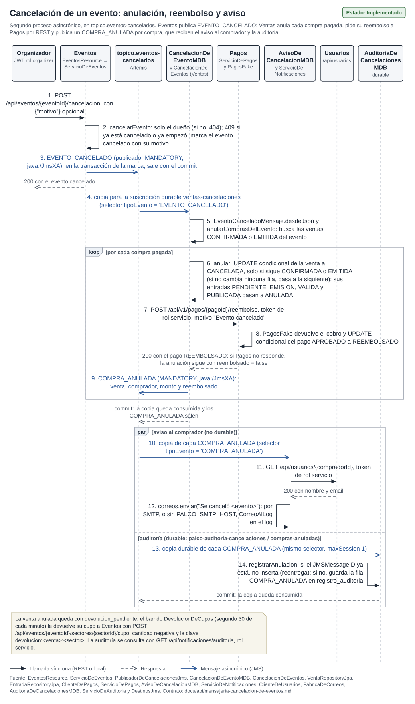

### A.10 Falla después del cobro y conciliación (transacción)

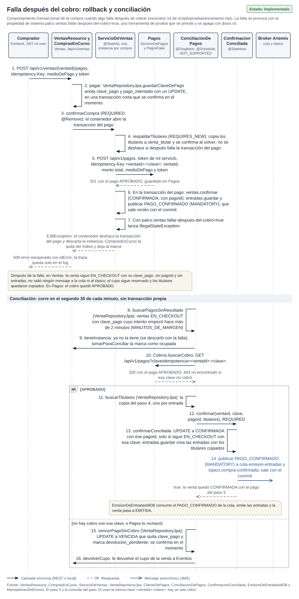

### A.11 Asistente con IA: pregunta, guardrails, modelo y fallback

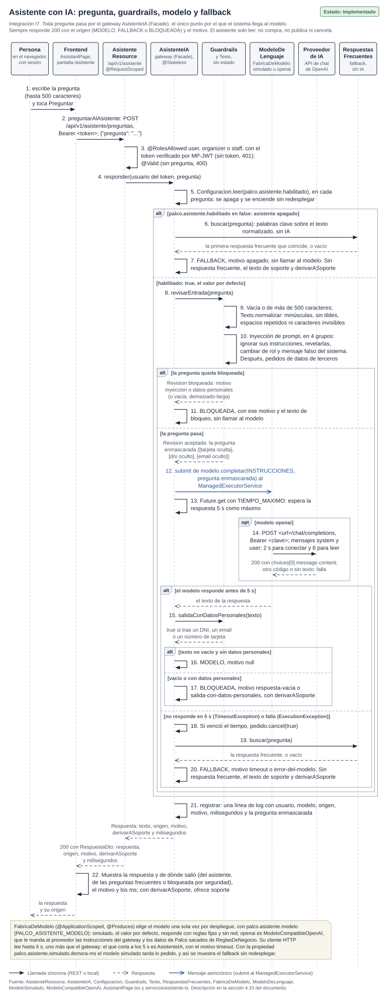

### A.12 Autenticación con JWT y token de servicio (REST)

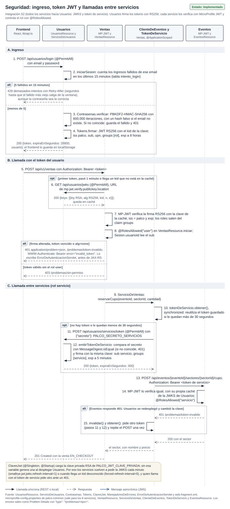

### A.13 Validación en la puerta (REST)

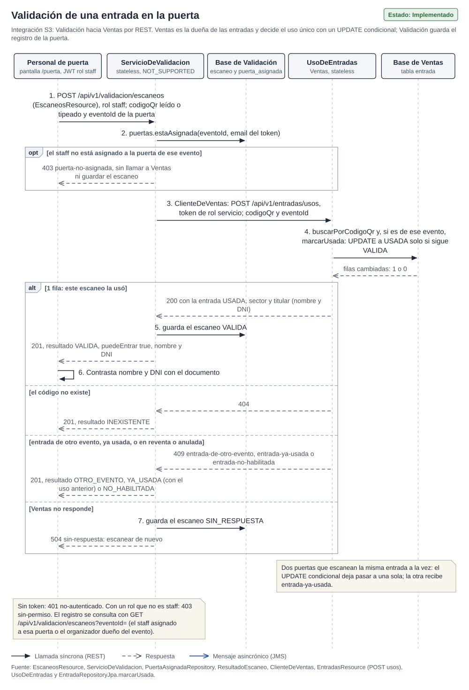

### A.14 Reventa oficial (REST y tópico)

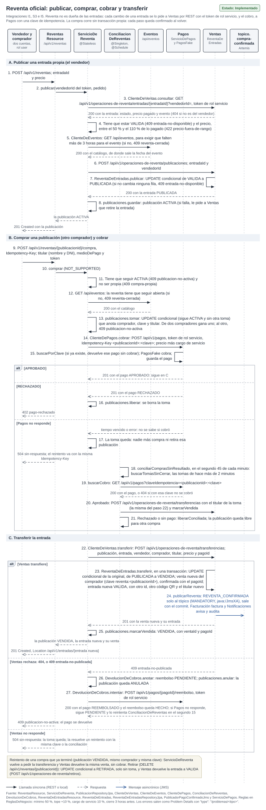

## Anexo B. Declaración de uso de herramientas de IA generativa

La declaración del grupo está en `docs/final/declaracion-uso-ia.md`.
