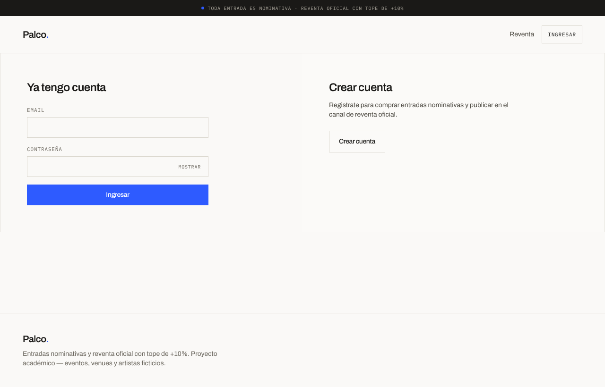
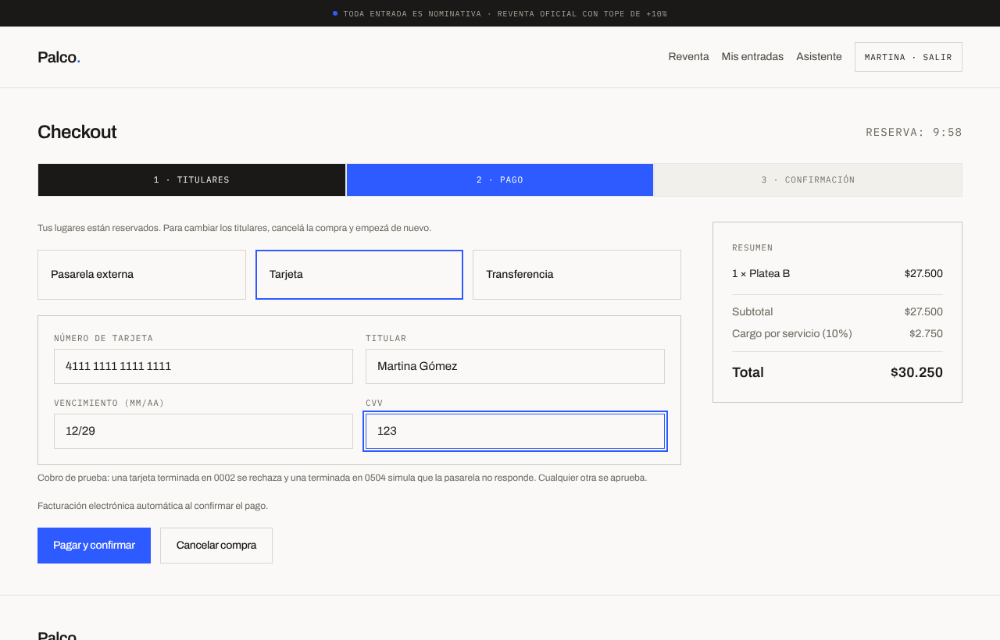
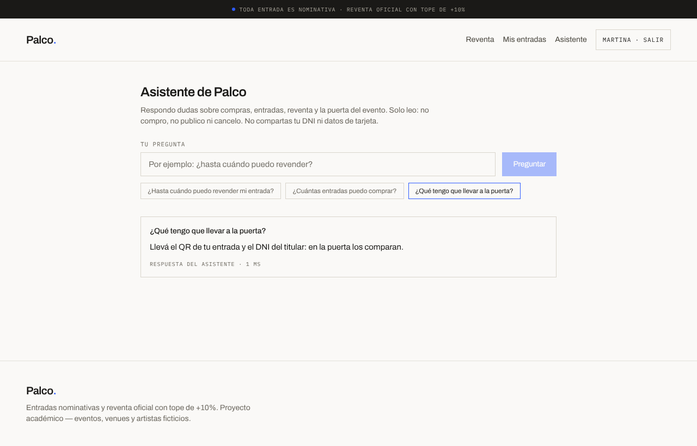
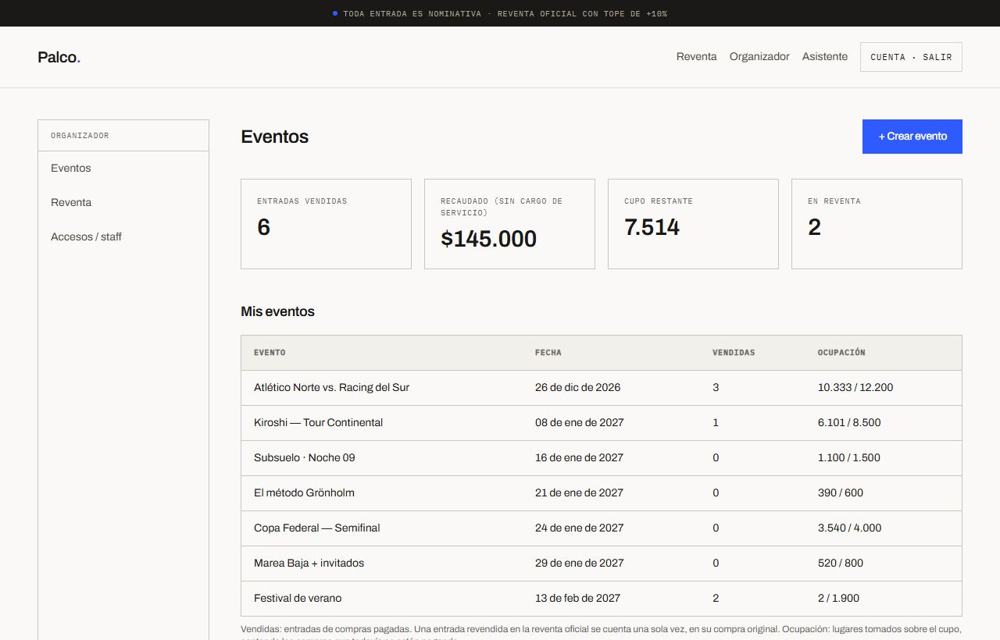
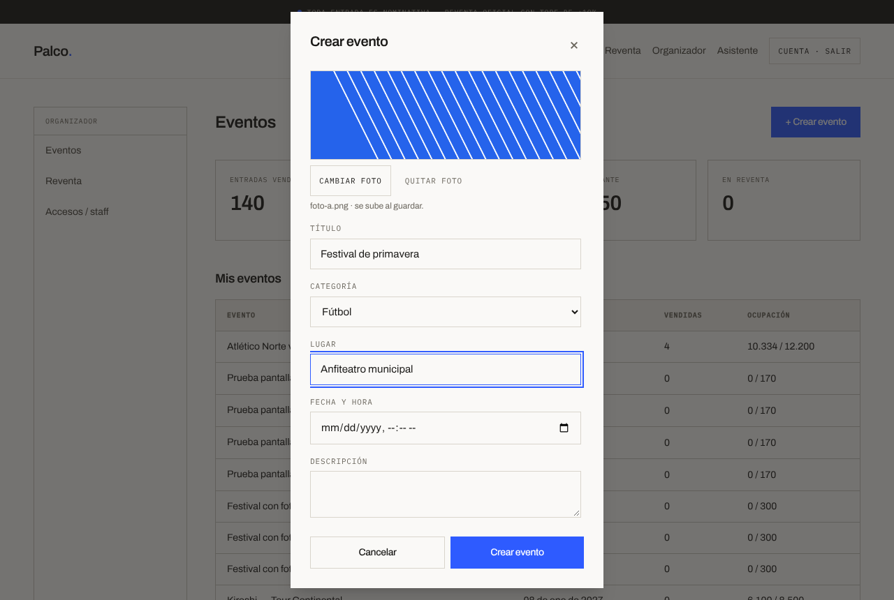

# Manual de usuario de Palco — primera versión

3.er Checkpoint (20/11/2026). Explica cómo usar Palco paso a paso: comprar una entrada, verla,
revenderla, consultar al asistente, administrar eventos y validar entradas en la puerta. Las
capturas son de la aplicación real, tomadas el 18/11/2026.

## Índice

1. [Qué es Palco](#1-qué-es-palco)
2. [Antes de empezar: requisitos y cómo abrir Palco](#2-antes-de-empezar-requisitos-y-cómo-abrir-palco)
3. [Ver el catálogo](#3-ver-el-catálogo)
4. [Elegir las entradas](#4-elegir-las-entradas)
5. [Ingresar o crear una cuenta](#5-ingresar-o-crear-una-cuenta)
6. [Comprar: los titulares](#6-comprar-los-titulares)
7. [Comprar: el pago](#7-comprar-el-pago)
8. [La confirmación y el código QR](#8-la-confirmación-y-el-código-qr)
9. [Mis entradas y publicar en la reventa](#9-mis-entradas-y-publicar-en-la-reventa)
10. [Comprar en la reventa](#10-comprar-en-la-reventa)
11. [El asistente](#11-el-asistente)
12. [Panel del organizador](#12-panel-del-organizador)
13. [Validar entradas en la puerta](#13-validar-entradas-en-la-puerta)
14. [Cerrar sesión](#14-cerrar-sesión)
15. [Errores frecuentes y qué hacer](#15-errores-frecuentes-y-qué-hacer)
16. [Preguntas frecuentes](#16-preguntas-frecuentes)

## 1. Qué es Palco

Palco es una plataforma de venta de entradas **nominativas**: cada entrada lleva el nombre y el DNI
de quien va a ir. Si alguien no puede ir, la revende en la **reventa oficial**, con un precio máximo
del 110 % del precio de lista de su sector. En la puerta se valida el código QR y se compara el titular
con el DNI de quien entra.

Hay tres tipos de usuario:

| Usuario | Qué hace | Dónde |
|---|---|---|
| Comprador | Compra, ve sus entradas, revende y consulta al asistente | Catálogo, Mis entradas, Reventa, Asistente |
| Organizador | Crea, edita y cancela eventos, ve ventas y recaudación, asigna el personal de puerta | Organizador |
| Personal de puerta | Valida las entradas en el ingreso | Puerta |

El catálogo y la **Reventa** se ven sin ingresar. Con la sesión iniciada, cualquier tipo de usuario ve
además el **Asistente**.

## 2. Antes de empezar: requisitos y cómo abrir Palco

**Requisitos:**

- Docker Desktop (o Docker con Compose v2), abierto.
- Un navegador actualizado (Chrome, Edge o Firefox).
- Los puertos 80, 443 y 8080 de la computadora libres.

Con Docker Desktop abierto, desde la carpeta del repositorio:

```bash
docker compose up --build
```

La primera vez tarda unos minutos, porque baja las imágenes y arma el sistema. Está listo cuando
`docker compose ps` muestra los tres contenedores (`db`, `backend` y `web`) como `healthy`.

Cuando termina de arrancar, se abre **https://localhost** en el navegador (`http://localhost` lleva
solo a la dirección segura). La primera vez el navegador avisa que el certificado no es de confianza:
es autofirmado, lo genera Palco al arrancar. Hay que abrir las opciones avanzadas del aviso y elegir
continuar a `localhost`. Se acepta una vez.

**Cuentas de prueba** (todas con la contraseña `palco1234`):

| Email | Tipo de usuario |
|---|---|
| `titular@palco.test` | Comprador |
| `otro.titular@palco.test` | Segundo comprador (para probar la reventa) |
| `organizador@palco.test` | Organizador de los seis eventos de prueba |
| `puerta@palco.test` | Personal de puerta de los seis eventos de prueba |
| `otro.organizador@palco.test` | Segundo organizador, que empieza sin eventos (para ver que cada uno ve solo los suyos) |
| `otra.puerta@palco.test` | Segundo personal de puerta, que empieza sin eventos asignados |

**Los emails en el entorno de prueba.** Palco manda emails al crear una cuenta (el código de
verificación), al confirmarse una compra y al cancelarse un evento. En el entorno de prueba no hay un
servidor de correo configurado, así que esos emails no llegan a ninguna casilla: quedan escritos en el
log del servidor. Para verlos, desde la carpeta del repositorio:

```bash
docker compose logs backend | grep "Email para"
```

(En PowerShell: `docker compose logs backend | Select-String "Email para"`.) Después de la fecha y la
hora, la línea del código de verificación dice:

```
Email para ana@ejemplo.com — Tu código de Palco: Hola Ana: tu código para verificar el email es 482913. Vence en 15 minutos.
```

## 3. Ver el catálogo

La página de inicio muestra el evento destacado y la lista de próximos eventos. Se puede buscar por
nombre del evento o del lugar, y filtrar por categoría (deportes, música, fiestas, teatro). No hace
falta haber ingresado para ver el catálogo.


## 4. Elegir las entradas

Al tocar un evento se abre su página, con la fecha, el lugar y los sectores. En **Elegí tus entradas**,
con los botones **+** y **−** se elige cuántas entradas de cada sector, hasta 6 por compra. Debajo se
ven el subtotal, el cargo por servicio (10 %) y el total. Un sector sin lugares figura como **AGOTADA**.

Después se toca **Continuar al checkout** (en el celular, **Continuar**, en la barra de abajo).

Más abajo, en la misma página, **Reventa oficial** muestra las entradas de ese evento que otros
compradores publicaron (ver la sección 10).


## 5. Ingresar o crear una cuenta

Si todavía no ingresó, Palco pide el email y la contraseña (**Ya tengo cuenta**) y, al tocar
**Ingresar**, sigue con la compra. Después de cinco intentos fallidos en quince minutos, el ingreso
queda bloqueado hasta que pasen.



**Crear una cuenta.** Quien no tiene cuenta toca **Crear cuenta**. Son dos pasos:

1. **Datos:** nombre, apellido, DNI (7 u 8 dígitos), fecha de nacimiento (hay que tener al menos 16
   años), email, teléfono (opcional) y la contraseña dos veces (al menos 8 caracteres, con letras y
   números). Se marcan **Acepto los términos y la política anti-reventa** y **Declaro que los datos
   ingresados son propios**, y se toca **Crear cuenta**.
2. **Verificar email:** Palco manda un código de 6 dígitos al email, que vence a los 15 minutos (en el
   entorno de prueba, el código se lee en el log: ver la sección 2). Se escribe o se pega en las seis
   casillas y se toca **Verificar email**. Con el código correcto, la cuenta queda verificada y con la
   sesión iniciada. Si el código venció o se equivocó varias veces, **reenviar código** manda uno nuevo
   (se habilita a los 30 segundos).

Si alguien intenta ingresar antes de verificar su email, Palco se lo avisa con el enlace **Verificar mi
email**, que lleva al segundo paso.

## 6. Comprar: los titulares

El checkout tiene tres pasos: titulares, pago y confirmación.

En el primero va el **nombre, apellido y DNI** de quien va a usar cada entrada. La primera entrada es
siempre de quien compra: sus datos salen de la cuenta y no se cambian. Las demás se completan a mano.
Al tocar **Continuar**, Palco reserva los lugares por **diez minutos**. Después de este paso los
titulares no se pueden cambiar.

Dos reglas para que nadie acapare entradas:

- **Hasta 6 entradas por evento**, sumando todas las compras de la misma cuenta. Si ya tenés 4 y pedís
  más de 2, Palco avisa que podés comprar 2 más.
- **Una entrada por persona y evento**: un DNI que ya tiene entrada para ese evento no puede ser
  titular de otra, aunque la compre otra cuenta.


## 7. Comprar: el pago

Arriba a la derecha se ve el tiempo que queda de la reserva. Se elige el medio de pago:

- **Tarjeta:** número, titular, vencimiento y código de seguridad. En el entorno de prueba sirve
  cualquier tarjeta; una que termina en `0002` es rechazada y una que termina en `0504` simula que
  la pasarela no responde.
- **Transferencia** y **Pasarela externa:** en esta versión el cobro es de prueba: se simula sin
  salir de Palco y se aprueba al confirmar.

Se toca **Pagar y confirmar**. Para abandonar, **Cancelar compra** libera los lugares.

Si el pago se rechaza, Palco muestra el motivo y la compra sigue abierta para intentar de nuevo. Si
la pasarela no responde, Palco muestra **No sabemos si el pago se acreditó**: los lugares siguen
reservados y no hay que pagar con otro medio; con **Reintentar pago** se repite el mismo pago, sin
cobrar dos veces, y con **Ver estado** se consulta cómo quedó.



## 8. La confirmación y el código QR

Con el pago aprobado, Palco muestra el número de orden y cada entrada con su **código QR**, el sector
y los datos del titular. Debajo del QR está el **Código para la puerta** en texto, con el botón
**Copiar código**. El comprobante de la derecha detalla lo pagado. La factura electrónica se genera
sola y Palco manda un email de confirmación (en el entorno de prueba queda en el log: ver la sección 2).

**Descargar PDF** abre la impresión del navegador, para guardar las entradas como PDF, y **Agregar al
calendario** descarga el evento en un archivo que se abre con el calendario.

En la puerta se pide el QR y el DNI del titular. El código es personal: no hay que compartirlo.


## 9. Mis entradas y publicar en la reventa

En **Mis entradas** están todas las entradas compradas, con su QR y su código para la puerta. Con las
flechas se pasa de una entrada a otra. A la derecha, debajo de la reventa, está el **Historial**: las
compras (cada una con su enlace **factura**), las entradas usadas y las reventas vendidas. Más abajo
aparecen las **compras en curso, canceladas o vencidas**.

Para revender una entrada, en **Publicar en reventa oficial** se escribe el precio de venta. Palco
muestra lo que se pagó, el **mínimo (50 %)** y el **tope (+10 %)**, y no deja publicar fuera de ese
rango. Se toca **Publicar**. Cuando otra persona la compra, se emite una entrada nueva a su nombre y
la vieja deja de servir.

### Reglas de la reventa

- **Precio:** entre el 50 % y el 110 % del **precio de lista del sector**, que es lo que costó la
  entrada en la venta original, sin el cargo por servicio. Una entrada comprada en la reventa conserva
  ese mismo rango: el tope no sube con cada reventa. Es en pesos enteros.
- **Cierre:** la reventa de un evento cierra **3 horas antes** de que empiece. Después no se publica
  ni se compra.
- **Cargo por servicio:** lo paga quien compra en la reventa (10 % del precio publicado), como en
  una compra común.
- **Mientras está publicada, la entrada no sirve para entrar.** En lugar del QR, Palco lo avisa.
- **Retirar:** con la entrada publicada, el botón **Retirar de reventa** la saca de la venta y la
  entrada vuelve a servir. Si la reventa ya cerró y la entrada sigue publicada, hay que retirarla para
  poder usarla.
- No se publica una entrada ya usada, ni una que no es propia.


**La factura.** Cada entrada tiene abajo el botón **Ver factura**, y cada compra del historial, el
enlace **factura**. Muestra la factura electrónica B con su número, la fecha, el **CAE** que dio
ARCA, su vencimiento y el total. En el entorno de prueba ARCA es un servicio simulado y el
comprobante no tiene validez fiscal. La factura se genera sola unos segundos después del pago: si
todavía no está, Palco lo avisa y se puede volver a consultar.


## 10. Comprar en la reventa

En **Reventa** se ven las entradas publicadas por otros compradores, con el evento, el sector, el tope
y el precio. Se pueden filtrar por evento y por sector, y ordenar por precio. Las de un evento también
aparecen en su página, en **Reventa oficial**.

Al tocar **Comprar** se abre la ventana **Comprar en la reventa oficial**, con el precio, el cargo por
servicio y el total:

1. **Titular:** nombre, apellido y DNI de quien va a ir. Vienen con los datos de la cuenta y se pueden
   cambiar.
2. **Medio de pago:** pasarela externa, tarjeta o transferencia, con las mismas tarjetas de prueba
   que en el checkout.
3. **Confirmar compra.**

La entrada se emite de nuevo, con otro QR, a nombre del titular, y aparece en **Mis entradas**. Una
publicación propia figura como **Es tu publicación** y no se puede comprar. Para comprar hay que
haber ingresado con una cuenta de comprador.


## 11. El asistente

En **Asistente** se pueden hacer preguntas sobre compras, entradas, reventa y la puerta del evento. Lo
ve cualquier cuenta con la sesión iniciada: comprador, organizador o personal de puerta. Hay
sugerencias para empezar: "¿Hasta cuándo puedo revender mi entrada?", "¿Cuántas entradas puedo
comprar?" y "¿Qué tengo que llevar a la puerta?".

Cosas a tener en cuenta:

- El asistente **solo informa**: no compra, no publica ni cancela nada.
- No hay que escribirle datos personales (DNI, tarjeta, email). Si se escriben, los oculta.
- Debajo de cada respuesta dice de dónde salió: **Respuesta del asistente**, **Respuesta de las
  preguntas frecuentes** (si el asistente tarda o no está disponible, responde igual con una
  respuesta frecuente) o **Pregunta bloqueada por seguridad**.
- Si no puede resolver la consulta, sugiere escribir a soporte.

En el entorno de prueba, las respuestas salen de un modelo simulado que conoce las reglas de Palco.



## 12. Panel del organizador

Al ingresar como organizador aparece **Organizador**. El panel muestra las entradas vendidas, lo
recaudado (sin el cargo por servicio), el cupo restante y las entradas en reventa, y la lista de sus
eventos con fecha, ventas y ocupación.

- **+ Crear evento:** foto, título, categoría, lugar, fecha y hora, descripción y sectores con precio
  y cupo.
- **Reventa:** las publicaciones activas del evento elegido.
- **Accesos / staff:** el registro de la puerta y el personal asignado a cada evento.

En pantallas anchas, el menú de la izquierda (**Eventos**, **Reventa** y **Accesos / staff**) salta a
cada parte del panel. Un organizador solo ve y modifica sus propios eventos.



### La foto del evento

Arriba del formulario de **Crear evento** está **Subir foto**: se elige una imagen JPG, PNG o WEBP de
hasta 2 MB y se ve enseguida cómo queda. La foto se sube al tocar **Crear evento**. Sin foto propia,
el evento usa la foto de su categoría. Con **quitar foto** se descarta la elegida.



### Editar un evento

En **Detalle por evento** se elige el evento y se toca **Editar evento**. El formulario se abre con
los datos actuales: se puede cambiar la foto (o quitarla para volver a la de la categoría), el título, la categoría, el lugar, la fecha, la descripción y
los sectores, y agregar sectores nuevos. Se toca **Guardar cambios**.

Un sector que ya tiene entradas vendidas no se puede quitar ni cambiar de precio, y su cupo no puede
bajar de lo vendido: así el precio de lista, sobre el que se calcula el tope de la reventa, sigue siendo
lo que pagó cada comprador.
Un evento que ya empezó o que está cancelado no se puede editar.


### Cancelar un evento

En **Detalle por evento** se toca **Cancelar evento**. Palco avisa qué va a pasar: el evento sale del
catálogo, se anulan las entradas vendidas, se le devuelve el pago a cada comprador y se le manda un
email (en el entorno de prueba, al log). Se puede escribir un motivo, que es lo que ven los
compradores. Se confirma con **Sí, cancelar el evento**. **No se puede deshacer.**

Después, el panel muestra el evento como cancelado. El comprador ve su compra anulada en **Mis
entradas**, con el aviso de la devolución, y si abre el enlace del evento ve que se canceló y no
puede comprar. Las publicaciones de ese evento en la reventa se retiran.


### La reventa de un evento

En **Reventa oficial**, dentro del detalle del evento, se ve cuántas publicaciones activas tiene y su
precio promedio. El tope lo fija Palco: el organizador no puede cambiarlo.

### Accesos en puerta y equipo de puerta

En **Accesos en puerta** se ven los ingresos, los rechazos y cuántas entradas faltan ingresar, y una
tabla con los últimos escaneos: el código (recortado), el resultado, la cuenta de puerta que escaneó y
la hora.

En **Equipo de puerta** están las cuentas que pueden validar entradas de ese evento:

1. En **Email de la cuenta de puerta** se escribe el email de una cuenta de personal de puerta (por
   ejemplo, `otra.puerta@palco.test`).
2. Se toca **Asignar**. La cuenta aparece en la lista y, desde ese momento, ve el evento en su pantalla
   de puerta.
3. Para sacarla, **Quitar**: deja de poder validar entradas de ese evento.

Solo se pueden asignar cuentas de personal de puerta.

## 13. Validar entradas en la puerta

Al ingresar como personal de puerta aparece **Puerta**. Solo se ven los eventos a los que el
organizador asignó esa cuenta.

1. En **Evento de esta puerta** se elige el evento.
2. En **Código QR** se escribe o se pega el código de la entrada: el texto que figura como **Código
   para la puerta** debajo del QR, en **Mis entradas** o en la confirmación de la compra.
3. Se toca **Validar entrada**.

Palco responde si la entrada es válida y muestra el titular y su documento, para compararlos con el
DNI de quien entra. Una entrada válida queda marcada como usada en ese mismo momento. Una entrada ya
usada, publicada en la reventa, revendida o de otro evento se rechaza, y un código que no existe
figura como **Código no reconocido**.

En la columna derecha, debajo del resultado, están arriba los contadores de **ingresos** y
**rechazos**, y abajo los **Últimos escaneos**, del más reciente al más antiguo.


## 14. Cerrar sesión

Arriba a la derecha está el botón con el nombre de la cuenta y **salir** (en el celular, solo
**salir**). Al tocarlo se cierra la sesión y se vuelve al catálogo. Si había una compra con los
lugares reservados y sin pagar, esos lugares se liberan.

## 15. Errores frecuentes y qué hacer

| Lo que aparece | Qué pasó | Qué hacer |
|---|---|---|
| "No pudimos cargar los eventos" | El sistema todavía está arrancando o no responde | Esperar a que `docker compose ps` muestre los contenedores `healthy` y tocar **Reintentar** |
| "Revisá el email y la contraseña." | El email o la contraseña no coinciden | Revisarlos; con **mostrar** se ve la contraseña escrita |
| "Hubo demasiados intentos fallidos. Probá de nuevo en N minutos." | Cinco intentos fallidos seguidos | Esperar los minutos que indica |
| Aviso de email sin verificar, con el enlace **Verificar mi email** | La cuenta se creó pero falta el código | Tocar el enlace y escribir el código (en el entorno de prueba, en el log: sección 2) |
| El código de verificación no se acepta | Está mal escrito, venció o se superaron los intentos | Tocar **reenviar código** y usar el nuevo |
| "Ese DNI ya está asignado a otra entrada de esta compra." | Dos entradas de la misma compra con el mismo DNI | Cada entrada lleva el DNI de una persona distinta |
| "El DNI … ya tiene una entrada para este evento." | Esa persona ya tiene entrada para el evento, aunque la haya comprado otra cuenta | Poner a otra persona como titular |
| "Cada persona puede tener hasta 6 entradas por evento… podés comprar N más." | Se pasó el tope sumando las compras anteriores | Pedir como mucho las que indica |
| "Venció tu reserva" | Pasaron los 10 minutos sin un pago aprobado | Volver al evento y elegir de nuevo |
| El pago se rechaza | La pasarela lo rechazó (en prueba, una tarjeta terminada en `0002`) | Probar con otra tarjeta u otro medio: la compra sigue abierta |
| "No sabemos si el pago se acreditó" | La pasarela no respondió (en prueba, una tarjeta terminada en `0504`) | No pagar con otro medio. **Reintentar pago** o **Ver estado** |
| "La factura todavía se está generando con ARCA…" | La factura tarda unos segundos después del pago | Volver a abrirla en unos segundos |
| "El máximo permitido es $…" o "El mínimo es $…" | El precio de reventa está fuera del rango | Poner un precio entre el mínimo y el tope que muestra la pantalla |
| "La reventa cierra 3 horas antes del evento." | Faltan menos de 3 horas para el evento | Ya no se puede publicar ni comprar en la reventa de ese evento |
| "Las compras se hacen con una cuenta de comprador. Ingresaste como …" | Se ingresó como organizador o personal de puerta | Cerrar sesión e ingresar con una cuenta de comprador |
| "No estás asignado a la puerta de ningún evento…" | El organizador todavía no asignó esa cuenta | Pedirle al organizador que la agregue en **Equipo de puerta**: el evento aparece solo, sin recargar |
| "Esa cuenta no es de personal de puerta…" | Se intentó asignar a la puerta una cuenta de comprador o de organizador | Asignar una cuenta de personal de puerta |
| En la puerta, "Sin respuesta" o "No se pudo validar" | El sistema no respondió a tiempo | Volver a validar el mismo código |

## 16. Preguntas frecuentes

| Pregunta | Respuesta |
|---|---|
| ¿Puedo cambiar el titular después de comprar? | No. La entrada es nominativa; si no puede ir, se revende. |
| ¿Puedo comprar más de una vez para el mismo evento? | Sí, hasta 6 entradas en total, y cada persona (DNI) con una sola entrada. |
| ¿A cuánto puedo revender? | Entre el 50 % y el 110 % del precio de lista del sector. |
| ¿Hasta cuándo puedo revender? | Hasta 3 horas antes de que empiece el evento. |
| ¿Puedo sacar una entrada de la reventa? | Sí, con **Retirar de reventa** en **Mis entradas**, mientras nadie la haya comprado. |
| ¿Qué pasa si se vence la reserva de diez minutos? | Los lugares se liberan y hay que empezar la compra de nuevo. |
| ¿Qué llevo a la puerta? | El QR de la entrada y el DNI del titular. |
| ¿Qué pasa si cancelan el evento? | Las entradas se anulan, se devuelve el pago, las publicaciones en la reventa se retiran y se manda un email. |
