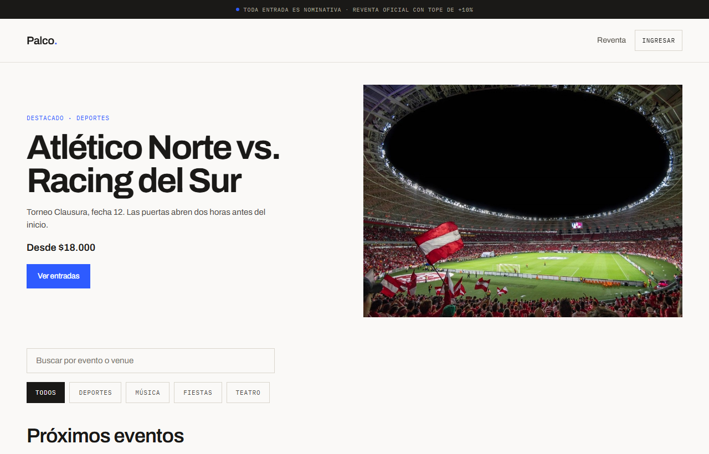
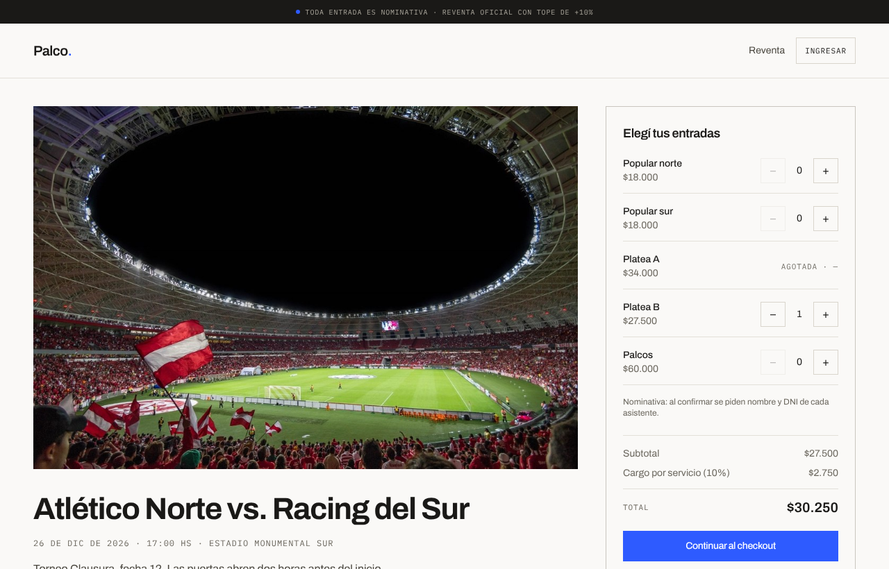
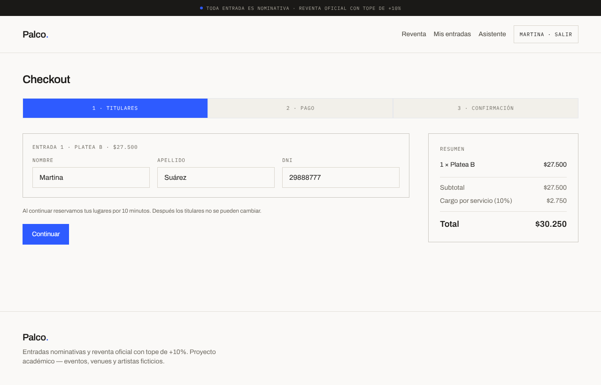
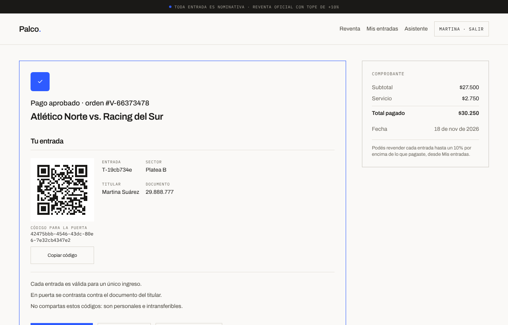
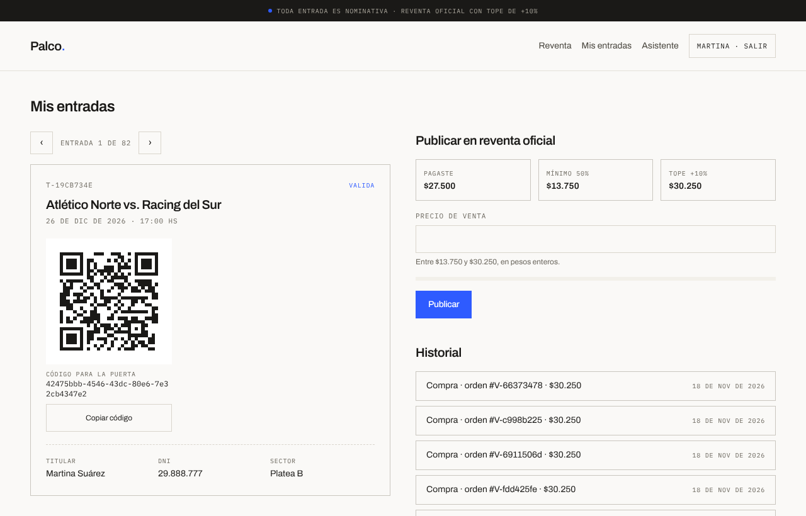
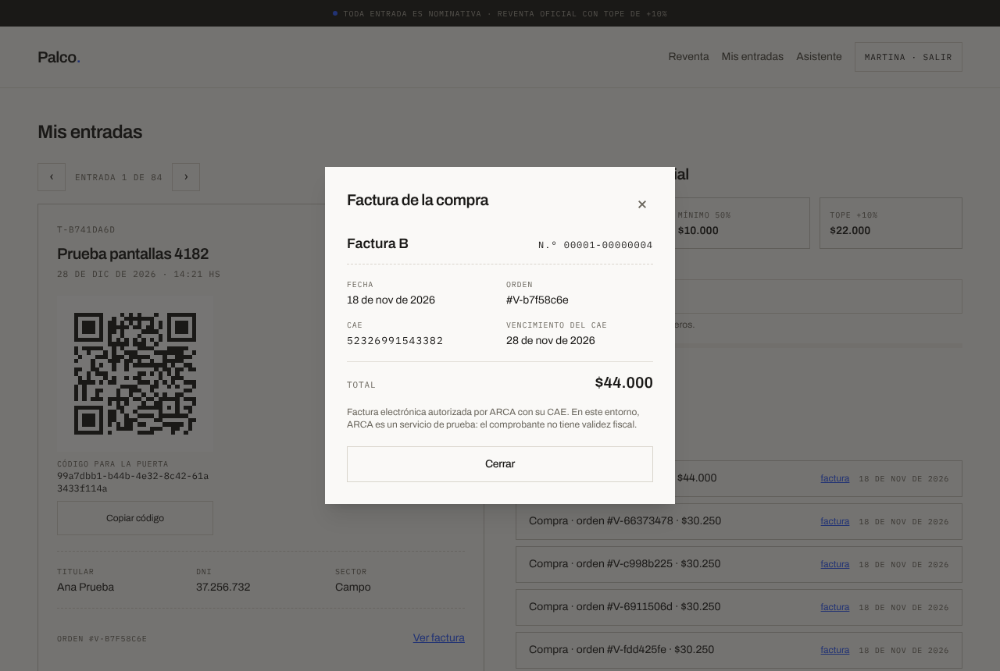
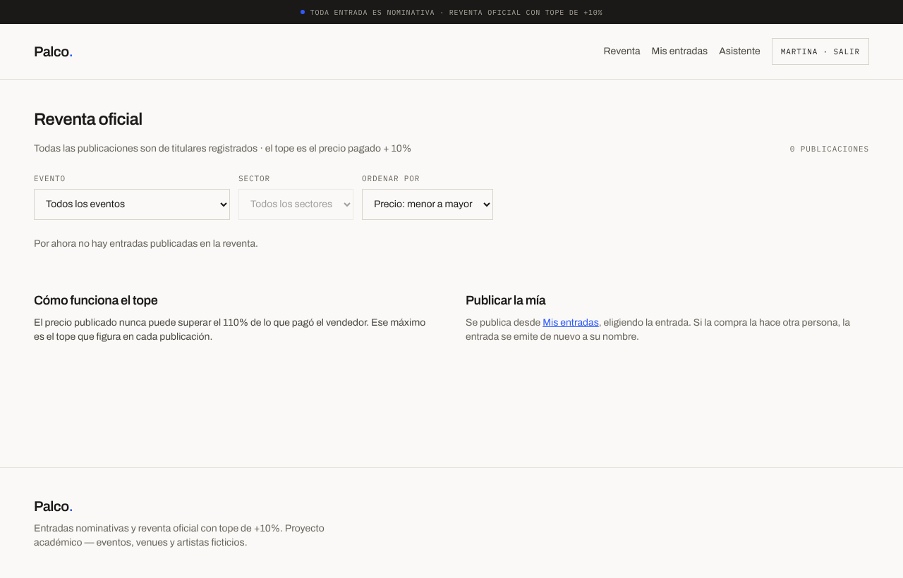
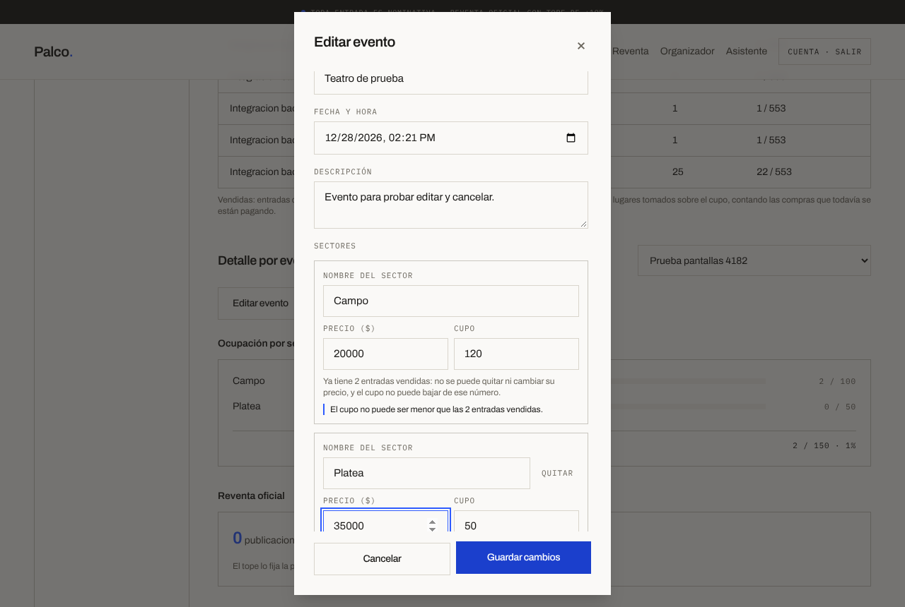
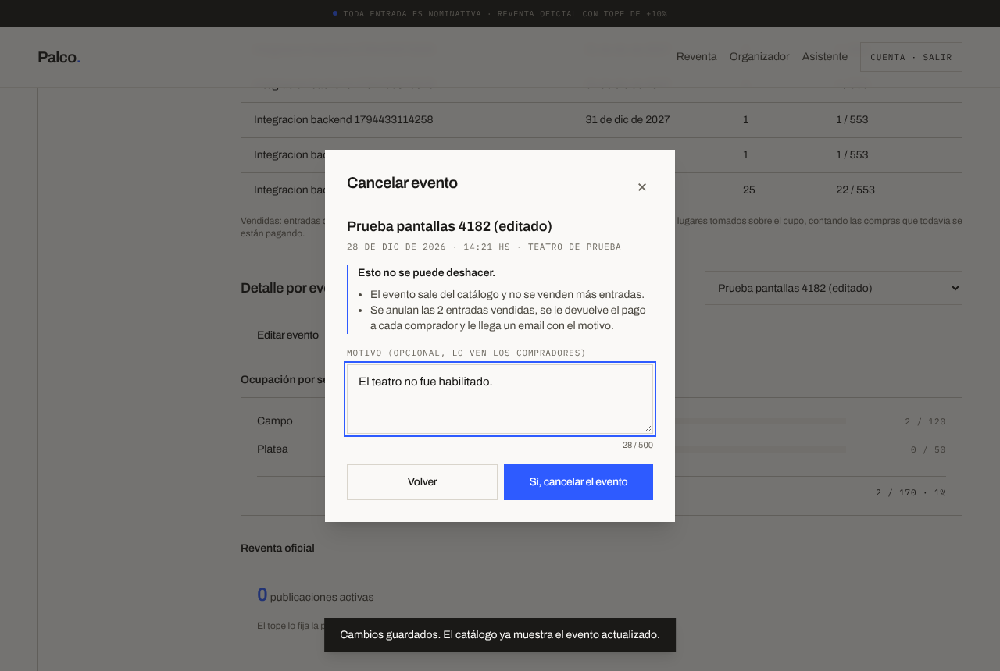
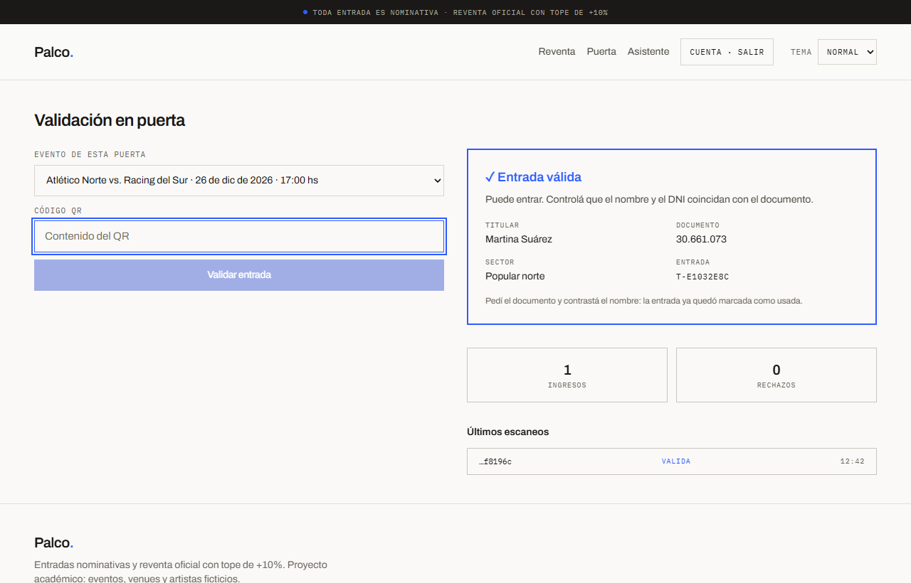

# Manual de usuario de Palco — primera versión

3.er Checkpoint (20/11/2026). Explica cómo usar Palco paso a paso: comprar una entrada, verla,
revenderla, consultar al asistente, administrar eventos y validar entradas en la puerta. Las
capturas son de la aplicación real, tomadas el 18/11/2026.

## 1. Qué es Palco

Palco es una plataforma de venta de entradas **nominativas**: cada entrada lleva el nombre y el DNI
de quien va a ir. Si alguien no puede ir, la revende en la **reventa oficial**, con un precio máximo
del 110 % de lo que pagó. En la puerta se valida el código QR contra el DNI del titular.

Hay tres tipos de usuario:

| Usuario | Qué hace | Dónde |
|---|---|---|
| Comprador | Compra, ve sus entradas, revende y consulta al asistente | Catálogo, Mis entradas, Reventa, Asistente |
| Organizador | Crea eventos, ve ventas y recaudación, asigna el personal de puerta | Organizador |
| Personal de puerta | Valida las entradas en el ingreso | Puerta |

## 2. Cómo abrir Palco

Con Docker Desktop abierto, desde la carpeta del repositorio:

```bash
docker compose up --build
```

Cuando termina de arrancar, se abre **https://localhost** en el navegador. La primera vez el
navegador avisa que el certificado no es de confianza (es autofirmado): hay que aceptarlo una vez.

**Cuentas de prueba** (todas con la contraseña `palco1234`):

| Email | Tipo de usuario |
|---|---|
| `titular@palco.test` | Comprador |
| `otro.titular@palco.test` | Segundo comprador (para probar la reventa) |
| `organizador@palco.test` | Organizador de los seis eventos de prueba |
| `puerta@palco.test` | Personal de puerta de los seis eventos de prueba |

## 3. Ver el catálogo

La página de inicio muestra el evento destacado y la lista de próximos eventos. Se puede buscar por
nombre del evento o del lugar, y filtrar por categoría (deportes, música, fiestas, teatro). No hace
falta haber ingresado para ver el catálogo.



## 4. Elegir las entradas

Al tocar un evento se abre su página, con la fecha, el lugar y los sectores. Con los botones **+** y
**−** se elige cuántas entradas de cada sector. A la derecha se ve el subtotal, el cargo por servicio
(10 %) y el total. Un sector sin lugares figura como **AGOTADO**.

Después se toca **Continuar al checkout**.



## 5. Ingresar o crear una cuenta

Si todavía no ingresó, Palco pide el email y la contraseña. Quien no tiene cuenta toca **Crear
cuenta** y completa sus datos. Después de cinco intentos fallidos, la cuenta se bloquea por quince
minutos.


## 6. Comprar: los titulares

El checkout tiene tres pasos: titulares, pago y confirmación.

En el primero se completa el **nombre, apellido y DNI** de quien va a usar cada entrada. Al tocar
**Continuar**, Palco reserva los lugares por **diez minutos**. Después de este paso los titulares no
se pueden cambiar.



## 7. Comprar: el pago

Arriba a la derecha se ve el tiempo que queda de la reserva. Se elige el medio de pago:

- **Tarjeta:** número, titular, vencimiento y código de seguridad. En el entorno de prueba sirve
  cualquier tarjeta; una que termina en `0002` es rechazada y una que termina en `0504` simula que
  la pasarela no responde.
- **Transferencia** y **Pasarela externa:** en esta versión el cobro es de prueba: se simula sin
  salir de Palco y se aprueba al confirmar.

Se toca **Pagar y confirmar**. Para abandonar, **Cancelar compra** libera los lugares.


## 8. La confirmación y el código QR

Con el pago aprobado, Palco muestra el número de orden y la entrada con su **código QR**, el sector
y los datos del titular. El comprobante de la derecha detalla lo pagado. La factura electrónica se
genera sola y llega un email de confirmación.

En la puerta se pide el QR y el DNI del titular. El código es personal: no hay que compartirlo.



## 9. Mis entradas y publicar en la reventa

En **Mis entradas** están todas las entradas compradas, con su QR, y abajo el historial de compras.
Con las flechas se pasa de una entrada a otra.

Para revender una entrada, en **Publicar en reventa oficial** se escribe el precio de venta. Palco
muestra el precio pagado, el mínimo y el **tope (110 %)**: no deja publicar por encima. Se toca
**Publicar**. Cuando otra persona la compra, se emite una entrada nueva a su nombre y la vieja deja
de servir.



**La factura.** Cada entrada tiene abajo el botón **Ver factura**, y cada compra del historial, el
enlace **factura**. Muestra la factura electrónica B con su número, la fecha, el **CAE** que dio
ARCA, su vencimiento y el total. La factura se genera sola unos segundos después del pago: si todavía
no está, Palco lo avisa y se puede volver a consultar.



## 10. Comprar en la reventa

En **Reventa** se ven las entradas publicadas por otros compradores. Se pueden filtrar por evento y
por sector, y ordenar por precio. La compra sigue los mismos pasos del checkout: el titular nuevo
completa sus datos y paga.



## 11. El asistente

En **Asistente** se pueden hacer preguntas sobre compras, entradas, reventa y la puerta del evento.
Hay sugerencias para empezar, por ejemplo "¿Hasta cuándo puedo revender?".

Cosas a tener en cuenta:

- El asistente **solo informa**: no compra, no publica ni cancela nada.
- No hay que escribirle datos personales (DNI, tarjeta, email). Si se escriben, los oculta.
- Si el asistente tarda o no está disponible, responde igual con una respuesta frecuente, y lo indica
  debajo de la respuesta.
- Si no puede resolver la consulta, sugiere escribir a soporte.


## 12. Panel del organizador

Al ingresar como organizador aparece **Organizador**. El panel muestra las entradas vendidas, lo
recaudado, el cupo restante y las entradas en reventa, y la lista de sus eventos con fecha, ventas y
ocupación.

- **+ Crear evento:** nombre, fecha, lugar, sectores con precio y cupo.
- **Reventa:** las publicaciones de sus eventos.
- **Accesos / staff:** asignar personal de puerta a cada evento.

Un organizador solo ve y modifica sus propios eventos.


### Editar un evento

En **Detalle por evento** se elige el evento y se toca **Editar evento**. El formulario se abre con
los datos actuales: se puede cambiar el título, la categoría, el lugar, la fecha, la descripción y
los sectores, y agregar sectores nuevos. Se toca **Guardar cambios**.

Un sector que ya tiene entradas vendidas no se puede quitar ni cambiar de precio, y su cupo no puede
bajar de lo vendido: así el tope de la reventa sigue calculándose sobre lo que pagó cada comprador.
Un evento que ya empezó o que está cancelado no se puede editar.



### Cancelar un evento

En **Detalle por evento** se toca **Cancelar evento**. Palco avisa qué va a pasar: el evento sale del
catálogo, se anulan las entradas vendidas, se le devuelve el pago a cada comprador y le llega un
email. Se puede escribir un motivo, que es lo que ven los compradores. Se confirma con **Sí, cancelar
el evento**. **No se puede deshacer.**

Después, el panel muestra el evento como cancelado. El comprador ve su compra anulada en **Mis
entradas**, con el aviso de la devolución, y si abre el enlace del evento ve que se canceló y no
puede comprar.



## 13. Validar entradas en la puerta

Al ingresar como personal de puerta aparece **Puerta**.

1. Se elige el evento de esta puerta.
2. Se escanea el QR con la cámara, o se pega el contenido del código en **Código QR**.
3. Se toca **Validar entrada**.

Palco responde si la entrada es válida y muestra el titular, para comparar con su DNI. Una entrada ya
usada, revendida o de otro evento se rechaza. Arriba se ven los contadores de ingresos y rechazos, y
a la derecha los últimos escaneos, del más reciente al más antiguo.



## 14. Preguntas frecuentes

| Pregunta | Respuesta |
|---|---|
| ¿Puedo cambiar el titular después de comprar? | No. La entrada es nominativa; si no puede ir, se revende. |
| ¿A cuánto puedo revender? | Hasta el 110 % de lo que pagó. |
| ¿Qué pasa si se vence la reserva de diez minutos? | Los lugares se liberan y hay que empezar la compra de nuevo. |
| ¿Qué llevo a la puerta? | El QR de la entrada y el DNI del titular. |
| ¿Qué pasa si cancelan el evento? | Las entradas se anulan, se devuelve el pago y llega un email. |
