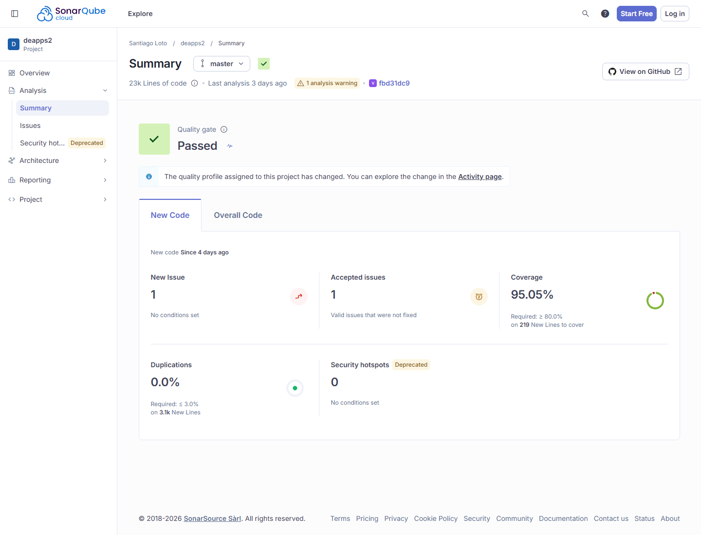
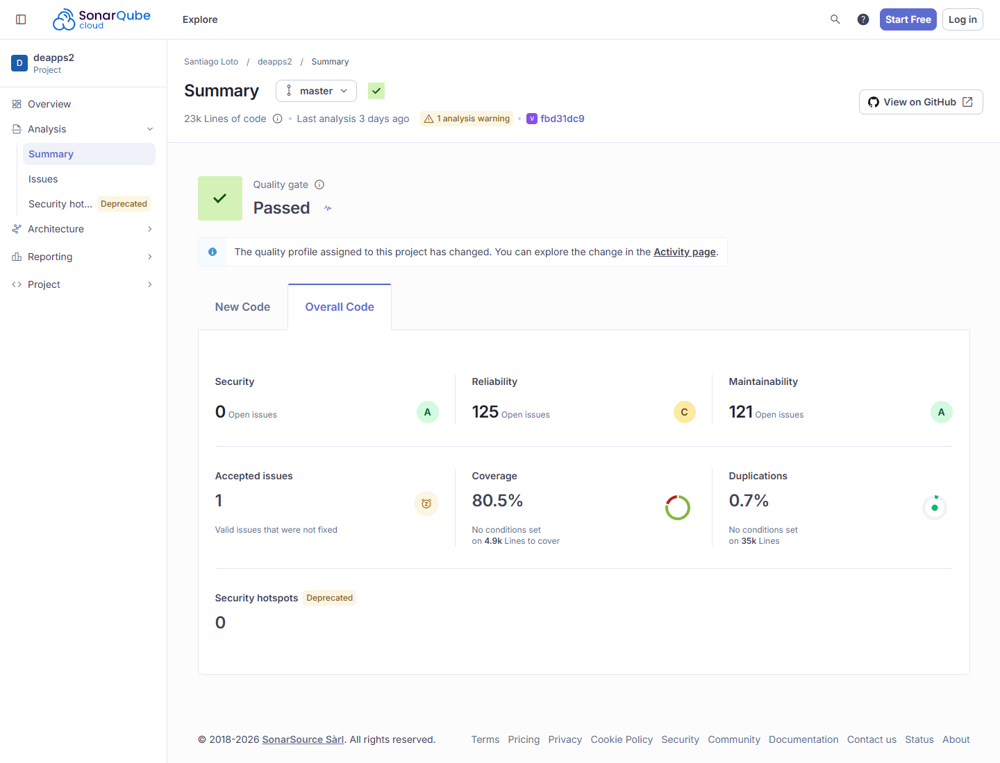

# Informe de ejecución de pruebas de Palco

Versión 1.0, 24/11/2026. Responsable: Joaquin Molina (QA).

Resultados de la corrida de todas las pruebas automatizadas sobre el commit `fbd31dc` de `master` (21/11/2026), el
candidato a la Entrega Final, más los dos tests unitarios de CA-12.4 y CA-16.4 que entran al tag. Es el punto 4 de
los entregables del QA de los Criterios de Testing de la cátedra (condición G4): totales por nivel, cobertura,
mutation score, tiempos, performance y Quality Gate. Cada cifra sale de un run de GitHub Actions o de una corrida
local con su salida guardada; los resúmenes están en `docs/testing/evidencia/final/` y cada sección nombra el suyo.
Lo que se corrigió el 24/11, después de esta corrida, se nombra aparte (secciones 3, 9 y 11): sus cifras son de
corridas locales sin salida guardada en `evidencia/final/`, y la prueba que lo verifica corre sobre el tag.

**Referencias:** plan de pruebas (`docs/testing/plan-de-pruebas.md`: niveles en la sección 2, criterios en la 4),
matriz de trazabilidad (`docs/testing/evidencia/matriz-de-trazabilidad.md`), registro de defectos
(`docs/testing/registro-de-defectos.md`) y los runs en `https://github.com/santttii/deapps2/actions/runs/<run>`.

## 1. Qué se corrió

| Run | Workflow | Cuándo (UTC) | Duración | Resultado | Resumen |
|---|---|---|---|---|---|
| 44867187162 | CI: backend, SonarCloud, frontend, gitleaks, integración (4 jobs), API y E2E | 21/11, 04:39:40 a 04:46:48 | 7 min 08 s | success | `ci-fbd31dc.txt`, `cobertura.txt`, `sonar.txt` |
| 44867187123 | Pruebas de seguridad | 21/11, 04:39:40 a 04:42:41 | 3 min 01 s | success | `seguridad.txt` |
| 44867187143 | Mutación | 21/11, 04:39:40 a 04:44:46 | 5 min 06 s | success | `mutacion.txt` |
| 44867187171 | Seguridad (Trivy) | 21/11, 04:39:41 a 04:41:45 | 2 min 04 s | success | `trivy.txt` |
| 44867187179 | Contrato | 21/11, 04:39:41 a 04:42:53 | 3 min 12 s | success | `contrato.txt` |
| 44867187212 | Lighthouse | 21/11, 04:39:41 a 04:43:53 | 4 min 12 s | success | `lighthouse.txt` |
| 44867187257 | ZAP | 21/11, 04:39:41 a 04:44:14 | 4 min 33 s | success | `zap.txt` |
| 45439831486 | Carga (k6), a mano sobre `fbd31dc` | 24/11, 16:40:20 a 16:48:45 | 8 min 25 s | success | `k6.txt` |
| 45439837443 | Estabilidad, a mano sobre `fbd31dc` | 24/11, 16:40:22 a 16:45:01 | 4 min 39 s | success | `estabilidad.txt` |
| Local | Los dos tests nuevos, con sus módulos y tres veces seguidas | 24/11, 17:03 a 17:10 | 47 s los módulos | BUILD SUCCESS | `junit-nuevos.txt` |

Los 21 check runs del commit (los 18 jobs del push, el análisis de SonarCloud y los jobs de Carga y Estabilidad)
terminaron en success. Cada workflow que necesita el sistema lo levanta de cero en el runner con
`docker compose up --build --wait` (PostgreSQL 17, WildFly 41 con el broker embebido, nginx con TLS y el ARCA
simulado): en los jobs de integración tardó entre 20 y 26 segundos, con las imágenes ya armadas. La corrida local fue
en Windows 11, con JDK 25.0.5 y Maven 3.9.16, sobre una copia del backend y de `docs/` tal como están en `fbd31dc`.

## 2. Totales por nivel

Ejecutados, pasados, fallados y bloqueados, cada nivel en su propia unidad (tests, pedidos, casos o comprobaciones).
Bloqueado es una prueba que no se pudo correr por un defecto: en esta corrida no hubo ninguna.

| Nivel | Herramienta | Unidad | Ejecutados | Pasaron | Fallaron | Bloqueados | Run y resumen |
|---|---|---|---:|---:|---:|---:|---|
| Unitarias | JUnit 6 + Mockito | tests | 1079 | 1079 | 0 | 0 | 44867187162 (1077) y local (2 nuevos); `ci-fbd31dc.txt`, `junit-nuevos.txt` |
| Integración con base | JUnit 6 + H2 en modo PostgreSQL (`*EnH2Test`) | tests | 109 | 109 | 0 | 0 | 44867187162; `ci-fbd31dc.txt` |
| Contrato SOAP | `ContratoDelWsdlTest` (dentro de las unitarias) | tests | 7 | 7 | 0 | 0 | 44867187162; `contrato.txt` |
| Set de evaluación del asistente | `EvaluacionDelAsistenteTest` (dentro de las unitarias) | casos | 26 | 26 | 0 | 0 | 44867187162; adversariales 11 de 11 |
| API | Postman + Newman | pedidos / aserciones | 218 / 676 | 218 / 676 | 0 | 0 | 44867187162, job "API"; `ci-fbd31dc.txt` |
| Contrato REST | Schemathesis 4.32.7, 4 roles | casos generados | 5574 | 5574 | 0 | 0 | 44867187179; `contrato.txt` |
| Integración de punta a punta | `escenarios.mjs` contra el compose | escenarios / comprobaciones | 24 / 389 | 24 / 389 | 0 | 0 | 44867187162, jobs "Integración"; `ci-fbd31dc.txt` |
| Resiliencia y patrones | `etag.mjs`, `patron-state.mjs`, `asistente.mjs`, `broker-apagado.mjs` | comprobaciones | 50 | 50 | 0 | 0 | 44867187162, job "Integración: general" |
| E2E | Playwright (Chromium) | tests | 31 | 31 | 0 | 0 | 44867187162, job "E2E"; `ci-fbd31dc.txt` |
| Seguridad por la API | `seguridad.mjs` (bloques A a E) | comprobaciones | 64 | 64 | 0 | 0 | 44867187123; `seguridad.txt` |
| Seguridad en el navegador | `xss.spec.ts` | tests | 2 | 2 | 0 | 0 | 44867187123; `seguridad.txt` |
| Escaneo web | OWASP ZAP 2.17.0, baseline y API autenticada | escaneos | 2 | 2 | 0 | 0 | 44867187257; `zap.txt` |
| Dependencias | Trivy v0.76.2 (repo, imagen backend, imagen web) | escaneos | 3 | 3 | 0 | 0 | 44867187171; `trivy.txt` |
| Secretos | gitleaks 8.28.0, todo el historial | escaneos | 1 | 1 | 0 | 0 | 44867187162, job "Secretos"; `ci-fbd31dc.txt` |
| Accesibilidad | Lighthouse 13.6.0, 5 pantallas en teléfono y escritorio | corridas | 10 | 10 | 0 | 0 | 44867187212; `lighthouse.txt` |
| Carga | k6 2.3.0, 50 usuarios virtuales, 5 min | umbrales | 11 | 11 | 0 | 0 | 45439831486; `k6.txt` |
| Estabilidad | `mvn test` 3 veces seguidas | corridas de 1186 tests | 3 | 3 | 0 | 0 | 45439837443; `estabilidad.txt` |
| Mutación | PIT 1.30.2 sobre el dominio | módulos sobre el 60 % | 8 | 8 | 0 | 0 | 44867187143; `mutacion.txt` |
| Análisis estático | SonarCloud (Quality Gate) | condiciones | 6 | 6 | 0 | 0 | 44867187162, job "SonarCloud"; `sonar.txt` |

Detalle de algunas filas:

- **Unitarias e integración con base:** 1186 tests en `fbd31dc` (1077 unitarios y 109 `*EnH2Test`, por módulo en
  `ci-fbd31dc.txt`), más los dos nuevos, que son unitarios:
  `ResumenDeVentasTest#siEventosNoRespondeNoHayResumenYNoSeLeenLasVentas` (CA-12.4) y
  `ServicioDeEventosTest#crearUnEventoSinFotoLoGuardaSinImagenPropia` (CA-16.4). Total, `fbd31dc` con los dos
  nuevos: 1188 (lo que el tag sume después, en la sección 11). Ningún test saltado ni con `flakes`. La base de los
  tests de repositorio es H2 en memoria; PostgreSQL 17 y el broker reales se
  ejercitan en las pruebas de sistema (escenarios, Newman, E2E, seguridad y contrato), que corren contra el compose.
- **API:** la colección corrió 216 pedidos con 673 aserciones, y el job corrió aparte dos pasos manuales (2 pedidos, 3
  aserciones). De las 52 operaciones de `openapi.yaml`, 49 tienen en la corrida un caso de éxito y uno de error;
  `POST /v1/operaciones-de-reventa/controles-de-compra` no tiene ningún pedido (DEF-66, sección 9; corregido el 24/11
  en `scripts/postman/generar.js`, se verifica con la corrida de Newman del tag), el éxito de
  `POST /usuarios/password/reinicio` está solo en los pasos manuales que el job no corre (lo recorren el escenario 24 y
  `recuperar.spec.ts`), y el error de `GET /usuarios/jwks` es el 405 de `POST /usuarios/jwks`, como explica
  `docs/api/GUIA_POSTMAN.md`.
- **Contrato REST:** comprador 3003 casos (52 operaciones), organizador 1127 (18), puerta 430 (7) y servicio 1014
  (15). Los avisos de Schemathesis (operaciones de otro rol que solo dan 403, ids que no existen y datos que la
  validación rechaza) están en `contrato.txt`: no son fallas, pero esos casos no llegan a la lógica de negocio.
- **Escaneos:** "pasó" quiere decir que cumple su criterio: ZAP sin alertas High y cada Medium justificada; Trivy sin
  CVE críticas ni altas fuera de `.trivyignore`; gitleaks sin hallazgos (176 commits).
- **Matriz de trazabilidad:** `docs/testing/evidencia/matriz-de-trazabilidad.md`, generada el 24/11/2026 a las 16:52
  UTC: 16 de 16 HU ejecutadas y 89 de 89 criterios en verde (las 9 HU Must, completas). Incluye los dos tests nuevos.

## 3. Cobertura

JaCoCo 0.8.16 sobre los tests de surefire del job "Backend" (run 44867187162). Resumen completo en `cobertura.txt`.

| Alcance | Líneas | Ramas |
|---|---|---|
| Negocio (`com.palco.*.negocio`, sin `negocio.externos`) | 1717 / 1793 = **95,8 %** | 637 / 690 = **92,3 %** |
| Dominio (`com.palco.*.dominio`) | 554 / 569 = **97,4 %** | 29 / 39 = **74,4 %** |
| Negocio y dominio juntos | 2271 / 2362 = 96,1 % | 666 / 729 = 91,4 % |
| Clientes de otros servicios (`*.negocio.externos`) | 662 / 987 = 67,1 % | 363 / 518 = 70,1 % |
| Negocio, clientes y dominio juntos | 2933 / 3349 = 87,6 % | 1029 / 1247 = 82,5 % |
| Todo el backend | 4008 / 4920 = **81,5 %** | 1268 / 1638 = **77,4 %** |

El umbral (80 % de líneas y 70 % de ramas en negocio y dominio) se cumple en el total y en cada servicio sin los
clientes (los más bajos: Pagos en líneas, con 91,6 %, y Usuarios en ramas, con 82,2 %). Contando los clientes,
Validación queda en 79,9 % de líneas.
Los módulos con menos cobertura total son `common` (52,3 %) y Pagos (72,5 %). SonarCloud, con los mismos reportes,
da 80,5 % de cobertura total y 95,0 % en el código nuevo. Los dos tests nuevos no están en esta medición.

**El umbral lo controla el build desde el 24/11.** En `fbd31dc` el 80/70 se comprobaba leyendo el reporte. Desde el
24/11, `backend/pom.xml` tiene en JaCoCo la regla `umbral-de-negocio-y-dominio` (goal `check`, en la fase `verify`
de cada módulo): 80 % de líneas y 70 % de ramas sobre `**/negocio/**` y `**/dominio/**`, sin `**/negocio/externos/**`,
medido por módulo. Si un módulo baja del umbral, `mvn verify` falla, y con él los jobs "Backend" y "SonarCloud" del CI.
Sin datos de ejecución (`-DskipTests`, como en el `Dockerfile` y en `mutacion.yml`) el control se saltea. Medido en
una corrida local del 24/11 (`mvn verify` de cada módulo, con `-Djacoco.append=false`), antes de sumar
`PuertaAsignadaTest` y `ConversorRolTest`:

| Módulo | Líneas | Ramas |
|---|---|---|
| Asistente | 109 / 116 = 94,0 % | 44 / 52 = 84,6 % |
| Eventos | 279 / 283 = 98,6 % | 94 / 100 = 94,0 % |
| Facturación | 111 / 114 = 97,4 % | 11 / 12 = 91,7 % |
| Notificaciones | 124 / 127 = 97,6 % | 24 / 24 = 100 % |
| Pagos | 98 / 107 = 91,6 % | 24 / 26 = 92,3 % |
| Reventa | 315 / 337 = 93,5 % | 86 / 96 = 89,6 % |
| Usuarios | 277 / 298 = 93,0 % | 74 / 90 = 82,2 % |
| Validación | 159 / 166 = 95,8 % | 43 / 52 = 82,7 % |
| Ventas | 809 / 823 = 98,3 % | 264 / 275 = 96,0 % |

Ningún módulo queda debajo del umbral. Con los dos tests nuevos de dominio, Validación pasa a 97,0 % de líneas y
94,2 % de ramas (y a 80,6 % de líneas contando sus clientes) y Usuarios a 84,4 % de ramas; el `mvn verify` completo
del backend de ese día terminó con "All coverage checks have been met" en los 11 módulos con código. Esas cifras son
de una corrida local y no tienen su salida en `evidencia/final/`: la medición oficial es la del CI sobre el tag.

## 4. Mutation score

PIT 1.30.2 sobre `com.palco.*.dominio.*` (run 44867187143, `mutacion.txt`). Mínimo: 60 % por módulo.

| Módulo | Score | Muertos / total |
|---|---:|---:|
| Eventos | 95,6 % | 43 / 45 |
| Facturación | 95,7 % | 22 / 23 |
| Notificaciones | 100,0 % | 8 / 8 |
| Pagos | 88,2 % | 15 / 17 |
| Reventa | 85,2 % | 23 / 27 |
| Usuarios | 81,8 % | 27 / 33 |
| Validación | 75,0 % | 15 / 20 |
| Ventas | 100,0 % | 68 / 68 |
| **Total** | **91,7 %** | **221 / 241** |

PIT no muta el negocio ni `common` (riesgo R-23 del plan): ahí la detección de cambios la miden la cobertura de
ramas y los tests de borde.

## 5. Performance

k6 2.3.0 (run 45439831486, `k6.txt`): 50 usuarios virtuales durante 5 minutos, después de 30 segundos de
calentamiento, cada uno con su cuenta, por nginx y HTTPS contra el compose del runner.

| Endpoint | Pedidos | Errores | p50 | p95 | p99 | Máximo |
|---|---:|---:|---:|---:|---:|---:|
| `GET /api/eventos` (catálogo) | 3741 | 0,00 % | 2,7 ms | 4,9 ms | 58,5 ms | 134 ms |
| `GET /api/eventos/{slug}` (detalle) | 3741 | 0,00 % | 2,5 ms | 4,5 ms | 6,9 ms | 34,2 ms |
| `POST /api/v1/ventas` (abrir una compra) | 3741 | 0,00 % | 10,2 ms | 22,8 ms | 41,5 ms | 102 ms |
| `DELETE /api/v1/ventas/{id}` (cancelarla) | 3741 | 0,00 % | 7,1 ms | 17,9 ms | 27,8 ms | 55,3 ms |
| Todos | 14964 | 0,00 % | 5,4 ms | 16,4 ms | 31,4 ms | 134 ms |

Cumple el criterio (p95 menor a 500 ms y menos de 1 % de errores en cada endpoint): los 11 umbrales de k6 dieron
bien, 14964 de 14964 respuestas pasaron la comprobación del cuerpo y ninguna iteración se interrumpió. El pool de la
base llegó a sus 10 conexiones, con esperas de hasta 157 ms y ninguna vencida.

## 6. Seguridad, dependencias, accesibilidad y estabilidad

- **ZAP** (run 44867187257, `zap.txt`): High 0; Medium 2, las dos justificadas en `.zap/reglas.tsv` (la CSP con
  `style-src 'unsafe-inline'` y la directiva amplia `img-src https:`); Low 5, sin justificar, que no cortan la
  corrida; informativas 9. ZAP marcó 4 instancias High de inyección SQL (regla 40018) que se comprobaron falsos
  positivos, una por una, en `.zap/reglas.tsv`: tres en el registro, donde lo que cambia entre respuestas es el orden
  de los campos del 400 (DEF-62), y una en el asistente, que no usa base de datos.
- **Trivy** (run 44867187171, `trivy.txt`): 0 CVE críticas o altas en los 15 manifiestos del repo, en la imagen web y
  en la imagen backend. Hay 6 altas aceptadas en `.trivyignore` (Jackson y Guava dentro de los módulos de WildFly
  41.0.1), cada una con su motivo y vencimiento el 31/12/2026.
- **gitleaks** (`ci-fbd31dc.txt`): 176 commits revisados, sin hallazgos.
- **Pruebas de seguridad** (run 44867187123, `seguridad.txt`): tokens JWT manipulados (8 variantes, 401 en los cinco
  servicios), mass assignment, XSS almacenado, XXE en el SOAP, cookies, CSP, HSTS, nosniff y CORS: 64 de 64; XSS en el
  navegador: 2 de 2. BOLA, BFLA y fuerza bruta están en la colección de Postman (sección 2).
- **Accesibilidad** (run 44867187212, `lighthouse.txt`): Lighthouse da 100 de accesibilidad y 100 de buenas prácticas
  en las 10 corridas (catálogo, evento, ingresar, registro y recuperar, en teléfono y escritorio). axe, con WCAG 2.2
  AA a 360, 768 y 1280 px, pasa en `accesibilidad.spec.ts` (5 de 5) y `temas.spec.ts`, dentro de los 31 E2E.
  Lighthouse no mide rendimiento en esta configuración: el rendimiento es el de k6.
- **Estabilidad** (run 45439837443, `estabilidad.txt`): `mvn test` tres veces seguidas sobre `fbd31dc`, 1186 tests
  en cada una, con el mismo resultado test por test (0 cambian). Los dos tests nuevos corrieron tres veces seguidas
  en la corrida local, con el mismo resultado. Las suites de sistema corrieron una vez: el resumen de Playwright no
  informa ninguna prueba inestable.

## 7. Análisis estático y Quality Gate

SonarCloud, proyecto `santttii_deapps2`, análisis de `fbd31dc` (job "SonarCloud" del run 44867187162). Detalle en
`sonar.txt`; enlace: https://sonarcloud.io/summary/overall?id=santttii_deapps2

**Quality Gate: aprobado** ("Passed"). Sus 6 condiciones, sobre el código nuevo desde el 20/11, dan bien:
confiabilidad, seguridad y mantenibilidad A, cobertura 95,0 % (mínimo 80 %), duplicación 0,0 % (máximo 3 %) y 100 %
de los security hotspots revisados.

Código total: 1 bug (MAJOR), 0 vulnerabilidades abiertas, 127 code smells (3 de severidad BLOCKER), 0 security
hotspots, duplicación 0,7 %, seguridad A, mantenibilidad A y **confiabilidad C**. La C la pone el único bug,
`java:S5850` en `common/Textos.java:63` (DEF-65, corregido el 24/11: se verifica con el análisis del tag). Los 3 code
smells BLOCKER son de nombres (`java:S1845`, DEF-67, abierto). Hay una vulnerabilidad Minor aceptada en SonarCloud
(`docker:S6471`, nginx arranca como root; DEF-71, aceptado), con la justificación escrita en `frontend/Dockerfile`:
el proceso principal abre los puertos 80 y 443 y los pedidos los atienden los workers con el usuario `nginx`.
SonarCloud marca además con `java:S8786` (expresiones con retroceso superlineal), como code smells, cinco líneas. Las
44 y 48 de `usuarios/api/Dtos.java` son DEF-64 (sección 9, corregido el 24/11). Las otras tres se midieron y no
demoran un pedido: la 58 de `Dtos.java` (el email del registro: uno de 20.000 caracteres recibe el 400
en 0,2 s), la 63 de `common/Textos.java` (100.001 caracteres en 0 ms, porque el slug nunca tiene dos guiones
seguidos) y la 45 de `asistente/negocio/Guardrails.java` (la expresión corregida por DEF-63, que cubre
`GuardrailsTest`). El detalle está en `registro-nombre-largo.txt`, sección 5.

**PMD 7.17.0** (conjunto `quickstart`, informativo, no corta el build): 223 hallazgos, 0 de prioridad 1, 147 de
prioridad 2 (todos `GuardLogStatement`), 74 de prioridad 3 y 2 de prioridad 4. **oxlint:** 4 avisos y 0 errores
(DEF-50).

## 8. Tiempos

| Qué | Tiempo | Fuente |
|---|---|---|
| Pipeline del push (7 workflows en paralelo) | 7 min 08 s de reloj, 04:39:40 a 04:46:48 UTC del 21/11 | `ci-fbd31dc.txt`, `estabilidad.txt` (pipeline.md) |
| El workflow más largo: CI | 7 min 08 s; su job más largo, "Integración: general", 6 min 39 s | run 44867187162 |
| `mvn verify` del backend (compilar, 1186 tests, JaCoCo y PMD) | 1 min 52 s; job "Backend", 2 min 07 s | run 44867187162 |
| `mvn test`, tres veces | 1 min 22 s, 1 min 19 s y 1 min 17 s (tiempo en los tests: 67,7 s, 66,1 s y 63,9 s) | run 45439837443 |
| Levantar el compose en el runner | 20 a 26 s | jobs "Integración" y Carga |
| Newman, la colección | 16 s; respuesta promedio 37 ms, máximo 545 ms | job "API" |
| Playwright, 31 tests con 2 workers | 1,2 min; job "E2E", 4 min 08 s | job "E2E" |
| Schemathesis, 4 roles | 24,4 s, 8,9 s, 3,3 s y 6,4 s; job, 3 min 09 s | run 44867187179 |
| PIT, 8 módulos | job, 5 min 03 s | run 44867187143 |
| ZAP, baseline y API | job, 4 min 20 s | run 44867187257 |
| Lighthouse, 10 corridas | job, 4 min 09 s | run 44867187212 |
| Trivy, 3 escaneos | 28 s, 40 s y 2 min 01 s | run 44867187171 |
| k6, con la preparación | 347 s (5 min de carga); job, 8 min 20 s | run 45439831486 |

Todos los workflows del commit, también Carga (8 min 25 s) y Estabilidad (4 min 39 s), quedan debajo de los 15
minutos que pide la cátedra.

## 9. Defectos

La línea de totales de `docs/testing/registro-de-defectos.md`, con corte el 24/11 (ya incluye los defectos de esta
corrida y los del informe de seguridad), dice: "Totales: 75 defectos. 29 cerrados, 21 corregidos que falta verificar
(DEF-02, DEF-14, DEF-30, DEF-32, DEF-33, DEF-34, DEF-35, DEF-36, DEF-47, DEF-52, DEF-53, DEF-55, DEF-57, DEF-59,
DEF-60, DEF-61, DEF-63, DEF-64, DEF-65, DEF-66 y DEF-70), 1 en corrección (DEF-46), 7 aceptados (DEF-38, DEF-39,
DEF-58, DEF-68, DEF-69, DEF-71 y DEF-75) y 17 nuevos abiertos. Por severidad: 1 bloqueante, 8 críticos, 16 mayores,
40 menores y 10 cosméticos." Los que no están cerrados, por severidad, según la tabla del registro:

| Severidad | Nuevos, en corrección o aceptados | Corregidos, a verificar sobre el tag | Máximo al cierre |
|---|---|---|---|
| Bloqueante | 0 | 0 | 0 |
| Crítica | 0 | 2: DEF-63 y DEF-64 | 0 |
| Mayor | 3: DEF-37 (nuevo), DEF-46 (en corrección) y DEF-38 (aceptado), cada uno con su alternativa escrita | 3: DEF-30, DEF-36 y DEF-47 | 3, con alternativa |
| Menor | 17 | 13 | Sin máximo |
| Cosmética | 5 | 3 | Sin máximo |

Qué dice esta corrida de los críticos y mayores que falta verificar:

- **DEF-63** (crítico): la prueba que lo encontró, Schemathesis, pasó sobre `fbd31dc` sin fallas ni cortes por
  tiempo en `POST /v1/asistente/preguntas` (run 44867187179), y sus dos tests de `GuardrailsTest`
  (`unTextoEnormeSinArrobaSeEnmascaraEnMenosDeUnSegundo` y `elEmailSeOcultaTambienEnMedioDeUnTexto`) pasaron en el
  run 44867187162.
- **DEF-64** (crítico): se encontró en esta corrida y se corrigió el 24/11, después de ella (abajo). Su prueba de
  cierre corre sobre el tag.
- **DEF-47** (mayor): `recuperar.spec.ts`, la prueba que lo cierra, pasó 4 de 4 en el job "E2E".
- **DEF-30 y DEF-36** (mayores): sus pruebas de cierre (los dos pasos por la reventa contra el sistema, y el compose
  sin definir `PALCO_CORREO_LOG_COMPLETO`, que desde el 24/11 queda en `false` por defecto) no son parte de ningún
  workflow y no se corrieron sobre `fbd31dc`. El escenario 23 pasó, pero recorre la compra del catálogo, no la de la
  reventa. La de DEF-36 corrió el 24/11 contra el compose armado con el código corregido
  (`docs/testing/evidencia/final/correo-en-el-log.txt`: 0 emails enteros y 0 códigos en el log); falta sobre el tag.

**Defectos nuevos de esta corrida.** Están en el registro desde el 24/11:

| ID | Defecto | Severidad | Prioridad | Estado (24/11) | Evidencia |
|---|---|---|---|---|---|
| DEF-64 | El registro tardaba con el cubo del largo de un nombre o un apellido lleno de espacios: un pedido sin sesión de 1,6 KB ocupaba un hilo del servidor 7 segundos | Crítica | Alta | Corregido, a verificar sobre el tag | `registro-nombre-largo.txt`: 1000 espacios, 2,4 s; 1500 espacios, 7,1 s contra el compose |
| DEF-65 | El bug `java:S5850` de SonarCloud en `Textos.slug` dejaba la confiabilidad del código total en C (la cátedra pide A) | Menor | Alta | Corregido, a verificar con el análisis de SonarCloud del tag | `sonar.txt` y la captura del código total |
| DEF-66 | La colección de Postman no tenía ningún pedido para `POST /v1/operaciones-de-reventa/controles-de-compra` | Menor | Alta | Corregido, a verificar con la corrida de Newman del tag | `ci-fbd31dc.txt`, sección 4 |
| DEF-67 | Tres code smells BLOCKER de SonarCloud (`java:S1845`) en `ArcaSoap`, `PagosFake` y `ResultadoDeCobro` | Cosmética | Baja | Nuevo (abierto) | `sonar.txt` |

DEF-64 es de la misma clase que DEF-63 (una expresión regular que tarda más que lineal con la entrada) y, como DEF-63,
es una falla de seguridad explotable, ahora sin sesión: `POST /api/usuarios/registro` es público. La expresión de
`nombre` y `apellido` en `RegistroDto` (`^\s*[A-Za-zÀ-ÿ' -]{2,}\s*$`) tiene el espacio en las tres partes y los
campos no tienen largo máximo. Ninguna prueba automatizada lo encontró: Schemathesis y ZAP no mandan cientos de
espacios seguidos. Con DEF-64 abierto, los críticos abiertos pasaban de 0 a 1 y la entrega no cumplía la sección 9
de los Criterios de Testing. En el informe de seguridad es el criterio SEC-W15.

Las correcciones del 24/11, después de esta corrida:

- **DEF-64:** nombre y apellido usan la constante `Dtos.NOMBRE`, `^\s*+[A-Za-zÀ-ÿ' -]{2,}+\s*+$`, con cuantificadores
  posesivos (la expresión no vuelve atrás y el tiempo es lineal), y `@Size(max = 80)`, el largo de la columna.
  `NombreYApellidoTest` (Usuarios), 4 tests: el de 100.000 espacios y un dígito termina en 4 ms; con la expresión
  vieja, 2000 espacios tardaban 10,3 s.
- **DEF-65:** `Textos.java:63` pasa de `"^-+|-+$"` a `"(?:^-+)|(?:-+$)"`; `TextosTest`, 5 de 5.
- **DEF-66:** tres pedidos de `controles-de-compra` en la carpeta 6 de `scripts/postman/generar.js` (204, 409
  `dni-con-entrada` y 403).
- Corrida local de los módulos tocados por DEF-64 y DEF-65, el 24/11:
  `mvn -o -f backend/pom.xml -pl common,servicios/usuarios -am test`, con `common` en 82 tests y Usuarios en 91, 0
  fallas.

Con DEF-64 corregido, el registro no tiene ningún crítico abierto: DEF-63 y DEF-64 cuentan como corregidos a verificar
hasta que su prueba pase sobre el tag (`NombreYApellidoTest` en el CI y los `curl` de `registro-nombre-largo.txt`
contra el compose del tag). Si falla, DEF-64 vuelve a abrirse y la entrega no cumple el "0 críticos".

## 10. Criterios de salida del plan

Los de la sección 4 del plan de pruebas, contra esta corrida:

| Criterio | Resultado | ¿Se cumple? |
|---|---|---|
| 0 tests unitarios fallando y la suite 3 veces seguidas con el mismo resultado | 1186 de 1186 en el CI y 1188 con los dos nuevos; 3 corridas idénticas | Sí |
| Escenarios, resiliencia, patrón State y colección de Postman, sin fallas | 24 de 24 escenarios (389 comprobaciones), 50 de 50 de resiliencia y State, Newman con 0 fallas | Sí |
| En la colección, cada endpoint con un caso de éxito y uno de error | 49 de 52 operaciones en la corrida; una sin ningún pedido (DEF-66, corregido el 24/11) | **No** sobre `fbd31dc`; **pendiente** sobre el tag |
| Al menos 5 recorridos E2E en el pipeline, en verde | 31 de 31 | Sí |
| Matriz: todas las HU, 95 % de los criterios o más, ningún criterio Must en falla | 16 de 16 HU, 89 de 89 criterios | Sí |
| Cobertura de negocio y dominio: 80 % de líneas y 70 % de ramas | Negocio 95,8 % y 92,3 %; dominio 97,4 % y 74,4 %; con los clientes de otros servicios, 87,6 % y 82,5 %. Desde el 24/11 lo controla el build (`umbral-de-negocio-y-dominio`, sección 3) | Sí |
| Mutation score de 60 % o más en el dominio de cada servicio | Entre 75,0 % (Validación) y 100 %; 91,7 % en total | Sí |
| Quality Gate aprobado, 0 bugs Blocker o Critical, 0 vulnerabilidades, duplicación de 3 % o menos, 100 % de hotspots revisados | Aprobado; 1 bug MAJOR; 0 vulnerabilidades abiertas; 0,7 %; sin hotspots | Sí |
| Rating A en confiabilidad y en seguridad | Seguridad A; confiabilidad A en el código nuevo y C en el total (DEF-65, corregido el 24/11) | **No** sobre `fbd31dc`; **pendiente** sobre el tag |
| Contrato: ninguna respuesta fuera de `openapi.yaml` y el WSDL igual al del repositorio | 5574 casos sin fallas; `ContratoDelWsdlTest` 7 de 7 | Sí |
| Carga: p95 menor a 500 ms y menos de 1 % de errores en cada endpoint crítico | p95 entre 4,5 y 22,8 ms; 0 % de errores | Sí |
| Seguridad: `seguridad.mjs` y `xss.spec.ts` en verde, ZAP sin High y Medium justificadas, Trivy sin críticas ni altas fuera de `.trivyignore`, gitleaks sin hallazgos | 64 de 64 y 2 de 2; High 0 y 2 Medium justificadas; 0 fuera de `.trivyignore`; 0 hallazgos | Sí |
| Accesibilidad: axe sin violaciones serias ni críticas, Lighthouse de 90 o más | axe en verde a 360, 768 y 1280 px; Lighthouse 100 en las 10 corridas | Sí |
| Set de evaluación del asistente: 24 de 26 o más, con los 11 adversariales | 26 de 26; 11 de 11 | Sí |
| CI en verde sobre el commit del tag y pipeline de 15 minutos o menos | Sobre `fbd31dc`: 21 de 21 check runs en verde y 7 min 08 s. El tag `v1.0-final` todavía no existe | Sí sobre `fbd31dc`; **pendiente** sobre el tag |
| Defectos: 0 bloqueantes, 0 críticos, hasta 3 mayores con alternativa, todos registrados | Sobre `fbd31dc`, 1 crítico abierto (DEF-64). En el registro del 24/11: 0 bloqueantes, 0 críticos abiertos y 2 a verificar (DEF-63 y DEF-64), 3 mayores abiertos con alternativa y 3 a verificar, y todos los defectos registrados | **No** sobre `fbd31dc`; **pendiente** sobre el tag |

Con esta corrida se cumplen 13 de los 16 criterios, uno de ellos solo sobre `fbd31dc`. No se cumplen tres: el de
defectos, por DEF-64, un crítico abierto; la confiabilidad A de SonarCloud en el código total, por DEF-65; y el caso
de éxito y de error de cada endpoint en Postman, por DEF-66. Ninguna prueba automatizada falló: los tres salen de
contrastar los resultados con los criterios y, en DEF-64, de medir contra el sistema las expresiones que marca
SonarCloud. Los tres defectos se corrigieron el 24/11 (sección 9) y se verifican con los workflows del commit del
tag: hasta esa corrida, esos tres criterios siguen sin cumplirse.

## 11. Lo que esta corrida no cubre

- **El commit del tag.** Esta corrida es sobre `fbd31dc` y los dos tests nuevos. Lo que entre al tag después de
  `fbd31dc` se mide con los workflows del commit del tag (sección 8 del plan), y este informe se actualiza con esos
  runs. Entre lo que todavía no corrió: las pruebas de integración contra PostgreSQL 17 y Artemis en contenedores
  (9 clases `*EnPostgresIT` y `FacturacionDeComprasEnArtemisIT`, con Testcontainers), la corrección de DEF-46 con sus
  tests y los E2E `factura-rechazada.spec.ts` y `foto-de-la-categoria.spec.ts` (CP-16.4.1), con los que Playwright
  pasa a listar 34 tests. Tampoco corrieron en el CI las correcciones del 24/11 de DEF-33 (la fecha de la compra en
  Mis entradas), DEF-36 (el compose sin el modo completo), DEF-64, DEF-65, DEF-66 y DEF-70 (la CSP sin Google Fonts),
  la regla `umbral-de-negocio-y-dominio` de JaCoCo ni los tests `NombreYApellidoTest`, `PuertaAsignadaTest` y
  `ConversorRolTest`. En `fbd31dc`, los tests de repositorio usan H2 en memoria; la base y el broker reales, en
  contenedores, los ejercitan las pruebas de sistema contra el compose (escenarios 7 a 13, 15 y 22, y
  `broker-apagado.mjs`).
- **Pruebas a mano.** El broker con el contenedor recreado y el ARCA sin responder con la DLQ y el reproceso no se
  repitieron sobre `fbd31dc`: su última corrida es la del 19/11 (`docs/testing/evidencia/checkpoint-3/`).
- **Verificación de DEF-30 y DEF-36** (sección 9): la prueba de cierre de DEF-30 no se corrió; la de DEF-36 corrió
  solo en local, el 24/11 (`correo-en-el-log.txt`). Las dos se corren sobre el tag.
- **Lighthouse** midió accesibilidad y buenas prácticas, no rendimiento ni SEO.
