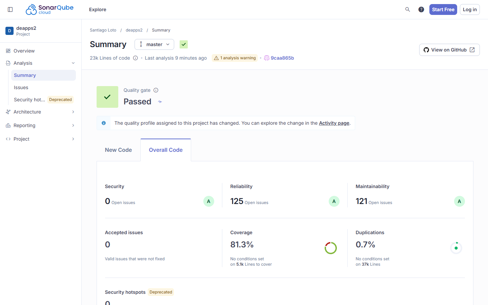

# Informe de ejecución de pruebas de Palco

Versión 2.0, 26/11/2026. Responsable: Joaquin Molina (QA).

**Control de versiones**

| Versión | Fecha | Cambios | Autor/a |
|---|---|---|---|
| 1.0 | 24/11/2026 | Corrida sobre `fbd31dc` (21/11), el candidato a la Entrega Final, y dos tests unitarios corridos en local (resumen del CI en `evidencia/final/ci-fbd31dc.txt`) | Joaquin Molina |
| 2.0 | 26/11/2026 | Corrida sobre `9caa865`, el código del tag `v1.0-final`: todas las cifras, los resúmenes de `evidencia/final/` y la captura del Quality Gate | Joaquin Molina |

Resultados de la corrida de todas las pruebas automatizadas sobre el commit `9caa865` de `master` (26/11/2026). El tag
`v1.0-final` va en un commit de solo documentación encima de `9caa865`, así que el código del tag es el de esta
corrida: es la corrida sobre el último commit de código antes del tag que pide el plan de pruebas (sección 8,
"Corrida sobre el tag `v1.0-final`"). Es el punto 4 de los entregables del QA de los Criterios de Testing de la
cátedra (condición G4): totales por nivel, cobertura, mutation score, tiempos, performance y Quality Gate. Cada cifra
sale de un run de GitHub Actions sobre `9caa865` o de la API pública de SonarCloud sobre el análisis de ese commit;
los resúmenes están en `docs/testing/evidencia/final/` y cada sección nombra el suyo.

**Referencias:** plan de pruebas (`docs/testing/plan-de-pruebas.md`: niveles en la sección 2, criterios en la 4,
corrida final en la 8), matriz de trazabilidad (`docs/testing/evidencia/matriz-de-trazabilidad.md`), registro de
defectos (`docs/testing/registro-de-defectos.md`) y los runs en `https://github.com/santttii/deapps2/actions/runs/<run>`.

## 1. Qué se corrió

| Run | Workflow | Cuándo (UTC) | Duración | Resultado | Resumen |
|---|---|---|---|---|---|
| [45889485001](https://github.com/santttii/deapps2/actions/runs/45889485001) | CI: backend (tests e IT), SonarCloud, frontend, gitleaks, integración (4 jobs), API y E2E | 26/11, 20:13:42 a 20:20:45 | 7 min 03 s | success | `ci-9caa865.txt`, `cobertura.txt`, `sonar.txt` |
| [45889484808](https://github.com/santttii/deapps2/actions/runs/45889484808) | Pruebas de seguridad | 26/11, 20:13:42 a 20:16:43 | 3 min 01 s | success | `seguridad.txt` |
| [45889484994](https://github.com/santttii/deapps2/actions/runs/45889484994) | Mutación | 26/11, 20:13:42 a 20:19:35 | 5 min 53 s | success | `mutacion.txt` |
| [45889484934](https://github.com/santttii/deapps2/actions/runs/45889484934) | Seguridad (Trivy); en el intento 2 volvió a correr "Dependencias del repo", que en el 1 había recibido un 429 de Maven Central | 26/11, 20:13:42 a 20:18:17 | 4 min 35 s | success | `trivy.txt` |
| [45889485045](https://github.com/santttii/deapps2/actions/runs/45889485045) | Contrato | 26/11, 20:13:42 a 20:17:01 | 3 min 19 s | success | `contrato.txt` |
| [45889484906](https://github.com/santttii/deapps2/actions/runs/45889484906) | Lighthouse | 26/11, 20:13:42 a 20:18:06 | 4 min 24 s | success | `lighthouse.txt` |
| [45889484996](https://github.com/santttii/deapps2/actions/runs/45889484996) | ZAP | 26/11, 20:13:42 a 20:18:46 | 5 min 04 s | success | `zap.txt` |
| [45889519557](https://github.com/santttii/deapps2/actions/runs/45889519557) | Carga (k6), a mano sobre `9caa865` | 26/11, 20:13:58 a 20:22:13 | 8 min 15 s | success | `k6.txt` |
| [45889523519](https://github.com/santttii/deapps2/actions/runs/45889523519) | Estabilidad, a mano sobre `9caa865` | 26/11, 20:14:00 a 20:18:15 | 4 min 15 s | success | `estabilidad.txt` |

Los 22 check runs del commit (los 19 jobs del push, el análisis de SonarCloud y los jobs de Carga y Estabilidad)
terminaron en success. El análisis de SonarCloud de `9caa865` lo publicó el job "SonarCloud" del CI a las 20:17:55;
sus cifras salen de la API pública de SonarCloud, consultada a las 20:26 (`sonar.txt`). Cada workflow que necesita el
sistema lo levanta de cero en el runner con `docker compose up --build --wait` (PostgreSQL 17, WildFly 41 con el
broker embebido, nginx con TLS y el ARCA simulado): en los jobs de este commit tardó entre 19 y 28 segundos. Las
pruebas de integración del backend (`*IT`) levantan PostgreSQL 17 y Artemis en contenedores, con Testcontainers,
dentro del job "Backend".

## 2. Totales por nivel

Ejecutados, pasados, fallados y bloqueados, cada nivel en su propia unidad (tests, pedidos, casos o comprobaciones).
Bloqueado es una prueba que no se pudo correr por un defecto: en esta corrida no hubo ninguna.

| Nivel | Herramienta | Unidad | Ejecutados | Pasaron | Fallaron | Bloqueados | Run y resumen |
|---|---|---|---:|---:|---:|---:|---|
| Unitarias | JUnit 6 + Mockito | tests | 1153 | 1153 | 0 | 0 | 45889485001; `ci-9caa865.txt` |
| Integración con base | JUnit 6 + H2 en modo PostgreSQL (`*EnH2Test`) | tests | 124 | 124 | 0 | 0 | 45889485001; `ci-9caa865.txt` |
| Integración con PostgreSQL y Artemis en contenedores | JUnit 6 + Testcontainers (`*EnPostgresIT` y `FacturacionDeComprasEnArtemisIT`) | tests | 61 | 61 | 0 | 0 | 45889485001; `ci-9caa865.txt` |
| Contrato SOAP | `ContratoDelWsdlTest` (dentro de las unitarias) | tests | 7 | 7 | 0 | 0 | 45889485001; `contrato.txt` |
| Set de evaluación del asistente | `EvaluacionDelAsistenteTest` (dentro de las unitarias) | casos | 26 | 26 | 0 | 0 | 45889485001; adversariales 11 de 11 |
| API | Postman + Newman | pedidos / aserciones | 221 / 685 | 221 / 685 | 0 | 0 | 45889485001, job "API"; `ci-9caa865.txt` |
| Contrato REST | Schemathesis 4.32.7, 4 roles | casos generados | 5633 | 5633 | 0 | 0 | 45889485045; `contrato.txt` |
| Integración de punta a punta | `escenarios.mjs` contra el compose | escenarios / comprobaciones | 24 / 389 | 24 / 389 | 0 | 0 | 45889485001, jobs "Integración"; `ci-9caa865.txt` |
| Resiliencia y patrones | `etag.mjs`, `patron-state.mjs`, `asistente.mjs`, `broker-apagado.mjs` | comprobaciones | 50 | 50 | 0 | 0 | 45889485001, job "Integración: general" |
| E2E | Playwright (Chromium) | tests | 39 | 39 | 0 | 0 | 45889485001, job "E2E"; `ci-9caa865.txt` |
| Seguridad por la API | `seguridad.mjs` (bloques A a E) | comprobaciones | 64 | 64 | 0 | 0 | 45889484808; `seguridad.txt` |
| Seguridad en el navegador | `xss.spec.ts` | tests | 2 | 2 | 0 | 0 | 45889484808; `seguridad.txt` |
| Escaneo web | OWASP ZAP 2.17.0, baseline y API autenticada | escaneos | 2 | 2 | 0 | 0 | 45889484996; `zap.txt` |
| Dependencias | Trivy v0.76.2 (repo, imagen web, imagen backend e imagen de la base) | escaneos | 4 | 4 | 0 | 0 | 45889484934; `trivy.txt` |
| Secretos | gitleaks 8.28.0, todo el historial | escaneos | 1 | 1 | 0 | 0 | 45889485001, job "Secretos"; `ci-9caa865.txt` |
| Accesibilidad | Lighthouse 13.6.0, 5 pantallas en teléfono y escritorio | corridas | 10 | 10 | 0 | 0 | 45889484906; `lighthouse.txt` |
| Carga | k6 2.3.0, 50 usuarios virtuales, 5 min | umbrales | 11 | 11 | 0 | 0 | 45889519557; `k6.txt` |
| Estabilidad | `mvn test` 3 veces seguidas | corridas de 1277 tests | 3 | 3 | 0 | 0 | 45889523519; `estabilidad.txt` |
| Mutación | PIT 1.30.2 sobre el dominio | módulos sobre el 60 % | 8 | 8 | 0 | 0 | 45889484994; `mutacion.txt` |
| Análisis estático | SonarCloud (Quality Gate) | condiciones | 6 | 6 | 0 | 0 | 45889485001, job "SonarCloud"; `sonar.txt` |

Detalle de algunas filas:

- **Unitarias e integración:** 1277 tests de surefire (1153 unitarios y 124 `*EnH2Test`) y 61 de failsafe, 1338 en
  total, por módulo en `ci-9caa865.txt`. Ninguno saltado ni con `flakes`. Entre ellos están los de CA-12.4
  (`ResumenDeVentasTest#siEventosNoRespondeNoHayResumenYNoSeLeenLasVentas`) y CA-16.4
  (`ServicioDeEventosTest#crearUnEventoSinFotoLoGuardaSinImagenPropia`), el de DEF-80
  (`ResumenDeVentasTest#unEventoIdConUnCaracterDeControlEsUn400SinConsultarAEventos`) y los tres de DEF-81
  (`MensajesDeValidacionTest#unTextoConElCaracterNuloSeRechazaCampoPorCampo` y
  `#laDescripcionYElMotivoAdmitenSaltosDeLineaYElTituloNo` en Eventos, y
  `ServicioDeFacturacionTest#unIdDeVentaConElCaracterNuloEsUn404SinConsultarLaBase`). Los 61 de failsafe corren contra
  PostgreSQL 17 (`postgres:17-alpine`) y Artemis (`apache/artemis:2.54.0`) en contenedores: 10 clases
  `*EnPostgresIT` (repositorios, migraciones y consultas de Usuarios, Eventos, Ventas, Notificaciones y Facturación)
  y `FacturacionDeComprasEnArtemisIT`. Los `*EnH2Test` prueban los repositorios contra H2 en memoria; la base y el
  broker reales los ejercitan también las pruebas de sistema (escenarios, Newman, E2E, seguridad y contrato), que
  corren contra el compose.
- **API:** la colección corrió 219 pedidos con 682 aserciones, y el job corrió aparte dos pasos manuales (2 pedidos,
  3 aserciones). De las 52 operaciones de `openapi.yaml`, 50 tienen en la corrida un caso de éxito y uno de error,
  entre ellas `POST /v1/operaciones-de-reventa/controles-de-compra` (204, 409 `dni-con-entrada` y 403; DEF-66). De
  las otras dos, el éxito de `POST /usuarios/password/reinicio` está solo en los pasos manuales que el job no corre
  (lo recorren el escenario 24 y `recuperar.spec.ts`), y el error de `GET /usuarios/jwks` es el 405 de
  `POST /usuarios/jwks`, como explica `docs/api/GUIA_POSTMAN.md`.
- **Contrato REST:** comprador 3009 casos (52 operaciones), organizador 1159 (18), puerta 425 (7) y servicio 1040
  (15). Los avisos de Schemathesis (operaciones de otro rol que solo dan 403, ids que no existen y datos que la
  validación rechaza) están en `contrato.txt`: no son fallas, pero esos casos no llegan a la lógica de negocio.
- **Escaneos:** "pasó" quiere decir que cumple su criterio: ZAP sin alertas High y cada Medium justificada; Trivy sin
  CVE críticas ni altas fuera de `.trivyignore`; gitleaks sin hallazgos (304 commits).
- **Matriz de trazabilidad:** `docs/testing/evidencia/matriz-de-trazabilidad.md`, generada el 26/11 a las 20:32 UTC
  (lo dice su encabezado) con los reportes de JUnit, Newman, Playwright y `escenarios.mjs` del CI de `9caa865` (run
  45889485001): 16 de 16 HU ejecutadas y 89 de 89 criterios en verde (las 9 HU Must, completas).

## 3. Cobertura

JaCoCo 0.8.16 sobre los tests de surefire del job "Backend" (run 45889485001); los `*IT` de failsafe corren sin el
agente de JaCoCo. Resumen completo en `cobertura.txt`.

| Alcance | Líneas | Ramas |
|---|---|---|
| Negocio (`com.palco.*.negocio`, sin `negocio.externos`) | 1822 / 1898 = **96,0 %** | 679 / 736 = **92,3 %** |
| Dominio (`com.palco.*.dominio`) | 556 / 569 = **97,7 %** | 37 / 39 = **94,9 %** |
| Negocio y dominio juntos | 2378 / 2467 = 96,4 % | 716 / 775 = 92,4 % |
| Clientes de otros servicios (`*.negocio.externos`) | 730 / 1071 = 68,2 % | 393 / 558 = 70,4 % |
| Negocio, clientes y dominio juntos | 3108 / 3538 = 87,8 % | 1109 / 1333 = 83,2 % |
| Todo el backend | 4213 / 5127 = **82,2 %** | 1361 / 1730 = **78,7 %** |

El umbral (80 % de líneas y 70 % de ramas en negocio y dominio) se cumple en el total y en cada servicio sin los
clientes (los más bajos: Pagos en líneas, con 92,4 %, y Usuarios en ramas, con 84,8 %). Contando los clientes, el
servicio más bajo es Validación, con 80,6 % de líneas y 79,0 % de ramas. Los módulos con menos cobertura total son
`common` (54,2 %) y Pagos (74,3 %). SonarCloud, con los mismos reportes, da 81,3 % de cobertura total y 92,7 % en el
código nuevo.

**El umbral lo controla el build.** `backend/pom.xml` tiene en JaCoCo la regla `umbral-de-negocio-y-dominio` (goal
`check`, en la fase `verify` de cada módulo): 80 % de líneas y 70 % de ramas sobre `**/negocio/**` y `**/dominio/**`,
sin `**/negocio/externos/**`, medido por módulo. Si un módulo baja del umbral, `mvn verify` falla, y con él los jobs
"Backend" y "SonarCloud" del CI. En el run 45889485001 la regla dio "All coverage checks have been met." en los 11
módulos con código. Negocio y dominio de cada servicio (`cobertura.txt`, sección 3):

| Servicio | Líneas | Ramas |
|---|---|---|
| Asistente | 136 / 143 = 95,1 % | 54 / 62 = 87,1 % |
| Eventos | 279 / 283 = 98,6 % | 94 / 100 = 94,0 % |
| Facturación | 113 / 116 = 97,4 % | 13 / 14 = 92,9 % |
| Notificaciones | 141 / 144 = 97,9 % | 36 / 38 = 94,7 % |
| Pagos | 109 / 118 = 92,4 % | 28 / 30 = 93,3 % |
| Reventa | 344 / 367 = 93,7 % | 99 / 110 = 90,0 % |
| Usuarios | 279 / 300 = 93,0 % | 78 / 92 = 84,8 % |
| Validación | 161 / 166 = 97,0 % | 49 / 52 = 94,2 % |
| Ventas | 816 / 830 = 98,3 % | 265 / 277 = 95,7 % |

## 4. Mutation score

PIT 1.30.2 sobre `com.palco.*.dominio.*` (run 45889484994, `mutacion.txt`). Mínimo: 60 % por módulo.

| Módulo | Score | Muertos / total |
|---|---:|---:|
| Eventos | 95,6 % | 43 / 45 |
| Facturación | 95,7 % | 22 / 23 |
| Notificaciones | 100,0 % | 8 / 8 |
| Pagos | 88,2 % | 15 / 17 |
| Reventa | 85,2 % | 23 / 27 |
| Usuarios | 81,8 % | 27 / 33 |
| Validación | 100,0 % | 20 / 20 |
| Ventas | 100,0 % | 68 / 68 |
| **Total** | **93,8 %** | **226 / 241** |

PIT no muta el negocio ni `common` (riesgo R-23 del plan): ahí la detección de cambios la miden la cobertura de
ramas y los tests de borde.

## 5. Performance

k6 2.3.0 (run 45889519557, `k6.txt`): 50 usuarios virtuales durante 5 minutos, después de 30 segundos de
calentamiento, cada uno con su cuenta, por nginx y HTTPS contra el compose del runner.

| Endpoint | Pedidos | Errores | p50 | p95 | p99 | Máximo |
|---|---:|---:|---:|---:|---:|---:|
| `GET /api/eventos` (catálogo) | 3761 | 0,00 % | 1,6 ms | 3,7 ms | 61,4 ms | 111 ms |
| `GET /api/eventos/{slug}` (detalle) | 3761 | 0,00 % | 1,4 ms | 2,8 ms | 4,6 ms | 12,0 ms |
| `POST /api/v1/ventas` (abrir una compra) | 3761 | 0,00 % | 8,9 ms | 17,3 ms | 29,6 ms | 74,8 ms |
| `DELETE /api/v1/ventas/{id}` (cancelarla) | 3761 | 0,00 % | 5,0 ms | 10,5 ms | 17,0 ms | 36,4 ms |
| Todos | 15044 | 0,00 % | 4,2 ms | 11,8 ms | 23,7 ms | 111 ms |

Cumple el criterio (p95 menor a 500 ms y menos de 1 % de errores en cada endpoint): los 11 umbrales de k6 dieron
bien, 15044 de 15044 respuestas pasaron la comprobación del cuerpo y ninguna iteración se interrumpió (3800
completas). El pool de la base llegó a sus 10 conexiones, con esperas de hasta 45 ms y ninguna vencida.

## 6. Seguridad, dependencias, accesibilidad y estabilidad

- **ZAP** (run 45889484996, `zap.txt`): High 0; Medium 0; Low 2, las dos justificadas en `.zap/reglas.tsv`
  (Cross-Origin-Embedder-Policy en el baseline y Unexpected Content-Type en la API); informativas 9. Se descontó una
  instancia High como falso positivo verificado en `.zap/reglas.tsv`: inyección SQL (regla 40018) en la pregunta al
  asistente, que no usa base de datos (lo que cambia entre respuestas es el campo `milisegundos`). Respecto de la corrida de `fbd31dc`, no aparecen las dos Medium de la CSP (DEF-69:
  la CSP de nginx tiene `style-src 'self'` e `img-src 'self' data: blob: https://picsum.photos`), ni las Low de
  Cross-Origin-Opener-Policy y Cross-Origin-Resource-Policy (DEF-74), ni las 4 instancias de inyección SQL (regla
  40018) que eran falsos positivos (tres en el registro de cuentas, DEF-62, y una en el asistente).
- **Trivy** (run 45889484934, `trivy.txt`): 0 CVE críticas o altas fuera de `.trivyignore` en los 15 manifiestos del
  repo y en las imágenes web, backend y de la base (`postgres:17-alpine`, que se escanea desde DEF-73). La imagen web
  da 0 (DEF-78). Aceptadas en `.trivyignore`, cada una con su motivo y vencimiento el 31/12/2026: 6 altas en la imagen
  backend (Jackson y Guava dentro de los módulos de WildFly 41.0.1) y, en la de la base, 1 alta de libxml2 y 26 de la
  biblioteca estándar de Go con la que viene compilado gosu.
- **gitleaks** (`ci-9caa865.txt`): 304 commits revisados, sin hallazgos.
- **Pruebas de seguridad** (run 45889484808, `seguridad.txt`): tokens JWT manipulados (8 variantes, 401 en los cinco
  servicios), mass assignment, XSS almacenado, XXE en el SOAP, cookies, CSP, HSTS, nosniff y CORS: 64 de 64; XSS en el
  navegador: 2 de 2. BOLA, BFLA y fuerza bruta están en la colección de Postman (sección 2).
- **Accesibilidad** (run 45889484906, `lighthouse.txt`): Lighthouse da 100 de accesibilidad y 100 de buenas prácticas
  en las 10 corridas (catálogo, evento, ingresar, registro y recuperar, en teléfono y escritorio). axe, con WCAG 2.2
  AA a 360, 768 y 1280 px, pasa en `accesibilidad.spec.ts` (5 de 5) y `temas.spec.ts`, dentro de los 39 E2E.
  Lighthouse no mide rendimiento en esta configuración: el rendimiento es el de k6.
- **Estabilidad** (run 45889523519, `estabilidad.txt`): `mvn test` tres veces seguidas sobre `9caa865`, 1277 tests
  en cada una, con el mismo resultado test por test (0 cambian). Los 61 `*IT` y las suites de sistema corrieron una
  vez: ningún reporte de failsafe tiene `flakes` y el log del job "E2E" no tiene pruebas inestables ni reintentos.

## 7. Análisis estático y Quality Gate

SonarCloud, proyecto `santttii_deapps2`, análisis de `9caa865` (job "SonarCloud" del run 45889485001, que espera el
resultado con `sonar.qualitygate.wait=true`: "QUALITY GATE STATUS: PASSED"). Detalle en `sonar.txt`; enlace:
https://sonarcloud.io/summary/overall?id=santttii_deapps2

**Quality Gate: aprobado** ("Passed"). Sus 6 condiciones, sobre el código nuevo desde el 20/11, dan bien:
confiabilidad, seguridad y mantenibilidad A, cobertura 92,7 % (mínimo 80 %), duplicación 0,0 % (máximo 3 %) y 100 %
de los security hotspots revisados.

Código total: 0 bugs, 0 vulnerabilidades (abiertas o aceptadas), 125 code smells, todos de severidad MAJOR (ninguno
BLOCKER ni CRITICAL), 0 security hotspots, duplicación 0,7 %, y confiabilidad, seguridad y mantenibilidad A. Respecto
del análisis de `fbd31dc`, están cerrados como corregidos el bug `java:S5850` de `common/Textos.java:63` (DEF-65), que
dejaba la confiabilidad del código total en C; los 3 code smells BLOCKER `java:S1845` de `ArcaSoap`, `PagosFake` y
`ResultadoDeCobro` (DEF-67); el bug `java:S8696` de `AsistenteIA` (DEF-76), que había dejado el Quality Gate en rojo
el 24/11; y la vulnerabilidad `docker:S6471` de `frontend/Dockerfile` (DEF-71), que estaba aceptada: la imagen web
corre nginx sin root (DEF-71 y DEF-78). También están cerrados, desde el análisis de `c5d3fd8`, los 2 BLOCKER
`java:S1845` de Asistente que aparecieron después de `fbd31dc` (DEF-79): `AsistenteIA.instrucciones` pasó a
`armarInstrucciones` y `CatalogoDeEventos.vigencia`, a `vigenciaDelCache`.

SonarCloud marca además con `java:S8786` (expresiones con retroceso superlineal), como code smells, tres líneas; las
de nombre y apellido de `usuarios/api/Dtos.java` (DEF-64) están cerradas. Las tres se midieron el 24/11 y no demoran
un pedido (`registro-nombre-largo.txt`, sección 5): la 77 de `Dtos.java` (el email del registro, que en `fbd31dc`
estaba en la 58: uno de 20.000 caracteres recibe el 400 en 0,2 s), la 63 de `common/Textos.java` (el texto de
`Textos.slug` nunca tiene dos guiones seguidos) y la 45 de `asistente/negocio/Guardrails.java` (la expresión
corregida por DEF-63, que cubre `GuardrailsTest`, 95 de 95 en este run).

**PMD 7.17.0** (conjunto `quickstart`, informativo, no corta el build; `ci-9caa865.txt`, sección 8): 225 hallazgos,
0 de prioridad 1, 151 de prioridad 2 (150 `GuardLogStatement` y 1 `AvoidUsingVolatile`), 72 de prioridad 3 y 2 de
prioridad 4. **oxlint:** 0 avisos y 0 errores (DEF-50).

## 8. Tiempos

| Qué | Tiempo | Fuente |
|---|---|---|
| Pipeline del push (7 workflows en paralelo) | 7 min 03 s de reloj, 20:13:42 a 20:20:45 UTC del 26/11 | `ci-9caa865.txt`, sección 1 |
| El workflow más largo: CI | 7 min 03 s; su job más largo, "Integración: general", 7 min 00 s | run 45889485001 |
| Mutación | 5 min 53 s; su job, 5 min 49 s | run 45889484994 |
| `mvn verify` del backend (compilar, 1277 tests, 61 IT, JaCoCo y PMD) | 2 min 35 s; job "Backend", 2 min 55 s | run 45889485001 |
| SonarCloud (`mvn verify` y el análisis, con la espera del Quality Gate) | job, 5 min 48 s; el análisis, 1 min 43 s | run 45889485001 |
| `mvn test`, tres veces | 1 min 15 s, 1 min 18 s y 1 min 18 s (tiempo en los tests: 63,1 s, 65,1 s y 65,4 s) | run 45889523519 |
| Levantar el compose en el runner | 19 a 28 s | jobs con compose de los runs del commit |
| Newman, la colección | 15,7 s; respuesta promedio 36 ms, máximo 543 ms | job "API" |
| Playwright, 39 tests con 2 workers | 1,3 min; job "E2E", 3 min 45 s | job "E2E" |
| Schemathesis, 4 roles | 24,0 s, 8,8 s, 3,8 s y 5,7 s; job, 3 min 16 s | run 45889485045 |
| ZAP, baseline y API | job, 5 min 01 s | run 45889484996 |
| Lighthouse, 10 corridas | job, 4 min 20 s | run 45889484906 |
| Trivy, 4 escaneos | repo 18 s (intento 2), imagen web 45 s, imagen backend 2 min 11 s e imagen de la base 29 s | run 45889484934 |
| k6, con la preparación | 348 s (5 min de carga); job, 8 min 12 s | run 45889519557 |

Carga y Estabilidad se dispararon a mano mientras corrían los workflows del push. Todos los workflows del commit,
también Carga (8 min 15 s) y Estabilidad (4 min 15 s), quedan debajo de los 15
minutos que pide la cátedra.

## 9. Defectos

La línea de totales de `docs/testing/registro-de-defectos.md` (ya incluye los defectos de esta corrida, los del
informe de seguridad y los del 25 y el 26/11) dice: "Totales: 81 defectos. 75 cerrados, 1 corregido que falta
verificar (DEF-02, en una máquina lenta), ninguno nuevo ni en corrección, y 5 aceptados (DEF-39, DEF-41, DEF-58,
DEF-68 y DEF-75). Por severidad: 1 bloqueante, 8 críticos, 16 mayores, 45 menores y 11 cosméticos." De los cerrados,
46 se cerraron el 26/11 con esta corrida, DEF-80 y DEF-81 entre ellos. Los que no están cerrados, por severidad, según la
sección 7 del registro:

| Severidad | Nuevos, en corrección o aceptados | Corregidos, a verificar | Máximo al cierre |
|---|---|---|---|
| Bloqueante | 0 | 0 | 0 |
| Crítica | 0 | 0 | 0 |
| Mayor | 0 | 0 | 3, con alternativa |
| Menor | 5, todos aceptados | 1: DEF-02 | Sin máximo |
| Cosmética | 0 | 0 | Sin máximo |

Qué dice la corrida de `9caa865` de los críticos y mayores corregidos, con la prueba de cierre que nombra el registro
para cada uno. Las pruebas de cierre que se corren contra el compose y no son parte de ningún workflow tienen su
salida en `docs/testing/evidencia/final/defectos-sobre-9caa865.txt` y en el registro.

- **DEF-63** (crítico): `GuardrailsTest#unTextoEnormeSinArrobaSeEnmascaraEnMenosDeUnSegundo` y
  `#elEmailSeOcultaTambienEnMedioDeUnTexto` pasaron (`GuardrailsTest`, 95 de 95, run 45889485001), y Schemathesis, la
  prueba que lo encontró, pasó sin fallas ni cortes por tiempo en `POST /v1/asistente/preguntas` (run 45889485045).
- **DEF-64** (crítico): `NombreYApellidoTest`, 4 de 4 (run 45889485001), y SonarCloud cerró los `java:S8786` de
  nombre y apellido (sección 7).
- **DEF-30** (mayor): `ReventaDeEntradasEnH2Test`, 19 de 19 (con
  `#conSeisEntradasParaElEventoNoCompraOtraEnLaReventa`, `#unDniQueYaTieneEntradaParaElEventoNoRecibeLaDeLaReventa` y
  `#laEntradaQueSeRevendeNoCuentaParaElDniPeroLasOtrasDeEsaVentaSi`), y `ServicioDeReventaTest`, 38 de 38 (run
  45889485001). En Newman, `controles-de-compra` responde 409 `dni-con-entrada` a nombre de alguien con entrada.
- **DEF-36** (mayor): Contrato y ZAP levantan el compose con `PALCO_CORREO_LOG_COMPLETO` en su valor por defecto, y su
  "Control de logs" dio limpio (1213 y 1241 renglones): ningún email `@palco.test` entero en el log. Ese control no
  busca los códigos de verificación.
- **DEF-37** (mayor): `PagoConfirmadoMensajeTest` (`common`, 19 de 19) y, de Notificaciones, `ServicioDeAuditoriaTest`
  (17 de 17), `MigracionesEnH2Test` (3 de 3) y `MigracionesEnPostgresIT` (1 de 1), run 45889485001.
- **DEF-38** (mayor): en Newman, «SEC-W05c Login: la sesión dura 15 minutos» dio `exp - iat` = 900 s, dentro de las
  682 aserciones sin fallas de la colección.
- **DEF-46** (mayor): `ReglasEntreComprasEnH2Test` (9 de 9) y `ReventaDeEntradasEnH2Test` (19 de 19) en el CI, y los
  escenarios 17 y 23 contra el compose, en PASA. Ninguno de los 61 `*IT` corre la carrera entre dos compras contra
  PostgreSQL.
- **DEF-47** (mayor): `recuperar.spec.ts`, la prueba que lo cierra, pasó 4 de 4 en el job "E2E".

**Los defectos que encontró la corrida de `fbd31dc`.** Están en el registro desde el 24/11, con su corrección. Lo que
dan sus pruebas de cierre en esta corrida:

| ID | Defecto | Severidad | Prueba de cierre | En `9caa865` |
|---|---|---|---|---|
| DEF-64 | El registro tardaba con el cubo del largo de un nombre o un apellido lleno de espacios: un pedido sin sesión de 1,6 KB ocupaba un hilo del servidor 7 segundos | Crítica | `NombreYApellidoTest` en el CI y los `curl` de `registro-nombre-largo.txt` contra el compose | `NombreYApellidoTest` 4 de 4; los `java:S8786` de nombre y apellido, cerrados |
| DEF-65 | El bug `java:S5850` de SonarCloud en `Textos.slug` dejaba la confiabilidad del código total en C | Menor | El análisis de SonarCloud | Cerrado; 0 bugs y confiabilidad A en el código total |
| DEF-66 | La colección de Postman no tenía ningún pedido para `POST /v1/operaciones-de-reventa/controles-de-compra` | Menor | La corrida de Newman | 204, 409 `dni-con-entrada` y 403, los tres en verde |
| DEF-67 | Tres code smells BLOCKER de SonarCloud (`java:S1845`) en `ArcaSoap`, `PagosFake` y `ResultadoDeCobro` | Cosmética | El análisis de SonarCloud, sin hallazgos Blocker | Los tres, cerrados; 0 BLOCKER abiertos (los 2 de la misma regla que aparecieron en Asistente son DEF-79, cerrados en `c5d3fd8`) |

**Hallazgos de esta corrida.** Ninguna prueba automatizada falló y el análisis de SonarCloud no tiene hallazgos
BLOCKER ni CRITICAL abiertos. Los 2 code smells BLOCKER `java:S1845` de Asistente que aparecieron después de `fbd31dc`
(DEF-79) los cierra `c5d3fd8` (sección 7); `AsistenteIATest`, `RiesgosDelAsistenteTest` y `CatalogoDeEventosTest`,
los tests que toca ese commit, pasaron en el job "Backend". DEF-80 (Menor: `GET /v1/resumenes?eventoId=` con el
carácter nulo respondía 504) lo encontró Schemathesis en la corrida del Contrato sobre `df7539b`; `70242ce` lo
corrige en `ResumenDeVentas.delEvento`. DEF-81 (Menor: `POST /api/eventos` con el carácter nulo en un texto
respondía 500, porque PostgreSQL no guarda ese carácter) lo encontró Schemathesis en la corrida del Contrato sobre `dfd89c4` (run 45887315864); `358ce5e` lo corrige en los DTO
de Eventos y `9caa865`, en Facturación, donde un `ventaId` con caracteres de control es 404 sin consultar la base. En
esta corrida pasan `ResumenDeVentasTest#unEventoIdConUnCaracterDeControlEsUn400SinConsultarAEventos`,
`MensajesDeValidacionTest#unTextoConElCaracterNuloSeRechazaCampoPorCampo` y
`#laDescripcionYElMotivoAdmitenSaltosDeLineaYElTituloNo` y
`ServicioDeFacturacionTest#unIdDeVentaConElCaracterNuloEsUn404SinConsultarLaBase` (run 45889485001), y el Contrato
de los cuatro roles, sin fallas (run 45889485045). El registro cerró los dos el 26/11 con esta corrida.

## 10. Criterios de salida del plan

Los de la sección 4 del plan de pruebas, contra esta corrida:

| Criterio | Resultado | ¿Se cumple? |
|---|---|---|
| 0 tests unitarios fallando y la suite 3 veces seguidas con el mismo resultado | 1277 de 1277 en el CI, más 61 de 61 `*IT`; 3 corridas idénticas | Sí |
| Escenarios, resiliencia, patrón State y colección de Postman, sin fallas | 24 de 24 escenarios (389 comprobaciones), 50 de 50 de resiliencia y State, Newman con 0 fallas | Sí |
| En la colección, cada endpoint con un caso de éxito y uno de error | 50 de 52 operaciones en la corrida; las otras dos, con el caso que falta en los pasos manuales (`/password/reinicio`) y en `POST /usuarios/jwks` (sección 2) | Sí |
| Al menos 5 recorridos E2E en el pipeline, en verde | 39 de 39 | Sí |
| Matriz: todas las HU, 95 % de los criterios o más, ningún criterio Must en falla | 16 de 16 HU, 89 de 89 criterios | Sí |
| Cobertura de negocio y dominio: 80 % de líneas y 70 % de ramas | Negocio 96,0 % y 92,3 %; dominio 97,7 % y 94,9 %; con los clientes de otros servicios, 87,8 % y 83,2 %. La regla `umbral-de-negocio-y-dominio` del build, en verde en los 11 módulos (sección 3) | Sí |
| Mutation score de 60 % o más en el dominio de cada servicio | Entre 81,8 % (Usuarios) y 100 %; 93,8 % en total | Sí |
| Quality Gate aprobado, 0 bugs Blocker o Critical, 0 vulnerabilidades, duplicación de 3 % o menos, 100 % de hotspots revisados | Aprobado; 0 bugs; 0 vulnerabilidades; 0,7 %; sin hotspots | Sí |
| Rating A en confiabilidad y en seguridad | A y A, en el código total y en el nuevo | Sí |
| Contrato: ninguna respuesta fuera de `openapi.yaml` y el WSDL igual al del repositorio | 5633 casos sin fallas; `ContratoDelWsdlTest` 7 de 7 | Sí |
| Carga: p95 menor a 500 ms y menos de 1 % de errores en cada endpoint crítico | p95 entre 2,8 y 17,3 ms; 0 % de errores | Sí |
| Seguridad: `seguridad.mjs` y `xss.spec.ts` en verde, ZAP sin High y Medium justificadas, Trivy sin críticas ni altas fuera de `.trivyignore`, gitleaks sin hallazgos | 64 de 64 y 2 de 2; High 0 (1 instancia descontada como falso positivo verificado) y Medium 0; 0 fuera de `.trivyignore` en los 4 escaneos; 0 hallazgos | Sí |
| Accesibilidad: axe sin violaciones serias ni críticas, Lighthouse de 90 o más | axe en verde a 360, 768 y 1280 px; Lighthouse 100 en las 10 corridas | Sí |
| Set de evaluación del asistente: 24 de 26 o más, con los 11 adversariales | 26 de 26; 11 de 11 | Sí |
| CI en verde sobre el commit del tag y pipeline de 15 minutos o menos | Sobre `9caa865`, el código del tag: 22 de 22 check runs en verde y 7 min 03 s | Sí |
| Defectos: 0 bloqueantes, 0 críticos, hasta 3 mayores con alternativa, todos registrados | Con la corrida de `9caa865`: 0 bloqueantes, 0 críticos y 0 mayores abiertos o a verificar; los dos críticos y los seis mayores que faltaba verificar se cerraron con esta corrida; 81 defectos registrados, con DEF-80 y DEF-81, que encontró el Contrato de `df7539b` y de `dfd89c4` y se cerraron con esta corrida | Sí |

Con la corrida de `9caa865` se cumplen los 16 criterios de salida del plan: los 15 que se miden con las pruebas y el
análisis estático, sin ninguna prueba automatizada con fallas, y el de defectos (sección 9).

## 11. Lo que se mide sobre el tag

- **Los workflows del tag.** El tag `v1.0-final` va en un commit de solo documentación encima de `9caa865`: el código
  del tag es el de esta corrida. Con un tag `v*` corren los nueve workflows (CI, Contrato, Pruebas de seguridad, ZAP,
  Seguridad, Mutación, Lighthouse, Carga y Estabilidad), que repiten estas corridas sobre el mismo código; su enlace
  va en el entregable de Teams (plan de pruebas, sección 8). Las cifras de este informe son las de `9caa865`.
- **Pruebas a mano.** El broker con el contenedor recreado y el ARCA sin responder con la DLQ y el reproceso no son
  parte de ningún workflow: su última corrida con la salida guardada es la del 19/11
  (`docs/testing/evidencia/checkpoint-3/`). En los workflows, el broker apagado lo cubre `broker-apagado.mjs` (10 de
  10, sin mensajes perdidos) y la DLQ, el escenario 12.
- **Lighthouse** midió accesibilidad y buenas prácticas, no rendimiento ni SEO.
